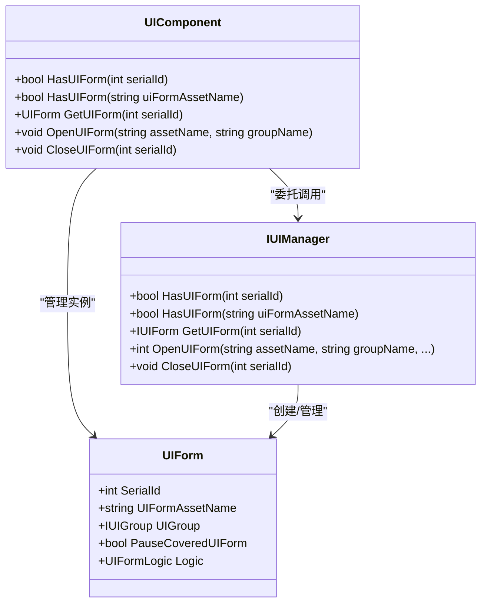

# UI窗体查询API

<cite>
**本文档引用文件**  
- [UIComponent.cs](file://Scripts/Runtime/UI/UIComponent.cs)
- [UIForm.cs](file://Scripts/Runtime/UI/UIForm.cs)
</cite>

## 目录
1. [简介](#简介)
2. [核心功能](#核心功能)
3. [方法重载说明](#方法重载说明)
4. [业务逻辑应用](#业务逻辑应用)
5. [性能分析](#性能分析)
6. [实际应用场景示例](#实际应用场景示例)
7. [结论](#结论)

## 简介
`UIComponent` 是 Unity 游戏框架中的核心组件之一，负责管理游戏中的用户界面（UI）窗体。该组件提供了丰富的 API 来创建、查询、打开和关闭 UI 窗体。其中，`HasUIForm` 方法在避免重复打开相同窗体或进行条件性操作时起着至关重要的作用。

本 API 文档重点介绍 `HasUIForm` 方法的两种重载形式：通过窗体序列号（serialId）和资源名称（uiFormAssetName）判断指定窗体是否存在。这两种方法均基于内部哈希表实现，时间复杂度为 O(1)，适用于高频调用场景。

## 核心功能
`UIComponent` 提供了对 UI 窗体的完整生命周期管理能力，包括：
- 窗体的打开与关闭
- 窗体状态的查询（是否存在、是否正在加载）
- 窗体实例的获取与遍历
- 界面组（UIGroup）的管理

其中，`HasUIForm` 方法作为查询接口，用于快速判断某个窗体是否已经存在，是实现“避免重复打开”逻辑的关键。

**Section sources**  
- [UIComponent.cs](file://Scripts/Runtime/UI/UIComponent.cs#L329-L342)

## 方法重载说明
`HasUIForm` 方法提供了两种重载形式，分别支持通过窗体序列号和资源名称进行存在性检查。

### 通过窗体序列号查询
```csharp
public bool HasUIForm(int serialId)
```
该方法接收一个整型参数 `serialId`，表示窗体的唯一序列编号。系统内部维护了一个以 `serialId` 为键的哈希表，用于快速查找对应的窗体实例。当需要根据窗体 ID 判断其是否存在时，此方法非常高效。

### 通过资源名称查询
```csharp
public bool HasUIForm(string uiFormAssetName)
```
该方法接收一个字符串参数 `uiFormAssetName`，表示窗体资源的名称（通常是预制体路径或资源标识）。系统同样使用哈希表结构存储资源名与窗体实例的映射关系，确保查询效率。

两种重载方法最终都委托给底层的 `IUIManager` 接口执行实际的查询操作，保证了逻辑的一致性和可扩展性。

**Section sources**  
- [UIComponent.cs](file://Scripts/Runtime/UI/UIComponent.cs#L329-L342)

## 业务逻辑应用
在实际开发中，`HasUIForm` 方法常用于以下业务场景：

### 避免重复打开相同窗体
在用户点击按钮打开设置界面时，若不加判断直接调用 `OpenUIForm`，可能导致多个相同的窗体实例被创建，造成资源浪费和逻辑混乱。通过先调用 `HasUIForm` 检查目标窗体是否存在，可以决定是复用现有实例还是新建一个。

### 条件性操作控制
某些功能模块可能依赖于特定窗体的状态。例如，在关闭主菜单前需要确认“背包”窗体是否已关闭；或者在播放动画前确保某个提示窗体不存在。这些条件判断都可以借助 `HasUIForm` 实现。

### 窗体状态同步
在多线程或异步加载环境下，可以通过定期调用 `HasUIForm` 来监控关键窗体的存在状态，从而触发相应的 UI 更新或数据刷新。

## 性能分析
由于 `HasUIForm` 方法基于哈希表实现，其时间复杂度为 **O(1)**，即无论当前系统中加载了多少个窗体，查询操作的时间开销始终保持恒定。

这种设计使得该方法非常适合在高频调用的场景下使用，例如：
- 每帧检测某个 HUD 窗体是否存在
- 在事件响应中频繁检查目标窗体状态
- 批量处理多个窗体请求前的预检

此外，哈希表的内存占用与实际加载的窗体数量成正比，具有良好的空间效率。



**Diagram sources**  
- [UIComponent.cs](file://Scripts/Runtime/UI/UIComponent.cs#L329-L342)  
- [UIForm.cs](file://Scripts/Runtime/UI/UIForm.cs#L58-L100)

**Section sources**  
- [UIComponent.cs](file://Scripts/Runtime/UI/UIComponent.cs#L329-L342)

## 实际应用场景示例
以下是一个典型的使用场景代码示例：

```csharp
// 打开设置窗体前先检查是否已存在
private void OpenSettingsForm()
{
    const string formAssetName = "UI/Forms/SettingsForm";
    
    if (UIComponent.HasUIForm(formAssetName))
    {
        // 如果已存在，则激活并聚焦该窗体
        UIForm form = UIComponent.GetUIForm(formAssetName);
        UIComponent.RefocusUIForm(form);
    }
    else
    {
        // 否则打开新的窗体实例
        UIComponent.OpenUIForm(formAssetName, "Default");
    }
}
```

在此示例中，通过 `HasUIForm` 方法有效避免了重复创建设置窗体的问题，提升了用户体验和系统稳定性。

## 结论
`HasUIForm` 方法作为 `UIComponent` 的核心查询接口，提供了高效、可靠的窗体存在性判断能力。其两种重载形式分别适用于基于 ID 和基于资源名的查询需求，配合 O(1) 的时间复杂度，使其成为处理高频 UI 查询的理想选择。

合理使用该方法，不仅可以避免资源浪费和逻辑冲突，还能提升整体系统的响应速度和稳定性。建议在所有涉及窗体打开操作的逻辑中，优先使用 `HasUIForm` 进行前置判断，以实现更优雅的 UI 管理策略。