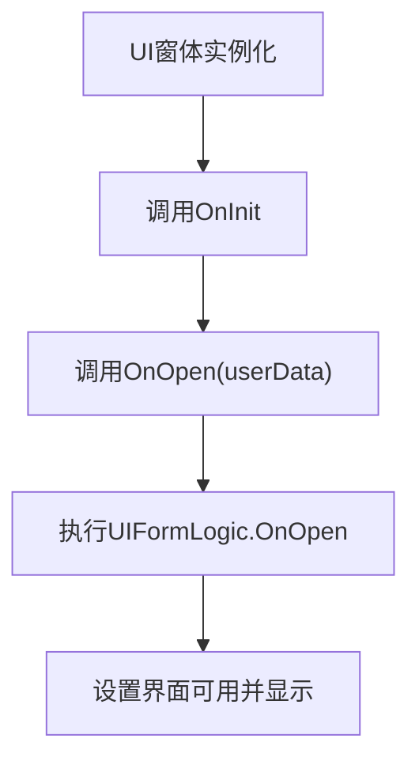
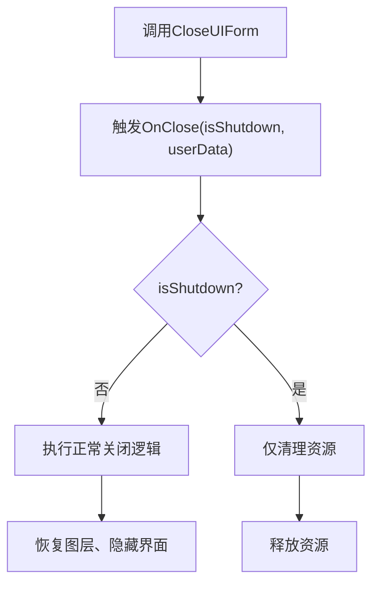
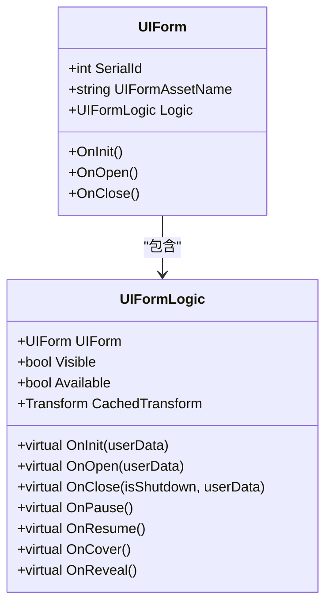
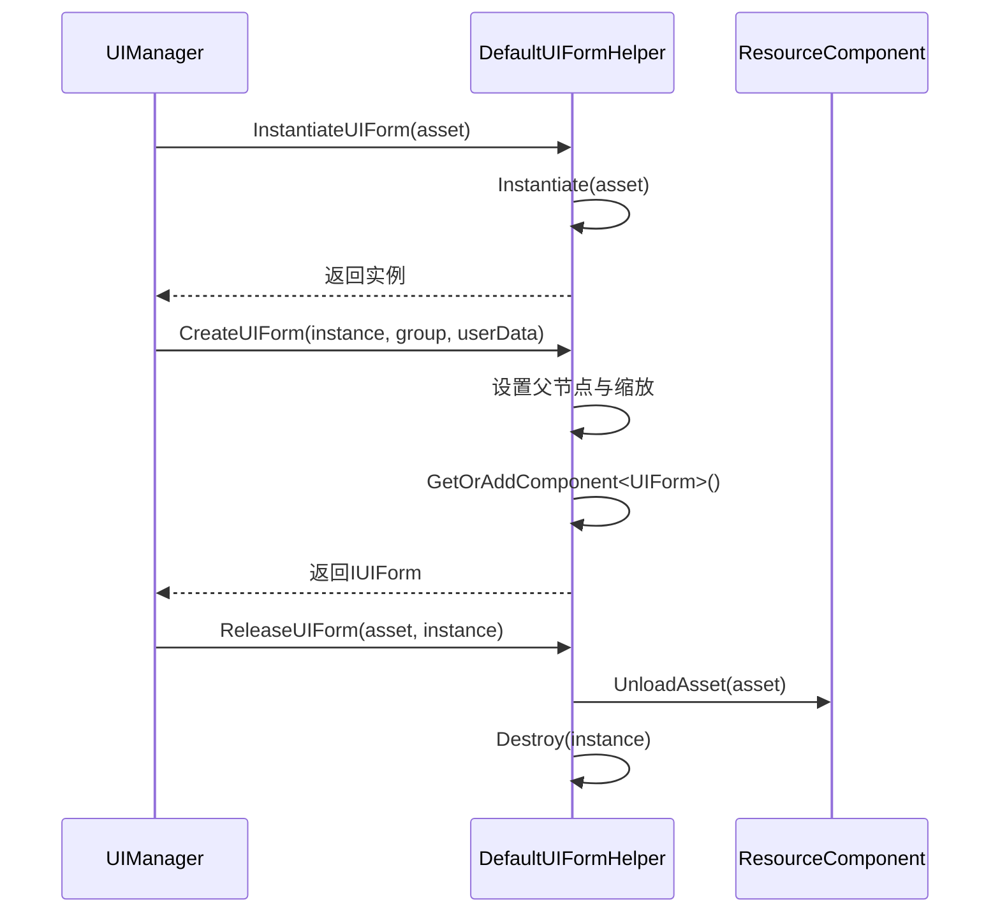

# UI窗体生命周期管理

<cite>
**本文档中引用的文件**  
- [UIForm.cs](file://Scripts/Runtime/UI/UIForm.cs)
- [UIFormLogic.cs](file://Scripts/Runtime/UI/UIFormLogic.cs)
- [DefaultUIFormHelper.cs](file://Scripts/Runtime/UI/DefaultUIFormHelper.cs)
</cite>

## 目录
1. [简介](#简介)
2. [核心生命周期方法详解](#核心生命周期方法详解)
3. [UIFormLogic的作用机制](#uiformlogic的作用机制)
4. [DefaultUIFormHelper的资源管理](#defaultuiformhelper的资源管理)
5. [完整示例：继承UIFormLogic实现业务逻辑](#完整示例继承uiformlogic实现业务逻辑)
6. [总结](#总结)

## 简介
在Unity游戏框架中，UI窗体的生命周期管理是界面系统的核心组成部分。通过`UIForm`类与`UIFormLogic`基类的协同工作，实现了对界面从创建、打开、暂停到关闭等全过程的精细化控制。本文档将深入解析`UIForm`类的核心生命周期方法，包括`OnOpen`、`OnClose`、`OnPause`、`OnResume`、`OnCover`、`OnReveal`等，并阐述`UIFormLogic`作为逻辑脚本挂载点的设计原理，以及`DefaultUIFormHelper`如何协助完成资源加载与实例化。

**Section sources**
- [UIForm.cs](file://Scripts/Runtime/UI/UIForm.cs#L16-L303)
- [UIFormLogic.cs](file://Scripts/Runtime/UI/UIFormLogic.cs#L14-L205)

## 核心生命周期方法详解

### OnOpen(object userData)
当UI窗体完成初始化后，框架会调用`OnOpen`方法。该方法接收一个`userData`参数，用于传递用户自定义数据（如初始化参数、上下文信息等），开发者可在重写此方法时处理这些数据并完成界面元素的初始化操作。



**Diagram sources**
- [UIForm.cs](file://Scripts/Runtime/UI/UIForm.cs#L164-L174)
- [UIFormLogic.cs](file://Scripts/Runtime/UI/UIFormLogic.cs#L123-L127)

**Section sources**
- [UIForm.cs](file://Scripts/Runtime/UI/UIForm.cs#L164-L174)
- [UIFormLogic.cs](file://Scripts/Runtime/UI/UIFormLogic.cs#L123-L127)

### OnClose(bool isShutdown, object userData)
当UI窗体被关闭时触发此方法。参数`isShutdown`用于区分是否因界面管理器关闭而触发（即框架销毁场景），`userData`可用于传递关闭时的附加信息。正常关闭时，该方法会恢复原始图层、隐藏界面并标记为不可用。



**Diagram sources**
- [UIForm.cs](file://Scripts/Runtime/UI/UIForm.cs#L181-L191)
- [UIFormLogic.cs](file://Scripts/Runtime/UI/UIFormLogic.cs#L134-L139)

**Section sources**
- [UIForm.cs](file://Scripts/Runtime/UI/UIForm.cs#L181-L191)
- [UIFormLogic.cs](file://Scripts/Runtime/UI/UIFormLogic.cs#L134-L139)

### OnPause 与 OnResume
当窗体被其他窗体部分遮挡时，会触发`OnPause`，此时界面不可见；当遮挡解除时，触发`OnResume`，界面恢复可见。这两个方法主要用于暂停和恢复界面的交互逻辑或动画。


**Diagram sources**
- [UIForm.cs](file://Scripts/Runtime/UI/UIForm.cs#L196-L221)
- [UIFormLogic.cs](file://Scripts/Runtime/UI/UIFormLogic.cs#L144-L155)

**Section sources**
- [UIForm.cs](file://Scripts/Runtime/UI/UIForm.cs#L196-L221)
- [UIFormLogic.cs](file://Scripts/Runtime/UI/UIFormLogic.cs#L144-L155)

### OnCover 与 OnReveal
当窗体被完全覆盖时调用`OnCover`，恢复显示时调用`OnReveal`。与`OnPause/OnResume`不同，这对方法通常用于处理更深层次的界面状态切换，如音乐播放暂停、后台任务调度等。


**Diagram sources**
- [UIForm.cs](file://Scripts/Runtime/UI/UIForm.cs#L226-L251)
- [UIFormLogic.cs](file://Scripts/Runtime/UI/UIFormLogic.cs#L160-L169)

**Section sources**
- [UIForm.cs](file://Scripts/Runtime/UI/UIForm.cs#L226-L251)
- [UIFormLogic.cs](file://Scripts/Runtime/UI/UIFormLogic.cs#L160-L169)

## UIFormLogic的作用机制
`UIFormLogic`是所有UI逻辑脚本的基类，继承自`MonoBehaviour`，作为具体逻辑的挂载点。每个`UIForm`实例都会通过`GetComponent<UIFormLogic>()`获取其关联的逻辑组件。开发者需继承`UIFormLogic`并重写其生命周期方法以实现具体业务逻辑。

关键特性：
- 提供对`UIForm`实例的引用（`UIForm`属性）
- 封装了`Visible`、`Available`等状态管理
- 提供`CachedTransform`缓存以提升性能
- 支持通过`InternalSetVisible`自定义显示逻辑



**Diagram sources**
- [UIForm.cs](file://Scripts/Runtime/UI/UIForm.cs#L94-L100)
- [UIFormLogic.cs](file://Scripts/Runtime/UI/UIFormLogic.cs#L25-L31)

**Section sources**
- [UIForm.cs](file://Scripts/Runtime/UI/UIForm.cs#L16-L303)
- [UIFormLogic.cs](file://Scripts/Runtime/UI/UIFormLogic.cs#L14-L205)

## DefaultUIFormHelper的资源管理
`DefaultUIFormHelper`是默认的UI辅助器，继承自`UIFormHelperBase`，负责UI资源的实例化、创建和释放。其主要职责包括：

- **实例化界面**：通过`InstantiateUIForm`方法将资源对象实例化为GameObject
- **创建UIForm**：调用`CreateUIForm`将实例化的GameObject挂载`UIForm`组件并设置父节点
- **释放资源**：在`ReleaseUIForm`中卸载资源并销毁实例



**Diagram sources**
- [DefaultUIFormHelper.cs](file://Scripts/Runtime/UI/DefaultUIFormHelper.cs#L15-L72)
- [UIForm.cs](file://Scripts/Runtime/UI/UIForm.cs#L16-L303)

**Section sources**
- [DefaultUIFormHelper.cs](file://Scripts/Runtime/UI/DefaultUIFormHelper.cs#L15-L72)

## 完整示例：继承UIFormLogic实现业务逻辑
以下是一个典型的`UIFormLogic`继承类示例，展示如何重写生命周期方法以实现按钮绑定、数据刷新等业务逻辑：

```csharp
public class ExampleUILogic : UIFormLogic
{
    private Button m_CloseButton;

    protected internal override void OnInit(object userData)
    {
        base.OnInit(userData);
        // 获取组件引用
        m_CloseButton = transform.Find("CloseButton").GetComponent<Button>();
    }

    protected internal override void OnOpen(object userData)
    {
        base.OnOpen(userData);
        // 绑定事件
        m_CloseButton.onClick.AddListener(OnCloseButtonClick);
        // 刷新数据
        RefreshData(userData as string);
    }

    protected internal override void OnClose(bool isShutdown, object userData)
    {
        // 解绑事件
        m_CloseButton.onClick.RemoveListener(OnCloseButtonClick);
        base.OnClose(isShutdown, userData);
    }

    private void OnCloseButtonClick()
    {
        // 关闭自身窗体
        UIComponent.Instance.CloseUIForm(this.UIForm);
    }

    private void RefreshData(string data)
    {
        // 更新UI显示
        transform.Find("Text").GetComponent<Text>().text = data;
    }
}
```

**Section sources**
- [UIFormLogic.cs](file://Scripts/Runtime/UI/UIFormLogic.cs#L14-L205)

## 总结
`UIForm`与`UIFormLogic`的分离设计实现了界面表现与逻辑处理的解耦，使得UI系统更加灵活和可维护。通过精确控制`OnOpen`、`OnClose`、`OnPause`、`OnResume`、`OnCover`、`OnReveal`等生命周期方法，开发者可以实现复杂的界面交互逻辑。结合`DefaultUIFormHelper`的资源管理机制，整个UI系统具备了高效、稳定、可扩展的特性。