# UI系统API

<cite>
**本文档引用的文件**
- [UIComponent.cs](file://Scripts/Runtime/UI/UIComponent.cs)
- [UIForm.cs](file://Scripts/Runtime/UI/UIForm.cs)
- [UIFormLogic.cs](file://Scripts/Runtime/UI/UIFormLogic.cs)
- [UIStringKey.cs](file://Scripts/Runtime/UI/UIStringKey.cs)
- [UIIntKey.cs](file://Scripts/Runtime/UI/UIIntKey.cs)
- [OpenUIFormSuccessEventArgs.cs](file://Scripts/Runtime/UI/OpenUIFormSuccessEventArgs.cs)
- [OpenUIFormFailureEventArgs.cs](file://Scripts/Runtime/UI/OpenUIFormFailureEventArgs.cs)
- [OpenUIFormUpdateEventArgs.cs](file://Scripts/Runtime/UI/OpenUIFormUpdateEventArgs.cs)
- [OpenUIFormDependencyAssetEventArgs.cs](file://Scripts/Runtime/UI/OpenUIFormDependencyAssetEventArgs.cs)
- [CloseUIFormCompleteEventArgs.cs](file://Scripts/Runtime/UI/CloseUIFormCompleteEventArgs.cs)
- [DefaultUIFormHelper.cs](file://Scripts/Runtime/UI/DefaultUIFormHelper.cs)
- [DefaultUIGroupHelper.cs](file://Scripts/Runtime/UI/DefaultUIGroupHelper.cs)
</cite>

## 目录
1. [简介](#简介)
2. [核心API详解](#核心api详解)
3. [UI窗体标识方式](#ui窗体标识方式)
4. [打开模式与层级管理](#打开模式与层级管理)
5. [UIForm生命周期](#uiform生命周期)
6. [UIFormLogic挂载机制](#uiformlogic挂载机制)
7. [UI事件系统](#ui事件系统)
8. [完整使用示例](#完整使用示例)
9. [UI组管理与性能优化](#ui组管理与性能优化)
10. [附录](#附录)

## 简介
本API文档详细说明了Unity游戏框架中的UI系统核心功能，重点介绍UI组件提供的窗体管理能力。文档涵盖UI窗体的创建、打开、关闭、查询等核心操作，以及窗体生命周期管理、事件回调机制和性能优化策略。通过本系统，开发者可以高效地管理游戏中的用户界面，实现复杂的UI交互逻辑。

## 核心API详解

### OpenUIForm方法族
`OpenUIForm`方法提供了多种重载形式，用于打开指定的UI窗体。该方法返回一个唯一的序列编号，可用于后续对窗体的操作。

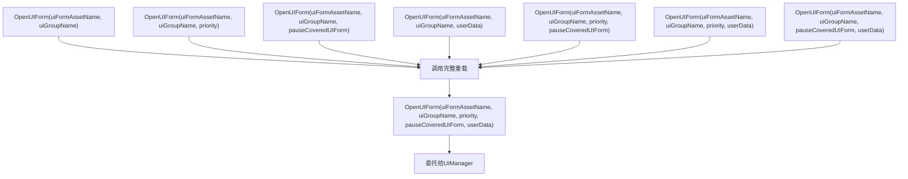

**图示来源**
- [UIComponent.cs](file://Scripts/Runtime/UI/UIComponent.cs#L492-L584)

### CloseUIForm方法族
`CloseUIForm`方法用于关闭指定的UI窗体，支持通过序列编号或UIForm实例进行关闭操作，并可传递用户自定义数据。

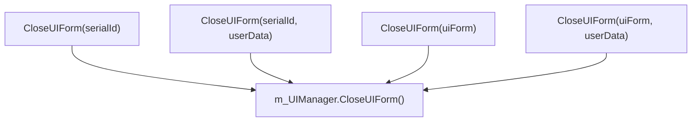

**图示来源**
- [UIComponent.cs](file://Scripts/Runtime/UI/UIComponent.cs#L590-L622)

### HasUIForm方法
`HasUIForm`方法用于检查指定的UI窗体是否存在，支持通过序列编号或资源名称进行查询。

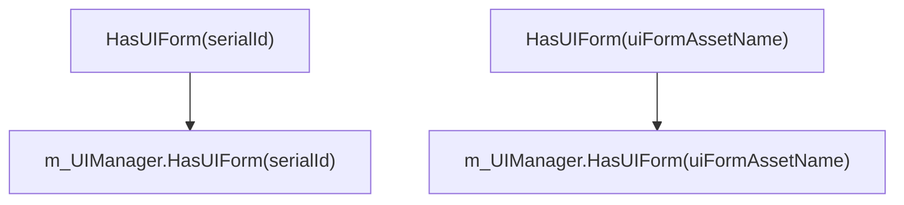

**图示来源**
- [UIComponent.cs](file://Scripts/Runtime/UI/UIComponent.cs#L329-L342)

## UI窗体标识方式

### UIStringKey
`UIStringKey`类用于为UI窗体提供字符串类型的主键标识，通过Unity的序列化字段在编辑器中配置。

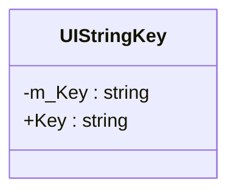

**图示来源**
- [UIStringKey.cs](file://Scripts/Runtime/UI/UIStringKey.cs#L14-L33)

### UIIntKey
`UIIntKey`类用于为UI窗体提供整数类型的主键标识，同样通过Unity的序列化字段在编辑器中配置。

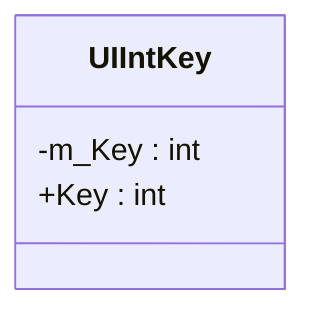

**图示来源**
- [UIIntKey.cs](file://Scripts/Runtime/UI/UIIntKey.cs#L14-L33)

## 打开模式与层级管理

### 打开模式
UI窗体支持两种打开模式：
- **模式化**：通过`pauseCoveredUIForm`参数控制，当设置为`true`时，被覆盖的UI窗体会被暂停
- **非模式化**：`pauseCoveredUIForm`设置为`false`，被覆盖的UI窗体保持运行状态

### 层级管理
UI窗体的层级由其所属的UI组（UIGroup）和在组内的深度共同决定。UI组的深度在创建时指定，窗体在组内的深度由UIManager自动管理。

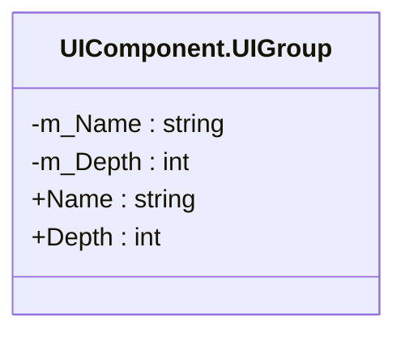

**图示来源**
- [UIComponent.UIGroup.cs](file://Scripts/Runtime/UI/UIComponent.UIGroup.cs#L14-L38)

## UIForm生命周期

### 生命周期方法
`UIForm`类通过代理调用`UIFormLogic`中的生命周期方法，形成完整的生命周期管理。

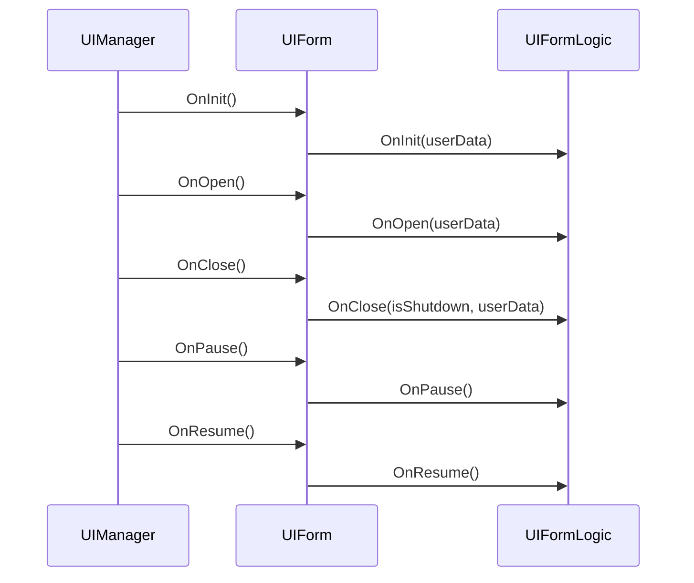

**图示来源**
- [UIForm.cs](file://Scripts/Runtime/UI/UIForm.cs#L111-L302)

## UIFormLogic挂载机制

### UIFormLogic基类
`UIFormLogic`是所有UI逻辑脚本的基类，必须继承自该类并挂载到UI窗体的GameObject上。

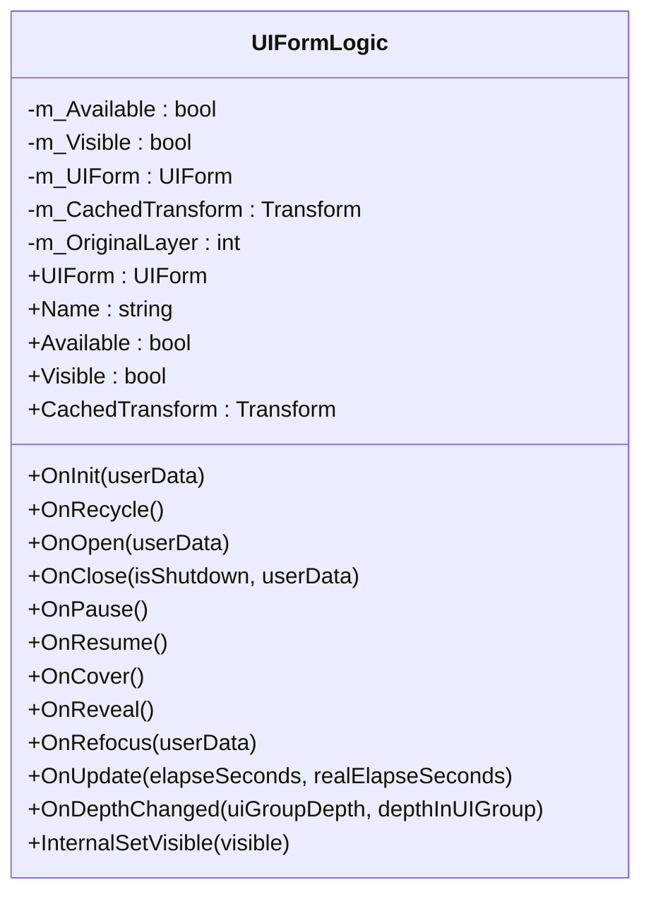

**图示来源**
- [UIFormLogic.cs](file://Scripts/Runtime/UI/UIFormLogic.cs#L14-L205)

### 挂载流程
1. UI窗体实例化时，`UIForm`组件会自动查找并获取`UIFormLogic`组件
2. 在`OnInit`方法中，`UIFormLogic`的`OnInit`被调用，完成初始化
3. 各生命周期方法通过`UIForm`代理调用`UIFormLogic`的对应方法

## UI事件系统

### 事件类结构
UI系统通过事件机制通知外部UI操作的结果和进度。

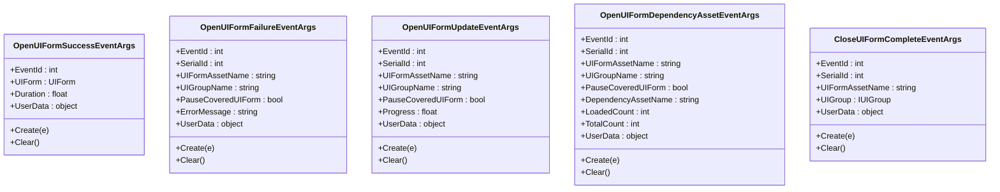

**图示来源**
- [OpenUIFormSuccessEventArgs.cs](file://Scripts/Runtime/UI/OpenUIFormSuccessEventArgs.cs#L1-L95)
- [OpenUIFormFailureEventArgs.cs](file://Scripts/Runtime/UI/OpenUIFormFailureEventArgs.cs#L1-L131)
- [OpenUIFormUpdateEventArgs.cs](file://Scripts/Runtime/UI/OpenUIFormUpdateEventArgs.cs#L1-L131)
- [OpenUIFormDependencyAssetEventArgs.cs](file://Scripts/Runtime/UI/OpenUIFormDependencyAssetEventArgs.cs#L1-L155)
- [CloseUIFormCompleteEventArgs.cs](file://Scripts/Runtime/UI/CloseUIFormCompleteEventArgs.cs#L1-L108)

## 完整使用示例

### 定义UI窗体逻辑
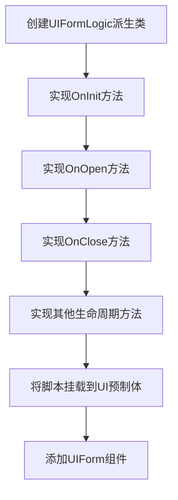

### 注册Helper
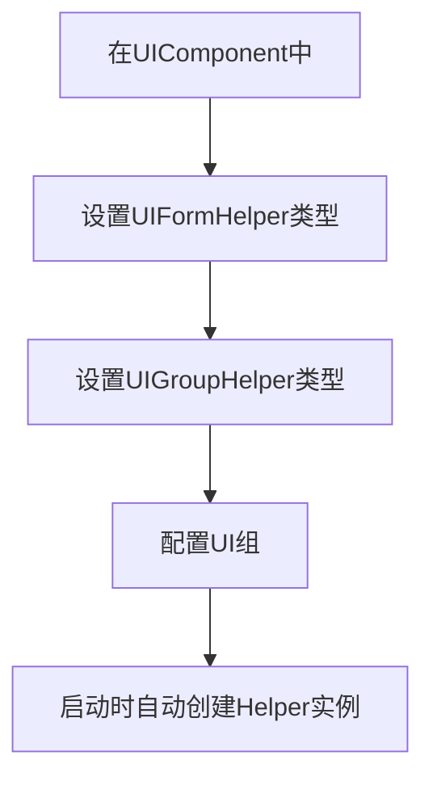

**图示来源**
- [DefaultUIFormHelper.cs](file://Scripts/Runtime/UI/DefaultUIFormHelper.cs#L1-L74)
- [DefaultUIGroupHelper.cs](file://Scripts/Runtime/UI/DefaultUIGroupHelper.cs#L1-L23)

### 动态打开关闭窗体
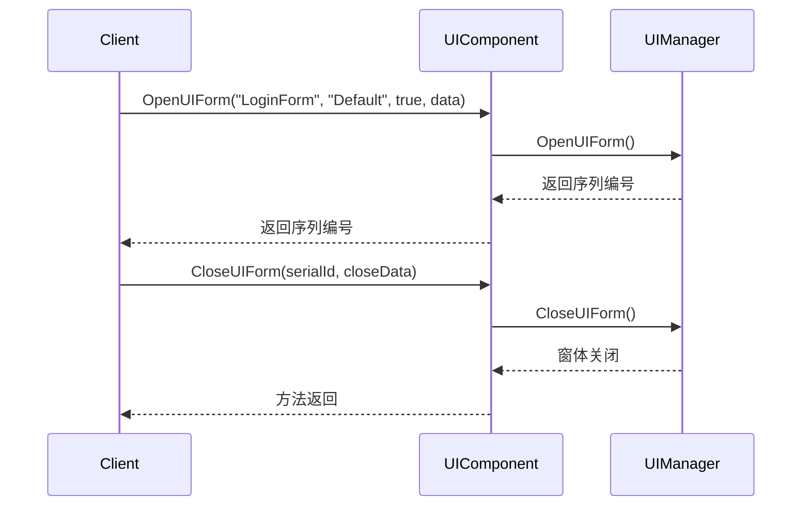

## UI组管理与性能优化

### UI组管理策略
UI组用于组织和管理UI窗体的层级和渲染顺序。

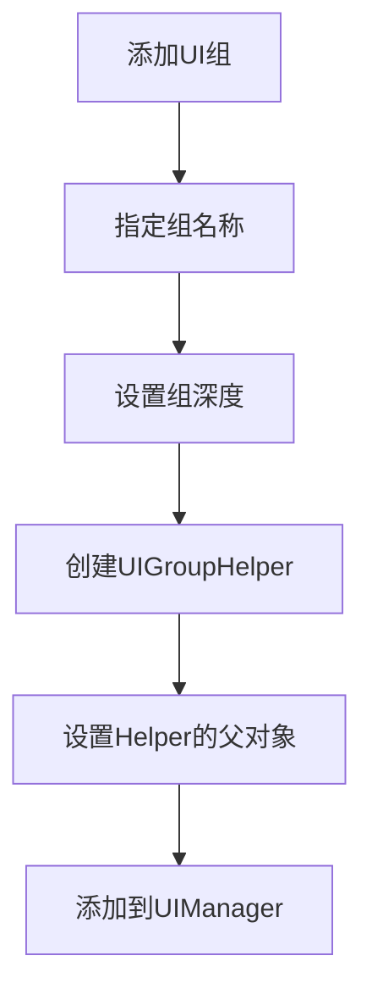

**图示来源**
- [UIComponent.cs](file://Scripts/Runtime/UI/UIComponent.cs#L284-L318)

### 性能优化技巧

#### 资源预加载
通过提前加载UI资源，避免在需要时出现卡顿。

#### 对象池复用
UI系统内置对象池机制，可配置实例的容量、过期时间和自动释放间隔。

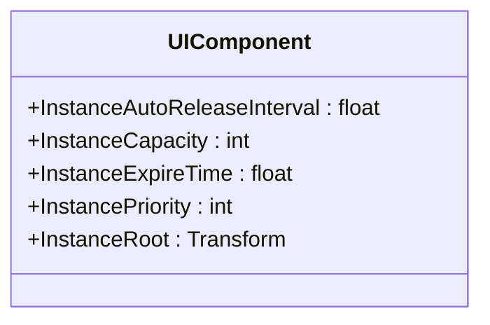

**图示来源**
- [UIComponent.cs](file://Scripts/Runtime/UI/UIComponent.cs#L45-L60)

## 附录

### 配置选项
| 配置项 | 类型 | 默认值 | 说明 |
|--------|------|--------|------|
| EnableOpenUIFormSuccessEvent | bool | true | 是否启用打开UI窗体成功事件 |
| EnableOpenUIFormFailureEvent | bool | true | 是否启用打开UI窗体失败事件 |
| EnableOpenUIFormUpdateEvent | bool | false | 是否启用打开UI窗体更新事件 |
| EnableOpenUIFormDependencyAssetEvent | bool | false | 是否启用打开UI窗体依赖资源事件 |
| EnableCloseUIFormCompleteEvent | bool | true | 是否启用关闭UI窗体完成事件 |
| InstanceAutoReleaseInterval | float | 60f | 实例自动释放间隔（秒） |
| InstanceCapacity | int | 16 | 实例池容量 |
| InstanceExpireTime | float | 60f | 实例过期时间（秒） |
| InstancePriority | int | 0 | 实例优先级 |
| InstanceRoot | Transform | null | 实例根节点 |

**本节来源**
- [UIComponent.cs](file://Scripts/Runtime/UI/UIComponent.cs#L45-L78)