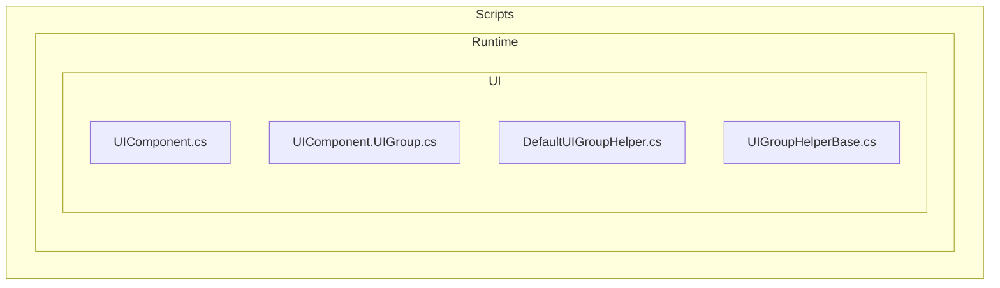
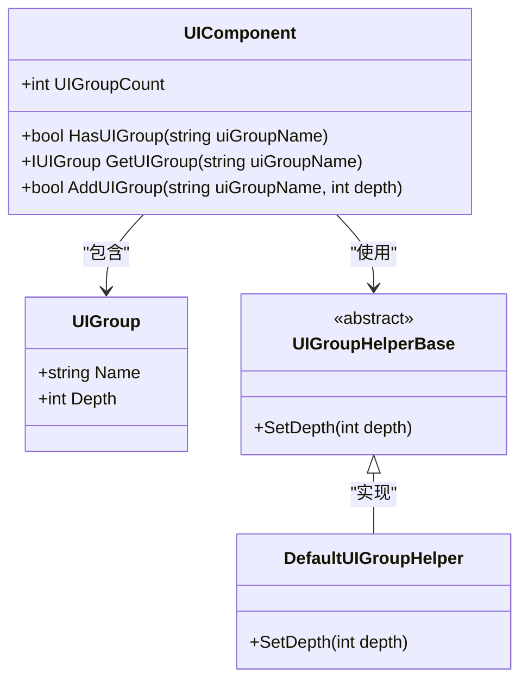
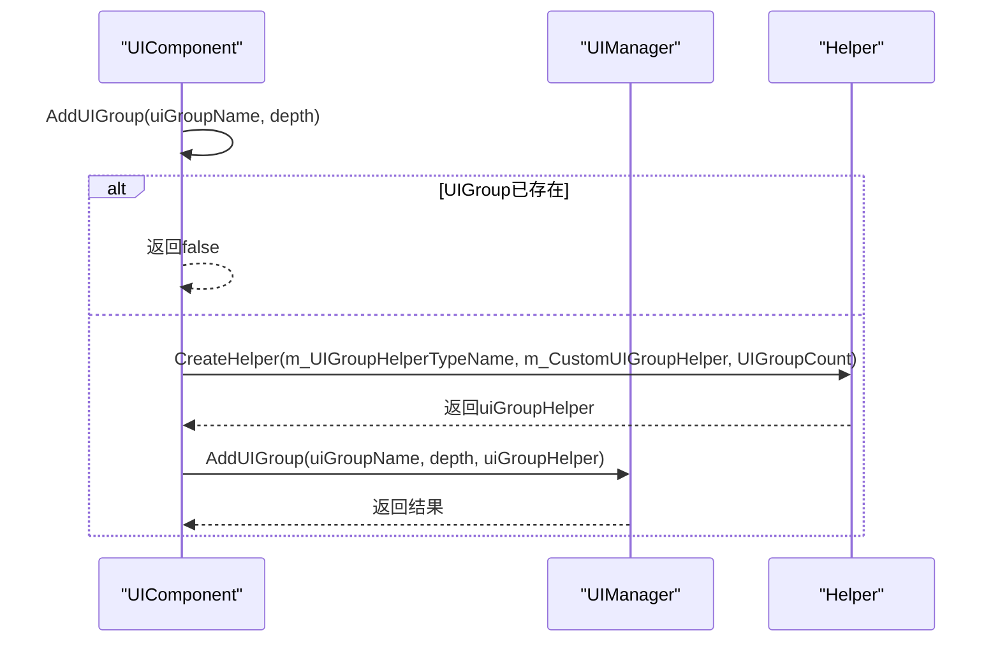
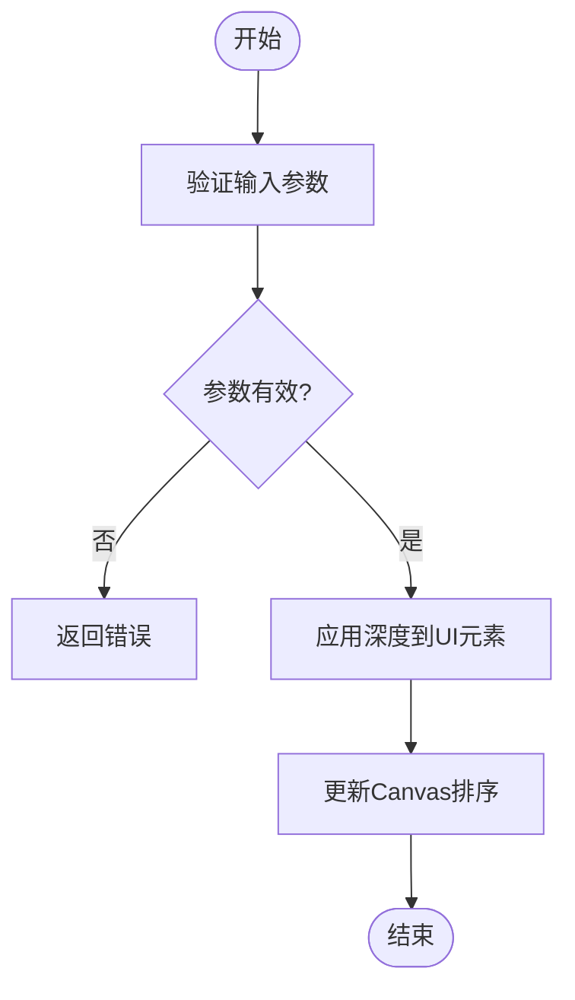
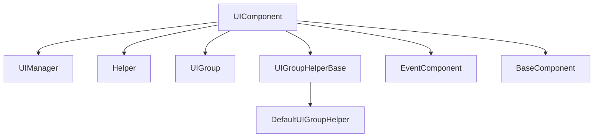

# UI组管理与层级控制

<cite>
**Referenced Files in This Document**  
- [UIComponent.cs](file://Scripts/Runtime/UI/UIComponent.cs)
- [UIComponent.UIGroup.cs](file://Scripts/Runtime/UI/UIComponent.UIGroup.cs)
- [DefaultUIGroupHelper.cs](file://Scripts/Runtime/UI/DefaultUIGroupHelper.cs)
- [UIGroupHelperBase.cs](file://Scripts/Runtime/UI/UIGroupHelperBase.cs)
</cite>

## 目录
1. [简介](#简介)
2. [项目结构](#项目结构)
3. [核心组件](#核心组件)
4. [架构概述](#架构概述)
5. [详细组件分析](#详细组件分析)
6. [依赖分析](#依赖分析)
7. [性能考虑](#性能考虑)
8. [故障排除指南](#故障排除指南)
9. [结论](#结论)

## 简介
本文档旨在阐述Unity游戏框架中UI组管理与层级控制的设计理念与实现机制。通过UIGroup系统，开发者能够对UI窗体进行有效的分组与层级管理，实现复杂的用户界面布局。文档将详细说明UIComponent中与UI组相关的接口、DefaultUIGroupHelper在资源加载与初始化中的作用，以及如何通过深度和优先级参数控制UI的显示顺序。

## 项目结构

**Diagram sources**  
- [UIComponent.cs](file://Scripts/Runtime/UI/UIComponent.cs)
- [UIComponent.UIGroup.cs](file://Scripts/Runtime/UI/UIComponent.UIGroup.cs)
- [DefaultUIGroupHelper.cs](file://Scripts/Runtime/UI/DefaultUIGroupHelper.cs)
- [UIGroupHelperBase.cs](file://Scripts/Runtime/UI/UIGroupHelperBase.cs)

**Section sources**
- [UIComponent.cs](file://Scripts/Runtime/UI/UIComponent.cs)
- [UIComponent.UIGroup.cs](file://Scripts/Runtime/UI/UIComponent.UIGroup.cs)

## 核心组件

UI组管理与层级控制的核心组件包括UIComponent、UIGroup、DefaultUIGroupHelper和UIGroupHelperBase。UIComponent作为主控组件，负责管理所有UI组和窗体；UIGroup类定义了界面组的基本属性；DefaultUIGroupHelper实现了UIGroupHelperBase，用于处理界面组的深度设置；UIGroupHelperBase作为抽象基类，定义了界面组辅助器的接口。

**Section sources**
- [UIComponent.cs](file://Scripts/Runtime/UI/UIComponent.cs#L12-L39)
- [DefaultUIGroupHelper.cs](file://Scripts/Runtime/UI/DefaultUIGroupHelper.cs#L12-L21)
- [UIGroupHelperBase.cs](file://Scripts/Runtime/UI/UIGroupHelperBase.cs#L12-L23)

## 架构概述

**Diagram sources**  
- [UIComponent.cs](file://Scripts/Runtime/UI/UIComponent.cs#L73)
- [UIComponent.UIGroup.cs](file://Scripts/Runtime/UI/UIComponent.UIGroup.cs#L12-L39)
- [UIGroupHelperBase.cs](file://Scripts/Runtime/UI/UIGroupHelperBase.cs#L21)
- [DefaultUIGroupHelper.cs](file://Scripts/Runtime/UI/DefaultUIGroupHelper.cs#L18-L20)

## 详细组件分析

### UIComponent分析

UIComponent是UI系统的核心管理组件，通过内部的UIGroup数组和UIManager实现对UI组的管理。组件提供了创建、获取和设置UI组深度的接口，虽然这些操作最终由UIManager执行，但UIComponent提供了更高级别的封装。

#### UI组创建与管理

**Diagram sources**  
- [UIComponent.cs](file://Scripts/Runtime/UI/UIComponent.cs#L301-L322)

**Section sources**
- [UIComponent.cs](file://Scripts/Runtime/UI/UIComponent.cs#L290-L322)

### DefaultUIGroupHelper分析

DefaultUIGroupHelper是UIGroupHelperBase的默认实现，负责在UI组初始化时设置其深度。该类通过重写SetDepth方法，将深度值应用到实际的UI元素上，从而实现不同UI组在Canvas上的层级分离。

#### 深度设置流程

**Diagram sources**  
- [DefaultUIGroupHelper.cs](file://Scripts/Runtime/UI/DefaultUIGroupHelper.cs#L18-L20)
- [UIGroupHelperBase.cs](file://Scripts/Runtime/UI/UIGroupHelperBase.cs#L21)

**Section sources**
- [DefaultUIGroupHelper.cs](file://Scripts/Runtime/UI/DefaultUIGroupHelper.cs#L12-L21)

## 依赖分析

**Diagram sources**  
- [UIComponent.cs](file://Scripts/Runtime/UI/UIComponent.cs#L60-L73)
- [UIGroupHelperBase.cs](file://Scripts/Runtime/UI/UIGroupHelperBase.cs#L12)
- [DefaultUIGroupHelper.cs](file://Scripts/Runtime/UI/DefaultUIGroupHelper.cs#L12)

**Section sources**
- [UIComponent.cs](file://Scripts/Runtime/UI/UIComponent.cs#L60-L73)
- [UIGroupHelperBase.cs](file://Scripts/Runtime/UI/UIGroupHelperBase.cs#L12-L23)

## 性能考虑

在UI组管理与层级控制中，合理的结构规划对性能至关重要。建议遵循以下优化技巧：

1. **合理规划UI组结构**：避免创建过多的UI组，减少渲染开销。
2. **利用对象池复用高频弹窗**：通过UIComponent的对象池机制复用频繁打开关闭的UI窗体。
3. **避免过度嵌套**：减少UI元素的层级嵌套，提高渲染效率。
4. **合理设置优先级**：通过priority参数优化同组内窗体的显示顺序，避免不必要的重绘。

## 故障排除指南

当遇到UI组管理相关问题时，可参考以下排查步骤：

1. **检查UI组是否已存在**：在添加新UI组前，使用HasUIGroup方法确认组名未被占用。
2. **验证UI组辅助器创建**：确保m_UIGroupHelperTypeName指向有效的UIGroupHelperBase实现。
3. **检查深度设置**：确认DefaultUIGroupHelper的SetDepth方法被正确调用并应用到UI元素。
4. **审查UIManager状态**：确保UIManager已正确初始化并设置了必要的管理器。

**Section sources**
- [UIComponent.cs](file://Scripts/Runtime/UI/UIComponent.cs#L301-L322)
- [DefaultUIGroupHelper.cs](file://Scripts/Runtime/UI/DefaultUIGroupHelper.cs#L18-L20)

## 结论

UI组管理与层级控制系统为Unity游戏框架提供了强大的UI组织能力。通过UIGroup机制，开发者能够有效地对UI窗体进行分组管理，并通过深度和优先级参数精确控制UI的显示层级。DefaultUIGroupHelper作为默认实现，简化了UI组的初始化过程。合理的UI组结构规划和性能优化技巧对于构建高效、可维护的用户界面至关重要。