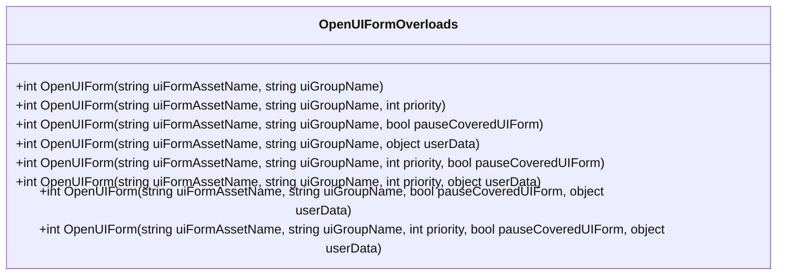
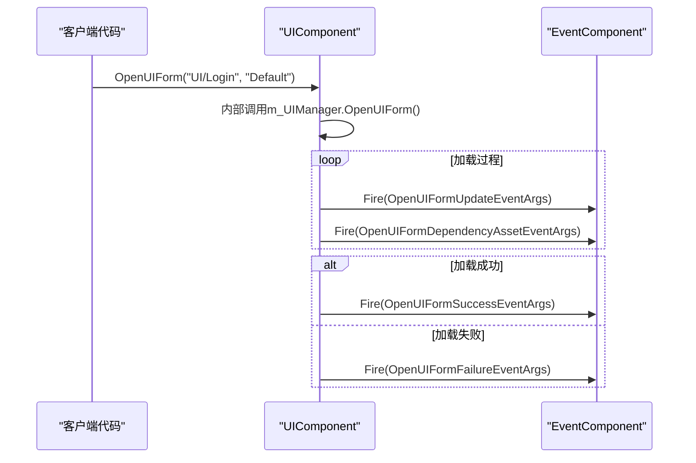

# 打开UI窗体API

<cite>
**Referenced Files in This Document**   
- [UIComponent.cs](file://Scripts/Runtime/UI/UIComponent.cs)
- [OpenUIFormSuccessEventArgs.cs](file://Scripts/Runtime/UI/OpenUIFormSuccessEventArgs.cs)
- [OpenUIFormFailureEventArgs.cs](file://Scripts/Runtime/UI/OpenUIFormFailureEventArgs.cs)
- [OpenUIFormUpdateEventArgs.cs](file://Scripts/Runtime/UI/OpenUIFormUpdateEventArgs.cs)
- [OpenUIFormDependencyAssetEventArgs.cs](file://Scripts/Runtime/UI/OpenUIFormDependencyAssetEventArgs.cs)
</cite>

## 目录
1. [简介](#简介)
2. [核心功能](#核心功能)
3. [OpenUIForm方法重载](#openuiform方法重载)
4. [事件系统](#事件系统)
5. [代码示例](#代码示例)
6. [最佳实践](#最佳实践)

## 简介

本API文档详细描述了Unity游戏框架中用于打开用户界面（UI）窗体的核心功能。`UIComponent`类提供了多个重载的`OpenUIForm`方法，允许开发者以灵活的方式加载和管理UI界面。该系统支持异步资源加载、界面分组管理、优先级控制以及用户自定义数据传递。通过事件驱动机制，开发者可以监听窗体打开过程中的各个阶段，包括成功、失败、进度更新和依赖资源加载等事件，从而实现精细的加载流程控制和用户体验优化。

## 核心功能

`UIComponent`作为游戏框架中的UI管理组件，负责统一管理所有UI窗体的生命周期。其核心功能是通过一系列`OpenUIForm`方法重载来异步加载指定的UI资源，并将其实例化到指定的UI组中。该系统与框架的资源管理、对象池和事件系统深度集成，确保了UI资源的高效加载和内存管理。

**Section sources**
- [UIComponent.cs](file://Scripts/Runtime/UI/UIComponent.cs#L1-L100)

## OpenUIForm方法重载

`UIComponent`提供了八个重载的`OpenUIForm`方法，以满足不同场景下的调用需求。所有重载最终都调用同一个包含全部参数的底层方法，通过提供默认值来简化常用场景的调用。

### 方法参数详解

| 参数 | 类型 | 说明 |
| :--- | :--- | :--- |
| `uiFormAssetName` | string | 要加载的UI窗体资源名称，通常为资源路径（如"UI/Forms/LoginForm"）。这是唯一必需的参数。 |
| `uiGroupName` | string | 指定该窗体所属的UI组名称。UI组用于管理窗体的层级、渲染顺序和共用逻辑。 |
| `priority` | int | 加载此UI资源的优先级。高优先级的资源会优先被加载。默认值为0。 |
| `pauseCoveredUIForm` | bool | 当新窗体打开时，是否暂停其下方被覆盖的窗体。暂停的窗体通常会停止更新和接收输入。默认值为false。 |
| `userData` | object | 用户自定义数据，在窗体打开成功或失败时，会原样传递给相应的事件。可用于传递初始化参数或上下文信息。 |

### 重载方法列表

所有重载方法均返回一个`int`类型的窗体序列号（`serialId`），该唯一标识符可用于后续对该窗体进行引用、关闭或操作。



**Diagram sources**
- [UIComponent.cs](file://Scripts/Runtime/UI/UIComponent.cs#L492-L584)

**Section sources**
- [UIComponent.cs](file://Scripts/Runtime/UI/UIComponent.cs#L492-L584)

## 事件系统

UI窗体的异步加载过程通过事件系统进行通知。`UIComponent`内部订阅了底层`IUIManager`的事件，并将其转换为框架的事件系统事件，开发者可以通过`EventComponent`来监听这些事件。

### OpenUIFormSuccessEventArgs（打开成功事件）

当UI窗体成功加载并实例化后触发。

| 属性 | 类型 | 说明 |
| :--- | :--- | :--- |
| `UIForm` | UIForm | 获取成功打开的UI窗体实例。 |
| `Duration` | float | 获取从开始加载到成功完成所花费的时间（秒）。 |
| `UserData` | object | 获取调用`OpenUIForm`时传入的用户自定义数据。 |

**Section sources**
- [OpenUIFormSuccessEventArgs.cs](file://Scripts/Runtime/UI/OpenUIFormSuccessEventArgs.cs#L15-L93)

### OpenUIFormFailureEventArgs（打开失败事件）

当UI窗体加载过程中发生错误时触发。

| 属性 | 类型 | 说明 |
| :--- | :--- | :--- |
| `SerialId` | int | 获取此次加载请求的序列号。 |
| `UIFormAssetName` | string | 获取尝试加载的UI资源名称。 |
| `UIGroupName` | string | 获取指定的UI组名称。 |
| `PauseCoveredUIForm` | bool | 获取是否请求暂停被覆盖窗体的标志。 |
| `ErrorMessage` | string | 获取详细的错误信息。 |
| `UserData` | object | 获取调用`OpenUIForm`时传入的用户自定义数据。 |

**Section sources**
- [OpenUIFormFailureEventArgs.cs](file://Scripts/Runtime/UI/OpenUIFormFailureEventArgs.cs#L15-L129)

### OpenUIFormUpdateEventArgs（加载进度更新事件）

在UI窗体加载过程中，当加载进度发生变化时触发。此事件可用于更新加载进度条。

| 属性 | 类型 | 说明 |
| :--- | :--- | :--- |
| `SerialId` | int | 获取此次加载请求的序列号。 |
| `UIFormAssetName` | string | 获取正在加载的UI资源名称。 |
| `UIGroupName` | string | 获取指定的UI组名称。 |
| `PauseCoveredUIForm` | bool | 获取是否请求暂停被覆盖窗体的标志。 |
| `Progress` | float | 获取当前加载进度，范围为0.0到1.0。 |
| `UserData` | object | 获取调用`OpenUIForm`时传入的用户自定义数据。 |

**Section sources**
- [OpenUIFormUpdateEventArgs.cs](file://Scripts/Runtime/UI/OpenUIFormUpdateEventArgs.cs#L15-L129)

### OpenUIFormDependencyAssetEventArgs（依赖资源加载事件）

当加载UI窗体时，如果该窗体依赖于其他资源（如纹理、预制件等），在加载这些依赖资源时会触发此事件。这提供了比`OpenUIFormUpdateEventArgs`更细粒度的加载信息。

| 属性 | 类型 | 说明 |
| :--- | :--- | :--- |
| `SerialId` | int | 获取此次加载请求的序列号。 |
| `UIFormAssetName` | string | 获取正在加载的UI资源名称。 |
| `UIGroupName` | string | 获取指定的UI组名称。 |
| `PauseCoveredUIForm` | bool | 获取是否请求暂停被覆盖窗体的标志。 |
| `DependencyAssetName` | string | 获取当前正在加载的依赖资源名称。 |
| `LoadedCount` | int | 获取当前已成功加载的依赖资源数量。 |
| `TotalCount` | int | 获取总共需要加载的依赖资源数量。 |
| `UserData` | object | 获取调用`OpenUIForm`时传入的用户自定义数据。 |

**Section sources**
- [OpenUIFormDependencyAssetEventArgs.cs](file://Scripts/Runtime/UI/OpenUIFormDependencyAssetEventArgs.cs#L15-L153)



**Diagram sources**
- [UIComponent.cs](file://Scripts/Runtime/UI/UIComponent.cs#L700-L722)
- [OpenUIFormSuccessEventArgs.cs](file://Scripts/Runtime/UI/OpenUIFormSuccessEventArgs.cs)
- [OpenUIFormFailureEventArgs.cs](file://Scripts/Runtime/UI/OpenUIFormFailureEventArgs.cs)
- [OpenUIFormUpdateEventArgs.cs](file://Scripts/Runtime/UI/OpenUIFormUpdateEventArgs.cs)
- [OpenUIFormDependencyAssetEventArgs.cs](file://Scripts/Runtime/UI/OpenUIFormDependencyAssetEventArgs.cs)

## 代码示例

以下示例展示了如何使用`OpenUIForm` API来打开一个登录窗体，并处理相关的事件。

```csharp
// 1. 定义事件处理函数
private void OnOpenUIFormSuccess(object sender, GameFramework.Event.GameEventArgs e)
{
    var ne = (OpenUIFormSuccessEventArgs)e;
    Log.Info($"UI Form '{ne.UIForm.AssetName}' opened successfully. Duration: {ne.Duration}s");
    // 可以在这里对新打开的窗体进行初始化
}

private void OnOpenUIFormFailure(object sender, GameFramework.Event.GameEventArgs e)
{
    var ne = (OpenUIFormFailureEventArgs)e;
    Log.Error($"Failed to open UI Form '{ne.UIFormAssetName}'. Error: {ne.ErrorMessage}");
    // 可以在这里弹出错误提示或进行重试
}

// 2. 订阅事件
GameEntry.Event.Subscribe(OpenUIFormSuccessEventArgs.EventId, OnOpenUIFormSuccess);
GameEntry.Event.Subscribe(OpenUIFormFailureEventArgs.EventId, OnOpenUIFormFailure);

// 3. 调用OpenUIForm方法
object userData = new { FromScene = "Main" }; // 传递自定义数据
int serialId = GameEntry.UI.OpenUIForm("UI/Forms/LoginForm", "Default", true, userData);

// 4. 使用serialId进行后续操作（例如，如果需要取消加载）
// GameEntry.UI.CloseUIForm(serialId); 
```

## 最佳实践

- **合理使用优先级**：对于需要立即响应的UI（如错误提示），应使用较高的优先级；对于后台加载的UI，可以使用较低的优先级以避免影响主流程。
- **有效利用userData**：`userData`是传递上下文信息的绝佳途径，例如，可以传递一个包含初始化参数的匿名对象或结构体。
- **及时清理事件订阅**：在不再需要监听事件时，务必使用`EventComponent.Unsubscribe`来取消订阅，以防止内存泄漏。
- **处理加载失败**：始终为`OpenUIFormFailureEventArgs`事件提供处理逻辑，以优雅地处理网络问题或资源缺失等异常情况。
- **启用进度事件**：对于加载时间较长的UI，建议启用`m_EnableOpenUIFormUpdateEvent`和`m_EnableOpenUIFormDependencyAssetEvent`，以便为用户提供加载进度反馈。