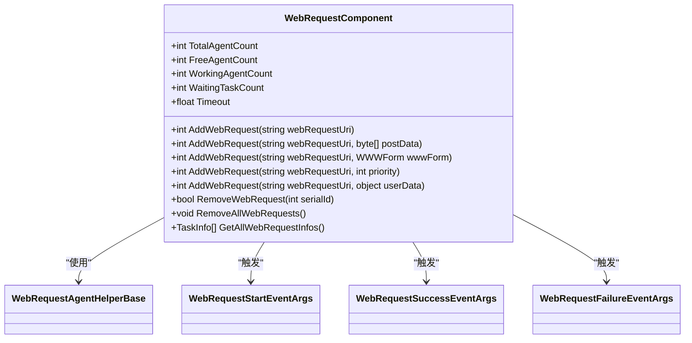
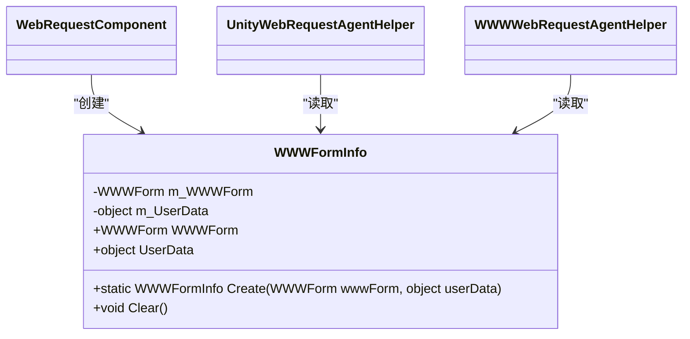
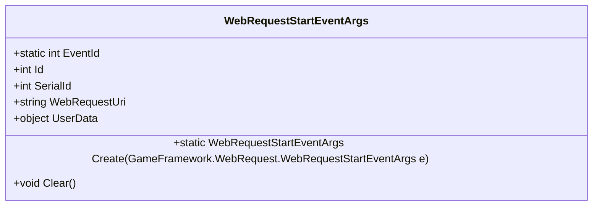
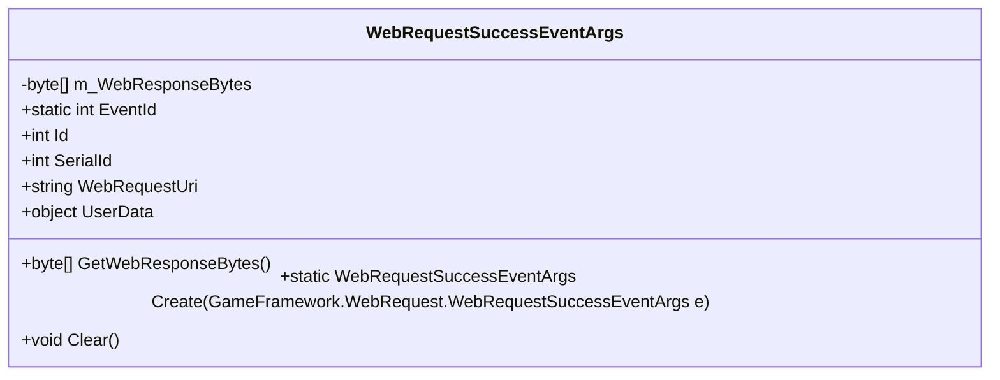
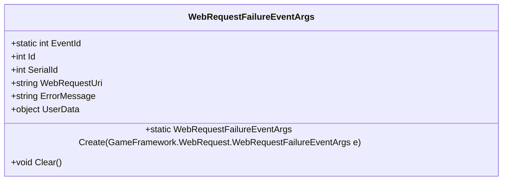
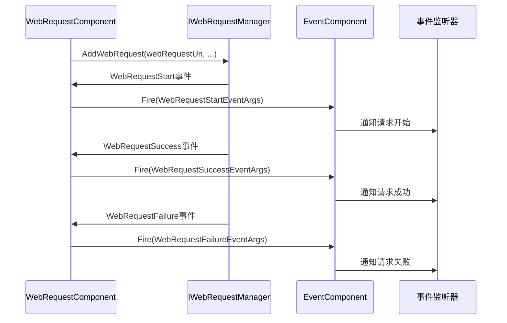
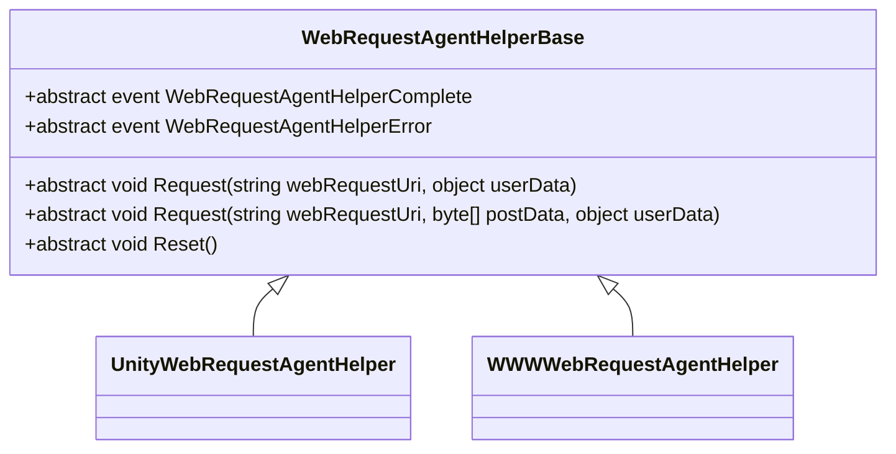

# Web请求API

<cite>
**本文档引用的文件**  
- [WebRequestComponent.cs](file://Scripts/Runtime/WebRequest/WebRequestComponent.cs)
- [WebRequestStartEventArgs.cs](file://Scripts/Runtime/WebRequest/WebRequestStartEventArgs.cs)
- [WebRequestSuccessEventArgs.cs](file://Scripts/Runtime/WebRequest/WebRequestSuccessEventArgs.cs)
- [WebRequestFailureEventArgs.cs](file://Scripts/Runtime/WebRequest/WebRequestFailureEventArgs.cs)
- [WWWFormInfo.cs](file://Scripts/Runtime/WebRequest/WWWFormInfo.cs)
- [UnityWebRequestAgentHelper.cs](file://Scripts/Runtime/WebRequest/UnityWebRequestAgentHelper.cs)
- [WWWWebRequestAgentHelper.cs](file://Scripts/Runtime/WebRequest/WWWWebRequestAgentHelper.cs)
- [WebRequestAgentHelperBase.cs](file://Scripts/Runtime/WebRequest/WebRequestAgentHelperBase.cs)
</cite>

## 目录
1. [简介](#简介)
2. [核心组件](#核心组件)
3. [Send方法参数详解](#send方法参数详解)
4. [事件系统](#事件系统)
5. [扩展点：WebRequestAgentHelperBase](#扩展点：webrequestagenthelperbase)
6. [示例代码](#示例代码)
7. [请求队列与管理](#请求队列与管理)
8. [错误重试机制](#错误重试机制)
9. [安全性考虑](#安全性考虑)

## 简介
Web请求API是Unity游戏框架中的一个核心组件，用于处理HTTP/HTTPS网络请求。该系统提供了一套完整的异步请求机制，支持GET/POST请求、表单数据提交、文件上传、超时控制和事件回调等功能。通过`WebRequestComponent`组件，开发者可以轻松地发送网络请求并处理响应结果。

## 核心组件

### WebRequestComponent
`WebRequestComponent`是Web请求系统的核心组件，负责管理所有Web请求任务。它提供了多种重载的`AddWebRequest`方法来发起请求，并通过事件系统通知请求状态变化。



**图表来源**
- [WebRequestComponent.cs](file://Scripts/Runtime/WebRequest/WebRequestComponent.cs#L0-L360)

**本节来源**
- [WebRequestComponent.cs](file://Scripts/Runtime/WebRequest/WebRequestComponent.cs#L0-L360)

## Send方法参数详解

### URL参数
URL参数指定要请求的远程地址，支持HTTP和HTTPS协议。在`AddWebRequest`方法中，URL作为第一个参数传入。

### 表单数据
表单数据可以通过`WWWForm`对象传递。系统使用`WWWFormInfo`类包装`WWWForm`和用户自定义数据，确保在请求过程中保持数据完整性。



**图表来源**
- [WWWFormInfo.cs](file://Scripts/Runtime/WebRequest/WWWFormInfo.cs#L0-L54)

**本节来源**
- [WWWFormInfo.cs](file://Scripts/Runtime/WebRequest/WWWFormInfo.cs#L0-L54)

### 超时设置
超时设置通过`Timeout`属性进行配置，默认值为30秒。该属性直接映射到内部`IWebRequestManager`的超时设置。

```csharp
[SPEC SYMBOL](file://Scripts/Runtime/WebRequest/WebRequestComponent.cs#L84-L96)
```

### 回调函数
回调函数通过事件系统实现，而不是直接的回调参数。组件会触发`WebRequestStart`、`WebRequestSuccess`和`WebRequestFailure`事件，开发者可以通过事件系统订阅这些事件来处理请求结果。

## 事件系统

### WebRequestStartEventArgs
`WebRequestStartEventArgs`事件在Web请求开始时触发，包含请求的基本信息。



**图表来源**
- [WebRequestStartEventArgs.cs](file://Scripts/Runtime/WebRequest/WebRequestStartEventArgs.cs#L15-L94)

**本节来源**
- [WebRequestStartEventArgs.cs](file://Scripts/Runtime/WebRequest/WebRequestStartEventArgs.cs#L15-L94)

### WebRequestSuccessEventArgs
`WebRequestSuccessEventArgs`事件在Web请求成功时触发，包含响应数据。



**图表来源**
- [WebRequestSuccessEventArgs.cs](file://Scripts/Runtime/WebRequest/WebRequestSuccessEventArgs.cs#L15-L109)

**本节来源**
- [WebRequestSuccessEventArgs.cs](file://Scripts/Runtime/WebRequest/WebRequestSuccessEventArgs.cs#L15-L109)

### WebRequestFailureEventArgs
`WebRequestFailureEventArgs`事件在Web请求失败时触发，包含错误信息。



**图表来源**
- [WebRequestFailureEventArgs.cs](file://Scripts/Runtime/WebRequest/WebRequestFailureEventArgs.cs#L15-L107)

**本节来源**
- [WebRequestFailureEventArgs.cs](file://Scripts/Runtime/WebRequest/WebRequestFailureEventArgs.cs#L15-L107)

### 事件触发流程


**图表来源**
- [WebRequestComponent.cs](file://Scripts/Runtime/WebRequest/WebRequestComponent.cs#L326-L359)

## 扩展点：WebRequestAgentHelperBase
`WebRequestAgentHelperBase`是一个抽象基类，允许开发者自定义底层请求实现。



**图表来源**
- [WebRequestAgentHelperBase.cs](file://Scripts/Runtime/WebRequest/WebRequestAgentHelperBase.cs#L16-L47)

**本节来源**
- [WebRequestAgentHelperBase.cs](file://Scripts/Runtime/WebRequest/WebRequestAgentHelperBase.cs#L16-L47)

### UnityWebRequestAgentHelper
使用UnityWebRequest实现的请求代理辅助器，支持Unity 5.4及以上版本。

```csharp
[SPEC SYMBOL](file://Scripts/Runtime/WebRequest/UnityWebRequestAgentHelper.cs#L30-L71)
```

### WWWWebRequestAgentHelper
使用WWW实现的请求代理辅助器，适用于较老版本的Unity。

```csharp
[SPEC SYMBOL](file://Scripts/Runtime/WebRequest/WWWWebRequestAgentHelper.cs#L42-L79)
```

## 示例代码

### 发送GET请求
```csharp
// 发送简单的GET请求
int serialId = webRequestComponent.AddWebRequest("https://api.example.com/data");
```

### 发送POST请求
```csharp
// 创建表单数据
WWWForm form = new WWWForm();
form.AddField("username", "user123");
form.AddField("password", "pass456");

// 发送POST请求
int serialId = webRequestComponent.AddWebRequest("https://api.example.com/login", form);
```

### 处理JSON响应
```csharp
// 订阅成功事件
EventComponent eventComponent = GameEntry.GetComponent<EventComponent>();
eventComponent.Subscribe(WebRequestSuccessEventArgs.EventId, OnWebRequestSuccess);

private void OnWebRequestSuccess(object sender, GameEventArgs e)
{
    WebRequestSuccessEventArgs ne = (WebRequestSuccessEventArgs)e;
    byte[] responseBytes = ne.GetWebResponseBytes();
    string responseText = System.Text.Encoding.UTF8.GetString(responseBytes);
    JSONObject jsonObject = new JSONObject(responseText);
    // 处理JSON数据
}
```

### 上传文件
```csharp
// 创建包含文件的表单
WWWForm form = new WWWForm();
form.AddBinaryData("file", fileData, "filename.txt", "text/plain");
form.AddField("description", "This is a test file");

// 发送上传请求
int serialId = webRequestComponent.AddWebRequest("https://api.example.com/upload", form);
```

## 请求队列与管理
系统内置了请求队列管理功能，支持优先级设置和请求管理。

```csharp
// 添加带优先级的请求
int serialId = webRequestComponent.AddWebRequest("https://api.example.com/data", 100);

// 获取所有请求信息
TaskInfo[] allTasks = webRequestComponent.GetAllWebRequestInfos();

// 移除特定请求
bool success = webRequestComponent.RemoveWebRequest(serialId);

// 移除所有请求
webRequestComponent.RemoveAllWebRequests();
```

## 错误重试机制
虽然核心组件未直接提供重试机制，但可以通过事件系统实现自定义重试逻辑。

```csharp
private int maxRetries = 3;
private Dictionary<int, int> retryCount = new Dictionary<int, int>();

private void OnWebRequestFailure(object sender, GameEventArgs e)
{
    WebRequestFailureEventArgs ne = (WebRequestFailureEventArgs)e;
    if (retryCount.ContainsKey(ne.SerialId))
    {
        retryCount[ne.SerialId]++;
    }
    else
    {
        retryCount[ne.SerialId] = 1;
    }

    if (retryCount[ne.SerialId] <= maxRetries)
    {
        // 重新发送请求
        webRequestComponent.AddWebRequest(ne.WebRequestUri, ne.UserData);
    }
    else
    {
        // 达到最大重试次数，放弃请求
        retryCount.Remove(ne.SerialId);
    }
}
```

## 安全性考虑
### HTTPS支持
系统原生支持HTTPS协议，建议在生产环境中使用HTTPS来保证数据传输安全。

### 数据验证
在处理响应数据时，应进行充分的验证和错误处理：

```csharp
private void OnWebRequestSuccess(object sender, GameEventArgs e)
{
    WebRequestSuccessEventArgs ne = (WebRequestSuccessEventArgs)e;
    byte[] responseData = ne.GetWebResponseBytes();
    
    // 验证响应数据
    if (responseData == null || responseData.Length == 0)
    {
        Debug.LogError("Received empty response");
        return;
    }
    
    // 处理响应数据
    ProcessResponseData(responseData);
}
```

### 敏感信息保护
避免在URL中传递敏感信息，建议使用POST请求并通过请求体发送敏感数据。