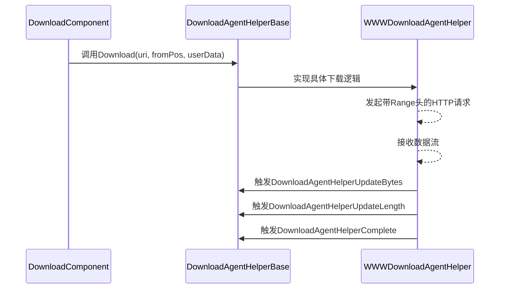
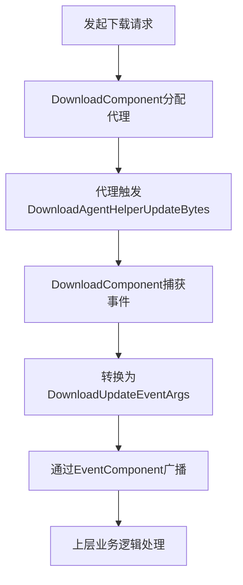

# 下载代理基类设计

<cite>
**本文档引用文件**  
- [DownloadAgentHelperBase.cs](file://Scripts/Runtime/Download/DownloadAgentHelperBase.cs)
- [WWWDownloadAgentHelper.cs](file://Scripts/Runtime/Download/WWWDownloadAgentHelper.cs)
- [UnityWebRequestDownloadAgentHelper.cs](file://Scripts/Runtime/Download/UnityWebRequestDownloadAgentHelper.cs)
- [DownloadComponent.cs](file://Scripts/Runtime/Download/DownloadComponent.cs)
- [DownloadUpdateEventArgs.cs](file://Scripts/Runtime/Download/DownloadUpdateEventArgs.cs)
- [DownloadSuccessEventArgs.cs](file://Scripts/Runtime/Download/DownloadSuccessEventArgs.cs)
- [DownloadFailureEventArgs.cs](file://Scripts/Runtime/Download/DownloadFailureEventArgs.cs)
- [DownloadStartEventArgs.cs](file://Scripts/Runtime/Download/DownloadStartEventArgs.cs)
</cite>

## 目录
1. [引言](#引言)
2. [核心职责与事件契约](#核心职责与事件契约)
3. [下载方法重载机制](#下载方法重载机制)
4. [状态重置与资源回收](#状态重置与资源回收)
5. [事件驱动模型解析](#事件驱动模型解析)
6. [继承实现模板](#继承实现模板)

## 引言
`DownloadAgentHelperBase` 是 Unity 游戏框架中所有下载代理实现的抽象基类，定义了统一的下载行为契约。该类继承自 `MonoBehaviour` 并实现 `IDownloadAgentHelper` 接口，为不同底层下载技术（如 WWW、UnityWebRequest）提供一致的封装接口。其核心设计采用事件驱动模型，实现下载流程与业务逻辑的解耦，支持分段下载、断点续传等高级功能。

**Section sources**
- [DownloadAgentHelperBase.cs](file://Scripts/Runtime/Download/DownloadAgentHelperBase.cs#L1-L74)

## 核心职责与事件契约
`DownloadAgentHelperBase` 定义了四个关键事件，用于通知下载过程中的状态变化：

### 下载数据流更新事件 (DownloadAgentHelperUpdateBytes)
该事件在接收到新的数据块时触发。事件参数包含实际接收到的字节数组、偏移量和长度，适用于流式处理或实时写入文件的场景。

### 下载数据大小更新事件 (DownloadAgentHelperUpdateLength)
该事件在累计下载字节数发生变化时触发。参数为本次新增的字节数，常用于更新进度条或统计总下载量。

### 下载完成事件 (DownloadAgentHelperComplete)
该事件在下载完全成功后触发。参数包含最终下载的总字节数，标志下载任务的正常结束。

### 下载错误事件 (DownloadAgentHelperError)
该事件在下载过程中发生错误时触发。参数包含错误码和错误信息，其中特别定义了 `RangeNotSatisfiableErrorCode`（416）用于处理范围请求不满足的情况，支持断点续传的错误识别。

**Section sources**
- [DownloadAgentHelperBase.cs](file://Scripts/Runtime/Download/DownloadAgentHelperBase.cs#L30-L37)
- [WWWDownloadAgentHelper.cs](file://Scripts/Runtime/Download/WWWDownloadAgentHelper.cs#L31-L78)
- [UnityWebRequestDownloadAgentHelper.cs](file://Scripts/Runtime/Download/UnityWebRequestDownloadAgentHelper.cs#L35-L78)

## 下载方法重载机制
基类提供了三个重载的 `Download` 方法，支持不同粒度的下载控制：

### 全量下载 (Download(string, object))
最基础的下载方法，用于从指定 URI 下载完整文件。`userData` 参数允许传递用户自定义数据，在事件回调中可被提取使用。

### 分段下载起始 (Download(string, int, object))
支持从指定字节位置开始下载，实现断点续传功能。子类实现时需确保底层协议支持 `Range` 请求头。

### 精确范围下载 (Download(string, int, int, object))
支持指定下载的起始和结束位置，适用于仅需获取文件部分内容的场景，如资源预加载或分片下载。



**Diagram sources**
- [DownloadAgentHelperBase.cs](file://Scripts/Runtime/Download/DownloadAgentHelperBase.cs#L48-L65)
- [WWWDownloadAgentHelper.cs](file://Scripts/Runtime/Download/WWWDownloadAgentHelper.cs#L76-L105)

**Section sources**
- [DownloadAgentHelperBase.cs](file://Scripts/Runtime/Download/DownloadAgentHelperBase.cs#L48-L65)

## 状态重置与资源回收
`Reset` 方法是基类定义的抽象方法，要求子类在下载任务结束后或需要重用代理实例时进行状态重置。其主要职责包括：
- 释放网络请求对象（如 `WWW` 或 `UnityWebRequest`）
- 清理内部缓冲区和临时数据
- 重置进度计数器和状态标志
- 确保事件处理器处于可重新订阅的干净状态

此方法是实现下载代理池复用的关键，避免频繁创建和销毁 GameObject 带来的性能开销。

**Section sources**
- [DownloadAgentHelperBase.cs](file://Scripts/Runtime/Download/DownloadAgentHelperBase.cs#L70-L70)

## 事件驱动模型解析
`DownloadAgentHelperBase` 通过事件驱动模型实现了高度解耦：

1. **事件定义**：在基类中声明抽象事件，强制子类实现事件的添加/移除逻辑。
2. **事件触发**：子类在具体下载逻辑中根据网络状态触发相应事件。
3. **事件订阅**：`DownloadComponent` 作为事件消费者，订阅所有代理实例的事件。
4. **事件转发**：`DownloadComponent` 将代理层事件转换为框架级事件（如 `DownloadSuccessEventArgs`），通过事件系统广播给上层业务。



**Diagram sources**
- [DownloadComponent.cs](file://Scripts/Runtime/Download/DownloadComponent.cs#L158-L186)
- [DownloadComponent.cs](file://Scripts/Runtime/Download/DownloadComponent.cs#L280-L304)
- [DownloadUpdateEventArgs.cs](file://Scripts/Runtime/Download/DownloadUpdateEventArgs.cs#L1-L120)

**Section sources**
- [DownloadComponent.cs](file://Scripts/Runtime/Download/DownloadComponent.cs#L158-L304)

## 继承实现模板
继承 `DownloadAgentHelperBase` 的基本代码结构如下：

```csharp
public class CustomDownloadAgentHelper : DownloadAgentHelperBase
{
    private CustomDownloadRequest m_Request;
    
    public override event EventHandler<DownloadAgentHelperUpdateBytesEventArgs> DownloadAgentHelperUpdateBytes;
    public override event EventHandler<DownloadAgentHelperUpdateLengthEventArgs> DownloadAgentHelperUpdateLength;
    public override event EventHandler<DownloadAgentHelperCompleteEventArgs> DownloadAgentHelperComplete;
    public override event EventHandler<DownloadAgentHelperErrorEventArgs> DownloadAgentHelperError;

    public override void Download(string downloadUri, object userData)
    {
        // 初始化请求，绑定事件回调
        m_Request = new CustomDownloadRequest(downloadUri, userData);
        m_Request.OnDataReceived += OnDataReceived;
        m_Request.OnCompleted += OnCompleted;
        m_Request.OnError += OnError;
        m_Request.Start();
    }

    public override void Download(string downloadUri, int fromPosition, object userData)
    {
        // 实现带起始位置的下载
    }

    public override void Download(string downloadUri, int fromPosition, int toPosition, object userData)
    {
        // 实现范围下载
    }

    public override void Reset()
    {
        // 释放m_Request资源，重置状态
        if (m_Request != null)
        {
            m_Request.Dispose();
            m_Request = null;
        }
    }

    private void OnDataReceived(byte[] data, int length)
    {
        DownloadAgentHelperUpdateBytes?.Invoke(this, DownloadAgentHelperUpdateBytesEventArgs.Create(data, 0, length));
        DownloadAgentHelperUpdateLength?.Invoke(this, DownloadAgentHelperUpdateLengthEventArgs.Create(length));
    }

    private void OnCompleted(int totalLength)
    {
        DownloadAgentHelperComplete?.Invoke(this, DownloadAgentHelperCompleteEventArgs.Create(totalLength));
    }

    private void OnError(bool isRangeNotSatisfiable, string errorMessage)
    {
        DownloadAgentHelperError?.Invoke(this, DownloadAgentHelperErrorEventArgs.Create(isRangeNotSatisfiable, errorMessage));
    }
}
```

**Section sources**
- [DownloadAgentHelperBase.cs](file://Scripts/Runtime/Download/DownloadAgentHelperBase.cs#L1-L74)
- [WWWDownloadAgentHelper.cs](file://Scripts/Runtime/Download/WWWDownloadAgentHelper.cs#L1-L245)