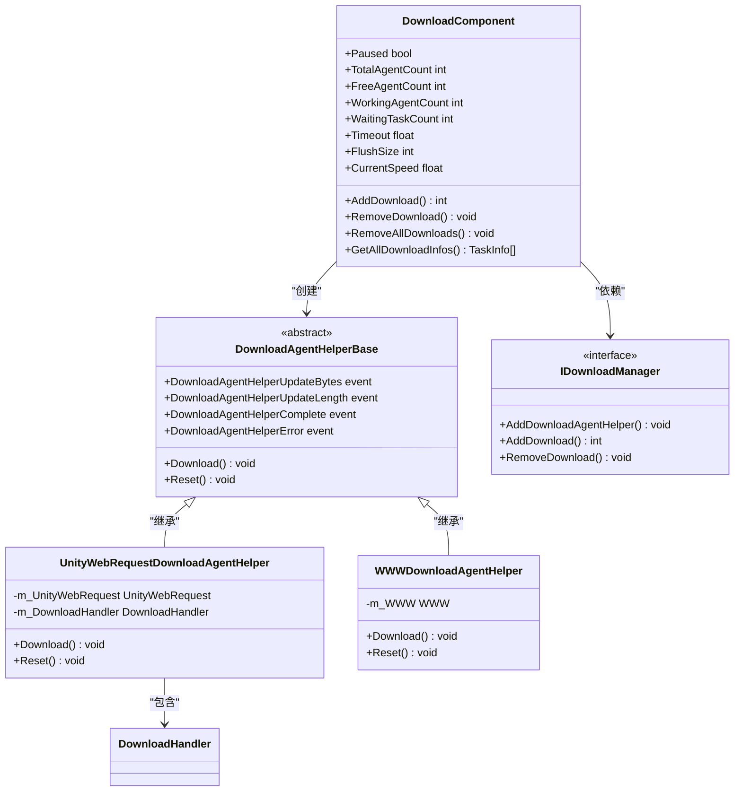

# 下载代理扩展机制

<cite>
**Referenced Files in This Document**  
- [DownloadAgentHelperBase.cs](file://Scripts/Runtime/Download/DownloadAgentHelperBase.cs)
- [UnityWebRequestDownloadAgentHelper.cs](file://Scripts/Runtime/Download/UnityWebRequestDownloadAgentHelper.cs)
- [UnityWebRequestDownloadAgentHelper.DownloadHandler.cs](file://Scripts/Runtime/Download/UnityWebRequestDownloadAgentHelper.DownloadHandler.cs)
- [WWWDownloadAgentHelper.cs](file://Scripts/Runtime/Download/WWWDownloadAgentHelper.cs)
- [DownloadComponent.cs](file://Scripts/Runtime/Download/DownloadComponent.cs)
</cite>

## 目录
1. [下载代理扩展机制](#下载代理扩展机制)
2. [核心抽象类设计原理](#核心抽象类设计原理)
3. [事件契约定义](#事件契约定义)
4. [具体实现分析](#具体实现分析)
5. [下载组件管理机制](#下载组件管理机制)
6. [自定义下载代理开发指南](#自定义下载代理开发指南)

## 核心抽象类设计原理

`DownloadAgentHelperBase` 抽象类作为下载功能的扩展点，采用面向对象的模板方法模式设计，为不同网络库的集成提供了统一的接口规范。该类继承自 `MonoBehaviour` 并实现 `IDownloadAgentHelper` 接口，确保了在 Unity 环境中的生命周期管理和组件化特性。

其核心设计原则是将下载功能的通用流程抽象化，同时将具体实现细节延迟到子类。通过定义多个重载的 `Download` 方法，支持从指定地址下载数据，并允许指定下载范围（起始位置、结束位置），满足断点续传等高级功能需求。

`Reset` 方法的抽象定义确保了所有实现类都能提供资源清理和状态重置的能力，这对于下载代理的复用至关重要。`RangeNotSatisfiableErrorCode` 常量（值为 416）的定义为处理 HTTP 范围请求错误提供了统一的标准。

**Section sources**
- [DownloadAgentHelperBase.cs](file://Scripts/Runtime/Download/DownloadAgentHelperBase.cs#L16-L71)

## 事件契约定义

`DownloadAgentHelperBase` 定义了四大核心事件，构成了下载过程的完整生命周期契约：

### UpdateBytes 事件
`DownloadAgentHelperUpdateBytes` 事件在接收到新的数据块时触发，用于流式传输场景。该事件通过 `DownloadAgentHelperUpdateBytesEventArgs` 参数传递接收到的原始字节数据、偏移量和长度，使上层逻辑能够实时处理下载数据，如写入文件或进行解码。

### UpdateLength 事件
`DownloadAgentHelperUpdateLength` 事件在下载进度更新时触发，通过 `DownloadAgentHelperUpdateLengthEventArgs` 参数传递本次接收到的数据长度。此事件主要用于更新下载进度条或计算下载速度，相比 UpdateBytes 事件更轻量，适用于仅需关注进度而不处理原始数据的场景。

### Complete 事件
`DownloadAgentHelperComplete` 事件在下载任务成功完成时触发，通过 `DownloadAgentHelperCompleteEventArgs` 参数传递最终下载的总字节数。该事件标志着一个下载任务的正常结束，通常用于资源加载完成后的后续处理。

### Error 事件
`DownloadAgentHelperError` 事件在下载过程中发生错误时触发，通过 `DownloadAgentHelperErrorEventArgs` 参数传递错误信息，包括是否为范围请求错误（416 错误码）和具体的错误消息。该事件是异常处理的关键，确保了下载系统的健壮性。

这四大事件共同构成了一个完整的异步下载状态机，为上层应用提供了清晰的下载过程监控能力。

**Section sources**
- [DownloadAgentHelperBase.cs](file://Scripts/Runtime/Download/DownloadAgentHelperBase.cs#L26-L41)

## 具体实现分析

### UnityWebRequestDownloadAgentHelper 实现

`UnityWebRequestDownloadAgentHelper` 是基于 UnityWebRequest 系统的现代实现。其核心机制是利用 `DownloadHandlerScript` 自定义下载处理器，实现流式数据接收。

该类内部定义了一个私有嵌套类 `DownloadHandler`，继承自 `DownloadHandlerScript`。在 `ReceiveData` 方法中，每当有新的数据块到达时，会立即触发 `DownloadAgentHelperUpdateBytes` 和 `DownloadAgentHelperUpdateLength` 事件，实现了真正的流式处理，无需等待整个文件下载完成。

`Download` 方法通过创建 `UnityWebRequest` 实例并设置自定义的 `DownloadHandler` 来启动下载。对于范围下载，通过设置 "Range" 请求头来实现。`Update` 方法在每帧检查下载状态，当 `isDone` 为 true 时，根据网络或 HTTP 错误情况触发 `DownloadAgentHelperError` 或 `DownloadAgentHelperComplete` 事件。

```mermaid
sequenceDiagram
participant U as UnityWebRequestDownloadAgentHelper
participant D as DownloadHandler
participant W as UnityWebRequest
participant E as 事件系统
U->>W : 创建 UnityWebRequest
W->>U : 设置自定义 DownloadHandler
loop 数据流接收
W->>D : ReceiveData(data, length)
D->>U : 触发 UpdateBytes 事件
E<<--U : 通知数据更新
D->>U : 触发 UpdateLength 事件
E<<--U : 通知进度更新
end
W->>U : isDone = true
alt 下载成功
U->>E : 触发 Complete 事件
else 下载失败
U->>E : 触发 Error 事件
end
```

**Diagram sources**
- [UnityWebRequestDownloadAgentHelper.cs](file://Scripts/Runtime/Download/UnityWebRequestDownloadAgentHelper.cs#L71-L246)
- [UnityWebRequestDownloadAgentHelper.DownloadHandler.cs](file://Scripts/Runtime/Download/UnityWebRequestDownloadAgentHelper.DownloadHandler.cs#L18-L46)

### WWWDownloadAgentHelper 实现

`WWWDownloadAgentHelper` 是基于已废弃的 `WWW` 类的兼容性实现，主要为支持较老的 Unity 版本。其工作原理与 `UnityWebRequestDownloadAgentHelper` 类似，但在数据处理方式上有所不同。

`WWW` 类不支持流式处理，因此 `Update` 方法通过比较 `bytesDownloaded` 的变化来模拟进度更新，触发 `DownloadAgentHelperUpdateLength` 事件。只有在下载完全完成（`isDone` 为 true）后，才能通过 `bytes` 属性获取完整数据，并一次性触发 `DownloadAgentHelperUpdateBytes` 和 `DownloadAgentHelperComplete` 事件。

对于范围下载，通过在请求头中添加 "Range" 字段来实现，与 `UnityWebRequestDownloadAgentHelper` 的机制一致。由于 `WWW` 类的局限性，该实现无法提供真正的流式体验，但保证了 API 契约的一致性。

**Section sources**
- [WWWDownloadAgentHelper.cs](file://Scripts/Runtime/Download/WWWDownloadAgentHelper.cs#L16-L246)

## 下载组件管理机制

`DownloadComponent` 是下载系统的管理中枢，负责协调多个下载代理辅助器。其核心管理机制如下：

### 代理辅助器创建
通过 `Helper.CreateHelper` 工厂方法创建下载代理辅助器实例。该方法支持两种模式：通过 `m_DownloadAgentHelperTypeName` 指定的类型名称进行反射创建，或直接使用 `m_CustomDownloadAgentHelper` 指定的自定义实例。这为系统提供了极大的灵活性。

### 代理池管理
在 `Start` 方法中，根据 `m_DownloadAgentHelperCount` 配置的数量，循环调用 `AddDownloadAgentHelper` 方法创建指定数量的代理辅助器实例。所有实例被挂载到 `m_InstanceRoot` 下，便于统一管理。

### 任务调度
`DownloadComponent` 本身不直接处理下载逻辑，而是作为 `IDownloadManager` 的前端。所有下载任务通过 `AddDownload` 等方法提交给 `m_DownloadManager`，由其根据代理池的状态进行调度和分发。

### 事件转发
`DownloadComponent` 订阅了 `IDownloadManager` 的各种下载事件（`DownloadStart`、`DownloadUpdate` 等），并将其转换为框架的事件系统事件（如 `DownloadStartEventArgs`），通过 `m_EventComponent` 进行广播。这种设计实现了关注点分离，使下载逻辑与业务逻辑解耦。



**Diagram sources**
- [DownloadComponent.cs](file://Scripts/Runtime/Download/DownloadComponent.cs#L16-L303)

**Section sources**
- [DownloadComponent.cs](file://Scripts/Runtime/Download/DownloadComponent.cs#L16-L303)

## 自定义下载代理开发指南

开发者可以创建自定义的下载代理以适配其他网络库或实现特殊功能。以下是开发步骤：

### 1. 继承基类
创建新类继承 `DownloadAgentHelperBase`，实现所有抽象成员。

### 2. 实现下载方法
根据目标网络库的 API，实现三个重载的 `Download` 方法。对于支持流式处理的库（如 HttpClient），应尽可能实现真正的流式数据传递；对于不支持的库，则在下载完成后一次性传递数据。

### 3. 处理范围下载
通过 HTTP "Range" 请求头实现断点续传功能。在收到 416 错误码时，应正确设置 `DownloadAgentHelperErrorEventArgs` 的 `isRangeNotSatisfiable` 参数。

### 4. 触发事件
在适当时机触发四大核心事件：
- 接收到数据块时：`DownloadAgentHelperUpdateBytes`
- 进度更新时：`DownloadAgentHelperUpdateLength`
- 下载完成时：`DownloadAgentHelperComplete`
- 发生错误时：`DownloadAgentHelperError`

### 5. 资源管理
在 `Reset` 方法中清理所有资源，确保代理可以被安全复用。

### 6. 配置使用
将新实现的类配置到 `DownloadComponent` 的 `m_DownloadAgentHelperTypeName` 字段，或通过 `m_CustomDownloadAgentHelper` 字段直接引用实例。

通过此扩展机制，可以轻松集成如 C# HttpClient、第三方网络库，或实现加密传输、代理服务器支持等高级功能，而无需修改框架核心代码。

**Section sources**
- [DownloadAgentHelperBase.cs](file://Scripts/Runtime/Download/DownloadAgentHelperBase.cs#L16-L71)