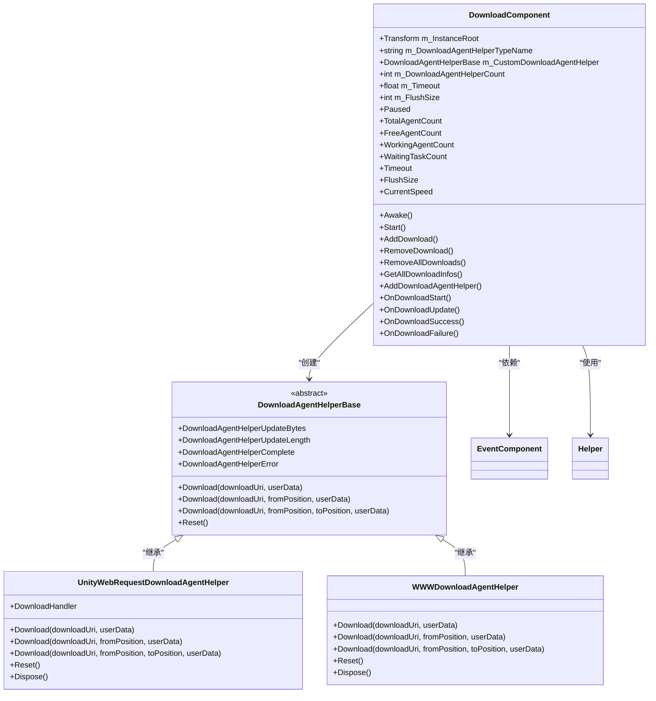
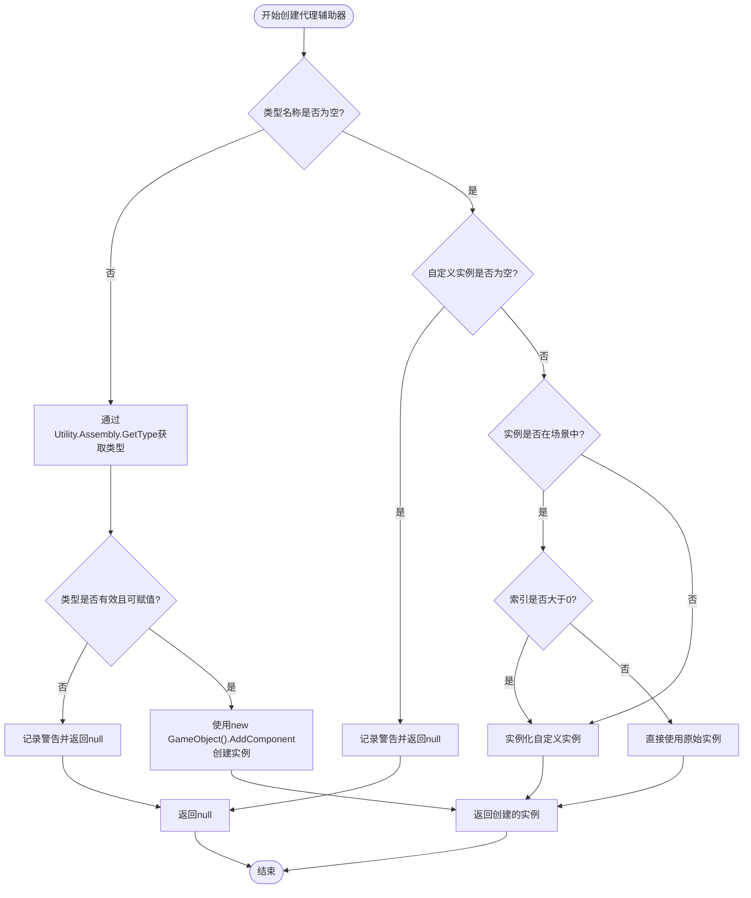
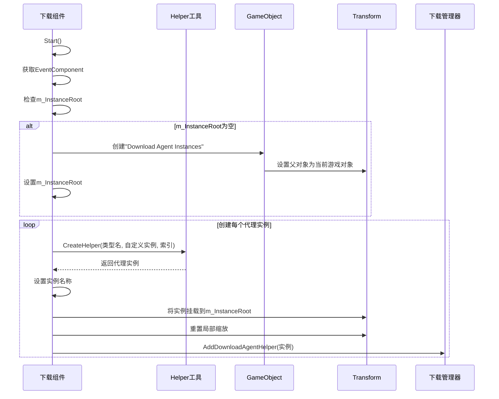
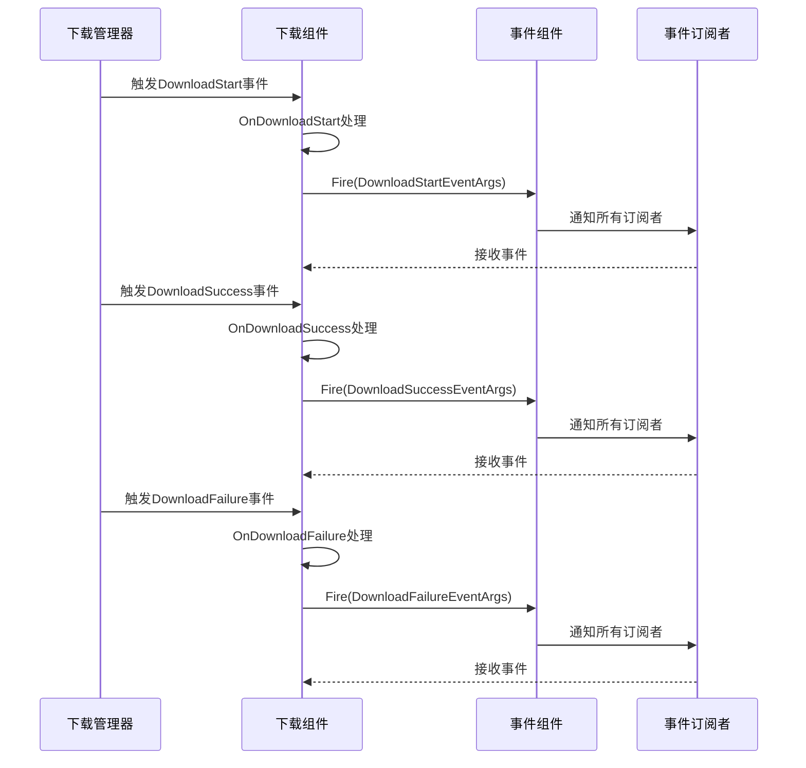
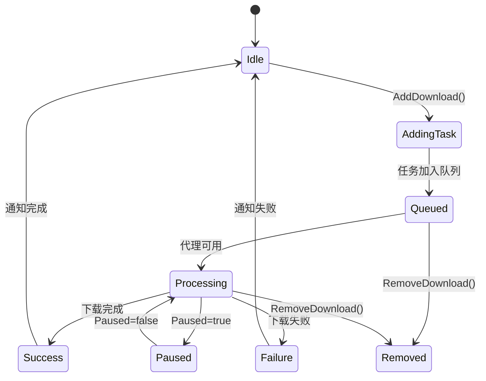

<cite>
**本文档中引用的文件**  
- [DownloadComponent.cs](file://Scripts/Runtime/Download/DownloadComponent.cs)
- [DownloadAgentHelperBase.cs](file://Scripts/Runtime/Download/DownloadAgentHelperBase.cs)
- [UnityWebRequestDownloadAgentHelper.cs](file://Scripts/Runtime/Download/UnityWebRequestDownloadAgentHelper.cs)
- [WWWDownloadAgentHelper.cs](file://Scripts/Runtime/Download/WWWDownloadAgentHelper.cs)
- [Helper.cs](file://Scripts/Runtime/Utility/Helper.cs)
- [EventComponent.cs](file://Scripts/Runtime/Event/EventComponent.cs)
- [DownloadStartEventArgs.cs](file://Scripts/Runtime/Download/DownloadStartEventArgs.cs)
- [DownloadSuccessEventArgs.cs](file://Scripts/Runtime/Download/DownloadSuccessEventArgs.cs)
- [DownloadFailureEventArgs.cs](file://Scripts/Runtime/Download/DownloadFailureEventArgs.cs)
</cite>

# 下载组件集成与管理

## 目录
1. [引言](#引言)
2. [核心组件分析](#核心组件分析)
3. [代理辅助器创建机制](#代理辅助器创建机制)
4. [下载代理管理与实例化](#下载代理管理与实例化)
5. [事件广播与冒泡机制](#事件广播与冒泡机制)
6. [下载任务调度流程](#下载任务调度流程)
7. [配置最佳实践](#配置最佳实践)
8. [总结](#总结)

## 引言

Unity游戏框架中的下载组件（DownloadComponent）提供了一套完整的异步下载解决方案，支持多代理并发下载、断点续传、事件驱动等高级特性。该组件通过灵活的代理辅助器机制，允许开发者自定义下载实现，并通过事件系统实现全局状态通知。本文档深入解析其核心机制，包括代理创建、实例管理、事件广播和任务调度等关键环节。

## 核心组件分析

### 下载组件结构

**Diagram sources**
- [DownloadComponent.cs](file://Scripts/Runtime/Download/DownloadComponent.cs#L16-L303)
- [DownloadAgentHelperBase.cs](file://Scripts/Runtime/Download/DownloadAgentHelperBase.cs#L16-L71)
- [UnityWebRequestDownloadAgentHelper.cs](file://Scripts/Runtime/Download/UnityWebRequestDownloadAgentHelper.cs#L16-L246)
- [WWWDownloadAgentHelper.cs](file://Scripts/Runtime/Download/WWWDownloadAgentHelper.cs#L16-L246)

**Section sources**
- [DownloadComponent.cs](file://Scripts/Runtime/Download/DownloadComponent.cs#L16-L303)
- [DownloadAgentHelperBase.cs](file://Scripts/Runtime/Download/DownloadAgentHelperBase.cs#L16-L71)

## 代理辅助器创建机制

### 反射与自定义实例创建

下载组件通过 `Helper.CreateHelper` 方法实现灵活的代理辅助器创建机制，支持两种创建方式：

1. **反射创建**：通过 `m_DownloadAgentHelperTypeName` 字段指定的类型名称，使用反射动态创建实例
2. **自定义实例注入**：通过 `m_CustomDownloadAgentHelper` 字段注入开发者预定义的实例

**Diagram sources**
- [Helper.cs](file://Scripts/Runtime/Utility/Helper.cs#L15-L75)

**Section sources**
- [Helper.cs](file://Scripts/Runtime/Utility/Helper.cs#L15-L75)
- [DownloadComponent.cs](file://Scripts/Runtime/Download/DownloadComponent.cs#L266-L281)

### 类型安全检查

创建过程中执行严格的类型安全检查：
- 验证指定类型是否存在
- 确保类型可赋值给 `DownloadAgentHelperBase`
- 处理各种异常情况并提供清晰的错误日志

这种双重创建机制既保证了灵活性，又确保了类型安全，使开发者既能使用框架提供的默认实现，又能轻松集成自定义下载逻辑。

## 下载代理管理与实例化

### 代理实例批量创建

`Start` 方法在组件初始化时负责创建和管理下载代理实例：

**Diagram sources**
- [DownloadComponent.cs](file://Scripts/Runtime/Download/DownloadComponent.cs#L166-L186)
- [DownloadComponent.cs](file://Scripts/Runtime/Download/DownloadComponent.cs#L266-L281)

**Section sources**
- [DownloadComponent.cs](file://Scripts/Runtime/Download/DownloadComponent.cs#L166-L186)

### 实例管理策略

- **层级管理**：所有代理实例统一挂载到 `m_InstanceRoot` 下，便于组织和管理
- **命名规范**：实例名称格式化为 "Download Agent Helper - {索引}"，便于调试
- **批量配置**：通过 `m_DownloadAgentHelperCount` 统一配置代理数量
- **生命周期**：代理实例的生命周期由下载管理器统一管理

这种集中式管理策略确保了代理实例的有序创建和高效管理，同时为开发者提供了清晰的调试视图。

## 事件广播与冒泡机制

### 事件冒泡流程

下载组件通过事件系统实现状态变更的全局通知，采用事件冒泡模式：

**Diagram sources**
- [DownloadComponent.cs](file://Scripts/Runtime/Download/DownloadComponent.cs#L283-L296)
- [EventComponent.cs](file://Scripts/Runtime/Event/EventComponent.cs#L119-L122)

**Section sources**
- [DownloadComponent.cs](file://Scripts/Runtime/Download/DownloadComponent.cs#L283-L296)

### 事件转换与封装

下载组件在转发事件时执行以下操作：
- **事件转换**：将内部事件转换为框架事件
- **资源池管理**：使用 `ReferencePool` 管理事件对象的生命周期
- **线程安全**：通过 `EventComponent.Fire` 确保事件分发的线程安全性

这种设计模式实现了组件间的松耦合，使任何系统都可以订阅下载状态变化，而无需直接依赖下载组件。

## 下载任务调度流程

### 任务生命周期

**Diagram sources**
- [DownloadComponent.cs](file://Scripts/Runtime/Download/DownloadComponent.cs#L194-L234)

### 任务调度机制

下载管理器负责任务的调度和分配：
- **优先级队列**：根据任务优先级进行调度
- **代理分配**：将任务分配给空闲的下载代理
- **并发控制**：通过代理数量限制并发下载数
- **错误处理**：自动重试或通知失败

这种分层架构将任务管理与执行分离，提高了系统的可维护性和扩展性。

## 配置最佳实践

### 核心配置参数

| 配置项 | 推荐值 | 说明 |
|--------|--------|------|
| m_DownloadAgentHelperCount | 3-5 | 代理数量，平衡并发性能与资源消耗 |
| m_Timeout | 30秒 | 下载超时时间，避免长时间等待 |
| m_FlushSize | 1MB | 缓冲区写入磁盘临界值，影响断点续传效率 |
| m_DownloadAgentHelperTypeName | UnityWebRequest实现 | 推荐使用现代UnityWebRequest |

### 配置建议

1. **代理数量**：根据目标平台性能调整，移动设备建议3-5个，PC端可适当增加
2. **超时设置**：网络环境较差时可适当延长，但不宜超过60秒
3. **刷新临界值**：大文件下载建议设置为1-5MB，小文件可降低至512KB
4. **自定义实现**：如需特殊下载逻辑，继承 `DownloadAgentHelperBase` 并注入 `m_CustomDownloadAgentHelper`

合理配置这些参数可以显著提升下载性能和用户体验。

## 总结

下载组件通过灵活的代理辅助器机制、高效的事件广播系统和智能的任务调度策略，为Unity项目提供了强大而稳定的下载功能。其核心优势在于：
- **灵活性**：支持反射创建和自定义实例注入
- **可扩展性**：易于集成新的下载实现
- **可靠性**：完善的错误处理和事件通知机制
- **易用性**：直观的配置选项和清晰的API设计

开发者应根据具体需求合理配置代理数量、超时时间和刷新临界值，以达到最佳的下载性能和用户体验。