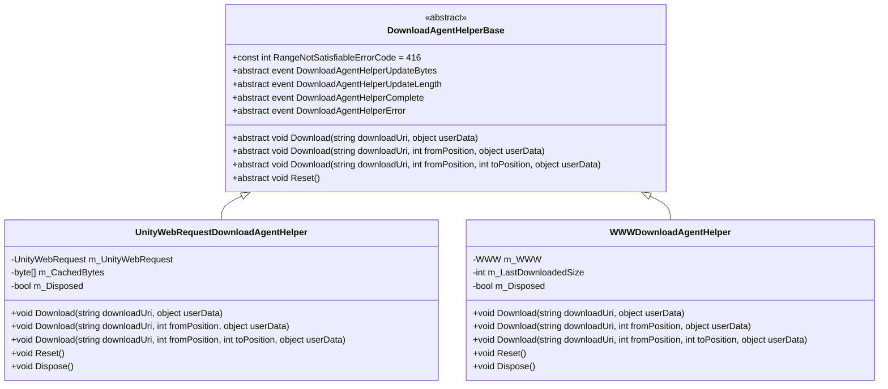
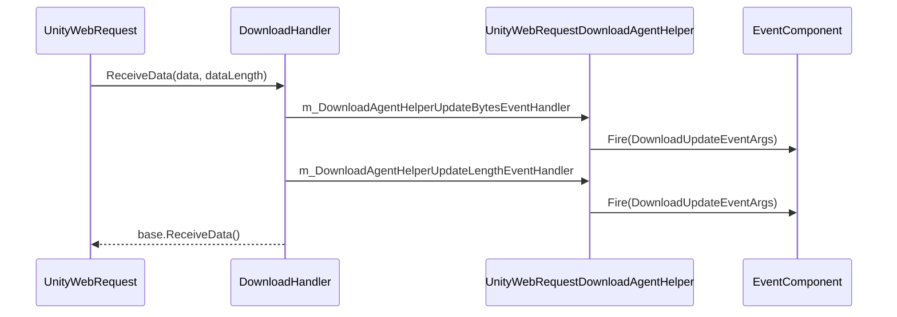
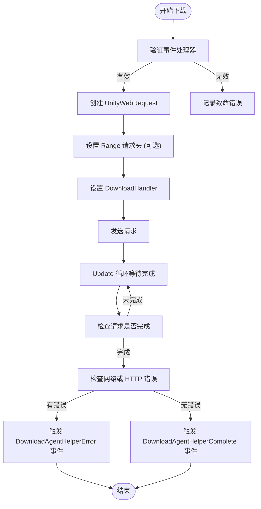
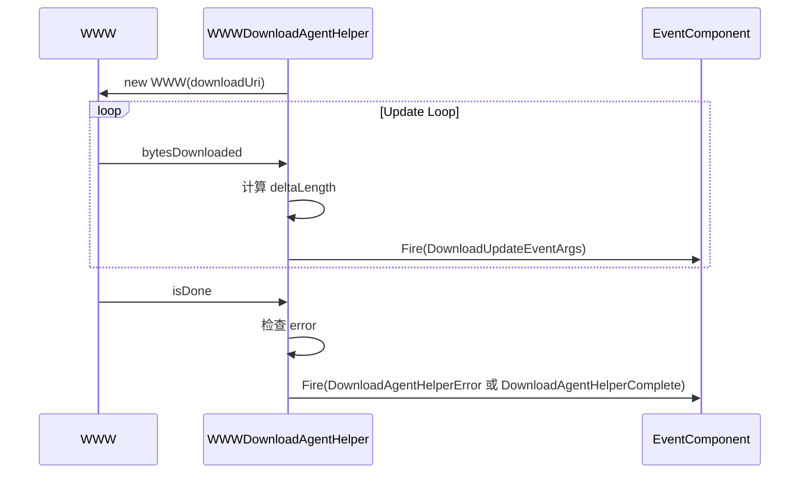
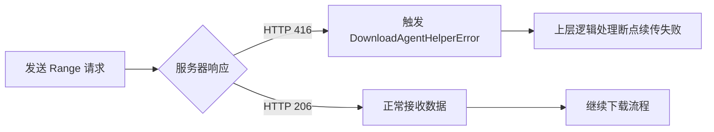
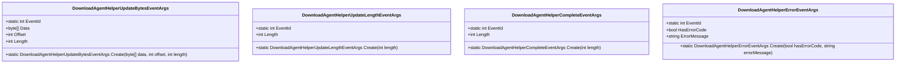
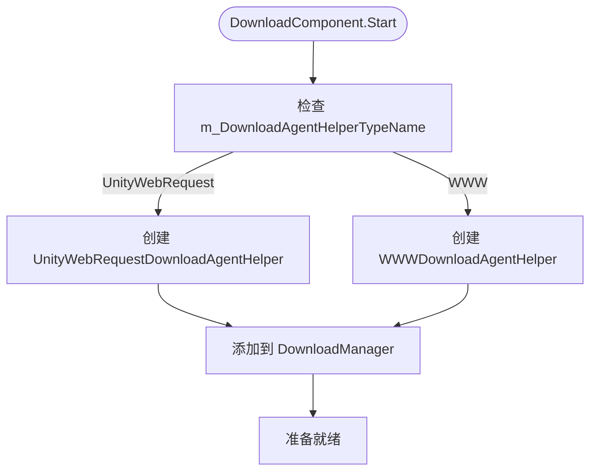

# 内置下载代理实现

<cite>
**Referenced Files in This Document**   
- [UnityWebRequestDownloadAgentHelper.cs](file://Scripts/Runtime/Download/UnityWebRequestDownloadAgentHelper.cs)
- [WWWDownloadAgentHelper.cs](file://Scripts/Runtime/Download/WWWDownloadAgentHelper.cs)
- [DownloadAgentHelperBase.cs](file://Scripts/Runtime/Download/DownloadAgentHelperBase.cs)
- [DownloadStartEventArgs.cs](file://Scripts/Runtime/Download/DownloadStartEventArgs.cs)
- [DownloadUpdateEventArgs.cs](file://Scripts/Runtime/Download/DownloadUpdateEventArgs.cs)
- [DownloadSuccessEventArgs.cs](file://Scripts/Runtime/Download/DownloadSuccessEventArgs.cs)
- [DownloadFailureEventArgs.cs](file://Scripts/Runtime/Download/DownloadFailureEventArgs.cs)
- [DownloadComponent.cs](file://Scripts/Runtime/Download/DownloadComponent.cs)
</cite>

## Table of Contents
1. [引言](#引言)
2. [核心机制分析](#核心机制分析)
3. [UnityWebRequestDownloadAgentHelper 实现](#unitywebrequestdownloadagenthelper-实现)
4. [WWWDownloadAgentHelper 实现](#wwwdownloadagenthelper-实现)
5. [HTTP 响应与错误处理](#http-响应与错误处理)
6. [下载进度更新机制](#下载进度更新机制)
7. [运行时环境自动选择](#运行时环境自动选择)
8. [结论](#结论)

## 引言

UnityGameFramework 提供了两种下载代理辅助器实现：`UnityWebRequestDownloadAgentHelper` 和 `WWWDownloadAgentHelper`，用于处理网络资源下载任务。这两种实现分别基于 Unity 的现代 `UnityWebRequest` 系统和已弃用的 `WWW` 系统。本文档将深入分析这两种实现的工作机制，重点解析 `UnityWebRequestDownloadAgentHelper` 如何利用 `DownloadHandlerScript` 实现流式数据接收，对比两种实现的差异，并说明框架如何根据运行时环境自动选择最优代理。

**Section sources**
- [UnityWebRequestDownloadAgentHelper.cs](file://Scripts/Runtime/Download/UnityWebRequestDownloadAgentHelper.cs)
- [WWWDownloadAgentHelper.cs](file://Scripts/Runtime/Download/WWWDownloadAgentHelper.cs)

## 核心机制分析

### 基类设计

两种下载代理辅助器均继承自 `DownloadAgentHelperBase` 抽象基类，该基类定义了统一的接口和事件契约：

**Diagram sources**
- [DownloadAgentHelperBase.cs](file://Scripts/Runtime/Download/DownloadAgentHelperBase.cs#L16-L71)
- [UnityWebRequestDownloadAgentHelper.cs](file://Scripts/Runtime/Download/UnityWebRequestDownloadAgentHelper.cs#L18-L246)
- [WWWDownloadAgentHelper.cs](file://Scripts/Runtime/Download/WWWDownloadAgentHelper.cs#L18-L246)

**Section sources**
- [DownloadAgentHelperBase.cs](file://Scripts/Runtime/Download/DownloadAgentHelperBase.cs#L16-L71)

## UnityWebRequestDownloadAgentHelper 实现

### 流式数据接收机制

`UnityWebRequestDownloadAgentHelper` 的核心优势在于其流式数据接收能力，这通过自定义的 `DownloadHandler` 类实现。该类继承自 `DownloadHandlerScript`，并重写了 `ReceiveData` 方法，实现了数据的实时分发。

**Diagram sources**
- [UnityWebRequestDownloadAgentHelper.DownloadHandler.cs](file://Scripts/Runtime/Download/UnityWebRequestDownloadAgentHelper.DownloadHandler.cs#L18-L46)
- [UnityWebRequestDownloadAgentHelper.cs](file://Scripts/Runtime/Download/UnityWebRequestDownloadAgentHelper.cs#L18-L246)

#### ReceiveData 方法解析

`ReceiveData` 方法是流式处理的核心，其工作机制如下：

1. **数据接收**：当 `UnityWebRequest` 接收到新的数据块时，会调用 `DownloadHandler` 的 `ReceiveData` 方法。
2. **事件分发**：方法首先创建 `DownloadAgentHelperUpdateBytesEventArgs` 事件对象，通过 `m_DownloadAgentHelperUpdateBytesEventHandler` 事件分发器将接收到的字节流传递给上层组件。
3. **长度更新**：同时创建 `DownloadAgentHelperUpdateLengthEventArgs` 事件对象，通知上层组件本次接收到的数据长度。
4. **资源管理**：使用 `ReferencePool.Release` 释放事件对象，避免内存泄漏。
5. **基类调用**：最后调用基类的 `ReceiveData` 方法，确保数据被正确处理。

**Section sources**
- [UnityWebRequestDownloadAgentHelper.DownloadHandler.cs](file://Scripts/Runtime/Download/UnityWebRequestDownloadAgentHelper.DownloadHandler.cs#L18-L46)

### 下载流程

`UnityWebRequestDownloadAgentHelper` 的下载流程通过 `Download` 方法启动，支持三种重载形式：全量下载、从指定位置开始下载、以及下载指定范围的数据。

**Diagram sources**
- [UnityWebRequestDownloadAgentHelper.cs](file://Scripts/Runtime/Download/UnityWebRequestDownloadAgentHelper.cs#L100-L164)
- [UnityWebRequestDownloadAgentHelper.cs](file://Scripts/Runtime/Download/UnityWebRequestDownloadAgentHelper.cs#L200-L246)

**Section sources**
- [UnityWebRequestDownloadAgentHelper.cs](file://Scripts/Runtime/Download/UnityWebRequestDownloadAgentHelper.cs#L100-L164)

## WWWDownloadAgentHelper 实现

### 实现差异与局限

`WWWDownloadAgentHelper` 基于已弃用的 `WWW` 系统，其实现机制与 `UnityWebRequestDownloadAgentHelper` 有显著差异，主要体现在数据接收方式和性能上。

**Diagram sources**
- [WWWDownloadAgentHelper.cs](file://Scripts/Runtime/Download/WWWDownloadAgentHelper.cs#L18-L246)

#### 适用场景与性能局限

- **适用场景**：主要用于兼容旧版 Unity 项目或特定平台（如 WebGL）的遗留代码。
- **性能局限**：
  1. **非流式处理**：`WWW` 系统在下载完成前会将所有数据缓存在内存中，对于大文件下载可能导致内存峰值过高。
  2. **阻塞式更新**：进度更新依赖于 `Update` 循环轮询 `bytesDownloaded`，无法实现真正的流式处理。
  3. **已弃用**：`WWW` 类已被 Unity 标记为弃用，未来版本可能移除。

**Section sources**
- [WWWDownloadAgentHelper.cs](file://Scripts/Runtime/Download/WWWDownloadAgentHelper.cs#L18-L246)

## HTTP 响应与错误处理

### 范围请求错误处理

两种实现都定义了 `RangeNotSatisfiableErrorCode` 常量（值为 416），用于处理范围请求不满足的情况。

**Diagram sources**
- [DownloadAgentHelperBase.cs](file://Scripts/Runtime/Download/DownloadAgentHelperBase.cs#L18)
- [UnityWebRequestDownloadAgentHelper.cs](file://Scripts/Runtime/Download/UnityWebRequestDownloadAgentHelper.cs#L220-L246)
- [WWWDownloadAgentHelper.cs](file://Scripts/Runtime/Download/WWWDownloadAgentHelper.cs#L220-L246)

#### 具体实现

- **UnityWebRequestDownloadAgentHelper**：在 `Update` 方法中，通过检查 `m_UnityWebRequest.responseCode` 是否等于 `RangeNotSatisfiableErrorCode` 来判断。
- **WWWDownloadAgentHelper**：在 `Update` 方法中，通过检查 `m_WWW.error` 是否以 "416" 开头来判断。

**Section sources**
- [DownloadAgentHelperBase.cs](file://Scripts/Runtime/Download/DownloadAgentHelperBase.cs#L18)
- [UnityWebRequestDownloadAgentHelper.cs](file://Scripts/Runtime/Download/UnityWebRequestDownloadAgentHelper.cs#L220-L246)
- [WWWDownloadAgentHelper.cs](file://Scripts/Runtime/Download/WWWDownloadAgentHelper.cs#L220-L246)

## 下载进度更新机制

### 事件驱动模型

两种实现均采用事件驱动模型来通知下载进度，但触发时机和粒度不同。

**Diagram sources**
- [DownloadAgentHelperUpdateBytesEventArgs](file://Scripts/Runtime/Download/DownloadAgentHelperUpdateBytesEventArgs.cs)
- [DownloadAgentHelperUpdateLengthEventArgs](file://Scripts/Runtime/Download/DownloadAgentHelperUpdateLengthEventArgs.cs)
- [DownloadAgentHelperCompleteEventArgs](file://Scripts/Runtime/Download/DownloadAgentHelperCompleteEventArgs.cs)
- [DownloadAgentHelperErrorEventArgs](file://Scripts/Runtime/Download/DownloadAgentHelperErrorEventArgs.cs)

#### 实现对比

| 特性 | UnityWebRequestDownloadAgentHelper | WWWDownloadAgentHelper |
| :--- | :--- | :--- |
| **触发时机** | 每次接收到数据块时 | `Update` 循环中轮询 `bytesDownloaded` |
| **数据粒度** | 实时流式数据块 | 累计下载字节数增量 |
| **内存效率** | 高，数据可即时处理 | 低，大文件需全部加载到内存 |

**Section sources**
- [UnityWebRequestDownloadAgentHelper.DownloadHandler.cs](file://Scripts/Runtime/Download/UnityWebRequestDownloadAgentHelper.DownloadHandler.cs#L18-L46)
- [WWWDownloadAgentHelper.cs](file://Scripts/Runtime/Download/WWWDownloadAgentHelper.cs#L200-L246)

## 运行时环境自动选择

### 自动选择机制

框架通过 `DownloadComponent` 实现运行时环境的自动选择。`DownloadComponent` 在 `Start` 方法中根据配置创建指定类型的下载代理辅助器。

**Diagram sources**
- [DownloadComponent.cs](file://Scripts/Runtime/Download/DownloadComponent.cs#L16-L303)

#### 配置与决策

- **默认配置**：`m_DownloadAgentHelperTypeName` 默认值为 `"UnityGameFramework.Runtime.UnityWebRequestDownloadAgentHelper"`，优先使用现代系统。
- **条件编译**：`WWWDownloadAgentHelper` 类被 `#if !UNITY_2018_3_OR_NEWER` 条件编译指令包裹，确保在 Unity 2018.3 及以上版本中不被编译，强制使用 `UnityWebRequest`。
- **动态创建**：通过 `Helper.CreateHelper` 方法根据类型名称动态创建实例，支持运行时配置切换。

**Section sources**
- [DownloadComponent.cs](file://Scripts/Runtime/Download/DownloadComponent.cs#L16-L303)

## 结论

`UnityWebRequestDownloadAgentHelper` 和 `WWWDownloadAgentHelper` 代表了 Unity 网络下载功能的演进。前者利用 `DownloadHandlerScript` 实现了高效的流式数据接收，通过 `ReceiveData` 方法将数据实时分发给上层组件，具有内存效率高、响应及时的优点。后者基于已弃用的 `WWW` 系统，采用轮询方式更新进度，存在内存占用高和性能局限的问题。框架通过 `DownloadComponent` 的配置机制和条件编译，实现了运行时环境的自动选择，确保在现代 Unity 项目中优先使用更优的 `UnityWebRequest` 实现，同时保持对旧版本的兼容性。