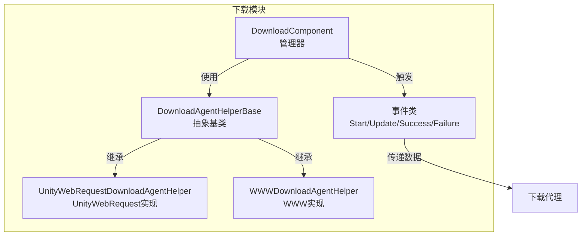
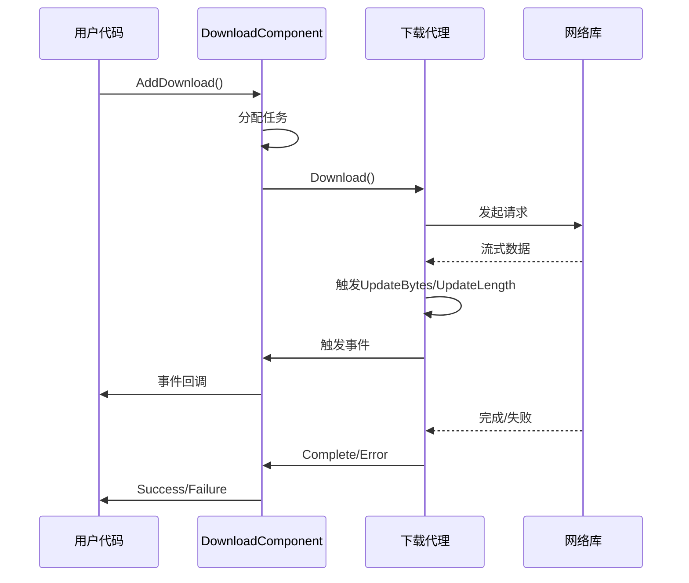
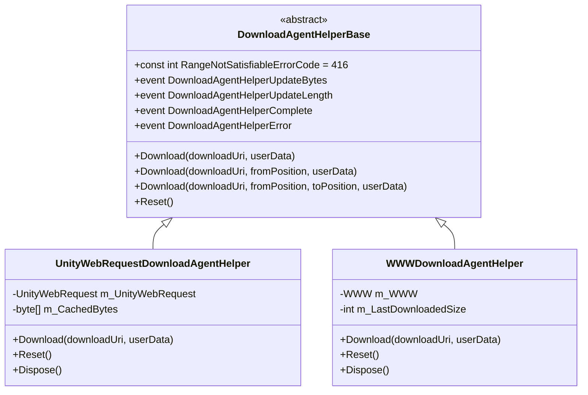
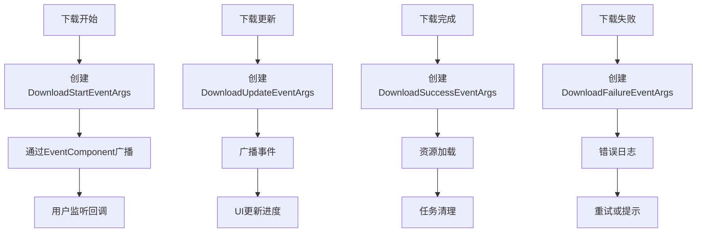
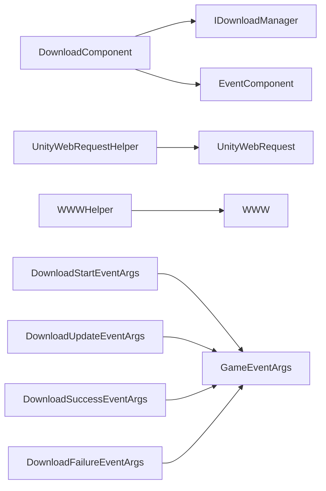

# 自定义下载代理开发指南

<cite>
**本文档中引用的文件**  
- [DownloadAgentHelperBase.cs](file://Scripts/Runtime/Download/DownloadAgentHelperBase.cs)
- [DownloadComponent.cs](file://Scripts/Runtime/Download/DownloadComponent.cs)
- [UnityWebRequestDownloadAgentHelper.cs](file://Scripts/Runtime/Download/UnityWebRequestDownloadAgentHelper.cs)
- [WWWDownloadAgentHelper.cs](file://Scripts/Runtime/Download/WWWDownloadAgentHelper.cs)
- [DownloadStartEventArgs.cs](file://Scripts/Runtime/Download/DownloadStartEventArgs.cs)
- [DownloadUpdateEventArgs.cs](file://Scripts/Runtime/Download/DownloadUpdateEventArgs.cs)
- [DownloadSuccessEventArgs.cs](file://Scripts/Runtime/Download/DownloadSuccessEventArgs.cs)
- [DownloadFailureEventArgs.cs](file://Scripts/Runtime/Download/DownloadFailureEventArgs.cs)
</cite>

## 目录
1. [简介](#简介)
2. [项目结构](#项目结构)
3. [核心组件](#核心组件)
4. [架构概述](#架构概述)
5. [详细组件分析](#详细组件分析)
6. [依赖分析](#依赖分析)
7. [性能考虑](#性能考虑)
8. [故障排除指南](#故障排除指南)
9. [结论](#结论)

## 简介
本文档旨在指导开发者如何创建自定义下载代理，以适配第三方网络库（如HttpClient、CurlSharp）或实现特殊功能（如加密传输、代理服务器支持）。文档将详细介绍从`DownloadAgentHelperBase`派生新类的完整步骤，涵盖事件触发、状态管理、异常处理等关键环节。同时，说明如何通过Inspector字段注入自定义代理实例，或修改`m_DownloadAgentHelperTypeName`指向新实现，并列举常见陷阱与性能优化建议。

## 项目结构
下载功能模块位于`Scripts/Runtime/Download/`目录下，包含核心基类、具体实现、事件参数类及组件管理器。该模块采用事件驱动架构，通过`DownloadComponent`统一管理多个下载代理实例，支持断点续传、优先级调度和异步回调。

**Diagram sources**
- [DownloadAgentHelperBase.cs](file://Scripts/Runtime/Download/DownloadAgentHelperBase.cs#L16-L71)
- [DownloadComponent.cs](file://Scripts/Runtime/Download/DownloadComponent.cs#L16-L303)
- [UnityWebRequestDownloadAgentHelper.cs](file://Scripts/Runtime/Download/UnityWebRequestDownloadAgentHelper.cs#L18-L46)
- [WWWDownloadAgentHelper.cs](file://Scripts/Runtime/Download/WWWDownloadAgentHelper.cs#L1-L246)

**Section sources**
- [DownloadAgentHelperBase.cs](file://Scripts/Runtime/Download/DownloadAgentHelperBase.cs#L1-L73)
- [DownloadComponent.cs](file://Scripts/Runtime/Download/DownloadComponent.cs#L1-L305)

## 核心组件
`DownloadAgentHelperBase`是所有下载代理的抽象基类，定义了事件契约和核心方法。`DownloadComponent`负责协调多个代理实例，管理任务队列和生命周期。`UnityWebRequestDownloadAgentHelper`和`WWWDownloadAgentHelper`为内置实现，分别基于UnityWebRequest和WWW。

**Section sources**
- [DownloadAgentHelperBase.cs](file://Scripts/Runtime/Download/DownloadAgentHelperBase.cs#L16-L71)
- [DownloadComponent.cs](file://Scripts/Runtime/Download/DownloadComponent.cs#L16-L303)

## 架构概述
系统采用组件化设计，`DownloadComponent`作为入口点，通过反射或引用创建`DownloadAgentHelperBase`的子类实例。每个代理负责一个下载任务，通过事件与框架通信。事件流包括开始、更新、成功、失败，确保状态同步。

**Diagram sources**
- [DownloadComponent.cs](file://Scripts/Runtime/Download/DownloadComponent.cs#L16-L303)
- [UnityWebRequestDownloadAgentHelper.cs](file://Scripts/Runtime/Download/UnityWebRequestDownloadAgentHelper.cs#L18-L46)

## 详细组件分析

### 下载代理基类分析
`DownloadAgentHelperBase`定义了四个核心事件：`DownloadAgentHelperUpdateBytes`、`DownloadAgentHelperUpdateLength`、`DownloadAgentHelperComplete`、`DownloadAgentHelperError`。开发者必须在子类中正确触发这些事件以维持框架契约。

**Diagram sources**
- [DownloadAgentHelperBase.cs](file://Scripts/Runtime/Download/DownloadAgentHelperBase.cs#L16-L71)
- [UnityWebRequestDownloadAgentHelper.cs](file://Scripts/Runtime/Download/UnityWebRequestDownloadAgentHelper.cs#L1-L246)
- [WWWDownloadAgentHelper.cs](file://Scripts/Runtime/Download/WWWDownloadAgentHelper.cs#L1-L246)

**Section sources**
- [DownloadAgentHelperBase.cs](file://Scripts/Runtime/Download/DownloadAgentHelperBase.cs#L1-L73)

### 事件系统分析
框架通过事件传递下载状态。`DownloadStartEventArgs`、`DownloadUpdateEventArgs`、`DownloadSuccessEventArgs`、`DownloadFailureEventArgs`封装了任务信息，由`DownloadComponent`转发至事件系统。

**Diagram sources**
- [DownloadStartEventArgs.cs](file://Scripts/Runtime/Download/DownloadStartEventArgs.cs#L1-L119)
- [DownloadUpdateEventArgs.cs](file://Scripts/Runtime/Download/DownloadUpdateEventArgs.cs#L1-L119)
- [DownloadSuccessEventArgs.cs](file://Scripts/Runtime/Download/DownloadSuccessEventArgs.cs#L1-L119)
- [DownloadFailureEventArgs.cs](file://Scripts/Runtime/Download/DownloadFailureEventArgs.cs#L1-L119)

**Section sources**
- [DownloadStartEventArgs.cs](file://Scripts/Runtime/Download/DownloadStartEventArgs.cs#L1-L119)
- [DownloadUpdateEventArgs.cs](file://Scripts/Runtime/Download/DownloadUpdateEventArgs.cs#L1-L119)

## 依赖分析
`DownloadComponent`依赖`IDownloadManager`模块和`EventComponent`进行事件分发。`DownloadAgentHelperBase`依赖Unity的网络API（UnityWebRequest或WWW）。事件类依赖`GameFramework.Event`系统。

**Diagram sources**
- [DownloadComponent.cs](file://Scripts/Runtime/Download/DownloadComponent.cs#L16-L303)
- [UnityWebRequestDownloadAgentHelper.cs](file://Scripts/Runtime/Download/UnityWebRequestDownloadAgentHelper.cs#L1-L246)
- [WWWDownloadAgentHelper.cs](file://Scripts/Runtime/Download/WWWDownloadAgentHelper.cs#L1-L246)

**Section sources**
- [DownloadComponent.cs](file://Scripts/Runtime/Download/DownloadComponent.cs#L1-L305)

## 性能考虑
- 使用`UnityWebRequest`替代`WWW`以获得更好的性能和控制力。
- 合理设置`FlushSize`避免频繁磁盘I/O。
- 复用`DownloadAgentHelper`实例减少GC压力。
- 异步处理避免阻塞主线程。
- 使用`ReferencePool`管理事件对象，减少内存分配。

## 故障排除指南
- **事件未触发**：确保在子类中正确注册事件处理器。
- **内存泄漏**：实现`IDisposable`并在`Reset()`中清理资源。
- **线程安全**：网络回调在主线程执行，无需额外同步。
- **断点续传失败**：检查服务器是否支持Range请求。
- **代理未创建**：确认`m_DownloadAgentHelperTypeName`拼写正确或`m_CustomDownloadAgentHelper`引用有效。

**Section sources**
- [DownloadAgentHelperBase.cs](file://Scripts/Runtime/Download/DownloadAgentHelperBase.cs#L16-L71)
- [DownloadComponent.cs](file://Scripts/Runtime/Download/DownloadComponent.cs#L16-L303)

## 结论
通过继承`DownloadAgentHelperBase`并实现其抽象方法与事件，开发者可轻松集成第三方网络库或添加高级功能。结合Inspector注入或类型名配置，系统具备高度可扩展性。遵循事件契约、妥善管理资源，即可构建稳定高效的自定义下载代理。