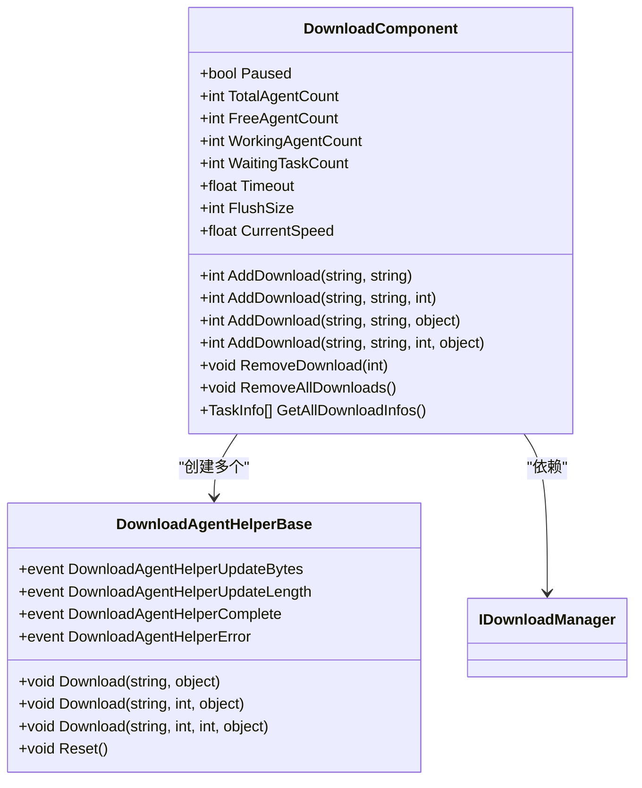
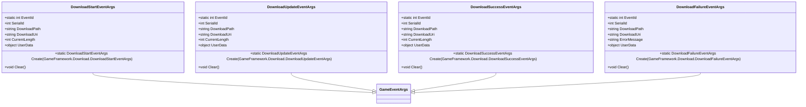
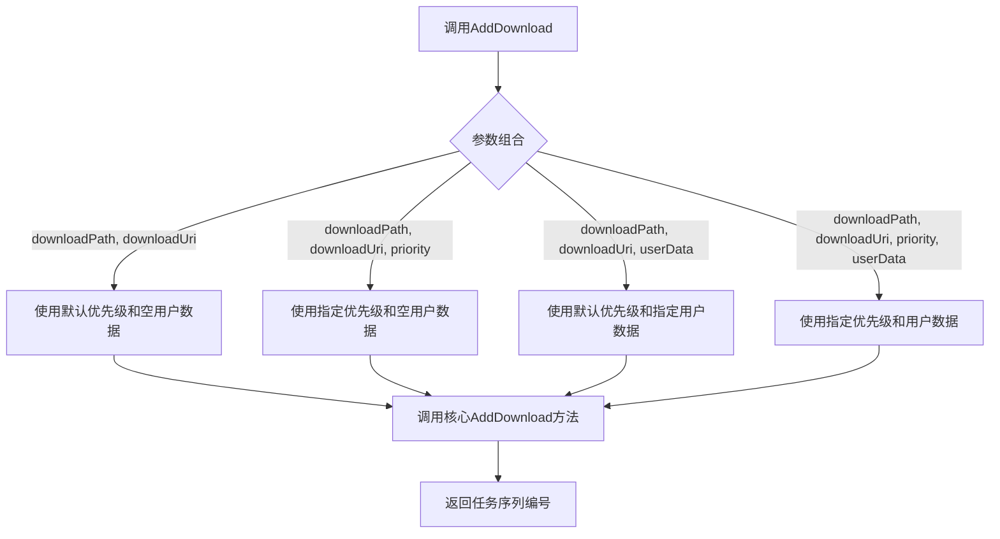
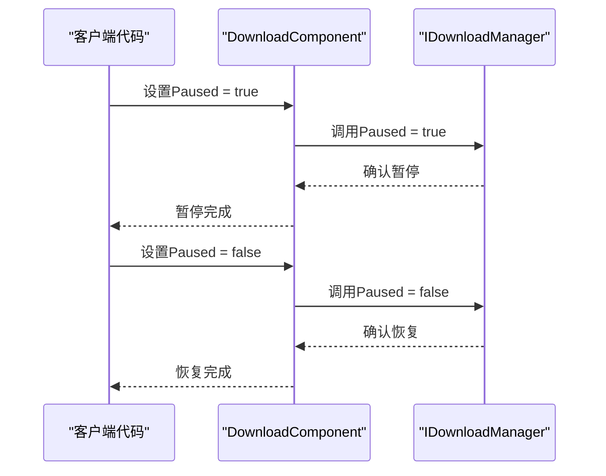
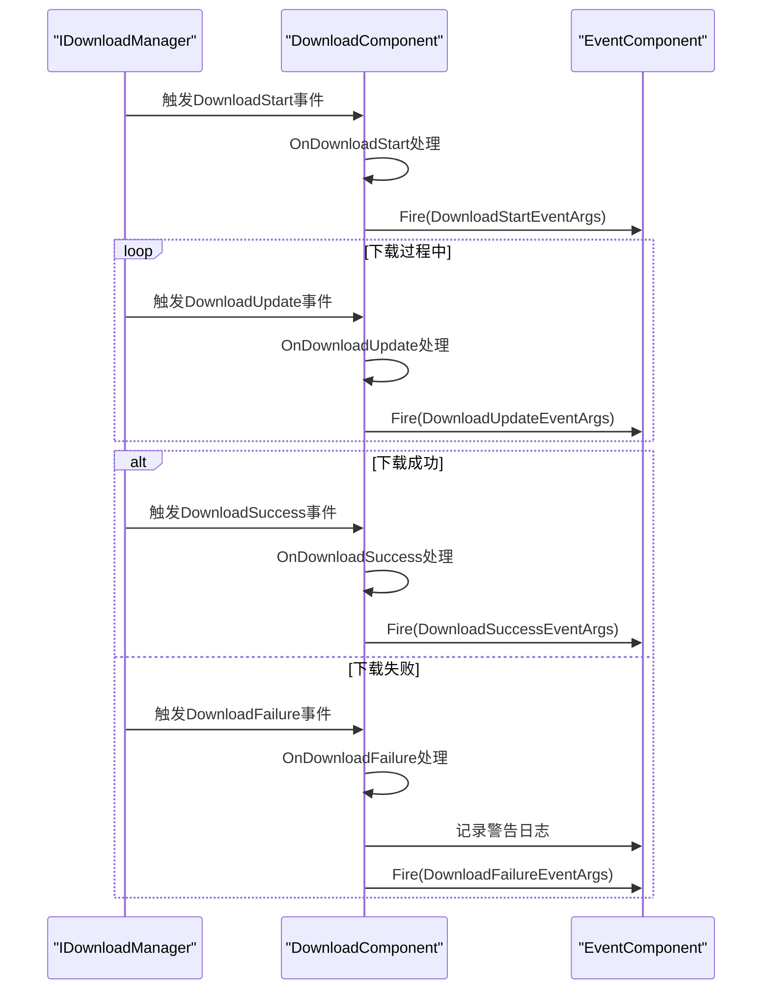
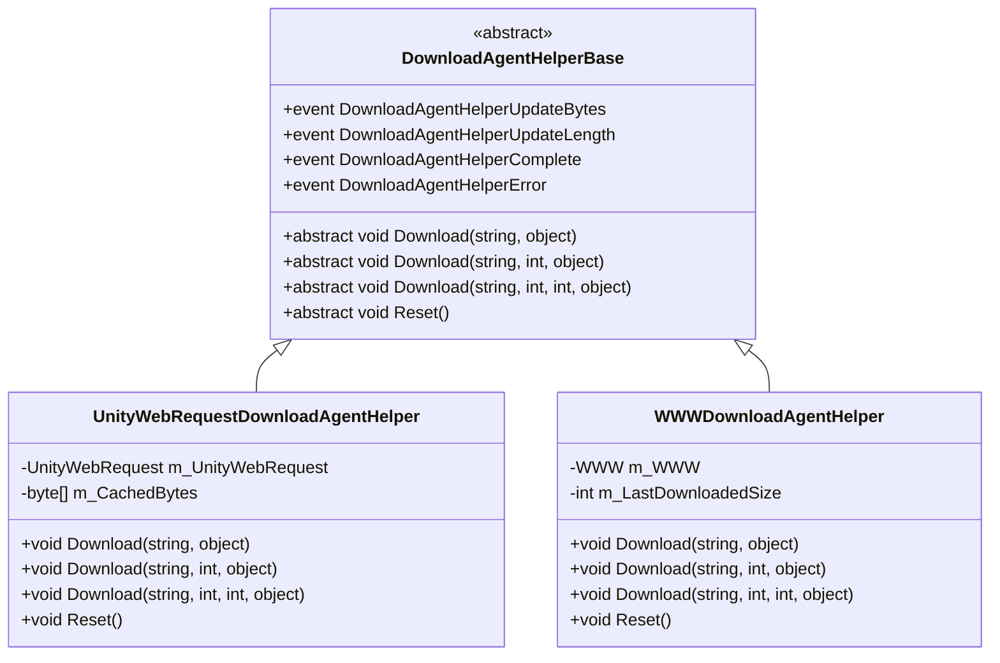

# 下载系统API

<cite>
**本文档中引用的文件**  
- [DownloadComponent.cs](file://Scripts/Runtime/Download/DownloadComponent.cs)
- [DownloadAgentHelperBase.cs](file://Scripts/Runtime/Download/DownloadAgentHelperBase.cs)
- [DownloadStartEventArgs.cs](file://Scripts/Runtime/Download/DownloadStartEventArgs.cs)
- [DownloadUpdateEventArgs.cs](file://Scripts/Runtime/Download/DownloadUpdateEventArgs.cs)
- [DownloadSuccessEventArgs.cs](file://Scripts/Runtime/Download/DownloadSuccessEventArgs.cs)
- [DownloadFailureEventArgs.cs](file://Scripts/Runtime/Download/DownloadFailureEventArgs.cs)
- [UnityWebRequestDownloadAgentHelper.cs](file://Scripts/Runtime/Download/UnityWebRequestDownloadAgentHelper.cs)
- [WWWDownloadAgentHelper.cs](file://Scripts/Runtime/Download/WWWDownloadAgentHelper.cs)
</cite>

## 目录
1. [简介](#简介)
2. [核心组件](#核心组件)
3. [下载任务管理](#下载任务管理)
4. [事件流与回调](#事件流与回调)
5. [下载代理扩展](#下载代理扩展)
6. [代码示例](#代码示例)
7. [高级功能](#高级功能)

## 简介

下载系统API提供了一套完整的文件下载解决方案，核心为`DownloadComponent`组件。该系统支持创建、启动、暂停和取消下载任务，并通过事件机制通知下载过程中的各种状态变化。系统设计支持断点续传，并允许开发者通过扩展点适配不同的底层网络库，如UnityWebRequest或WWW。

## 核心组件

下载系统由多个核心组件构成，它们协同工作以实现完整的下载功能。

**Section sources**
- [DownloadComponent.cs](file://Scripts/Runtime/Download/DownloadComponent.cs#L16-L303)
- [DownloadAgentHelperBase.cs](file://Scripts/Runtime/Download/DownloadAgentHelperBase.cs#L16-L71)

### DownloadComponent

`DownloadComponent`是下载系统的主控制器，负责管理所有下载任务和代理。它继承自`GameFrameworkComponent`，作为Unity中的一个组件挂载在游戏对象上。

该组件通过`IDownloadManager`接口与底层下载管理器交互，并在`Awake`方法中注册了四个关键事件：`DownloadStart`、`DownloadUpdate`、`DownloadSuccess`和`DownloadFailure`。在`Start`方法中，它会创建指定数量的下载代理辅助器实例，并将它们添加到下载管理器中。



**Diagram sources**
- [DownloadComponent.cs](file://Scripts/Runtime/Download/DownloadComponent.cs#L16-L303)
- [DownloadAgentHelperBase.cs](file://Scripts/Runtime/Download/DownloadAgentHelperBase.cs#L16-L71)

### 事件参数类

系统定义了四个事件参数类，用于在下载过程中传递相关信息：

- `DownloadStartEventArgs`：下载开始时触发
- `DownloadUpdateEventArgs`：下载进度更新时触发
- `DownloadSuccessEventArgs`：下载成功时触发
- `DownloadFailureEventArgs`：下载失败时触发

这些类都继承自`GameEventArgs`，并实现了对象池模式，通过`Create`和`Clear`方法进行对象的获取和回收，以减少GC压力。



**Diagram sources**
- [DownloadStartEventArgs.cs](file://Scripts/Runtime/Download/DownloadStartEventArgs.cs#L15-L117)
- [DownloadUpdateEventArgs.cs](file://Scripts/Runtime/Download/DownloadUpdateEventArgs.cs#L15-L117)
- [DownloadSuccessEventArgs.cs](file://Scripts/Runtime/Download/DownloadSuccessEventArgs.cs#L15-L117)
- [DownloadFailureEventArgs.cs](file://Scripts/Runtime/Download/DownloadFailureEventArgs.cs#L15-L117)

## 下载任务管理

`DownloadComponent`提供了完整的下载任务管理功能，包括任务的创建、移除和状态查询。

**Section sources**
- [DownloadComponent.cs](file://Scripts/Runtime/Download/DownloadComponent.cs#L194-L234)
- [DownloadComponent.cs](file://Scripts/Runtime/Download/DownloadComponent.cs#L240-L243)

### 创建下载任务

通过`AddDownload`方法可以创建新的下载任务。系统提供了四个重载版本，支持不同的参数组合：



**Diagram sources**
- [DownloadComponent.cs](file://Scripts/Runtime/Download/DownloadComponent.cs#L194-L234)

### 暂停与恢复下载

通过设置`Paused`属性可以全局暂停或恢复所有下载任务：



**Diagram sources**
- [DownloadComponent.cs](file://Scripts/Runtime/Download/DownloadComponent.cs#L47-L57)

### 移除下载任务

通过`RemoveDownload`方法可以移除指定序列编号的下载任务，`RemoveAllDownloads`方法则用于移除所有下载任务。

## 事件流与回调

下载系统通过事件机制通知下载过程中的各种状态变化，形成了清晰的事件流。

**Section sources**
- [DownloadComponent.cs](file://Scripts/Runtime/Download/DownloadComponent.cs#L283-L302)

### 事件处理流程



**Diagram sources**
- [DownloadComponent.cs](file://Scripts/Runtime/Download/DownloadComponent.cs#L283-L302)

### 事件参数传递

每个事件处理方法都会创建相应的事件参数对象，并通过`EventComponent`广播出去。这些事件参数对象从底层下载管理器的事件中获取数据，并通过`Create`静态方法进行创建，确保了数据的正确传递和对象池的高效使用。

## 下载代理扩展

`DownloadAgentHelperBase`是下载代理的扩展点，允许开发者适配不同的底层网络库。

**Section sources**
- [DownloadAgentHelperBase.cs](file://Scripts/Runtime/Download/DownloadAgentHelperBase.cs#L16-L71)
- [UnityWebRequestDownloadAgentHelper.cs](file://Scripts/Runtime/Download/UnityWebRequestDownloadAgentHelper.cs#L18-L46)
- [WWWDownloadAgentHelper.cs](file://Scripts/Runtime/Download/WWWDownloadAgentHelper.cs#L18-L46)

### 扩展机制



**Diagram sources**
- [DownloadAgentHelperBase.cs](file://Scripts/Runtime/Download/DownloadAgentHelperBase.cs#L16-L71)
- [UnityWebRequestDownloadAgentHelper.cs](file://Scripts/Runtime/Download/UnityWebRequestDownloadAgentHelper.cs#L18-L46)
- [WWWDownloadAgentHelper.cs](file://Scripts/Runtime/Download/WWWDownloadAgentHelper.cs#L18-L46)

### 配置与使用

`DownloadComponent`通过序列化字段`m_DownloadAgentHelperTypeName`和`m_CustomDownloadAgentHelper`来配置使用的下载代理辅助器类型。默认使用`UnityWebRequestDownloadAgentHelper`，但可以通过Inspector面板或代码进行修改。

## 代码示例

以下代码示例展示了如何使用下载系统API。

### 发起文件下载

```csharp
// 获取DownloadComponent实例
DownloadComponent downloadComponent = GameEntry.GetComponent<DownloadComponent>();

// 添加下载任务
int serialId = downloadComponent.AddDownload(
    "Assets/Downloaded/test.zip",
    "http://example.com/files/test.zip",
    "用户自定义数据"
);

// 监听下载事件
GameEntry.Event.Subscribe<DownloadStartEventArgs>(OnDownloadStart);
GameEntry.Event.Subscribe<DownloadUpdateEventArgs>(OnDownloadUpdate);
GameEntry.Event.Subscribe<DownloadSuccessEventArgs>(OnDownloadSuccess);
GameEntry.Event.Subscribe<DownloadFailureEventArgs>(OnDownloadFailure);
```

### 处理下载事件

```csharp
private void OnDownloadStart(object sender, GameEventArgs e)
{
    DownloadStartEventArgs ne = (DownloadStartEventArgs)e;
    Debug.Log($"下载开始: 序列号={ne.SerialId}, 路径={ne.DownloadPath}, 地址={ne.DownloadUri}");
}

private void OnDownloadUpdate(object sender, GameEventArgs e)
{
    DownloadUpdateEventArgs ne = (DownloadUpdateEventArgs)e;
    float progress = (float)ne.CurrentLength / totalFileSize; // 需要预先获取文件大小
    Debug.Log($"下载进度: {progress:P2}");
}

private void OnDownloadSuccess(object sender, GameEventArgs e)
{
    DownloadSuccessEventArgs ne = (DownloadSuccessEventArgs)e;
    Debug.Log($"下载成功: 序列号={ne.SerialId}, 大小={ne.CurrentLength}字节");
}

private void OnDownloadFailure(object sender, GameEventArgs e)
{
    DownloadFailureEventArgs ne = (DownloadFailureEventArgs)e;
    Debug.LogError($"下载失败: 序列号={ne.SerialId}, 错误={ne.ErrorMessage}");
}
```

## 高级功能

### 断点续传

系统通过`Download`方法的重载支持断点续传功能。当需要从特定位置开始下载时，可以调用带有`fromPosition`参数的`Download`方法：

```csharp
// 从第1024字节开始下载
downloadAgentHelper.Download("http://example.com/file.zip", 1024, userData);
```

`UnityWebRequestDownloadAgentHelper`和`WWWDownloadAgentHelper`都通过设置HTTP Range头来实现断点续传。

### 性能优化

系统通过以下方式优化性能：
- 使用对象池管理事件参数对象，减少GC压力
- 通过`FlushSize`属性控制缓冲区写入磁盘的临界大小
- 支持多代理并发下载，提高下载效率

### 错误处理

系统提供了完善的错误处理机制，包括网络错误、HTTP错误和范围不适用错误（416状态码）。错误信息会通过`DownloadFailureEventArgs`传递给上层应用，便于进行错误处理和用户提示。