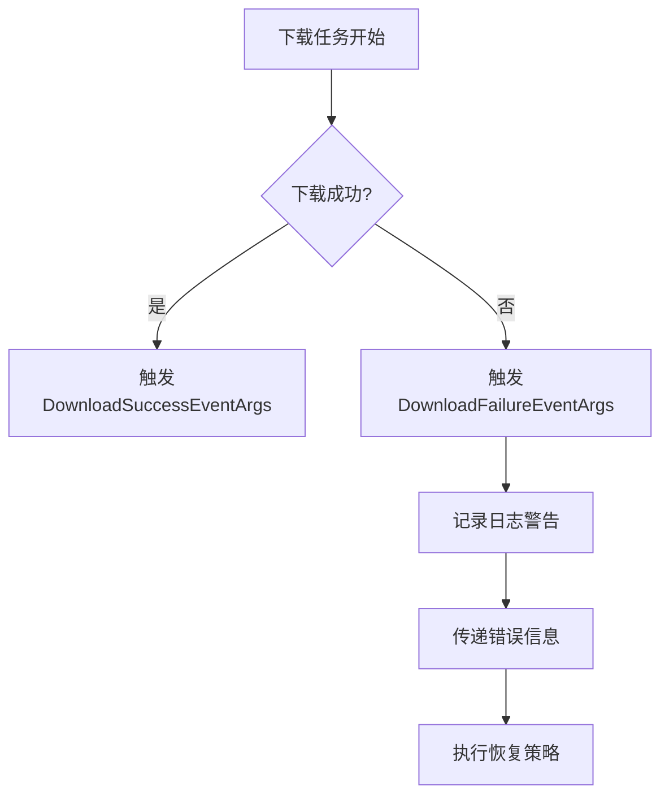
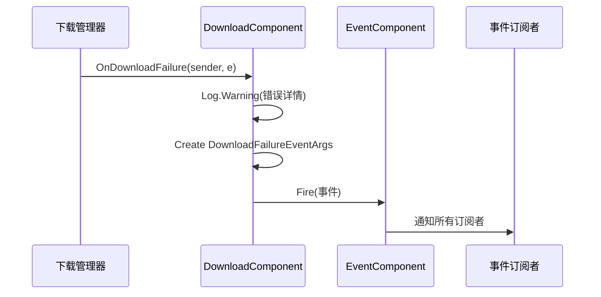
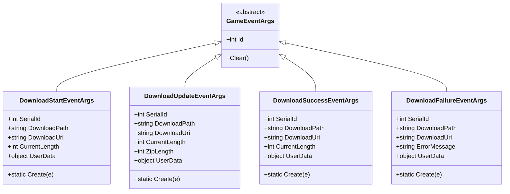

# 下载失败事件 (DownloadFailureEventArgs)

<cite>
**Referenced Files in This Document **   
- [DownloadFailureEventArgs.cs](file://Scripts/Runtime/Download/DownloadFailureEventArgs.cs)
- [DownloadComponent.cs](file://Scripts/Runtime/Download/DownloadComponent.cs)
- [DownloadStartEventArgs.cs](file://Scripts/Runtime/Download/DownloadStartEventArgs.cs)
- [DownloadSuccessEventArgs.cs](file://Scripts/Runtime/Download/DownloadSuccessEventArgs.cs)
</cite>

## 目录
1. [简介](#简介)
2. [核心组件](#核心组件)
3. [错误处理机制](#错误处理机制)
4. [事件属性详解](#事件属性详解)
5. [事件触发流程](#事件触发流程)
6. [异常处理代码示例](#异常处理代码示例)
7. [相关事件对比](#相关事件对比)

## 简介
`DownloadFailureEventArgs` 类是 Unity 游戏框架中下载模块的关键组成部分，专门用于处理下载任务失败时的错误信息传递。该类作为事件参数，在网络错误、超时或文件写入失败等异常情况下被触发，为上层应用提供详细的故障诊断信息。通过订阅此事件，开发者可以实现完善的错误处理策略，包括向用户显示错误信息、记录日志、执行重试机制或根据错误类型采取不同的恢复措施。

## 核心组件

`DownloadFailureEventArgs` 类在下载失败场景中扮演着核心角色，它封装了所有必要的故障信息，使得错误处理逻辑能够准确地定位和响应问题。该类继承自 `GameEventArgs`，并实现了事件池模式，通过 `ReferencePool.Acquire` 方法获取实例，有效减少了垃圾回收的压力。

**Section sources**
- [DownloadFailureEventArgs.cs](file://Scripts/Runtime/Download/DownloadFailureEventArgs.cs#L15-L117)
- [DownloadComponent.cs](file://Scripts/Runtime/Download/DownloadComponent.cs#L298-L302)

## 错误处理机制

`DownloadFailureEventArgs` 类为下载模块提供了结构化的错误处理机制。当下载任务因网络问题、服务器错误或本地存储问题而失败时，该事件会被触发，携带详细的错误信息。这种机制使得上层应用无需直接处理底层网络异常，而是通过事件驱动的方式优雅地响应各种失败场景。



**Diagram sources **
- [DownloadFailureEventArgs.cs](file://Scripts/Runtime/Download/DownloadFailureEventArgs.cs#L15-L117)
- [DownloadComponent.cs](file://Scripts/Runtime/Download/DownloadComponent.cs#L298-L302)

**Section sources**
- [DownloadFailureEventArgs.cs](file://Scripts/Runtime/Download/DownloadFailureEventArgs.cs#L15-L117)
- [DownloadComponent.cs](file://Scripts/Runtime/Download/DownloadComponent.cs#L298-L302)

## 事件属性详解

### ErrorMessage 属性
`ErrorMessage` 属性是 `DownloadFailureEventArgs` 类中最关键的属性之一，它提供了下载失败的具体原因。该属性为字符串类型，包含了来自底层下载系统的详细错误信息，如网络连接超时、HTTP 错误码、文件写入权限不足等。开发者可以通过分析此信息来判断失败的根本原因，并据此采取相应的处理措施。

### SerialId 和 DownloadUri 属性
`SerialId` 和 `DownloadUri` 属性共同构成了故障任务的唯一标识。`SerialId` 是下载任务的序列编号，由下载系统在创建任务时分配，用于在多个并发下载任务中精确地定位到特定的失败任务。`DownloadUri` 则记录了原始的下载地址，帮助开发者快速识别是哪个资源的下载出现了问题。这两个属性的组合使得在复杂的应用场景中能够高效地追踪和诊断下载故障。

### UserData 属性
`UserData` 属性是一个对象类型的字段，用于在下载任务创建时传递用户自定义的上下文数据。在失败场景下，这个属性尤为重要，因为它允许开发者将与下载任务相关的业务逻辑信息（如用户ID、任务类型、优先级等）一并传递，在处理错误时可以利用这些信息执行更智能的恢复策略。

**Section sources**
- [DownloadFailureEventArgs.cs](file://Scripts/Runtime/Download/DownloadFailureEventArgs.cs#L15-L117)

## 事件触发流程

`DownloadFailureEventArgs` 事件由 `DownloadComponent` 类的 `OnDownloadFailure` 方法触发。当底层下载管理器检测到下载失败时，会调用此方法。该方法首先通过 `Log.Warning` 记录一条包含序列ID、下载路径、下载地址和错误信息的日志警告，然后通过 `EventComponent.Fire` 方法将封装了失败信息的 `DownloadFailureEventArgs` 事件广播出去。



**Diagram sources **
- [DownloadComponent.cs](file://Scripts/Runtime/Download/DownloadComponent.cs#L298-L302)
- [DownloadFailureEventArgs.cs](file://Scripts/Runtime/Download/DownloadFailureEventArgs.cs#L95-L104)

**Section sources**
- [DownloadComponent.cs](file://Scripts/Runtime/Download/DownloadComponent.cs#L298-L302)

## 异常处理代码示例

以下是一个完整的异常处理代码示例，展示了如何订阅 `DownloadFailureEventArgs` 事件并实现综合的错误处理策略：

```csharp
// 订阅下载失败事件
EventComponent eventComponent = GameEntry.GetComponent<EventComponent>();
eventComponent.Subscribe<DownloadFailureEventArgs>(OnDownloadFailure);

private void OnDownloadFailure(object sender, DownloadFailureEventArgs e)
{
    // 1. 向用户显示错误信息
    ShowUserNotification($"下载失败: {e.ErrorMessage}");

    // 2. 记录详细日志
    Log.Error($"下载任务 {e.SerialId} 失败\n地址: {e.DownloadUri}\n错误: {e.ErrorMessage}");

    // 3. 根据错误类型执行不同的恢复策略
    if (e.ErrorMessage.Contains("timeout"))
    {
        // 网络超时，尝试重试
        RetryDownload(e.SerialId, e.UserData);
    }
    else if (e.ErrorMessage.Contains("disk"))
    {
        // 磁盘空间不足，提示用户清理
        PromptUserToFreeSpace();
    }
    else
    {
        // 其他错误，标记任务为失败
        MarkTaskAsFailed(e.SerialId);
    }

    // 4. 利用UserData中的上下文信息
    if (e.UserData is DownloadTaskContext context)
    {
        context.OnFailure(e.ErrorMessage);
    }
}

private void RetryDownload(int serialId, object userData)
{
    // 实现重试逻辑，可能包含指数退避
    int retryCount = GetRetryCount(userData);
    if (retryCount < MaxRetries)
    {
        // 延迟后重新添加下载任务
        StartCoroutine(DelayedRetry(serialId, userData, CalculateDelay(retryCount)));
    }
}
```

**Section sources**
- [DownloadFailureEventArgs.cs](file://Scripts/Runtime/Download/DownloadFailureEventArgs.cs#L15-L117)
- [DownloadComponent.cs](file://Scripts/Runtime/Download/DownloadComponent.cs#L298-L302)

## 相关事件对比

为了更好地理解 `DownloadFailureEventArgs` 的作用，可以将其与同模块中的其他事件进行对比：



**Diagram sources **
- [DownloadStartEventArgs.cs](file://Scripts/Runtime/Download/DownloadStartEventArgs.cs#L15-L117)
- [DownloadSuccessEventArgs.cs](file://Scripts/Runtime/Download/DownloadSuccessEventArgs.cs#L15-L117)
- [DownloadFailureEventArgs.cs](file://Scripts/Runtime/Download/DownloadFailureEventArgs.cs#L15-L117)

**Section sources**
- [DownloadStartEventArgs.cs](file://Scripts/Runtime/Download/DownloadStartEventArgs.cs#L15-L117)
- [DownloadSuccessEventArgs.cs](file://Scripts/Runtime/Download/DownloadSuccessEventArgs.cs#L15-L117)
- [DownloadFailureEventArgs.cs](file://Scripts/Runtime/Download/DownloadFailureEventArgs.cs#L15-L117)