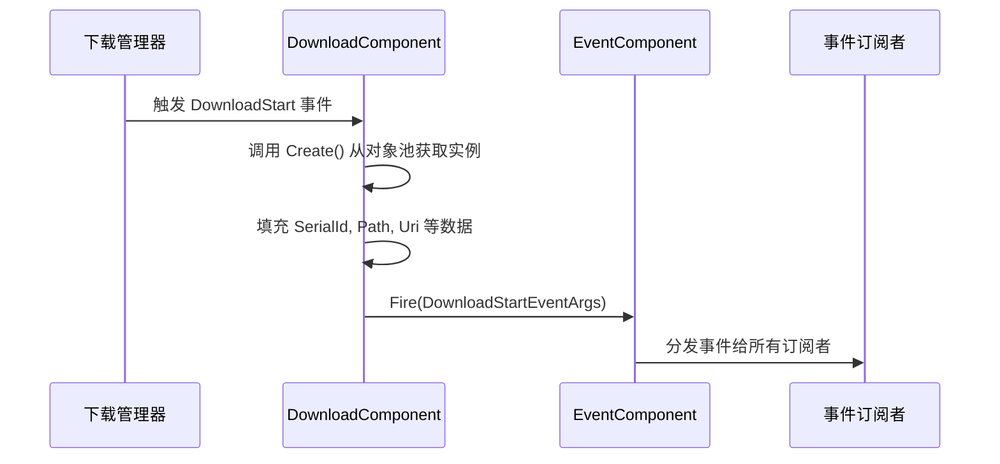
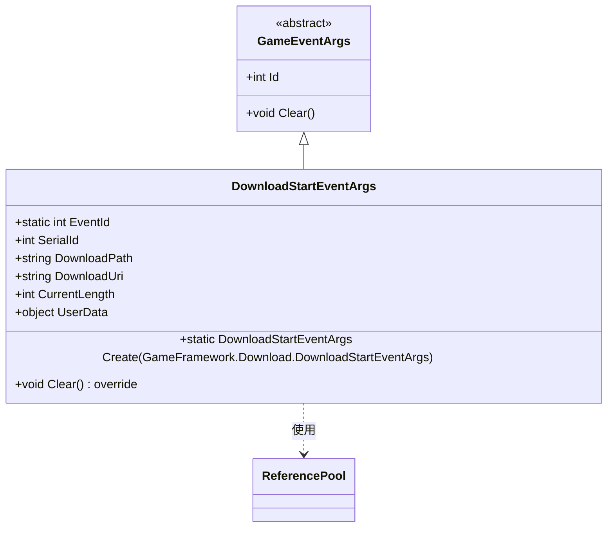

# 下载开始事件 (DownloadStartEventArgs)

<cite>
**本文档中引用的文件**   
- [DownloadStartEventArgs.cs](file://Scripts/Runtime/Download/DownloadStartEventArgs.cs)
- [DownloadComponent.cs](file://Scripts/Runtime/Download/DownloadComponent.cs)
- [EventComponent.cs](file://Scripts/Runtime/Event/EventComponent.cs)
</cite>

## 目录
1. [简介](#简介)
2. [核心属性说明](#核心属性说明)
3. [事件触发与分发流程](#事件触发与分发流程)
4. [事件订阅与使用示例](#事件订阅与使用示例)
5. [对象池管理机制](#对象池管理机制)
6. [总结](#总结)

## 简介

`DownloadStartEventArgs` 类是 Unity 游戏框架中用于表示**下载流程起始信号**的核心事件类。该类继承自 `GameEventArgs`，封装了新下载任务启动时的关键信息，包括下载路径、URI、当前大小、序列号以及用户自定义数据。它作为事件系统的一部分，由 `DownloadComponent` 在检测到下载任务开始时触发，并通过 `EventComponent` 进行全局分发，供其他系统监听和响应。

该事件的设计遵循高性能与内存优化原则，采用对象池（`ReferencePool`）进行实例管理，避免频繁的内存分配与垃圾回收，适用于高频事件场景。

**Section sources**
- [DownloadStartEventArgs.cs](file://Scripts/Runtime/Download/DownloadStartEventArgs.cs#L15-L117)

## 核心属性说明

`DownloadStartEventArgs` 提供了多个只读公共属性，用于传递下载任务的上下文信息：

- **SerialId**: 获取下载任务的序列编号。该编号由下载管理器唯一分配，可用于追踪特定下载任务的整个生命周期。
- **DownloadPath**: 获取下载完成后文件的本地存放路径。此路径通常指向持久化存储目录下的目标文件位置。
- **DownloadUri**: 获取原始下载地址（URL）。这是资源从服务器获取的网络地址。
- **CurrentLength**: 获取当前已下载的数据大小（以字节为单位）。在事件触发时，此值通常为 0，表示下载刚刚开始。
- **UserData**: 获取用户自定义数据。在调用 `AddDownload` 添加下载任务时传入，可用于传递上下文信息（如任务类型、回调函数、UI 关联对象等），便于事件处理时进行差异化处理。

这些属性均通过私有 `set` 访问器确保外部不可修改，保证事件数据的不可变性与安全性。

**Section sources**
- [DownloadStartEventArgs.cs](file://Scripts/Runtime/Download/DownloadStartEventArgs.cs#L45-L85)

## 事件触发与分发流程

`DownloadStartEventArgs` 的完整生命周期涉及两个核心组件：`DownloadComponent` 和 `EventComponent`。

1. 当底层下载管理器 (`IDownloadManager`) 检测到一个新下载任务开始时，会触发其 `DownloadStart` 事件。
2. `DownloadComponent` 通过注册的私有方法 `OnDownloadStart` 监听该事件。
3. 在 `OnDownloadStart` 方法中，`DownloadComponent` 调用 `DownloadStartEventArgs.Create(e)` 工厂方法，从对象池中获取一个 `DownloadStartEventArgs` 实例，并将内部事件 `e` 的数据填充到该实例中。
4. 随后，`DownloadComponent` 通过其持有的 `EventComponent` 实例调用 `Fire` 方法，将构建好的 `DownloadStartEventArgs` 事件对象作为参数进行抛出。
5. `EventComponent` 接收到事件后，根据事件的 `Id`（即 `DownloadStartEventArgs.EventId`），将事件分发给所有已订阅该事件编号的监听者。

此流程实现了下载模块与其他业务逻辑（如 UI 更新、日志记录、进度追踪）的解耦。



**Diagram sources**
- [DownloadComponent.cs](file://Scripts/Runtime/Download/DownloadComponent.cs#L283-L286)
- [EventComponent.cs](file://Scripts/Runtime/Event/EventComponent.cs#L115-L125)

**Section sources**
- [DownloadComponent.cs](file://Scripts/Runtime/Download/DownloadComponent.cs#L283-L286)
- [EventComponent.cs](file://Scripts/Runtime/Event/EventComponent.cs#L115-L125)

## 事件订阅与使用示例

要监听下载开始事件，需通过 `EventComponent` 订阅 `DownloadStartEventArgs.EventId` 对应的事件编号。以下为代码示例：

```csharp
// 订阅下载开始事件
GameEntry.Event.Subscribe(DownloadStartEventArgs.EventId, OnDownloadStart);

private void OnDownloadStart(object sender, GameEventArgs e)
{
    DownloadStartEventArgs args = (DownloadStartEventArgs)e;
    Log.Info($"下载任务开始: ID={args.SerialId}, URI={args.DownloadUri}, 路径={args.DownloadPath}");

    // 使用 UserData 进行上下文处理
    if (args.UserData is string taskId)
    {
        Log.Debug($"任务 {taskId} 正在开始下载...");
        // 执行特定业务逻辑，如更新UI
    }
}

// 在适当时机取消订阅
private void OnDestroy()
{
    GameEntry.Event.Unsubscribe(DownloadStartEventArgs.EventId, OnDownloadStart);
}
```

在此示例中，`UserData` 被用作传递任务 ID 的载体，使得事件处理函数能够识别是哪个具体任务启动了下载。

**Section sources**
- [DownloadStartEventArgs.cs](file://Scripts/Runtime/Download/DownloadStartEventArgs.cs#L95-L104)
- [EventComponent.cs](file://Scripts/Runtime/Event/EventComponent.cs#L105-L108)

## 对象池管理机制

`DownloadStartEventArgs` 的实例管理采用对象池模式，继承自 `GameEventArgs` 并重写 `Clear` 方法，以实现高效的对象复用。

- **创建实例**：通过静态 `Create` 方法创建实例。该方法调用 `ReferencePool.Acquire<DownloadStartEventArgs>()` 从对象池中获取一个现有实例，而非使用 `new` 关键字创建新对象，从而避免内存分配。
- **回收实例**：当事件处理完毕，`EventComponent` 会调用事件对象的 `Clear` 方法进行清理。`DownloadStartEventArgs` 的 `Clear` 方法将所有字段（`SerialId`, `DownloadPath`, `DownloadUri`, `CurrentLength`, `UserData`）重置为默认值或 `null`，然后调用 `ReferencePool.Release(this)` 将实例归还到对象池中，供后续事件复用。

这种机制显著减少了 GC 压力，提升了系统性能，尤其在大量下载任务并发的场景下效果明显。



**Diagram sources**
- [DownloadStartEventArgs.cs](file://Scripts/Runtime/Download/DownloadStartEventArgs.cs#L15-L117)

**Section sources**
- [DownloadStartEventArgs.cs](file://Scripts/Runtime/Download/DownloadStartEventArgs.cs#L95-L104)
- [DownloadStartEventArgs.cs](file://Scripts/Runtime/Download/DownloadStartEventArgs.cs#L110-L117)

## 总结

`DownloadStartEventArgs` 是 Unity 游戏框架下载模块的关键事件类，它以类型安全、内存高效的方式传递下载任务的启动信息。通过与 `DownloadComponent` 和 `EventComponent` 的协同工作，实现了下载流程的事件驱动架构。其基于对象池的实例管理机制确保了高性能，而 `UserData` 属性则提供了强大的上下文扩展能力。开发者可通过订阅该事件，及时响应下载任务的启动，实现进度显示、日志记录、资源预加载等业务逻辑。