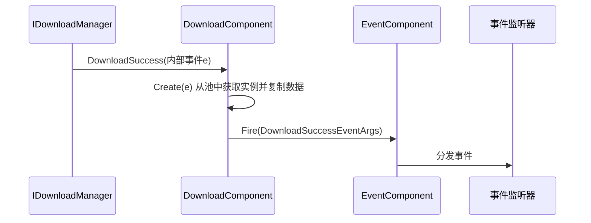
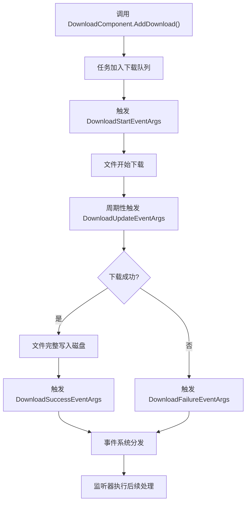

# 下载成功事件 (DownloadSuccessEventArgs)

<cite>
**本文档中引用的文件**   
- [DownloadSuccessEventArgs.cs](file://Scripts/Runtime/Download/DownloadSuccessEventArgs.cs)
- [DownloadComponent.cs](file://Scripts/Runtime/Download/DownloadComponent.cs)
- [EventComponent.cs](file://Scripts/Runtime/Event/EventComponent.cs)
</cite>

## 目录
1. [简介](#简介)
2. [核心属性语义](#核心属性语义)
3. [事件触发机制](#事件触发机制)
4. [事件监听与后续处理](#事件监听与后续处理)
5. [利用UserData实现回调逻辑](#利用userdata实现回调逻辑)
6. [完整事件流程图示](#完整事件流程图示)

## 简介

`DownloadSuccessEventArgs` 类是 Unity 游戏框架中用于通知下载任务已成功完成的核心事件类型。该事件标志着一个下载任务的最终成功状态，表示文件已完整地从远程地址下载并成功写入本地磁盘指定路径。此事件是下载模块事件系统的一部分，与 `DownloadStartEventArgs`、`DownloadUpdateEventArgs` 和 `DownloadFailureEventArgs` 共同构成了完整的下载生命周期通知体系。

当一个下载任务成功完成后，`DownloadComponent` 会通过其内部的事件系统分发 `DownloadSuccessEventArgs` 事件。开发者可以订阅此事件，以启动诸如资源加载、文件解压、UI 状态更新或执行用户自定义回调等后续处理流程。

**Section sources**
- [DownloadSuccessEventArgs.cs](file://Scripts/Runtime/Download/DownloadSuccessEventArgs.cs#L15-L117)

## 核心属性语义

`DownloadSuccessEventArgs` 类包含多个关键属性，用于提供下载任务完成后的详细信息。这些属性在事件触发时具有明确的语义。

### SerialId (序列编号)

`SerialId` 属性表示该下载任务的唯一序列编号。这个编号是在调用 `DownloadComponent.AddDownload` 方法添加下载任务时由系统自动生成并返回的。它在整个下载过程中作为任务的唯一标识符，使得开发者能够精确地追踪和管理多个并发的下载任务。

**Section sources**
- [DownloadSuccessEventArgs.cs](file://Scripts/Runtime/Download/DownloadSuccessEventArgs.cs#L55-L59)

### DownloadPath (下载路径)

`DownloadPath` 属性表示文件下载完成后在本地磁盘上的存放路径。这是在调用 `AddDownload` 方法时指定的目标路径。该路径通常指向应用程序的持久化数据目录（如 `Application.persistentDataPath`），确保下载的文件可以在应用重启后依然存在。

**Section sources**
- [DownloadSuccessEventArgs.cs](file://Scripts/Runtime/Download/DownloadSuccessEventArgs.cs#L64-L68)

### DownloadUri (下载地址)

`DownloadUri` 属性存储了本次下载任务所使用的原始网络地址（URL）。这有助于开发者验证下载来源，或在日志中记录下载行为。

**Section sources**
- [DownloadSuccessEventArgs.cs](file://Scripts/Runtime/Download/DownloadSuccessEventArgs.cs#L73-L77)

### CurrentLength (当前大小)

在 `DownloadSuccessEventArgs` 事件中，`CurrentLength` 属性具有特殊的语义：它表示**已成功下载并写入磁盘的完整文件的大小（以字节为单位）**。这与在 `DownloadUpdateEventArgs` 事件中表示“当前已下载的进度”不同，在成功事件中，`CurrentLength` 即为文件的最终总大小。开发者可以利用此值来验证下载的完整性或进行后续的资源处理。

**Section sources**
- [DownloadSuccessEventArgs.cs](file://Scripts/Runtime/Download/DownloadSuccessEventArgs.cs#L82-L86)

### UserData (用户自定义数据)

`UserData` 属性是一个类型为 `object` 的字段，允许开发者在发起下载请求时传入任意自定义数据。这个数据会贯穿整个下载过程，并在成功（或失败）事件中被原样返回。这是实现请求与响应关联的关键机制，常用于传递回调函数、上下文信息或任务元数据。

**Section sources**
- [DownloadSuccessEventArgs.cs](file://Scripts/Runtime/Download/DownloadSuccessEventArgs.cs#L91-L95)

## 事件触发机制

`DownloadSuccessEventArgs` 事件的触发是一个由 `DownloadComponent` 和底层下载管理器协同完成的流程。

1.  **底层事件监听**：`DownloadComponent` 在其 `Awake` 方法中，通过订阅 `m_DownloadManager`（`IDownloadManager` 接口的实例）的 `DownloadSuccess` 事件来监听下载完成。
2.  **事件转换与分发**：当底层下载管理器报告某个任务成功时，它会触发 `DownloadSuccess` 事件，并传递一个内部的 `GameFramework.Download.DownloadSuccessEventArgs` 对象。
3.  **创建框架事件**：`DownloadComponent` 的私有方法 `OnDownloadSuccess` 会捕获这个内部事件。它调用 `DownloadSuccessEventArgs.Create(e)` 静态方法，从对象池中获取一个 `DownloadSuccessEventArgs` 实例，并将内部事件 `e` 的所有数据（`SerialId`, `DownloadPath`, `DownloadUri`, `CurrentLength`, `UserData`）复制到新创建的框架事件实例中。
4.  **发布事件**：最后，`OnDownloadSuccess` 方法通过 `m_EventComponent.Fire(this, ...)` 将这个准备好的 `DownloadSuccessEventArgs` 事件发布到游戏框架的全局事件系统中。



**Diagram sources**
- [DownloadComponent.cs](file://Scripts/Runtime/Download/DownloadComponent.cs#L293-L296)
- [DownloadSuccessEventArgs.cs](file://Scripts/Runtime/Download/DownloadSuccessEventArgs.cs#L95-L104)
- [EventComponent.cs](file://Scripts/Runtime/Event/EventComponent.cs#L119-L122)

**Section sources**
- [DownloadComponent.cs](file://Scripts/Runtime/Download/DownloadComponent.cs#L293-L296)

## 事件监听与后续处理

开发者可以通过 `EventComponent` 订阅 `DownloadSuccessEventArgs` 事件，以在下载成功后执行自定义逻辑。以下是一个典型的监听和处理示例：

```csharp
// 假设在某个MonoBehaviour或GameFrameworkComponent中
private void Start()
{
    // 订阅下载成功事件
    GameEntry.Event.Subscribe(DownloadSuccessEventArgs.EventId, OnDownloadSuccess);
}

private void OnDownloadSuccess(object sender, GameEventArgs e)
{
    DownloadSuccessEventArgs ne = (DownloadSuccessEventArgs)e;
    
    // 获取事件数据
    int serialId = ne.SerialId;
    string downloadPath = ne.DownloadPath;
    int fileSize = ne.CurrentLength; // 完整文件大小
    
    // 启动后续处理，例如：
    Debug.Log($"下载成功！文件已保存至: {downloadPath}, 大小: {fileSize} 字节");
    
    // 1. 加载资源
    // Texture2D texture = Texture2D.LoadImageFromFile(downloadPath);
    
    // 2. 解压文件
    // Utility.Zip.Decompress(downloadPath, targetExtractPath);
    
    // 3. 更新UI
    // UIManager.Instance.ShowDownloadCompleteUI(downloadPath);
}

private void OnDestroy()
{
    // 记得取消订阅以防止内存泄漏
    GameEntry.Event.Unsubscribe(DownloadSuccessEventArgs.EventId, OnDownloadSuccess);
}
```

**Section sources**
- [DownloadSuccessEventArgs.cs](file://Scripts/Runtime/Download/DownloadSuccessEventArgs.cs#L15-L117)

## 利用UserData实现回调逻辑

`UserData` 属性是实现“请求-响应”模式回调逻辑的核心。开发者可以在发起下载时传入一个包含回调信息的对象，并在成功事件中取出并执行它。

```csharp
// 定义一个包含回调的类
public class DownloadCallbackData
{
    public Action<string> OnSuccess; // 成功回调，参数为下载路径
    public Action<string> OnFailure; // 失败回调
    public object Context; // 其他上下文数据
}

// 发起下载请求
public void StartDownload(string url, string savePath, Action<string> onSuccess, Action<string> onFailure)
{
    var callbackData = new DownloadCallbackData
    {
        OnSuccess = onSuccess,
        OnFailure = onFailure
    };
    
    // 将回调数据作为UserData传入
    int serialId = GameEntry.Download.AddDownload(savePath, url, callbackData);
}

// 在下载成功事件中处理回调
private void OnDownloadSuccess(object sender, GameEventArgs e)
{
    DownloadSuccessEventArgs ne = (DownloadSuccessEventArgs)e;
    string downloadPath = ne.DownloadPath;
    
    // 取出UserData
    DownloadCallbackData userData = ne.UserData as DownloadCallbackData;
    if (userData != null && userData.OnSuccess != null)
    {
        // 执行成功回调
        userData.OnSuccess(downloadPath);
    }
}
```

**Section sources**
- [DownloadSuccessEventArgs.cs](file://Scripts/Runtime/Download/DownloadSuccessEventArgs.cs#L91-L95)

## 完整事件流程图示

下图展示了从添加下载任务到成功事件分发的完整流程，以及与其他下载事件的关系。



**Diagram sources**
- [DownloadComponent.cs](file://Scripts/Runtime/Download/DownloadComponent.cs#L293-L296)
- [DownloadSuccessEventArgs.cs](file://Scripts/Runtime/Download/DownloadSuccessEventArgs.cs#L15-L117)