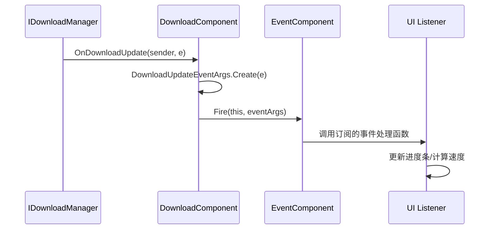

# 下载进度更新事件 (DownloadUpdateEventArgs)

<cite>
**Referenced Files in This Document**   
- [DownloadUpdateEventArgs.cs](file://Scripts/Runtime/Download/DownloadUpdateEventArgs.cs)
- [DownloadComponent.cs](file://Scripts/Runtime/Download/DownloadComponent.cs)
- [EventComponent.cs](file://Scripts/Runtime/Event/EventComponent.cs)
</cite>

## 目录
1. [简介](#简介)
2. [核心组件](#核心组件)
3. [事件机制与数据流](#事件机制与数据流)
4. [属性详解](#属性详解)
5. [实际应用示例](#实际应用示例)
6. [结论](#结论)

## 简介
`DownloadUpdateEventArgs` 类是 Unity 游戏框架中用于在文件下载过程中实时报告进度的核心事件数据类。它被设计为一个轻量级、可复用的对象，通过事件系统在下载任务执行期间高频次地传递当前的下载状态。本文档将深入剖析该类的内部机制，详细解释其如何与 `DownloadComponent` 和 `EventComponent` 协同工作，以实现高效、实时的下载进度监控。

## 核心组件

本节分析构成下载进度更新功能的三个核心类。

**Section sources**
- [DownloadUpdateEventArgs.cs](file://Scripts/Runtime/Download/DownloadUpdateEventArgs.cs#L15-L117)
- [DownloadComponent.cs](file://Scripts/Runtime/Download/DownloadComponent.cs#L288-L291)
- [EventComponent.cs](file://Scripts/Runtime/Event/EventComponent.cs#L17-L133)

### DownloadUpdateEventArgs 类
`DownloadUpdateEventArgs` 是一个继承自 `GameEventArgs` 的密封类，专门用于封装单次下载进度更新的所有相关信息。它通过静态 `EventId` 字段定义了事件的唯一标识符，确保事件系统能够正确地识别和路由该事件。该类的实例通过 `ReferencePool`（引用池）进行管理，实现了对象的复用，有效避免了因频繁创建和销毁对象而引发的垃圾回收（GC）问题，这对于需要高频触发的进度更新事件至关重要。

### DownloadComponent 类
`DownloadComponent` 是负责管理所有下载任务的主控组件。它内部持有一个 `IDownloadManager` 的引用，并通过订阅其 `DownloadUpdate` 事件来监听所有下载任务的进度变化。当底层下载管理器报告进度更新时，`DownloadComponent` 的私有方法 `OnDownloadUpdate` 会被调用。

### EventComponent 类
`EventComponent` 是游戏框架中的全局事件中心，它封装了底层的 `IEventManager` 模块。该组件提供了 `Subscribe` 和 `Fire` 等核心方法，允许游戏中的任何部分订阅特定类型的事件或广播事件。`DownloadComponent` 正是通过调用 `EventComponent` 的 `Fire` 方法，将封装好的 `DownloadUpdateEventArgs` 事件广播给所有已订阅的监听者。

## 事件机制与数据流



**Diagram sources**
- [DownloadComponent.cs](file://Scripts/Runtime/Download/DownloadComponent.cs#L288-L291)
- [EventComponent.cs](file://Scripts/Runtime/Event/EventComponent.cs#L124-L133)
- [DownloadUpdateEventArgs.cs](file://Scripts/Runtime/Download/DownloadUpdateEventArgs.cs#L95-L104)

**Section sources**
- [DownloadComponent.cs](file://Scripts/Runtime/Download/DownloadComponent.cs#L288-L291)
- [EventComponent.cs](file://Scripts/Runtime/Event/EventComponent.cs#L124-L133)
- [DownloadUpdateEventArgs.cs](file://Scripts/Runtime/Download/DownloadUpdateEventArgs.cs#L95-L104)

该图清晰地展示了下载进度更新事件的完整生命周期：
1.  **事件触发**：底层的 `IDownloadManager` 在下载过程中检测到进度变化，触发其 `DownloadUpdate` 事件。
2.  **事件转换**：`DownloadComponent` 的 `OnDownloadUpdate` 方法被调用。该方法立即调用 `DownloadUpdateEventArgs.Create(e)` 静态方法，从引用池中获取一个 `DownloadUpdateEventArgs` 实例，并将底层事件 `e` 中的数据（如 `SerialId`, `CurrentLength`）复制到该实例中。
3.  **事件广播**：`DownloadComponent` 调用 `EventComponent` 的 `Fire` 方法，将准备好的 `DownloadUpdateEventArgs` 实例作为参数进行广播。`Fire` 方法保证了事件处理是线程安全的，通常会在下一帧的主线程中执行回调。
4.  **事件处理**：所有通过 `EventComponent.Subscribe` 订阅了 `DownloadUpdateEventArgs.EventId` 的监听者（例如UI脚本）都会收到通知，并执行其注册的事件处理函数，从而实现UI的实时更新。

## 属性详解

`DownloadUpdateEventArgs` 类提供了多个只读属性，用于向事件监听者传递关键的下载信息。

### CurrentLength 属性
`CurrentLength` 属性是一个整数，表示从下载开始到目前为止已成功接收的字节数。由于 `DownloadUpdateEventArgs` 事件会随着数据的接收而频繁触发（例如，每接收一个数据块就触发一次），`CurrentLength` 的值会持续递增。监听者可以通过比较连续两次事件中 `CurrentLength` 的值，结合时间差，来计算出实时的下载速度（例如，`速度 = (当前长度 - 上次长度) / 时间差`）。

### SerialId 属性
`SerialId` 属性是一个整数，作为下载任务的唯一序列编号。当通过 `DownloadComponent.AddDownload` 方法发起一个下载请求时，该方法会返回一个 `SerialId`。这个编号会贯穿整个下载任务的生命周期。在 `DownloadUpdateEventArgs` 事件中包含 `SerialId`，使得监听者能够精确地将进度信息与特定的下载任务关联起来。这对于同时管理多个并发下载任务的场景至关重要，UI 可以根据 `SerialId` 来更新对应任务的进度条，而不会混淆。

### UserData 属性
`UserData` 属性是一个类型为 `object` 的字段，允许开发者在发起下载任务时传入任何自定义的数据。这个数据会随着下载任务的创建而被绑定，并在后续所有的相关事件（包括 `DownloadStartEventArgs`, `DownloadUpdateEventArgs`, `DownloadSuccessEventArgs` 等）中保持一致。这为开发者提供了一种强大的机制，可以在事件处理函数中访问与下载任务上下文相关的额外信息，例如，可以将一个UI进度条的引用或一个任务描述字符串作为 `UserData` 传递，从而在收到进度更新时直接操作对应的UI元素。

**Section sources**
- [DownloadUpdateEventArgs.cs](file://Scripts/Runtime/Download/DownloadUpdateEventArgs.cs#L60-L67)
- [DownloadUpdateEventArgs.cs](file://Scripts/Runtime/Download/DownloadUpdateEventArgs.cs#L45-L52)
- [DownloadUpdateEventArgs.cs](file://Scripts/Runtime/Download/DownloadUpdateEventArgs.cs#L75-L82)

## 实际应用示例

以下代码片段演示了如何在实际项目中订阅和处理 `DownloadUpdateEventArgs` 事件。

```csharp
// 1. 订阅事件
private void Start()
{
    // 获取事件组件并订阅下载更新事件
    EventComponent eventComponent = GameEntry.GetComponent<EventComponent>();
    eventComponent.Subscribe(DownloadUpdateEventArgs.EventId, OnDownloadUpdate);
}

// 2. 事件处理函数
private void OnDownloadUpdate(object sender, GameEventArgs e)
{
    DownloadUpdateEventArgs ne = (DownloadUpdateEventArgs)e;

    // 使用 SerialId 区分不同的下载任务
    if (ne.SerialId == targetDownloadSerialId)
    {
        // 更新UI进度条
        float progress = (float)ne.CurrentLength / totalFileSize;
        progressBar.value = progress;

        // 计算并显示下载速度
        float speed = CalculateSpeed(ne.CurrentLength);
        speedText.text = $"速度: {speed} KB/s";
    }
}

// 3. 发起下载任务并传递UserData
private int StartDownload(string url, string savePath, Slider uiSlider)
{
    // 将UI元素作为UserData传入，便于在事件中直接访问
    return DownloadComponent.AddDownload(savePath, url, uiSlider);
}
```

**Section sources**
- [EventComponent.cs](file://Scripts/Runtime/Event/EventComponent.cs#L90-L93)
- [DownloadComponent.cs](file://Scripts/Runtime/Download/DownloadComponent.cs#L231-L234)
- [DownloadUpdateEventArgs.cs](file://Scripts/Runtime/Download/DownloadUpdateEventArgs.cs#L15-L32)

## 结论
`DownloadUpdateEventArgs` 类是 Unity 游戏框架中实现高效、实时下载进度监控的关键。它通过与 `DownloadComponent` 和 `EventComponent` 的紧密协作，构建了一个清晰、解耦的事件驱动架构。其 `CurrentLength`、`SerialId` 和 `UserData` 属性为开发者提供了全面的进度信息、任务标识和上下文数据，使得实现复杂的下载管理逻辑（如多任务并发、UI实时更新、速度计算）变得简单而可靠。通过理解其内部机制和使用模式，开发者可以充分利用这一功能，为玩家提供流畅、透明的资源下载体验。