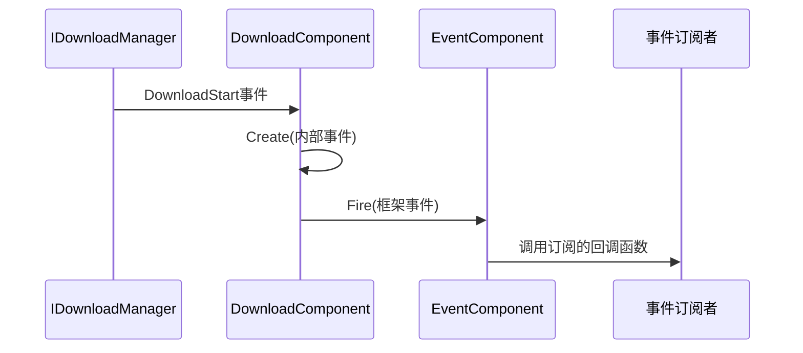
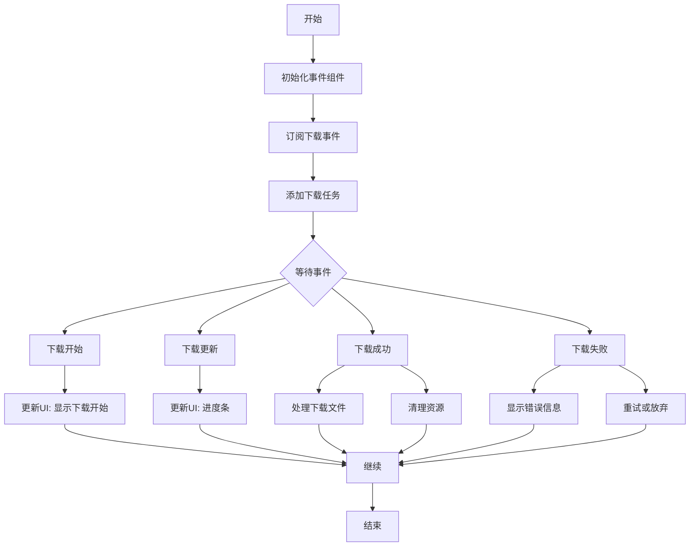

# 事件系统与回调处理

<cite>
**Referenced Files in This Document **   
- [DownloadStartEventArgs.cs](file://Scripts/Runtime/Download/DownloadStartEventArgs.cs)
- [DownloadUpdateEventArgs.cs](file://Scripts/Runtime/Download/DownloadUpdateEventArgs.cs)
- [DownloadSuccessEventArgs.cs](file://Scripts/Runtime/Download/DownloadSuccessEventArgs.cs)
- [DownloadFailureEventArgs.cs](file://Scripts/Runtime/Download/DownloadFailureEventArgs.cs)
- [EventComponent.cs](file://Scripts/Runtime/Event/EventComponent.cs)
- [DownloadComponent.cs](file://Scripts/Runtime/Download/DownloadComponent.cs)
</cite>

## 目录
1. [引言](#引言)
2. [事件类结构与用途](#事件类结构与用途)
3. [事件分发机制](#事件分发机制)
4. [事件监听与业务逻辑实现](#事件监听与业务逻辑实现)
5. [完整事件监听代码示例](#完整事件监听代码示例)
6. [结论](#结论)

## 引言

在Unity游戏开发框架中，下载过程中的事件流机制是实现异步操作反馈和业务逻辑解耦的核心组件。本文档全面解析了下载事件系统的架构与实现，重点阐述`DownloadStartEventArgs`、`DownloadUpdateEventArgs`、`DownloadSuccessEventArgs`和`DownloadFailureEventArgs`四个事件类的设计原理与使用方法。通过`EventComponent`事件分发机制，开发者能够高效地订阅和处理下载生命周期中的各种状态变化，从而构建响应式的游戏逻辑。

## 事件类结构与用途

### 下载开始事件 (DownloadStartEventArgs)

`DownloadStartEventArgs`类用于表示下载任务开始的事件。该事件在下载请求被接受并准备执行时触发。

**公共属性：**
- `SerialId`: 下载任务的序列编号，用于唯一标识一个下载任务
- `DownloadPath`: 文件下载后存放的本地路径
- `DownloadUri`: 原始下载地址（URL）
- `CurrentLength`: 当前已下载的数据大小（字节）
- `UserData`: 用户自定义数据，用于在事件处理中传递上下文信息

**静态工厂方法：**
`Create`静态方法通过对象池模式创建事件实例，接收内部下载事件参数并复制其数据，确保事件对象的高效复用。

**Section sources**
- [DownloadStartEventArgs.cs](file://Scripts/Runtime/Download/DownloadStartEventArgs.cs#L15-L120)

### 下载更新事件 (DownloadUpdateEventArgs)

`DownloadUpdateEventArgs`类用于表示下载进度更新的事件。该事件在下载过程中定期触发，提供实时的进度反馈。

**公共属性：**
- `SerialId`: 下载任务的序列编号
- `DownloadPath`: 下载文件的存放路径
- `DownloadUri`: 下载地址
- `CurrentLength`: 当前已下载的数据大小
- `UserData`: 用户自定义数据

该事件类与`DownloadStartEventArgs`具有相同的属性结构，但用于不同的生命周期阶段，便于开发者统一处理下载相关的状态信息。

**Section sources**
- [DownloadUpdateEventArgs.cs](file://Scripts/Runtime/Download/DownloadUpdateEventArgs.cs#L15-L120)

### 下载成功事件 (DownloadSuccessEventArgs)

`DownloadSuccessEventArgs`类用于表示下载任务成功完成的事件。该事件在文件完整下载并保存到指定路径后触发。

**公共属性：**
- `SerialId`: 下载任务的序列编号
- `DownloadPath`: 文件成功下载后的存放路径
- `DownloadUri`: 下载地址
- `CurrentLength`: 最终下载完成的数据大小
- `UserData`: 用户自定义数据

此事件标志着下载流程的正常结束，开发者可在此事件中执行后续的资源加载或数据处理操作。

**Section sources**
- [DownloadSuccessEventArgs.cs](file://Scripts/Runtime/Download/DownloadSuccessEventArgs.cs#L15-L120)

### 下载失败事件 (DownloadFailureEventArgs)

`DownloadFailureEventArgs`类用于表示下载任务失败的事件。该事件在下载过程中发生错误时触发。

**公共属性：**
- `SerialId`: 下载任务的序列编号
- `DownloadPath`: 尝试下载的文件路径
- `DownloadUri`: 下载地址
- `ErrorMessage`: 错误信息，描述失败原因
- `UserData`: 用户自定义数据

与前三个事件相比，`DownloadFailureEventArgs`特有的`ErrorMessage`属性提供了详细的错误诊断信息，有助于开发者进行问题排查和用户提示。

**Section sources**
- [DownloadFailureEventArgs.cs](file://Scripts/Runtime/Download/DownloadFailureEventArgs.cs#L15-L120)

## 事件分发机制

### EventComponent 事件分发核心

`EventComponent`是整个框架的事件分发中心，实现了基于观察者模式的事件系统。该组件通过`IEventManager`模块管理所有事件的订阅与发布。

**核心功能：**
- `Subscribe`: 订阅特定事件类型的处理回调
- `Unsubscribe`: 取消订阅事件处理回调
- `Fire`: 抛出事件（线程安全，延迟到下一帧处理）
- `FireNow`: 立即抛出事件（非线程安全）

**Section sources**
- [EventComponent.cs](file://Scripts/Runtime/Event/EventComponent.cs#L15-L136)

### DownloadComponent 事件桥接

`DownloadComponent`作为下载功能的高层封装，负责将底层下载管理器的事件转换为框架事件系统可识别的格式。

**事件转换流程：**
1. 在`Awake`方法中订阅`IDownloadManager`的原生事件
2. 实现事件处理方法（`OnDownloadStart`、`OnDownloadUpdate`等）
3. 在处理方法中通过`DownloadStartEventArgs.Create(e)`等工厂方法创建框架事件
4. 使用`m_EventComponent.Fire(this, eventArgs)`将事件分发到全局事件系统

这种桥接模式实现了低耦合的架构设计，使得下载功能与事件系统相互独立又能够无缝集成。



**Diagram sources**
- [DownloadComponent.cs](file://Scripts/Runtime/Download/DownloadComponent.cs#L150-L185)
- [EventComponent.cs](file://Scripts/Runtime/Event/EventComponent.cs#L110-L120)

## 事件监听与业务逻辑实现

### 事件订阅模式

开发者通过`EventComponent`的`Subscribe`方法注册事件处理回调，指定关注的事件类型ID和处理函数。

```csharp
eventComponent.Subscribe(DownloadStartEventArgs.EventId, OnDownloadStart);
```

### UserData 传递与使用

`UserData`属性是实现业务逻辑上下文传递的关键机制。在添加下载任务时，可以传入自定义对象，在事件处理时获取该对象以执行特定逻辑。

```csharp
// 添加下载任务时传递用户数据
downloadComponent.AddDownload(path, uri, userData);

// 在事件处理中使用用户数据
private void OnDownloadSuccess(object sender, GameEventArgs e)
{
    DownloadSuccessEventArgs ne = (DownloadSuccessEventArgs)e;
    MyDownloadContext context = (MyDownloadContext)ne.UserData;
    // 基于上下文执行业务逻辑
}
```

## 完整事件监听代码示例



**Diagram sources**
- [DownloadStartEventArgs.cs](file://Scripts/Runtime/Download/DownloadStartEventArgs.cs#L15-L30)
- [DownloadUpdateEventArgs.cs](file://Scripts/Runtime/Download/DownloadUpdateEventArgs.cs#L15-L30)
- [DownloadSuccessEventArgs.cs](file://Scripts/Runtime/Download/DownloadSuccessEventArgs.cs#L15-L30)
- [DownloadFailureEventArgs.cs](file://Scripts/Runtime/Download/DownloadFailureEventArgs.cs#L15-L30)

### 示例代码结构

```csharp
public class DownloadManager : MonoBehaviour
{
    private EventComponent m_EventComponent;
    private DownloadComponent m_DownloadComponent;

    private void Start()
    {
        // 获取组件引用
        m_EventComponent = GameEntry.GetComponent<EventComponent>();
        m_DownloadComponent = GameEntry.GetComponent<DownloadComponent>();

        // 订阅下载事件
        SubscribeDownloadEvents();
    }

    private void SubscribeDownloadEvents()
    {
        m_EventComponent.Subscribe(DownloadStartEventArgs.EventId, OnDownloadStart);
        m_EventComponent.Subscribe(DownloadUpdateEventArgs.EventId, OnDownloadUpdate);
        m_EventComponent.Subscribe(DownloadSuccessEventArgs.EventId, OnDownloadSuccess);
        m_EventComponent.Subscribe(DownloadFailureEventArgs.EventId, OnDownloadFailure);
    }

    private void OnDownloadStart(object sender, GameEventArgs e)
    {
        DownloadStartEventArgs ne = (DownloadStartEventArgs)e;
        Debug.Log($"下载开始: {ne.DownloadPath}, 任务ID: {ne.SerialId}");
        
        // 更新UI，显示下载开始状态
        UpdateDownloadUI(ne.SerialId, "开始下载", 0);
    }

    private void OnDownloadUpdate(object sender, GameEventArgs e)
    {
        DownloadUpdateEventArgs ne = (DownloadUpdateEventArgs)e;
        float progress = (float)ne.CurrentLength / expectedTotalSize; // 需要预先知道总大小
        
        Debug.Log($"下载进度: {ne.DownloadPath}, 进度: {progress:P}");
        
        // 更新进度条
        UpdateDownloadProgress(ne.SerialId, progress);
    }

    private void OnDownloadSuccess(object sender, GameEventArgs e)
    {
        DownloadSuccessEventArgs ne = (DownloadSuccessEventArgs)e;
        Debug.Log($"下载成功: {ne.DownloadPath}, 大小: {ne.CurrentLength} bytes");
        
        // 处理下载完成的文件
        ProcessDownloadedFile(ne.DownloadPath, ne.UserData);
        
        // 清理下载任务
        m_DownloadComponent.RemoveDownload(ne.SerialId);
    }

    private void OnDownloadFailure(object sender, GameEventArgs e)
    {
        DownloadFailureEventArgs ne = (DownloadFailureEventArgs)e;
        Debug.LogError($"下载失败: {ne.DownloadPath}, 错误: {ne.ErrorMessage}");
        
        // 显示错误信息给用户
        ShowDownloadError(ne.ErrorMessage);
        
        // 根据用户数据决定是否重试
        if (ShouldRetryDownload(ne.UserData))
        {
            RetryDownload(ne.DownloadPath, ne.UserData);
        }
    }

    public void StartDownload(string url, string savePath, object userData = null)
    {
        int serialId = m_DownloadComponent.AddDownload(savePath, url, userData);
        Debug.Log($"已添加下载任务，序列号: {serialId}");
    }
}
```

**Section sources**
- [DownloadStartEventArgs.cs](file://Scripts/Runtime/Download/DownloadStartEventArgs.cs)
- [DownloadUpdateEventArgs.cs](file://Scripts/Runtime/Download/DownloadUpdateEventArgs.cs)
- [DownloadSuccessEventArgs.cs](file://Scripts/Runtime/Download/DownloadSuccessEventArgs.cs)
- [DownloadFailureEventArgs.cs](file://Scripts/Runtime/Download/DownloadFailureEventArgs.cs)
- [EventComponent.cs](file://Scripts/Runtime/Event/EventComponent.cs)
- [DownloadComponent.cs](file://Scripts/Runtime/Download/DownloadComponent.cs)

## 结论

本文档详细解析了Unity游戏框架中下载事件流机制的完整实现。通过`DownloadStartEventArgs`、`DownloadUpdateEventArgs`、`DownloadSuccessEventArgs`和`DownloadFailureEventArgs`四个事件类，框架提供了完整的下载生命周期监控能力。`EventComponent`作为事件分发中枢，实现了高效的事件订阅与发布机制。开发者可以通过简单的事件订阅模式，结合`UserData`上下文传递，实现灵活的业务逻辑处理。这种基于事件驱动的架构设计不仅提高了代码的可维护性，还增强了系统的响应能力和用户体验。