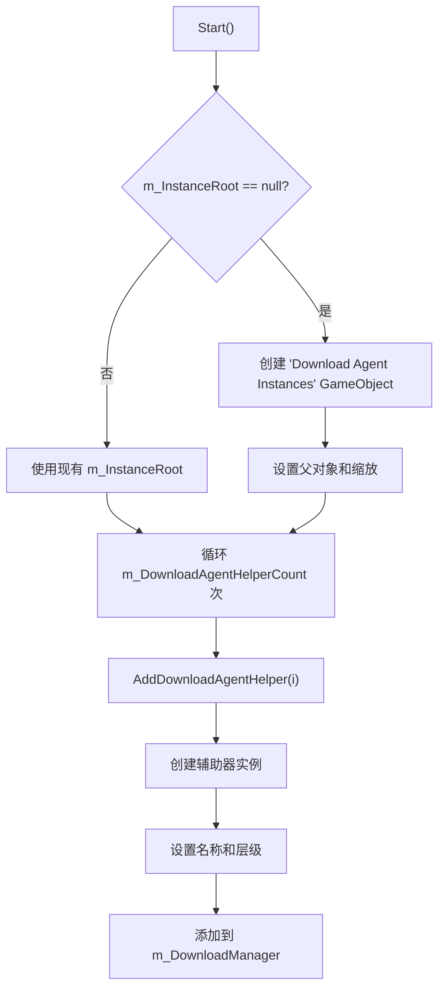
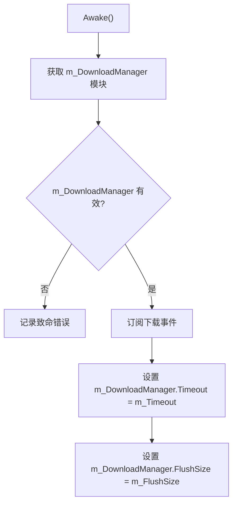
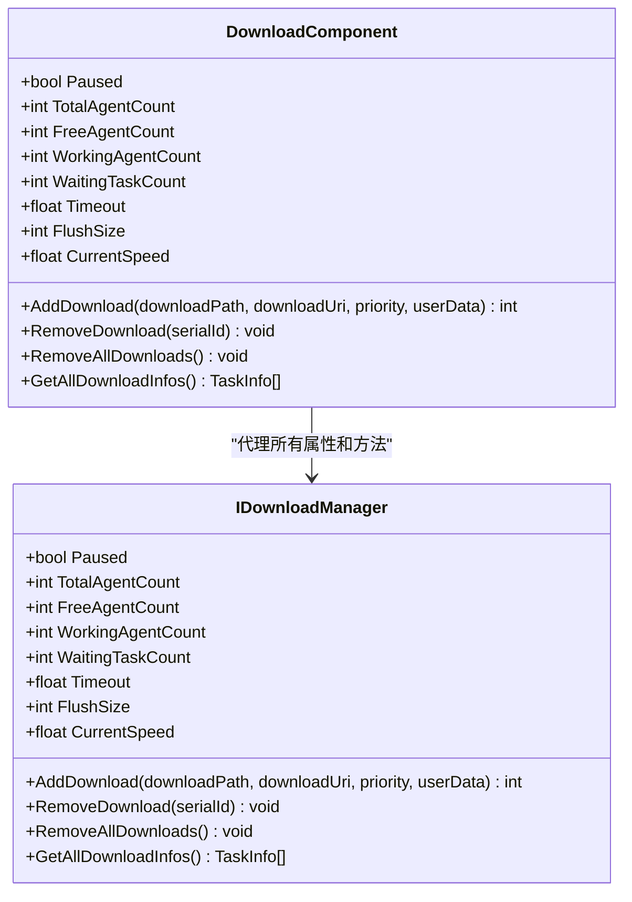

# 配置与性能调优

<cite>
**Referenced Files in This Document**   
- [DownloadComponent.cs](file://Scripts/Runtime/Download/DownloadComponent.cs)
- [UnityWebRequestDownloadAgentHelper.cs](file://Scripts/Runtime/Download/UnityWebRequestDownloadAgentHelper.cs)
- [DownloadAgentHelperBase.cs](file://Scripts/Runtime/Download/DownloadAgentHelperBase.cs)
</cite>

## Table of Contents
1. [核心配置参数](#核心配置参数)
2. [代理数量配置](#代理数量配置)
3. [超时时间配置](#超时时间配置)
4. [刷新大小配置](#刷新大小配置)
5. [实例根节点配置](#实例根节点配置)
6. [全局暂停控制](#全局暂停控制)
7. [双重赋值逻辑](#双重赋值逻辑)
8. [性能调优建议](#性能调优建议)
9. [最佳实践与常见陷阱](#最佳实践与常见陷阱)

## 核心配置参数

`DownloadComponent` 提供了多个可配置参数，用于精细控制下载行为。这些参数通过序列化字段暴露在Unity编辑器中，允许开发者根据项目需求进行调整。本节将详细说明 `m_DownloadAgentHelperCount`（代理数量）、`m_Timeout`（超时时间）、`m_FlushSize`（刷新大小）和 `m_InstanceRoot`（实例根节点）等关键配置项的作用及其对下载系统的影响。

**Section sources**
- [DownloadComponent.cs](file://Scripts/Runtime/Download/DownloadComponent.cs#L27-L42)

## 代理数量配置

`m_DownloadAgentHelperCount` 字段定义了下载系统中创建的下载代理辅助器（Download Agent Helper）的数量，默认值为3。每个代理辅助器对应一个独立的下载通道，能够同时处理一个下载任务。

该配置直接影响系统的并发下载能力。增加代理数量可以提高同时下载的文件数量，从而加快整体资源加载速度。然而，过多的并发连接可能会导致网络拥塞、服务器压力增大或移动设备性能下降。因此，需要根据目标平台的网络能力和硬件性能进行合理配置。

在 `Start` 方法中，组件会根据此值循环调用 `AddDownloadAgentHelper` 方法，为每个代理创建对应的辅助器实例，并将其挂载到 `m_InstanceRoot` 指定的变换节点下。



**Diagram sources**
- [DownloadComponent.cs](file://Scripts/Runtime/Download/DownloadComponent.cs#L166-L186)

**Section sources**
- [DownloadComponent.cs](file://Scripts/Runtime/Download/DownloadComponent.cs#L36-L36)
- [DownloadComponent.cs](file://Scripts/Runtime/Download/DownloadComponent.cs#L182-L186)

## 超时时间配置

`m_Timeout` 字段设置了单个下载任务的超时时长，单位为秒，默认值为30秒。当一个下载任务在指定时间内未能完成，系统将触发下载失败事件。

超时机制对于防止下载任务无限期挂起至关重要，尤其是在网络状况不佳或服务器响应缓慢的情况下。合理的超时设置可以确保应用的响应性，避免因单个失败任务阻塞整个资源加载流程。

该字段的值在 `Awake` 方法中被同步到 `m_DownloadManager` 的 `Timeout` 属性，作为下载管理器的全局超时阈值。



**Diagram sources**
- [DownloadComponent.cs](file://Scripts/Runtime/Download/DownloadComponent.cs#L147-L164)

**Section sources**
- [DownloadComponent.cs](file://Scripts/Runtime/Download/DownloadComponent.cs#L39-L39)

## 刷新大小配置

`m_FlushSize` 字段定义了将下载数据从内存缓冲区写入磁盘的临界大小，单位为字节，默认值为1兆字节（1024 * 1024）。此配置仅在启用断点续传功能时有效。

在断点续传场景下，下载的数据会先缓存在内存中。当累积的数据量达到 `FlushSize` 设定的阈值时，系统会将这批数据批量写入临时文件。这种批量写入策略可以显著减少磁盘I/O操作的频率，提高写入效率，并降低因意外中断导致的数据丢失风险。

较小的 `FlushSize` 值意味着更频繁的磁盘写入，虽然能更快地持久化数据，但会增加I/O开销。较大的值则能提高写入效率，但会占用更多内存，并在中断时可能丢失更多已下载但未写入的数据。

**Section sources**
- [DownloadComponent.cs](file://Scripts/Runtime/Download/DownloadComponent.cs#L42-L42)

## 实例根节点配置

`m_InstanceRoot` 字段指定了所有下载代理辅助器实例在场景中的父级变换节点。如果未在编辑器中指定，组件会在运行时自动创建一个名为 "Download Agent Instances" 的空GameObject作为根节点。

此配置主要用于组织场景中的对象层级结构，便于在Unity编辑器中管理和调试。将所有下载代理集中在一个父节点下，可以清晰地看到它们的运行状态，也方便进行批量操作或禁用。

**Section sources**
- [DownloadComponent.cs](file://Scripts/Runtime/Download/DownloadComponent.cs#L27-L27)

## 全局暂停控制

`Paused` 属性提供了一个全局开关，用于控制整个下载系统的暂停状态。该属性是一个代理属性，其 getter 和 setter 直接访问底层 `m_DownloadManager` 的 `Paused` 属性。

当 `Paused` 设置为 `true` 时，所有正在工作的下载代理将暂停下载，新的下载任务将进入等待队列。设置为 `false` 时，暂停的代理将恢复下载，等待队列中的任务也将开始执行。

这种全局控制机制使得开发者可以轻松实现如“后台下载”、“节电模式”或“用户手动暂停”等高级功能。



**Diagram sources**
- [DownloadComponent.cs](file://Scripts/Runtime/Download/DownloadComponent.cs#L47-L57)

**Section sources**
- [DownloadComponent.cs](file://Scripts/Runtime/Download/DownloadComponent.cs#L47-L57)

## 双重赋值逻辑

`Timeout` 和 `FlushSize` 属性采用了双重赋值逻辑，即在设置属性值时，不仅更新底层 `m_DownloadManager` 的对应属性，还会同步更新自身的缓存字段 `m_Timeout` 和 `m_FlushSize`。

这种设计确保了即使在 `Awake` 方法执行前或 `m_DownloadManager` 尚未初始化时，通过代码设置的属性值也能被正确保存。当 `Awake` 方法执行时，这些缓存的值会被用来初始化 `m_DownloadManager`，保证了配置的一致性和可靠性。

```csharp
public float Timeout
{
    get { return m_DownloadManager.Timeout; }
    set { m_DownloadManager.Timeout = m_Timeout = value; } // 双重赋值
}
```

**Section sources**
- [DownloadComponent.cs](file://Scripts/Runtime/Download/DownloadComponent.cs#L106-L116)
- [DownloadComponent.cs](file://Scripts/Runtime/Download/DownloadComponent.cs#L121-L131)

## 性能调优建议

### 代理数量调整
- **移动平台**：建议设置为1-3。移动设备的网络连接和CPU性能有限，过多的并发连接可能导致性能下降或被运营商限速。
- **PC/主机平台**：可根据网络带宽设置为3-8。高速网络环境下，更多的代理可以更好地利用带宽。
- **测试方法**：在目标设备上进行压力测试，观察CPU、内存和网络使用率，找到性能与效率的最佳平衡点。

### 超时阈值设置
- **稳定网络**：可设置为15-30秒。过短的超时可能导致正常下载被误判为失败。
- **不稳定网络**：建议设置为60秒或更长。对于移动网络或偏远地区，较长的超时可以提高下载成功率。
- **动态调整**：可考虑根据网络类型（Wi-Fi/4G）动态调整超时值。

### 刷新大小优化
- **大文件下载**：建议设置为2-4兆字节。减少I/O次数，提高写入效率。
- **小文件或内存受限设备**：建议设置为512KB或更低。避免占用过多内存。
- **断点续传关键性**：如果数据完整性要求极高，可适当减小 `FlushSize`，以减少中断时的数据丢失量。

## 最佳实践与常见陷阱

### 最佳实践
1. **合理配置代理数量**：避免盲目增加代理数量，应根据实际测试结果进行优化。
2. **利用全局暂停**：在应用进入后台或用户切换网络时，使用 `Paused` 属性暂停下载，提升用户体验。
3. **监控下载状态**：利用 `TotalAgentCount`、`FreeAgentCount` 等属性监控系统负载，实现智能调度。
4. **事件驱动设计**：通过订阅 `DownloadStart`、`DownloadUpdate` 等事件，实现下载进度的实时反馈。

### 常见陷阱
1. **忽略超时设置**：默认的30秒超时可能不适合所有场景，需根据实际网络环境调整。
2. **过度依赖断点续传**：`FlushSize` 仅在断点续传时有效，普通下载任务不受此参数影响。
3. **内存泄漏风险**：确保在场景切换或应用退出时调用 `RemoveAllDownloads` 清理下载任务。
4. **线程安全问题**：所有下载相关的回调都在Unity主线程中执行，无需担心多线程问题，但也意味着不能在回调中执行耗时操作。

通过合理配置和调优这些参数，可以显著提升游戏资源下载的效率和稳定性，为玩家提供更流畅的加载体验。