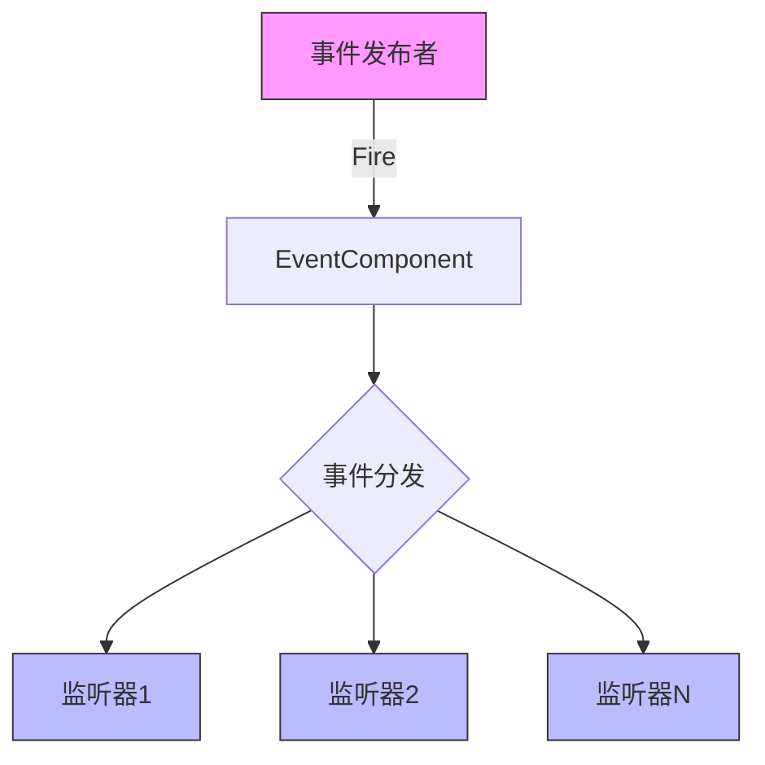
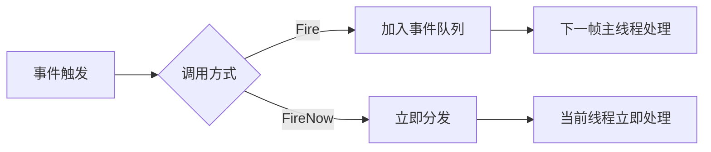

# 事件系统API

<cite>
**Referenced Files in This Document**   
- [EventComponent.cs](file://Scripts/Runtime/Event/EventComponent.cs)
- [LoadConfigSuccessEventArgs.cs](file://Scripts/Runtime/Config/LoadConfigSuccessEventArgs.cs)
- [LoadDataTableSuccessEventArgs.cs](file://Scripts/Runtime/DataTable/LoadDataTableSuccessEventArgs.cs)
</cite>

## 目录
1. [简介](#简介)
2. [核心API](#核心api)
3. [事件机制详解](#事件机制详解)
4. [自定义事件实现](#自定义事件实现)
5. [事件生命周期管理](#事件生命周期管理)
6. [调用模式与性能考量](#调用模式与性能考量)

## 简介

事件系统是Unity游戏框架中的核心通信机制，旨在实现游戏逻辑组件间的解耦。通过发布-订阅模式，该系统支持一对多的通信架构，使得不同系统能够以松耦合的方式进行交互。`EventComponent`作为事件系统的入口点，提供了事件注册、注销和触发的标准接口，是构建可维护、可扩展游戏架构的关键组件。

## 核心API

`EventComponent`提供了三个核心方法来管理事件的整个生命周期：订阅（Subscribe）、注销（Unsubscribe）和抛出（Fire）。这些方法共同构成了事件驱动编程的基础。

### 订阅事件 (Subscribe)

[Subscribe](file://Scripts/Runtime/Event/EventComponent.cs#L90-L93) 方法允许对象注册对特定事件的兴趣。通过提供事件ID和事件处理程序委托，监听器可以接收并响应特定类型的事件。

**Section sources**
- [EventComponent.cs](file://Scripts/Runtime/Event/EventComponent.cs#L90-L93)

### 注销事件 (Unsubscribe)

[Unsubscribe](file://Scripts/Runtime/Event/EventComponent.cs#L100-L103) 方法用于移除先前注册的事件监听器。这是管理事件生命周期、防止内存泄漏的关键操作，应在监听器不再需要接收事件时调用。

**Section sources**
- [EventComponent.cs](file://Scripts/Runtime/Event/EventComponent.cs#L100-L103)

### 抛出事件 (Fire)

[Fire](file://Scripts/Runtime/Event/EventComponent.cs#L119-L122) 方法用于广播事件。此操作是线程安全的，确保事件处理函数在主线程中被调用，但事件分发会延迟到下一帧。这对于从工作线程安全地通知主线程非常有用。

**Section sources**
- [EventComponent.cs](file://Scripts/Runtime/Event/EventComponent.cs#L119-L122)

## 事件机制详解

事件系统基于观察者设计模式，实现了发布者与订阅者之间的完全解耦。发布者无需知道谁在监听，而监听者也无需知道事件的具体来源。

**Diagram sources**
- [EventComponent.cs](file://Scripts/Runtime/Event/EventComponent.cs#L119-L122)

**Section sources**
- [EventComponent.cs](file://Scripts/Runtime/Event/EventComponent.cs#L119-L122)

## 自定义事件实现

框架鼓励通过继承 `GameEventArgs` 基类来创建自定义事件类型。这确保了所有事件都遵循统一的接口，并能被事件系统正确处理。

### 自定义事件示例

以下两个文件展示了如何实现具体的自定义事件：

- **[LoadConfigSuccessEventArgs.cs](file://Scripts/Runtime/Config/LoadConfigSuccessEventArgs.cs)**: 定义了加载全局配置成功时抛出的事件，包含配置资源名、加载耗时等信息。
- **[LoadDataTableSuccessEventArgs.cs](file://Scripts/Runtime/DataTable/LoadDataTableSuccessEventArgs.cs)**: 定义了加载数据表成功时抛出的事件，结构与前者类似，但针对数据表资源。

这些事件类通过静态 `EventId` 属性提供唯一的事件类型标识，并通过 `Create` 静态方法从对象池中获取实例，以减少垃圾回收压力。

**Section sources**
- [LoadConfigSuccessEventArgs.cs](file://Scripts/Runtime/Config/LoadConfigSuccessEventArgs.cs)
- [LoadDataTableSuccessEventArgs.cs](file://Scripts/Runtime/DataTable/LoadDataTableSuccessEventArgs.cs)

## 事件生命周期管理

正确的事件生命周期管理对于防止内存泄漏至关重要。当一个对象订阅了事件但未在销毁前注销，事件系统会持有该对象的引用，导致其无法被垃圾回收。

### 最佳实践

1.  **成对操作**：确保每个 `Subscribe` 调用都有一个对应的 `Unsubscribe` 调用。
2.  **在 OnDestroy 中注销**：对于 MonoBehaviour 组件，应在 `OnDestroy` 方法中注销所有事件监听。
3.  **使用弱引用**：虽然当前实现未展示，但高级事件系统可考虑使用弱引用来避免强引用导致的内存泄漏。

**Section sources**
- [EventComponent.cs](file://Scripts/Runtime/Event/EventComponent.cs#L100-L103)

## 调用模式与性能考量

事件系统提供了两种事件分发模式，以适应不同的性能和线程安全需求。

### 线程安全模式 (Fire)

`Fire` 方法是线程安全的，适用于从非主线程（如异步加载线程）抛出事件。事件会被暂存，并在下一帧的主线程中分发。这种模式牺牲了即时性以换取线程安全。

### 立即模式 (FireNow)

`FireNow` 方法会立即在当前线程中分发事件，不保证线程安全。当确定在主线程中调用且需要即时响应时，应使用此方法以获得最佳性能。

**Diagram sources**
- [EventComponent.cs](file://Scripts/Runtime/Event/EventComponent.cs#L119-L122)

**Section sources**
- [EventComponent.cs](file://Scripts/Runtime/Event/EventComponent.cs#L119-L122)