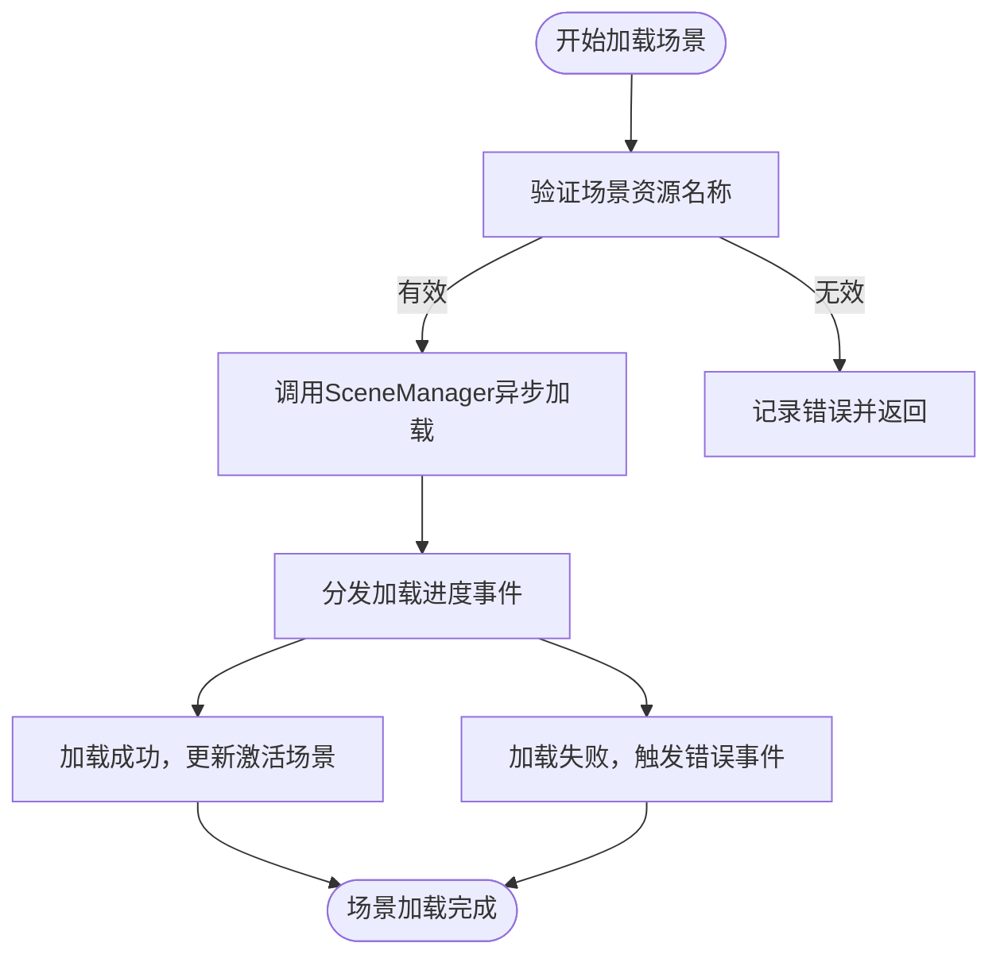
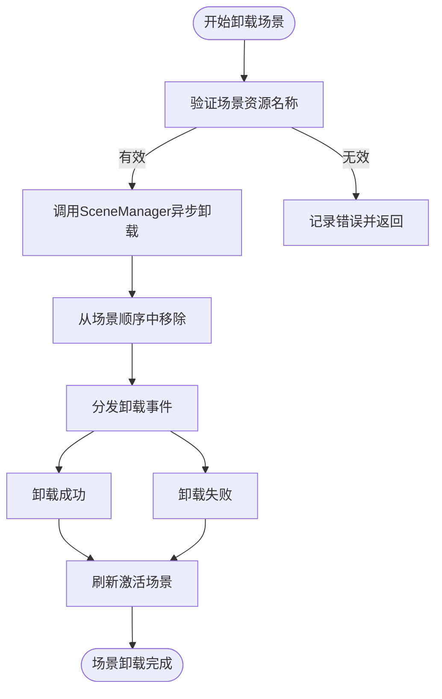
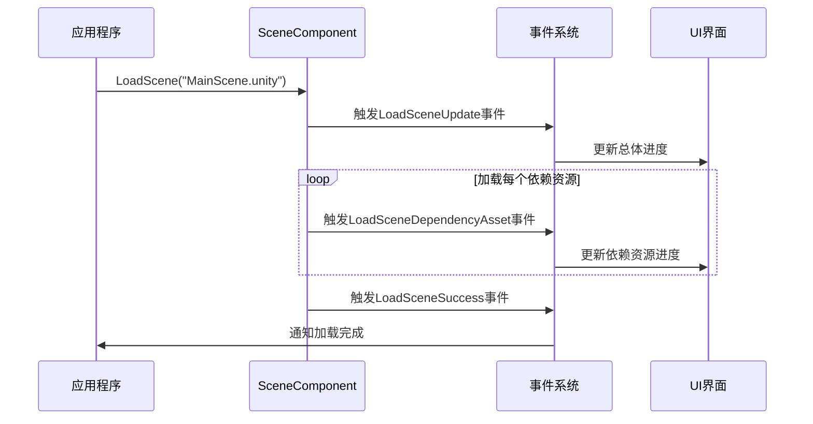
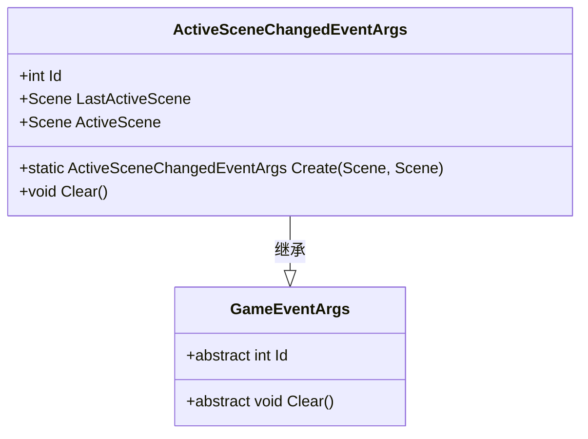
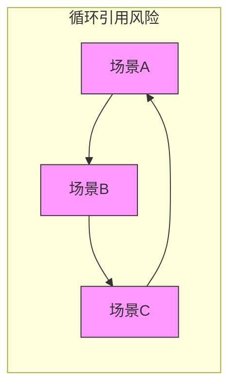

# 场景管理API

<cite>
**本文档引用的文件**  
- [SceneComponent.cs](file://Scripts/Runtime/Scene/SceneComponent.cs)
- [LoadSceneSuccessEventArgs.cs](file://Scripts/Runtime/Scene/LoadSceneSuccessEventArgs.cs)
- [LoadSceneFailureEventArgs.cs](file://Scripts/Runtime/Scene/LoadSceneFailureEventArgs.cs)
- [LoadSceneUpdateEventArgs.cs](file://Scripts/Runtime/Scene/LoadSceneUpdateEventArgs.cs)
- [LoadSceneDependencyAssetEventArgs.cs](file://Scripts/Runtime/Scene/LoadSceneDependencyAssetEventArgs.cs)
- [UnloadSceneSuccessEventArgs.cs](file://Scripts/Runtime/Scene/UnloadSceneSuccessEventArgs.cs)
- [UnloadSceneFailureEventArgs.cs](file://Scripts/Runtime/Scene/UnloadSceneFailureEventArgs.cs)
- [ActiveSceneChangedEventArgs.cs](file://Scripts/Runtime/Scene/ActiveSceneChangedEventArgs.cs)
</cite>

## 目录
1. [核心功能概述](#核心功能概述)
2. [SceneComponent类核心方法](#sceneComponent类核心方法)
3. [场景事件系统](#场景事件系统)
4. [场景激活变更](#场景激活变更)
5. [代码示例与最佳实践](#代码示例与最佳实践)
6. [资源依赖与循环引用](#资源依赖与循环引用)

## 核心功能概述

场景管理API提供了异步加载和卸载Unity场景的完整解决方案。该系统通过`SceneComponent`类作为主要入口，实现了对场景生命周期的全面控制。API设计遵循事件驱动架构，通过一系列事件类来通知开发者场景加载、卸载过程中的各个状态变化，从而实现平滑的场景过渡和精确的进度监控。

整个系统的核心是异步操作机制，允许开发者在不阻塞主线程的情况下进行场景切换。同时，系统内置了完整的错误处理机制和资源依赖管理，确保场景切换的稳定性和可靠性。

## SceneComponent类核心方法

`SceneComponent`类提供了加载和卸载场景的主要接口，支持多种参数组合以满足不同的使用场景。

### LoadScene方法

`LoadScene`方法用于异步加载指定的场景资源。该方法提供了多个重载版本，以支持不同的参数组合：

- `LoadScene(string sceneAssetName)`：使用默认优先级加载场景
- `LoadScene(string sceneAssetName, int priority)`：指定加载优先级
- `LoadScene(string sceneAssetName, object userData)`：附加用户自定义数据
- `LoadScene(string sceneAssetName, int priority, object userData)`：完整参数版本

**参数说明**：
- `sceneAssetName`：场景资源名称，必须是完整的路径格式（如"Assets/Scenes/MainScene.unity"）
- `priority`：加载优先级，数值越大优先级越高
- `userData`：用户自定义数据，将在相关事件中传递

**执行流程**：
1. 验证场景资源名称的有效性
2. 调用底层场景管理器开始异步加载
3. 触发一系列进度事件
4. 完成加载后更新场景激活状态



**Section sources**
- [SceneComponent.cs](file://Scripts/Runtime/Scene/SceneComponent.cs#L284-L299)

### UnloadScene方法

`UnloadScene`方法用于卸载已加载的场景。与加载方法类似，也提供了两个重载版本：

- `UnloadScene(string sceneAssetName)`：卸载场景，不传递用户数据
- `UnloadScene(string sceneAssetName, object userData)`：卸载场景，附加用户自定义数据

**参数说明**：
- `sceneAssetName`：要卸载的场景资源名称
- `userData`：用户自定义数据

**执行流程**：
1. 验证场景资源名称的有效性
2. 调用底层场景管理器开始异步卸载
3. 从场景顺序管理器中移除该场景
4. 触发相应的成功或失败事件



**Section sources**
- [SceneComponent.cs](file://Scripts/Runtime/Scene/SceneComponent.cs#L315-L331)

## 场景事件系统

场景管理API通过一系列事件类来通知开发者场景操作的各个状态变化。这些事件遵循统一的设计模式，都继承自`GameEventArgs`基类，并通过事件系统进行分发。

### LoadSceneSuccessEventArgs

当场景成功加载时触发此事件。

**字段说明**：
- `SceneAssetName`：成功加载的场景资源名称
- `Duration`：场景加载所花费的时间（秒）
- `UserData`：用户在调用`LoadScene`时传递的自定义数据

**触发时机**：场景完全加载并初始化完成后

**Section sources**
- [LoadSceneSuccessEventArgs.cs](file://Scripts/Runtime/Scene/LoadSceneSuccessEventArgs.cs#L15-L93)

### LoadSceneFailureEventArgs

当场景加载失败时触发此事件。

**字段说明**：
- `SceneAssetName`：尝试加载的场景资源名称
- `ErrorMessage`：详细的错误信息，说明加载失败的原因
- `UserData`：用户在调用`LoadScene`时传递的自定义数据

**触发时机**：场景加载过程中发生错误时

**Section sources**
- [LoadSceneFailureEventArgs.cs](file://Scripts/Runtime/Scene/LoadSceneFailureEventArgs.cs#L15-L93)

### LoadSceneUpdateEventArgs

在场景加载过程中定期触发，用于报告加载进度。

**字段说明**：
- `SceneAssetName`：正在加载的场景资源名称
- `Progress`：当前加载进度（0.0到1.0之间的浮点数）
- `UserData`：用户在调用`LoadScene`时传递的自定义数据

**触发时机**：加载过程中定期触发，可用于更新进度条

**Section sources**
- [LoadSceneUpdateEventArgs.cs](file://Scripts/Runtime/Scene/LoadSceneUpdateEventArgs.cs#L15-L93)

### LoadSceneDependencyAssetEventArgs

当加载场景依赖的资源时触发此事件。

**字段说明**：
- `SceneAssetName`：主场景资源名称
- `DependencyAssetName`：当前正在加载的依赖资源名称
- `LoadedCount`：已加载的依赖资源数量
- `TotalCount`：总共需要加载的依赖资源数量
- `UserData`：用户在调用`LoadScene`时传递的自定义数据

**触发时机**：加载每个依赖资源时



**Diagram sources**
- [LoadSceneDependencyAssetEventArgs.cs](file://Scripts/Runtime/Scene/LoadSceneDependencyAssetEventArgs.cs#L15-L117)
- [SceneComponent.cs](file://Scripts/Runtime/Scene/SceneComponent.cs#L284-L299)

### UnloadSceneSuccessEventArgs

当场景成功卸载时触发此事件。

**字段说明**：
- `SceneAssetName`：成功卸载的场景资源名称
- `UserData`：用户在调用`UnloadScene`时传递的自定义数据

**触发时机**：场景完全卸载后

**Section sources**
- [UnloadSceneSuccessEventArgs.cs](file://Scripts/Runtime/Scene/UnloadSceneSuccessEventArgs.cs#L15-L81)

### UnloadSceneFailureEventArgs

当场景卸载失败时触发此事件。

**字段说明**：
- `SceneAssetName`：尝试卸载的场景资源名称
- `UserData`：用户在调用`UnloadScene`时传递的自定义数据

**触发时机**：场景卸载过程中发生错误时

**Section sources**
- [UnloadSceneFailureEventArgs.cs](file://Scripts/Runtime/Scene/UnloadSceneFailureEventArgs.cs#L15-L81)

## 场景激活变更

### ActiveSceneChangedEventArgs

当激活场景发生变更时触发此事件。该事件在场景加载成功或通过其他方式改变激活场景时被触发。

**字段说明**：
- `LastActiveScene`：之前的激活场景
- `ActiveScene`：新的激活场景

**作用机制**：
1. 当场景加载成功时，系统会自动调用`SetActiveScene`方法
2. 比较当前激活场景与新场景是否不同
3. 如果不同，则触发`ActiveSceneChangedEventArgs`事件
4. 同时更新主摄像机引用

**重要性**：
- 允许开发者监听场景激活变化，执行相应的初始化或清理工作
- 确保UI、音频等系统能够正确响应场景切换
- 维护正确的场景层级关系



**Diagram sources**
- [ActiveSceneChangedEventArgs.cs](file://Scripts/Runtime/Scene/ActiveSceneChangedEventArgs.cs#L16-L83)

**Section sources**
- [ActiveSceneChangedEventArgs.cs](file://Scripts/Runtime/Scene/ActiveSceneChangedEventArgs.cs#L16-L83)
- [SceneComponent.cs](file://Scripts/Runtime/Scene/SceneComponent.cs#L350-L355)

## 代码示例与最佳实践

### 平滑场景过渡

```csharp
// 示例：实现淡入淡出的场景过渡
public class SceneTransitionManager : MonoBehaviour
{
    private SceneComponent sceneComponent;
    
    private void Start()
    {
        sceneComponent = GameEntry.GetComponent<SceneComponent>();
        // 订阅场景事件
        GameEntry.Event.Subscribe<LoadSceneSuccessEventArgs>(OnLoadSceneSuccess);
        GameEntry.Event.Subscribe<LoadSceneUpdateEventArgs>(OnLoadSceneUpdate);
    }
    
    public void LoadSceneWithTransition(string sceneName)
    {
        // 开始淡出动画
        StartCoroutine(FadeOutRoutine());
        
        // 异步加载新场景
        sceneComponent.LoadScene(sceneName, this);
    }
    
    private void OnLoadSceneUpdate(object sender, LoadSceneUpdateEventArgs e)
    {
        // 更新加载进度UI
        UpdateLoadingProgress(e.Progress);
    }
    
    private void OnLoadSceneSuccess(object sender, LoadSceneSuccessEventArgs e)
    {
        // 开始淡入动画
        StartCoroutine(FadeInRoutine());
    }
}
```

### 加载进度显示

```csharp
// 示例：显示详细的加载进度
public class LoadingIndicator : MonoBehaviour
{
    [SerializeField] private Slider progressBar;
    [SerializeField] private Text progressText;
    [SerializeField] private Text assetNameText;
    
    private void OnEnable()
    {
        GameEntry.Event.Subscribe<LoadSceneUpdateEventArgs>(OnSceneProgressUpdate);
        GameEntry.Event.Subscribe<LoadSceneDependencyAssetEventArgs>(OnDependencyAssetUpdate);
    }
    
    private void OnDisable()
    {
        GameEntry.Event.Unsubscribe<LoadSceneUpdateEventArgs>(OnSceneProgressUpdate);
        GameEntry.Event.Unsubscribe<LoadSceneDependencyAssetEventArgs>(OnDependencyAssetUpdate);
    }
    
    private void OnSceneProgressUpdate(object sender, LoadSceneUpdateEventArgs e)
    {
        progressBar.value = e.Progress;
        progressText.text = $"总体进度: {e.Progress:P}";
    }
    
    private void OnDependencyAssetUpdate(object sender, LoadSceneDependencyAssetEventArgs e)
    {
        assetNameText.text = $"加载: {e.DependencyAssetName} ({e.LoadedCount}/{e.TotalCount})";
    }
}
```

### 错误处理机制

```csharp
// 示例：健壮的错误处理
public class SceneManagerWithErrorHandling : MonoBehaviour
{
    private SceneComponent sceneComponent;
    private int retryCount = 0;
    private const int MaxRetryCount = 3;
    
    private void Start()
    {
        sceneComponent = GameEntry.GetComponent<SceneComponent>();
        GameEntry.Event.Subscribe<LoadSceneFailureEventArgs>(OnLoadSceneFailure);
    }
    
    public void SafeLoadScene(string sceneName)
    {
        retryCount = 0;
        TryLoadScene(sceneName);
    }
    
    private void TryLoadScene(string sceneName)
    {
        sceneComponent.LoadScene(sceneName, this);
    }
    
    private void OnLoadSceneFailure(object sender, LoadSceneFailureEventArgs e)
    {
        Debug.LogError($"场景加载失败: {e.SceneAssetName}, 错误: {e.ErrorMessage}");
        
        if (retryCount < MaxRetryCount)
        {
            retryCount++;
            Debug.LogWarning($"第 {retryCount} 次重试...");
            Invoke(nameof(TryLoadScene), 2f, e.SceneAssetName); // 2秒后重试
        }
        else
        {
            ShowErrorMessage("场景加载失败，请检查网络连接或重启游戏。");
        }
    }
}
```

**Section sources**
- [SceneComponent.cs](file://Scripts/Runtime/Scene/SceneComponent.cs#L284-L299)
- [LoadSceneSuccessEventArgs.cs](file://Scripts/Runtime/Scene/LoadSceneSuccessEventArgs.cs#L15-L93)
- [LoadSceneFailureEventArgs.cs](file://Scripts/Runtime/Scene/LoadSceneFailureEventArgs.cs#L15-L93)
- [LoadSceneUpdateEventArgs.cs](file://Scripts/Runtime/Scene/LoadSceneUpdateEventArgs.cs#L15-L93)

## 资源依赖与循环引用

### 资源依赖管理

场景加载过程中，系统会自动处理场景所依赖的所有资源。开发者可以通过`LoadSceneDependencyAssetEventArgs`事件监控依赖资源的加载状态。

**最佳实践**：
1. 合理组织资源依赖关系，避免单个场景依赖过多资源
2. 使用资源分组和优先级设置，确保关键资源优先加载
3. 在编辑器中使用资源分析工具检查依赖关系

### 避免循环引用

在场景管理中，需要特别注意避免以下类型的循环引用：

1. **场景间的循环引用**：场景A加载场景B，场景B又加载场景A
2. **组件间的循环依赖**：多个组件相互持有对方引用
3. **事件订阅循环**：事件处理器又触发相同的事件

**预防措施**：
- 使用弱引用或事件系统替代直接引用
- 遵循单一职责原则，避免组件功能过于复杂
- 在场景卸载时及时清理事件订阅
- 使用资源管理工具定期检查循环依赖



**Diagram sources**
- [SceneComponent.cs](file://Scripts/Runtime/Scene/SceneComponent.cs#L315-L331)
- [SceneComponent.cs](file://Scripts/Runtime/Scene/SceneComponent.cs#L284-L299)