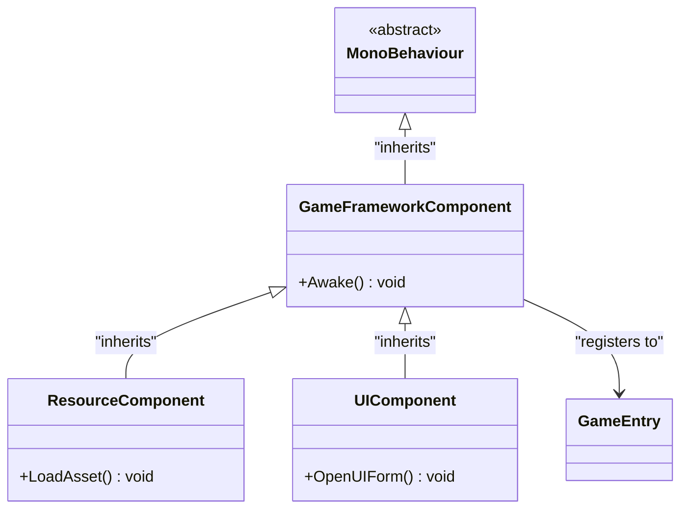
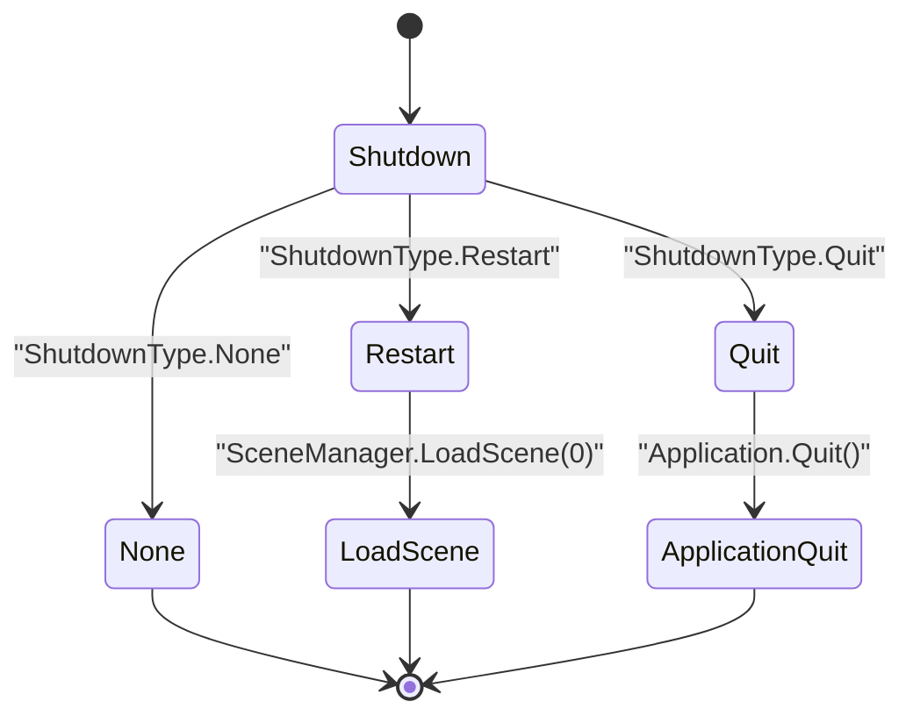

# 基础组件API

<cite>
**Referenced Files in This Document**   
- [GameEntry.cs](file://Scripts/Runtime/Base/GameEntry.cs)
- [GameFrameworkComponent.cs](file://Scripts/Runtime/Base/GameFrameworkComponent.cs)
- [BaseComponent.cs](file://Scripts/Runtime/Base/BaseComponent.cs)
- [ShutdownType.cs](file://Scripts/Runtime/Base/ShutdownType.cs)
</cite>

## 目录
1. [简介](#简介)
2. [核心组件概览](#核心组件概览)
3. [GameEntry 全局访问入口](#gameentry-全局访问入口)
4. [GameFrameworkComponent 基类](#gameframeworkcomponent-基类)
5. [BaseComponent 初始化与关闭](#basecomponent-初始化与关闭)
6. [ShutdownType 关闭类型](#shutdowntype-关闭类型)
7. [组件注册与管理机制](#组件注册与管理机制)
8. [典型调用场景](#典型调用场景)
9. [异常处理与约定](#异常处理与约定)

## 简介
本文档详细说明Unity游戏框架中的核心基础组件，包括`GameEntry`、`GameFrameworkComponent`、`BaseComponent`和`ShutdownType`。`GameEntry`作为全局静态访问入口，提供统一的组件获取方式。`GameFrameworkComponent`是所有框架组件的基类，定义了在Unity生命周期中的初始化行为。`BaseComponent`作为核心系统组件，负责框架的初始化配置与全局状态管理。`ShutdownType`枚举则定义了应用程序关闭时的不同行为模式。这些组件共同构成了游戏框架的基石。

## 核心组件概览
游戏框架的基础组件通过分层设计实现功能解耦与高效管理。`GameEntry`提供静态方法供全局访问；`GameFrameworkComponent`作为所有组件的抽象基类，确保统一的注册流程；`BaseComponent`是框架的核心，管理版本、日志等辅助系统；`ShutdownType`则为应用的终止提供灵活的控制选项。

**Section sources**
- [GameEntry.cs](file://Scripts/Runtime/Base/GameEntry.cs#L18-L145)
- [GameFrameworkComponent.cs](file://Scripts/Runtime/Base/GameFrameworkComponent.cs#L14-L23)
- [BaseComponent.cs](file://Scripts/Runtime/Base/BaseComponent.cs#L18-L395)
- [ShutdownType.cs](file://Scripts/Runtime/Base/ShutdownType.cs#L12-L28)

## GameEntry 全局访问入口

`GameEntry`类是一个静态类，作为游戏框架所有组件的全局访问入口。它通过内部的链表维护所有已注册的`GameFrameworkComponent`实例，提供多种方式来获取特定组件。

### 泛型方法 GetComponent<T>()
该方法使用泛型约束，确保类型安全。调用时，编译器会检查`T`是否继承自`GameFrameworkComponent`，从而避免运行时类型错误。

```csharp
T GetComponent<T>() where T : GameFrameworkComponent
```

**Section sources**
- [GameEntry.cs](file://Scripts/Runtime/Base/GameEntry.cs#L25-L30)

### 反射方法 GetComponent(Type)
此重载方法接受`Type`对象作为参数，通过反射机制进行类型匹配。它遍历内部组件链表，比较每个组件的实际类型与传入的`Type`对象。

```csharp
GameFrameworkComponent GetComponent(Type type)
```

**Section sources**
- [GameEntry.cs](file://Scripts/Runtime/Base/GameEntry.cs#L42-L56)

### 字符串名称方法 GetComponent(string)
该方法通过组件类型的全名（`FullName`）或简称（`Name`）进行查找，为动态加载或配置驱动的场景提供了便利。

```csharp
GameFrameworkComponent GetComponent(string typeName)
```

**Section sources**
- [GameEntry.cs](file://Scripts/Runtime/Base/GameEntry.cs#L63-L78)

### 参数类型匹配逻辑
- **泛型方法**：在编译期进行类型检查，性能最优。
- **Type方法**：在运行时通过`GetType()`和`==`操作符精确匹配类型。
- **字符串方法**：在运行时比较`type.FullName`和`type.Name`，支持模糊匹配。

### 返回值处理
所有`GetComponent`方法在未找到匹配组件时均返回`null`。调用者必须进行空值检查以避免`NullReferenceException`。

### 典型调用场景
```csharp
// 获取资源管理组件
ResourceComponent resourceComponent = GameEntry.GetComponent<ResourceComponent>();

// 获取UI管理组件
UIComponent uiComponent = GameEntry.GetComponent<UIComponent>();

// 通过类型对象获取
Type resourceType = typeof(ResourceComponent);
ResourceComponent resourceComponent2 = GameEntry.GetComponent(resourceType);
```

**Section sources**
- [GameEntry.cs](file://Scripts/Runtime/Base/GameEntry.cs#L25-L78)

## GameFrameworkComponent 基类

`GameFrameworkComponent`是所有游戏框架组件的抽象基类，继承自Unity的`MonoBehaviour`。它定义了组件在场景加载时的自动注册机制。

### 生命周期机制
`Awake`方法是Unity生命周期中的第一个回调。`GameFrameworkComponent`在此方法中调用`GameEntry.RegisterComponent(this)`，将自身注册到全局组件列表中。

```csharp
protected virtual void Awake()
{
    GameEntry.RegisterComponent(this);
}
```

**Diagram sources**
- [GameFrameworkComponent.cs](file://Scripts/Runtime/Base/GameFrameworkComponent.cs#L19-L22)

**Section sources**
- [GameFrameworkComponent.cs](file://Scripts/Runtime/Base/GameFrameworkComponent.cs#L14-L23)

### 在Unity MonoBehaviour体系中的角色
作为`MonoBehaviour`的子类，`GameFrameworkComponent`可以被附加到Unity场景中的`GameObject`上。其`Awake`方法的自动调用确保了所有派生组件都能在游戏启动时被正确注册，无需手动干预。



**Diagram sources**
- [GameFrameworkComponent.cs](file://Scripts/Runtime/Base/GameFrameworkComponent.cs#L14-L23)
- [GameEntry.cs](file://Scripts/Runtime/Base/GameEntry.cs#L18-L145)

## BaseComponent 初始化与关闭

`BaseComponent`是框架的核心组件，负责初始化各种辅助系统（如日志、压缩、JSON等）并管理全局游戏设置。

### 初始化流程
`BaseComponent`的`Awake`方法在`GameFrameworkComponent`的`Awake`之后执行。它首先调用基类的`Awake`完成注册，然后依次初始化版本、日志、压缩和JSON辅助器，并应用帧率、游戏速度等全局设置。

**Section sources**
- [BaseComponent.cs](file://Scripts/Runtime/Base/BaseComponent.cs#L110-L170)

### 关闭流程
`BaseComponent`提供了`Shutdown`方法，用于安全地关闭框架。该方法会销毁其关联的`GameObject`，触发`OnDestroy`回调，最终调用`GameFrameworkEntry.Shutdown()`完成清理。

```csharp
internal void Shutdown()
{
    Destroy(gameObject);
}
```

**Section sources**
- [BaseComponent.cs](file://Scripts/Runtime/Base/BaseComponent.cs#L282-L285)

## ShutdownType 关闭类型

`ShutdownType`是一个枚举，定义了关闭游戏框架时的三种不同行为。

### 枚举值说明
- **None**: 仅关闭游戏框架本身，不重启或退出应用。
- **Restart**: 关闭框架后，重新加载游戏框架所在的场景（编号为0），实现游戏重启。
- **Quit**: 关闭框架并退出应用程序，在编辑器中还会停止播放模式。

```csharp
public enum ShutdownType : byte
{
    None = 0,
    Restart,
    Quit,
}
```

**Section sources**
- [ShutdownType.cs](file://Scripts/Runtime/Base/ShutdownType.cs#L12-L28)

### 对应用程序行为的影响
`ShutdownType`的值直接决定了`GameEntry.Shutdown`方法的后续操作。选择`Restart`可以快速重置游戏状态，而`Quit`则用于正常退出游戏。



**Diagram sources**
- [GameEntry.cs](file://Scripts/Runtime/Base/GameEntry.cs#L85-L135)
- [ShutdownType.cs](file://Scripts/Runtime/Base/ShutdownType.cs#L12-L28)

## 组件注册与管理机制

框架使用一个`GameFrameworkLinkedList<GameFrameworkComponent>`来存储所有已注册的组件。该链表在`GameEntry`中为静态，确保全局唯一。

### 内部链表实现
- **注册**：`RegisterComponent`方法检查组件类型是否已存在，若不存在则添加到链表末尾。
- **查找**：`GetComponent`方法遍历链表，通过类型或名称进行匹配。
- **线程安全性**：由于所有操作均在Unity主线程的`Awake`和`Start`阶段完成，因此无需额外的线程同步机制。

**Section sources**
- [GameEntry.cs](file://Scripts/Runtime/Base/GameEntry.cs#L18-L145)

## 典型调用场景

通过`GameEntry`安全访问系统组件的示例如下：

```csharp
// 安全获取资源组件
ResourceComponent resourceComponent = GameEntry.GetComponent<ResourceComponent>();
if (resourceComponent != null)
{
    resourceComponent.LoadAsset("Assets/Prefabs/Player.prefab");
}

// 安全获取UI组件
UIComponent uiComponent = GameEntry.GetComponent<UIComponent>();
if (uiComponent != null)
{
    uiComponent.OpenUIForm("MainMenuForm");
}
```

**Section sources**
- [GameEntry.cs](file://Scripts/Runtime/Base/GameEntry.cs#L25-L78)

## 异常处理与约定

框架遵循明确的异常处理约定：
- **请求不存在的组件**：所有`GetComponent`方法返回`null`，不抛出异常。调用者负责空值检查。
- **重复注册组件**：`RegisterComponent`方法会记录错误日志并拒绝重复注册，保证组件的唯一性。
- **辅助器初始化失败**：`BaseComponent`在初始化`VersionHelper`、`LogHelper`等时，若类型不存在或实例化失败，会抛出`GameFrameworkException`。

**Section sources**
- [GameEntry.cs](file://Scripts/Runtime/Base/GameEntry.cs#L138-L143)
- [BaseComponent.cs](file://Scripts/Runtime/Base/BaseComponent.cs#L210-L215)