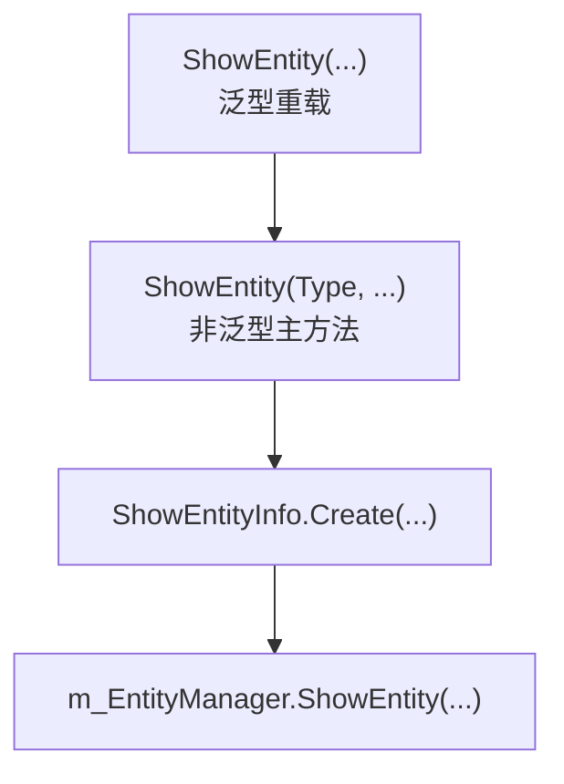
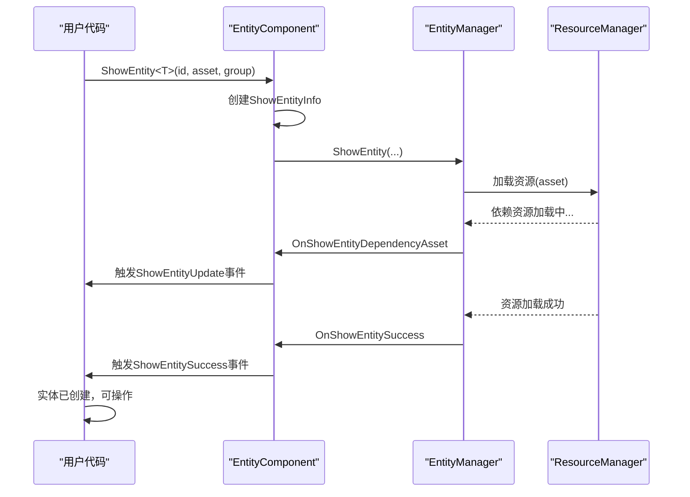

# 实体创建与显示

<cite>
**本文档引用文件**  
- [EntityComponent.cs](file://Scripts/Runtime/Entity/EntityComponent.cs)
- [ShowEntityInfo.cs](file://Scripts/Runtime/Entity/ShowEntityInfo.cs)
- [ShowEntitySuccessEventArgs.cs](file://Scripts/Runtime/Entity/ShowEntitySuccessEventArgs.cs)
- [ShowEntityFailureEventArgs.cs](file://Scripts/Runtime/Entity/ShowEntityFailureEventArgs.cs)
- [ShowEntityUpdateEventArgs.cs](file://Scripts/Runtime/Entity/ShowEntityUpdateEventArgs.cs)
- [ShowEntityDependencyAssetEventArgs.cs](file://Scripts/Runtime/Entity/ShowEntityDependencyAssetEventArgs.cs)
- [Entity.cs](file://Scripts/Runtime/Entity/Entity.cs)
- [EntityLogic.cs](file://Scripts/Runtime/Entity/EntityLogic.cs)
</cite>

## 目录
1. [简介](#简介)
2. [核心参数说明](#核心参数说明)
3. [ShowEntity系列重载方法](#showentity系列重载方法)
4. [ShowEntityInfo类的作用](#showentityinfo类的作用)
5. [同步与异步创建流程](#同步与异步创建流程)
6. [事件系统与回调处理](#事件系统与回调处理)
7. [实体池复用机制与性能优化](#实体池复用机制与性能优化)
8. [最佳实践与内存泄漏防范](#最佳实践与内存泄漏防范)

## 简介
本文档详细说明Unity游戏框架中实体创建与显示的核心机制，重点围绕`EntityComponent.ShowEntity`系列方法展开。涵盖参数作用、异步加载封装、事件系统、资源管理及性能优化策略，为开发者提供完整的实体生命周期管理指导。

## 核心参数说明
`ShowEntity`方法支持多个关键参数，用于精确控制实体的创建与行为：

- **实体ID（entityId）**：唯一标识符，用于后续查找、隐藏或操作实体。
- **资源名（entityAssetName）**：指定要加载的实体资源路径或名称，通常对应预制体（Prefab）。
- **实体组（entityGroupName）**：将实体归类至特定组，便于批量管理、资源隔离和优先级控制。
- **优先级（priority）**：决定资源加载顺序，高优先级实体优先加载，适用于关键角色或UI。
- **用户数据（userData）**：传递自定义数据，在实体初始化、显示回调中使用，常用于配置或上下文传递。

**Section sources**
- [EntityComponent.cs](file://Scripts/Runtime/Entity/EntityComponent.cs#L485-L494)

## ShowEntity系列重载方法
`EntityComponent`提供了多个`ShowEntity<T>`泛型重载方法，支持灵活调用：

- `ShowEntity<T>(int, string, string)`：最简形式，使用默认优先级。
- `ShowEntity<T>(int, string, string, int)`：指定加载优先级。
- `ShowEntity<T>(int, string, string, object)`：附加用户数据。
- `ShowEntity<T>(int, string, string, int, object)`：完整参数版本。

所有泛型重载最终调用非泛型版本，通过`typeof(T)`获取实体逻辑类型，并封装为`ShowEntityInfo`对象。



**Diagram sources**
- [EntityComponent.cs](file://Scripts/Runtime/Entity/EntityComponent.cs#L393-L474)

**Section sources**
- [EntityComponent.cs](file://Scripts/Runtime/Entity/EntityComponent.cs#L393-L494)

## ShowEntityInfo类的作用
`ShowEntityInfo`是内部封装类，实现`IReference`接口，用于在异步加载流程中传递实体逻辑类型和用户数据。

- **封装逻辑类型**：通过`EntityLogicType`属性保存泛型T对应的Type，供实体初始化时使用。
- **传递用户数据**：`UserData`字段保留调用者传入的上下文信息。
- **对象池管理**：使用`ReferencePool`进行实例的获取与释放，避免频繁GC，提升性能。

```mermaid
classDiagram
class ShowEntityInfo {
+Type EntityLogicType
+object UserData
+static ShowEntityInfo Create(Type, object)
+void Clear()
}
ShowEntityInfo : m_EntityLogicType : Type
ShowEntityInfo : m_UserData : object
```

**Diagram sources**
- [ShowEntityInfo.cs](file://Scripts/Runtime/Entity/ShowEntityInfo.cs#L12-L52)

**Section sources**
- [ShowEntityInfo.cs](file://Scripts/Runtime/Entity/ShowEntityInfo.cs#L12-L52)

## 同步与异步创建流程
实体创建本质上是异步资源加载过程，框架封装了同步调用的假象。

### 异步加载流程
1. 调用`ShowEntity`，创建`ShowEntityInfo`对象。
2. 通过`m_EntityManager`发起资源加载请求。
3. 触发`ShowEntityDependencyAsset`事件，通知依赖资源加载进度。
4. 资源加载完成后，触发`ShowEntitySuccess`或`ShowEntityFailure`事件。

### 同步调用假象
尽管API看似同步，但实际操作在后台线程或协程中完成。开发者需通过事件订阅或回调来处理加载结果，而非期望立即获取实体实例。



**Diagram sources**
- [EntityComponent.cs](file://Scripts/Runtime/Entity/EntityComponent.cs#L1119-L1138)
- [Entity.cs](file://Scripts/Runtime/Entity/Entity.cs#L67-L85)

**Section sources**
- [EntityComponent.cs](file://Scripts/Runtime/Entity/EntityComponent.cs#L485-L494)
- [Entity.cs](file://Scripts/Runtime/Entity/Entity.cs#L67-L85)

## 事件系统与回调处理
框架通过事件系统解耦实体加载逻辑与业务逻辑。

### 关键事件类
- **ShowEntitySuccessEventArgs**：加载成功事件，包含`EntityLogicType`、`Entity`实例、`Duration`和`UserData`。
- **ShowEntityFailureEventArgs**：加载失败事件，包含错误信息`ErrorMessage`。
- **ShowEntityUpdateEventArgs**：加载进度更新事件，`Progress`表示进度百分比。
- **ShowEntityDependencyAssetEventArgs**：依赖资源加载事件，提供`LoadedCount`和`TotalCount`。

### 事件订阅示例
```csharp
// 订阅成功事件
GameEntry.Event.Subscribe(ShowEntitySuccessEventArgs.EventId, OnShowEntitySuccess);

private void OnShowEntitySuccess(object sender, GameEventArgs e)
{
    ShowEntitySuccessEventArgs ne = (ShowEntitySuccessEventArgs)e;
    Entity entity = ne.Entity;
    object userData = ne.UserData;
    // 处理实体创建成功逻辑
}
```

**Section sources**
- [ShowEntitySuccessEventArgs.cs](file://Scripts/Runtime/Entity/ShowEntitySuccessEventArgs.cs#L16-L108)
- [ShowEntityFailureEventArgs.cs](file://Scripts/Runtime/Entity/ShowEntityFailureEventArgs.cs#L16-L134)
- [ShowEntityUpdateEventArgs.cs](file://Scripts/Runtime/Entity/ShowEntityUpdateEventArgs.cs#L16-L133)
- [ShowEntityDependencyAssetEventArgs.cs](file://Scripts/Runtime/Entity/ShowEntityDependencyAssetEventArgs.cs#L16-L157)

## 实体池复用机制与性能优化
框架内置实体池（Object Pool）机制，显著提升性能并减少GC压力。

- **自动复用**：隐藏的实体不会被销毁，而是返回对象池，下次创建时优先从池中取出。
- **配置灵活**：可通过`EntityGroup`配置池的容量`InstanceCapacity`、过期时间`InstanceExpireTime`和释放间隔`InstanceAutoReleaseInterval`。
- **性能优势**：避免频繁的Instantiate/Destroy操作，尤其在大量实体动态创建/销毁场景下效果显著。

**Section sources**
- [EntityComponent.cs](file://Scripts/Runtime/Entity/EntityComponent.cs#L12-L72)
- [EntityComponent.cs](file://Scripts/Runtime/Entity/EntityComponent.cs#L100-L114)

## 最佳实践与内存泄漏防范
### 避免内存泄漏
- **及时释放引用**：在`UserData`中避免持有长生命周期对象的强引用。
- **正确隐藏实体**：使用`HideEntity`而非直接Destroy GameObject。
- **事件解订阅**：在场景切换或对象销毁时，及时解订阅实体相关事件。

### 推荐实践
- **合理使用实体组**：按功能或资源类型划分实体组，便于管理和优化。
- **优先级设置**：为关键实体设置高优先级，确保及时加载。
- **UserData设计**：使用轻量级数据结构传递上下文，避免序列化大对象。

**Section sources**
- [EntityComponent.cs](file://Scripts/Runtime/Entity/EntityComponent.cs#L550-L565)
- [EntityLogic.cs](file://Scripts/Runtime/Entity/EntityLogic.cs#L100-L120)