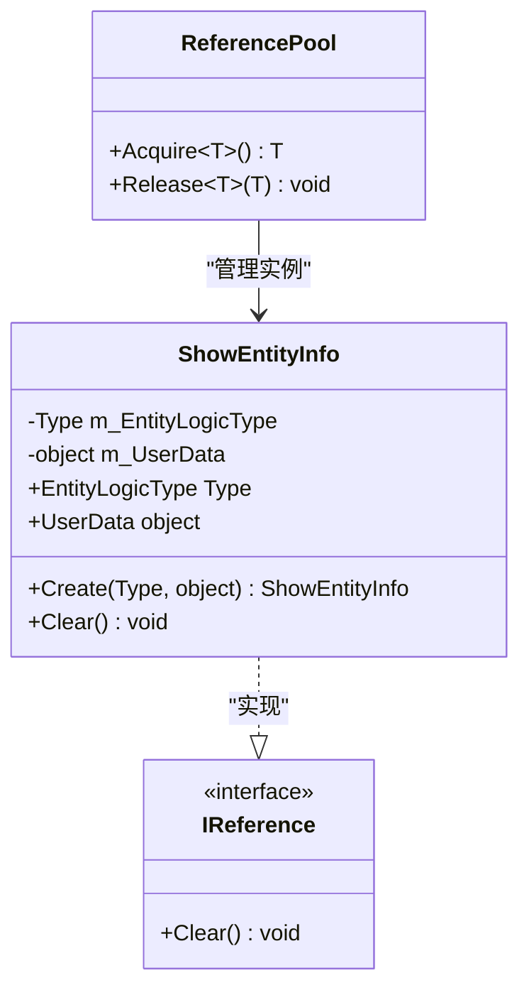
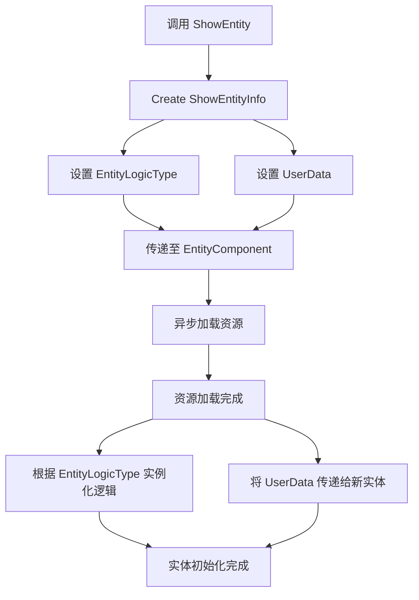

# 实体创建信息封装

<cite>
**Referenced Files in This Document**  
- [ShowEntityInfo.cs](file://Scripts/Runtime/Entity/ShowEntityInfo.cs)
- [EntityComponent.cs](file://Scripts/Runtime/Entity/EntityComponent.cs)
- [ReferencePoolComponent.cs](file://Scripts/Runtime/ReferencePool/ReferencePoolComponent.cs)
</cite>

## Table of Contents
1. [类概述](#类概述)
2. [内存池复用机制](#内存池复用机制)
3. [字段封装与异步加载](#字段封装与异步加载)
4. [静态创建方法分析](#静态创建方法分析)
5. [与ReferencePool组件的协作](#与referencepool组件的协作)
6. [设计优势与GC优化](#设计优势与gc优化)
7. [自定义UserData典型用例](#自定义userdata典型用例)
8. [数据污染风险与防范](#数据污染风险与防范)

## 类概述

`ShowEntityInfo`类是Unity游戏框架中用于封装实体创建信息的核心数据结构。该类实现了`IReference`接口，作为可复用对象参与内存池管理，主要用于在异步加载实体时传递必要的初始化参数。其设计目标是提供一个轻量级、可回收的容器，用于封装实体逻辑类型和用户自定义数据，从而避免频繁的内存分配与回收操作。

**Section sources**
- [ShowEntityInfo.cs](file://Scripts/Runtime/Entity/ShowEntityInfo.cs#L12-L52)

## 内存池复用机制

`ShowEntityInfo`类通过实现`IReference`接口，完全融入了框架的引用池（Reference Pool）管理系统。该机制的核心在于对象的复用而非创建与销毁，从而有效避免了因频繁实例化导致的垃圾回收（GC）压力。

当系统需要创建新的`ShowEntityInfo`实例时，并非通过`new`关键字直接分配内存，而是从`ReferencePool`中获取一个已存在的、但已被标记为可复用的实例。使用完毕后，该实例不会被直接销毁，而是通过`Clear()`方法重置其内部状态，并返回到引用池中等待下一次复用。



**Diagram sources**
- [ShowEntityInfo.cs](file://Scripts/Runtime/Entity/ShowEntityInfo.cs#L12-L52)
- [ReferencePoolComponent.cs](file://Scripts/Runtime/ReferencePool/ReferencePoolComponent.cs#L1-L64)

**Section sources**
- [ShowEntityInfo.cs](file://Scripts/Runtime/Entity/ShowEntityInfo.cs#L12-L52)

## 字段封装与异步加载

`ShowEntityInfo`类封装了两个关键字段，用于在实体异步加载流程中传递上下文信息：

- **EntityLogicType**: 一个`Type`类型的私有字段`m_EntityLogicType`，用于指定新创建实体所关联的逻辑脚本类型。该字段通过只读属性`EntityLogicType`暴露，确保了类型信息在加载过程中的安全传递。
- **UserData**: 一个`object`类型的私有字段`m_UserData`，作为通用容器，允许开发者传递任意自定义数据。该字段同样通过只读属性`UserData`暴露，为实体初始化提供了极大的灵活性。

这两个字段的封装是异步加载流程的核心。当调用`EntityComponent.ShowEntity`方法时，`ShowEntityInfo`实例作为用户数据被传递。在资源加载完成的回调中，系统能够根据`EntityLogicType`实例化正确的逻辑组件，并将`UserData`传递给新实体，使其能够根据初始化参数进行配置。

**Section sources**
- [ShowEntityInfo.cs](file://Scripts/Runtime/Entity/ShowEntityInfo.cs#L12-L52)

## 静态创建方法分析

`ShowEntityInfo`类提供了静态的`Create`方法作为其主要的实例获取途径，该方法的设计体现了内存池模式的最佳实践：

```csharp
public static ShowEntityInfo Create(Type entityLogicType, object userData)
{
    ShowEntityInfo showEntityInfo = ReferencePool.Acquire<ShowEntityInfo>();
    showEntityInfo.m_EntityLogicType = entityLogicType;
    showEntityInfo.m_UserData = userData;
    return showEntityInfo;
}
```

该方法的执行流程如下：
1.  **获取实例**: 调用`ReferencePool.Acquire<ShowEntityInfo>()`从引用池中获取一个`ShowEntityInfo`实例。如果池中有可用实例，则直接返回并重用；否则，创建一个新实例。
2.  **初始化数据**: 将传入的`entityLogicType`和`userData`参数赋值给实例的内部字段。
3.  **返回实例**: 将已初始化的实例返回给调用者。

此模式将实例的获取与初始化逻辑封装在一起，确保了每次获取的实例都处于一个已知的、正确的状态，简化了调用方的使用。

**Section sources**
- [ShowEntityInfo.cs](file://Scripts/Runtime/Entity/ShowEntityInfo.cs#L39-L45)

## 与ReferencePool组件的协作

`ShowEntityInfo`类与`ReferencePoolComponent`组件紧密协作，共同构成了框架的引用池系统。`ReferencePoolComponent`是一个Unity组件，通常挂载在场景中的管理对象上，负责对`ReferencePool`进行初始化和配置。

`ReferencePool`是静态类，作为引用池的全局访问点。`ShowEntityInfo`通过调用`ReferencePool.Acquire<T>()`和`ReferencePool.Release<T>()`（后者通常在框架内部调用）来参与池管理。`ReferencePoolComponent`则通过其`EnableStrictCheck`等属性，为整个引用池系统提供运行时配置，例如是否开启严格的引用检查以帮助开发者发现潜在的内存泄漏问题。

这种协作关系使得`ShowEntityInfo`这类可复用对象的生命周期管理变得透明且高效，开发者无需关心底层的池化细节。

**Section sources**
- [ShowEntityInfo.cs](file://Scripts/Runtime/Entity/ShowEntityInfo.cs#L39-L45)
- [ReferencePoolComponent.cs](file://Scripts/Runtime/ReferencePool/ReferencePoolComponent.cs#L1-L64)

## 设计优势与GC优化

`ShowEntityInfo`类的设计在性能层面具有显著优势，其核心在于**避免了GC的频繁触发**。

在传统的设计模式中，每次显示一个实体都需要创建一个新的`ShowEntityInfo`对象。在高频操作（如大量敌人生成）的场景下，这会产生大量的临时对象，导致堆内存快速填满，从而频繁触发垃圾回收。GC的执行是耗时的，可能导致游戏帧率骤降，出现卡顿。

通过引用池复用机制，`ShowEntityInfo`的实例被反复使用。对象的创建次数被极大地减少，生命周期被延长。这使得堆内存中的短期对象数量保持在较低水平，显著降低了GC的触发频率和工作量，从而保证了游戏运行的流畅性。

**Section sources**
- [ShowEntityInfo.cs](file://Scripts/Runtime/Entity/ShowEntityInfo.cs#L12-L52)

## 自定义UserData典型用例

`UserData`字段的灵活性使其适用于多种需要传递初始化参数的场景：

- **关卡初始化参数**: 在加载一个角色实体时，`UserData`可以是一个包含角色等级、初始血量、装备信息等的`LevelInitData`结构体，确保角色在生成时就具备正确的状态。
- **网络同步数据**: 在由网络消息触发的实体创建中，`UserData`可以包含从服务器接收到的同步数据包，如玩家ID、位置坐标、朝向等，用于在本地精确还原远程实体的状态。
- **任务目标信息**: 创建一个任务相关的NPC时，`UserData`可以携带任务ID和目标描述，使NPC的逻辑组件能够根据这些信息配置其行为。
- **特效参数**: 加载一个粒子特效实体时，`UserData`可以指定特效的持续时间、颜色、播放速度等动态参数。



**Diagram sources**
- [ShowEntityInfo.cs](file://Scripts/Runtime/Entity/ShowEntityInfo.cs#L39-L45)
- [EntityComponent.cs](file://Scripts/Runtime/Entity/EntityComponent.cs#L1-L799)

**Section sources**
- [ShowEntityInfo.cs](file://Scripts/Runtime/Entity/ShowEntityInfo.cs#L39-L45)
- [EntityComponent.cs](file://Scripts/Runtime/Entity/EntityComponent.cs#L1-L799)

## 数据污染风险与防范

不当使用`ShowEntityInfo`可能导致严重的**数据污染风险**。由于实例是复用的，如果在使用后没有正确地将其释放回引用池，或者在释放后仍然持有对其的引用，那么下一次从池中获取的实例可能携带上一次使用的残留数据。

例如，如果一个`ShowEntityInfo`实例在第一次使用时设置了`UserData`为`playerData1`，使用后未调用`Clear()`或未正确释放，当它被再次获取用于设置`playerData2`时，如果代码有缺陷未能完全覆盖所有字段，就可能导致`playerData2`中混杂了`playerData1`的旧数据。

**防范措施**：
1.  **严格遵循获取-使用-释放模式**: 确保每次通过`Create`方法获取的实例，在框架内部使用完毕后，都会被正确地调用`Clear()`并释放回池中。开发者通常不需要手动释放，但必须确保不破坏框架的这一流程。
2.  **避免长期持有引用**: 不要将`ShowEntityInfo`实例存储在长期存在的变量或数据结构中。它应被视为一个短暂的、一次性的数据载体。
3.  **利用严格检查**: 在开发阶段，启用`ReferencePoolComponent`的严格检查模式（`EnableStrictCheck`），它可以帮助检测对象的重复释放或未释放等问题，及时发现潜在的内存管理错误。

**Section sources**
- [ShowEntityInfo.cs](file://Scripts/Runtime/Entity/ShowEntityInfo.cs#L47-L51)