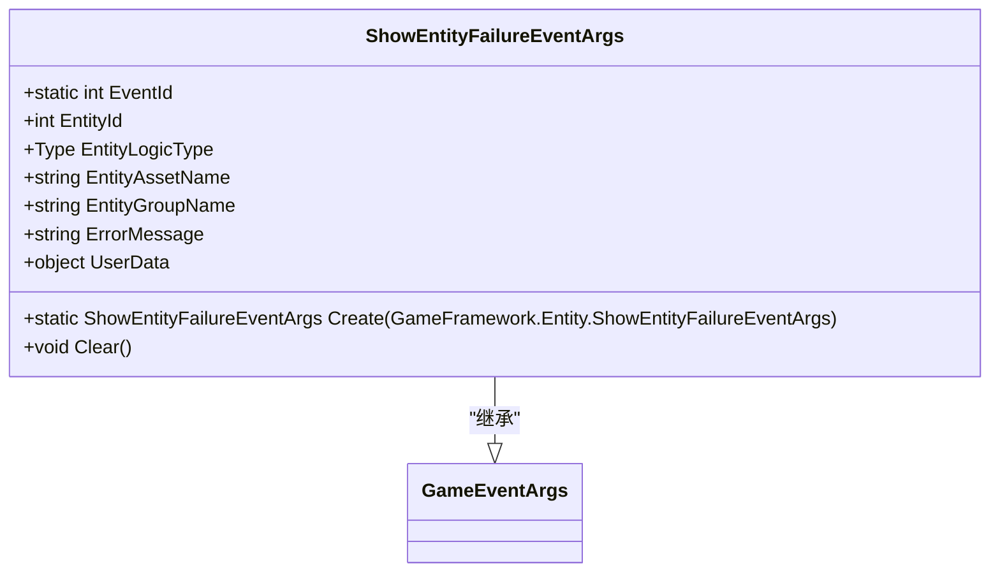
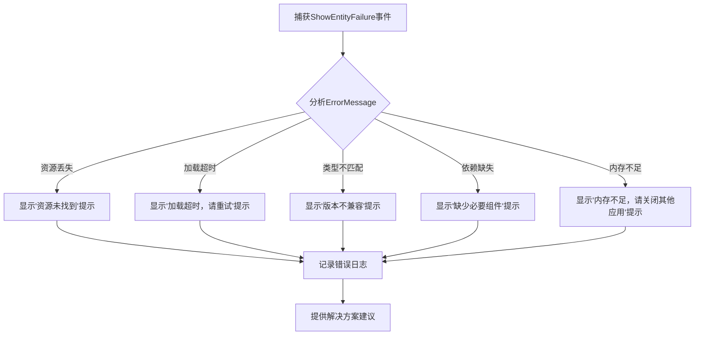
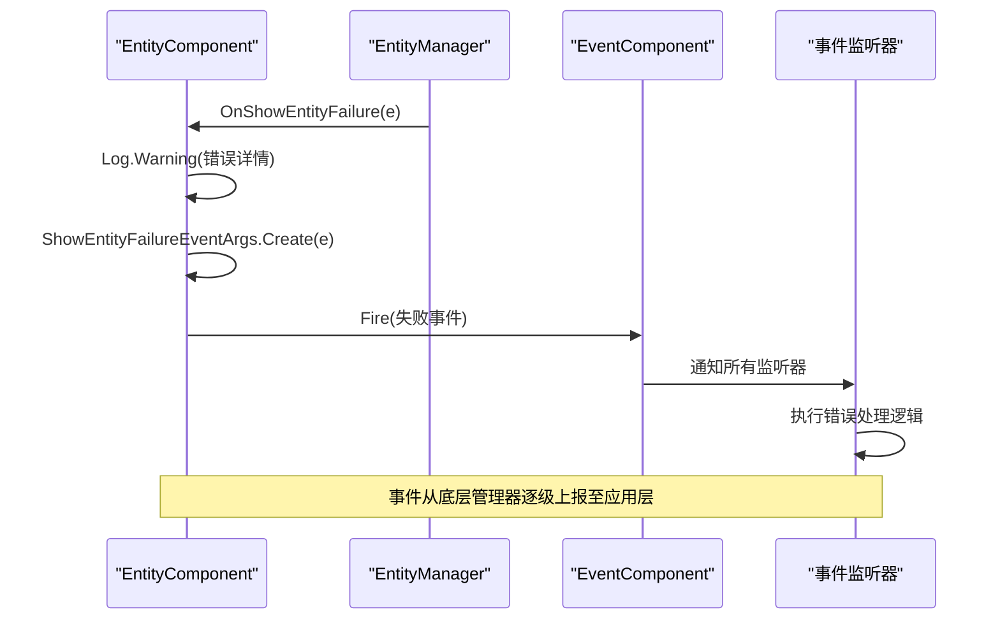
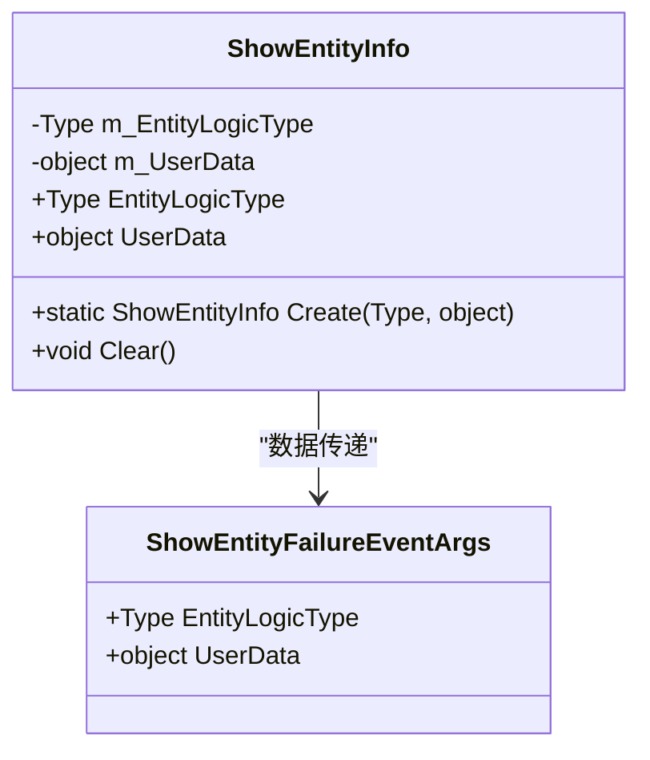

# 实体创建失败处理

<cite>
**Referenced Files in This Document**   
- [ShowEntityFailureEventArgs.cs](file://Scripts/Runtime/Entity/ShowEntityFailureEventArgs.cs)
- [EntityComponent.cs](file://Scripts/Runtime/Entity/EntityComponent.cs)
- [ShowEntityInfo.cs](file://Scripts/Runtime/Entity/ShowEntityInfo.cs)
- [Entity.cs](file://Scripts/Runtime/Entity/Entity.cs)
</cite>

## 目录
1. [简介](#简介)
2. [核心组件](#核心组件)
3. [错误报告机制分析](#错误报告机制分析)
4. [错误处理代码范例](#错误处理代码范例)
5. [事件触发路径分析](#事件触发路径分析)
6. [常见错误码与解决方案](#常见错误码与解决方案)
7. [结论](#结论)

## 简介
本文档深入解析Unity游戏框架中实体创建失败的处理机制，重点分析`ShowEntityFailureEventArgs`类的错误报告功能。文档详细说明了`ErrorMessage`字段的异常来源、`EntityId`与`EntityAssetName`在问题定位中的作用，并提供完整的错误处理代码范例。通过结合`EntityComponent`源码分析失败事件的触发路径，强调`UserData`在上下文恢复中的价值，帮助开发者快速排查和解决实体创建过程中的各类问题。

## 核心组件

`ShowEntityFailureEventArgs`类是实体创建失败事件的核心数据载体，封装了失败事件的所有关键信息。该类继承自`GameEventArgs`，实现了`IReference`接口，通过对象池进行高效管理。

**Section sources**
- [ShowEntityFailureEventArgs.cs](file://Scripts/Runtime/Entity/ShowEntityFailureEventArgs.cs#L16-L132)

## 错误报告机制分析

### ShowEntityFailureEventArgs类结构

`ShowEntityFailureEventArgs`类提供了全面的错误信息封装，其主要字段包括：

- `EntityId`: 实体的唯一标识编号，用于精确定位失败的实体实例
- `EntityLogicType`: 实体逻辑类型，指示实体应加载的逻辑脚本类型
- `EntityAssetName`: 实体资源名称，指向具体的资源文件路径
- `EntityGroupName`: 实体组名称，标识实体所属的管理组
- `ErrorMessage`: 详细的错误描述信息，包含具体的失败原因
- `UserData`: 用户自定义数据，用于传递上下文信息



**Diagram sources **
- [ShowEntityFailureEventArgs.cs](file://Scripts/Runtime/Entity/ShowEntityFailureEventArgs.cs#L16-L132)

**Section sources**
- [ShowEntityFailureEventArgs.cs](file://Scripts/Runtime/Entity/ShowEntityFailureEventArgs.cs#L16-L132)

### ErrorMessage异常来源

`ErrorMessage`字段记录了实体创建失败的具体原因，常见的异常来源包括：

1. **资源丢失**: 指定的`EntityAssetName`对应的资源文件不存在或路径错误
2. **加载超时**: 资源加载时间超过预设阈值，导致加载中断
3. **类型不匹配**: 请求的实体逻辑类型与实际资源不兼容
4. **依赖缺失**: 实体依赖的其他资源或组件未能成功加载
5. **内存不足**: 系统内存不足以完成实体实例化

这些错误信息通过`OnShowEntityFailure`方法捕获并封装到事件中，为开发者提供详细的调试线索。

**Section sources**
- [EntityComponent.cs](file://Scripts/Runtime/Entity/EntityComponent.cs#L1124-L1128)

### EntityId与EntityAssetName的作用

`EntityId`和`EntityAssetName`在问题定位中发挥着关键作用：

- `EntityId`作为运行时的唯一标识，可用于追踪特定实体的生命周期和状态变化
- `EntityAssetName`作为资源标识，直接关联到具体的资源文件，便于快速定位资源问题

两者结合使用，可以精确地将运行时错误映射到具体的资源和实例，大大提高了问题排查的效率。

**Section sources**
- [ShowEntityFailureEventArgs.cs](file://Scripts/Runtime/Entity/ShowEntityFailureEventArgs.cs#L58-L70)

## 错误处理代码范例

### 异常分类与用户提示



**Diagram sources **
- [ShowEntityFailureEventArgs.cs](file://Scripts/Runtime/Entity/ShowEntityFailureEventArgs.cs#L86-L90)
- [EntityComponent.cs](file://Scripts/Runtime/Entity/EntityComponent.cs#L1124-L1128)

### 自动重试逻辑实现

```csharp
// [ShowEntityFailureEventArgs.Create](file://Scripts/Runtime/Entity/ShowEntityFailureEventArgs.cs#L106-L118)
// [EntityComponent.OnShowEntityFailure](file://Scripts/Runtime/Entity/EntityComponent.cs#L1124-L1128)
// [ShowEntityInfo.Create](file://Scripts/Runtime/Entity/ShowEntityInfo.cs#L39-L45)
// [EntityComponent.ShowEntity](file://Scripts/Runtime/Entity/EntityComponent.cs#L485-L494)
```

自动重试逻辑通过以下步骤实现：
1. 监听`ShowEntityFailureEventArgs`事件
2. 根据错误类型判断是否适合重试
3. 对于临时性错误（如网络超时），执行有限次数的重试
4. 重试时保留原始的`UserData`以维持上下文一致性
5. 达到重试上限后，转为用户提示模式

**Section sources**
- [ShowEntityFailureEventArgs.cs](file://Scripts/Runtime/Entity/ShowEntityFailureEventArgs.cs#L106-L118)
- [EntityComponent.cs](file://Scripts/Runtime/Entity/EntityComponent.cs#L1124-L1128)

## 事件触发路径分析

### 失败事件的完整触发流程



**Diagram sources **
- [EntityComponent.cs](file://Scripts/Runtime/Entity/EntityComponent.cs#L1124-L1128)
- [ShowEntityFailureEventArgs.cs](file://Scripts/Runtime/Entity/ShowEntityFailureEventArgs.cs#L106-L118)

### UserData在上下文恢复中的价值

`UserData`字段在错误处理和上下文恢复中具有重要价值：

1. **状态保持**: 保存实体创建前的上下文状态，便于恢复
2. **参数传递**: 携带创建实体所需的额外参数，支持重试时的参数一致性
3. **调试信息**: 包含调用堆栈或业务上下文，辅助问题诊断
4. **用户体验**: 保存用户操作意图，确保错误恢复后能继续原操作

在`ShowEntityInfo`类中，`UserData`与`EntityLogicType`一起被封装，确保了从请求到失败处理的完整上下文传递。



**Diagram sources **
- [ShowEntityInfo.cs](file://Scripts/Runtime/Entity/ShowEntityInfo.cs#L12-L52)
- [ShowEntityFailureEventArgs.cs](file://Scripts/Runtime/Entity/ShowEntityFailureEventArgs.cs#L16-L132)

**Section sources**
- [ShowEntityInfo.cs](file://Scripts/Runtime/Entity/ShowEntityInfo.cs#L12-L52)

## 常见错误码与解决方案

| 错误类型 | 错误消息特征 | 可能原因 | 解决方案 |
|--------|------------|--------|--------|
| 资源丢失 | "not found", "missing" | 资源路径错误或文件不存在 | 检查资源路径配置，确认文件存在 |
| 加载超时 | "timeout", "exceeded" | 网络延迟或资源过大 | 优化资源大小，增加超时阈值 |
| 类型不匹配 | "invalid type", "mismatch" | 逻辑脚本版本不兼容 | 确认实体逻辑类型正确性 |
| 依赖缺失 | "dependency", "required" | 必要组件未加载 | 检查依赖关系，确保前置加载 |
| 内存不足 | "out of memory", "insufficient" | 系统资源紧张 | 优化内存使用，分批加载资源 |

**Section sources**
- [EntityComponent.cs](file://Scripts/Runtime/Entity/EntityComponent.cs#L1124-L1128)
- [ShowEntityFailureEventArgs.cs](file://Scripts/Runtime/Entity/ShowEntityFailureEventArgs.cs#L86-L90)

## 结论
`ShowEntityFailureEventArgs`类提供了完善的实体创建失败处理机制，通过结构化的错误信息和完整的上下文传递，极大地简化了错误诊断和恢复过程。开发者应充分利用`EntityId`、`EntityAssetName`和`UserData`等字段，结合自动重试和用户友好的提示策略，构建健壮的实体管理系统。通过理解事件的触发路径和错误分类，可以快速定位并解决各类实体创建问题，提升游戏的稳定性和用户体验。