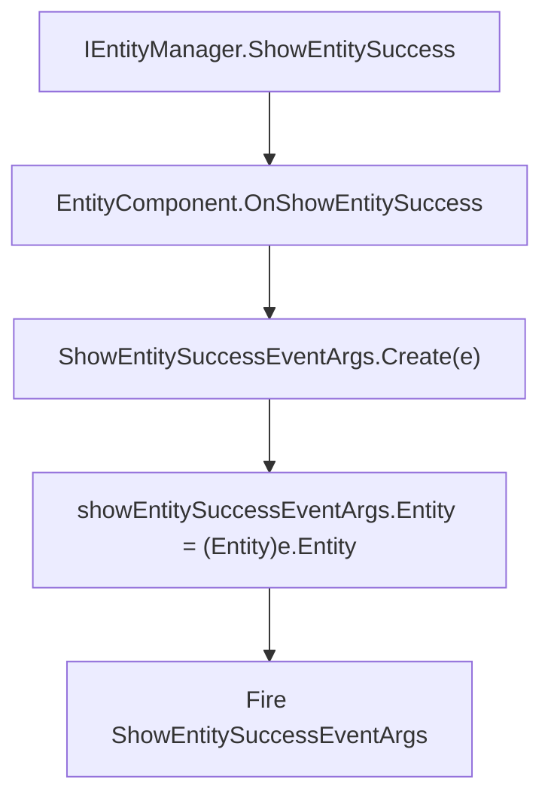
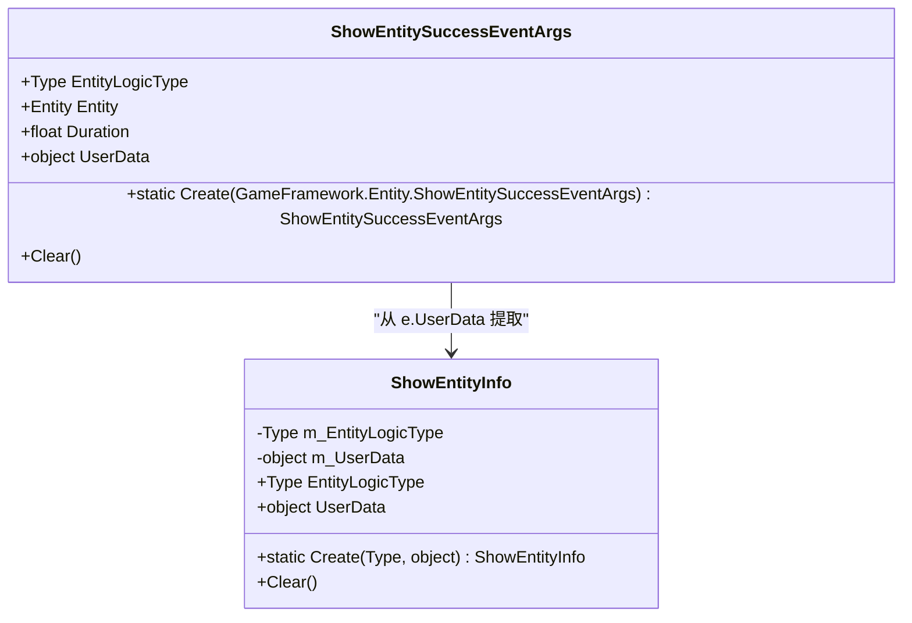
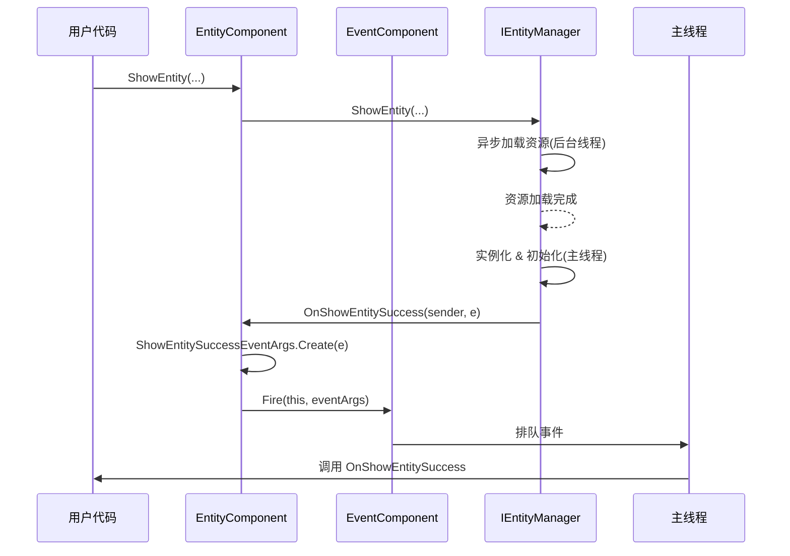

# 实体创建成功处理

<cite>
**Referenced Files in This Document**  
- [ShowEntitySuccessEventArgs.cs](file://Scripts/Runtime/Entity/ShowEntitySuccessEventArgs.cs)
- [EntityComponent.cs](file://Scripts/Runtime/Entity/EntityComponent.cs)
- [ShowEntityInfo.cs](file://Scripts/Runtime/Entity/ShowEntityInfo.cs)
- [EventComponent.cs](file://Scripts/Runtime/Event/EventComponent.cs)
</cite>

## 目录
1. [简介](#简介)
2. [核心组件](#核心组件)
3. [字段含义与使用方式](#字段含义与使用方式)
4. [事件订阅与代码示例](#事件订阅与代码示例)
5. [回调触发时机与线程安全性](#回调触发时机与线程安全性)
6. [性能监控与日志记录最佳实践](#性能监控与日志记录最佳实践)

## 简介
本文档详细描述了Unity游戏框架中实体创建成功事件的处理机制。重点围绕`ShowEntitySuccessEventArgs`类的设计与使用，阐述其在实体系统中的核心作用。该事件在实体成功加载并实例化后触发，为上层逻辑提供对新创建实体的访问能力，同时携带加载耗时、用户自定义数据等关键信息，是实现实体初始化、性能分析和业务逻辑衔接的重要桥梁。

## 核心组件

`ShowEntitySuccessEventArgs` 是一个密封类，继承自 `GameEventArgs`，用于封装实体创建成功时的事件数据。它通过事件系统与 `EntityComponent` 紧密协作，将底层资源加载的完成状态通知给上层订阅者。

**Section sources**
- [ShowEntitySuccessEventArgs.cs](file://Scripts/Runtime/Entity/ShowEntitySuccessEventArgs.cs#L16-L108)
- [EntityComponent.cs](file://Scripts/Runtime/Entity/EntityComponent.cs#L1119-L1122)

## 字段含义与使用方式

### Entity 属性：返回新创建实体实例的机制

`Entity` 属性是 `ShowEntitySuccessEventArgs` 的核心，它直接引用了成功创建的实体实例。

该机制通过 `EntityComponent` 内部的 `OnShowEntitySuccess` 回调实现。当底层 `IEntityManager` 完成实体的资源加载、组件挂载和初始化后，会触发其 `ShowEntitySuccess` 事件。`EntityComponent` 作为监听者，接收到此事件后，会调用 `ShowEntitySuccessEventArgs.Create` 静态方法，将底层事件中的 `e.Entity`（类型为 `IEntity`）转换为框架公开的 `Entity` 类型，并赋值给新创建的 `ShowEntitySuccessEventArgs` 实例的 `Entity` 属性。



**Diagram sources**
- [EntityComponent.cs](file://Scripts/Runtime/Entity/EntityComponent.cs#L1119-L1122)
- [ShowEntitySuccessEventArgs.cs](file://Scripts/Runtime/Entity/ShowEntitySuccessEventArgs.cs#L86-L96)

### Duration 字段：记录加载耗时的统计逻辑

`Duration` 字段是一个 `float` 类型，用于记录从发起显示实体请求到实体完全创建成功所花费的总时间（以秒为单位）。

这个时间的统计逻辑完全由底层 `IEntityManager` 模块负责。当调用 `EntityComponent.ShowEntity` 方法时，`IEntityManager` 会启动一个计时器。计时器从资源加载请求发出开始，到实体的 `Awake` 和 `Start` 等初始化方法执行完毕，整个流程确认成功后停止。最终的耗时被记录在内部的 `GameFramework.Entity.ShowEntitySuccessEventArgs` 事件中，并通过 `ShowEntitySuccessEventArgs.Create` 方法传递到上层事件。

### UserData 字段：传递用户自定义数据

`UserData` 字段是一个 `object` 类型，为开发者提供了在发起创建实体请求时传递任意自定义数据的能力，并在实体创建成功后原样返回。

其工作流程如下：
1.  **创建时传递**：当调用 `EntityComponent.ShowEntity` 方法时，最后一个参数 `userData` 会被封装进一个 `ShowEntityInfo` 对象中。
2.  **内部流转**：`ShowEntityInfo` 对象作为 `IReference` 类型被 `IEntityManager` 持有，贯穿整个加载过程。
3.  **成功时提取**：当实体创建成功，触发 `OnShowEntitySuccess` 回调时，`Create` 方法会从 `e.UserData`（即 `ShowEntityInfo`）中提取出原始的 `UserData`，并赋值给 `ShowEntitySuccessEventArgs` 的 `UserData` 属性。



**Diagram sources**
- [ShowEntityInfo.cs](file://Scripts/Runtime/Entity/ShowEntityInfo.cs#L12-L52)
- [ShowEntitySuccessEventArgs.cs](file://Scripts/Runtime/Entity/ShowEntitySuccessEventArgs.cs#L86-L96)

## 事件订阅与代码示例

以下代码示例展示了如何订阅 `ShowEntitySuccessEventArgs` 事件，获取实体逻辑类型并执行后续初始化操作。

```csharp
// 1. 定义事件处理方法
private void OnShowEntitySuccess(object sender, ShowEntitySuccessEventArgs e)
{
    // 获取新创建的实体
    Entity entity = e.Entity;
    
    // 获取实体的逻辑类型，可用于类型判断或日志记录
    Type entityLogicType = e.EntityLogicType;
    Debug.Log($"实体创建成功: {entity.Name}, 类型: {entityLogicType.Name}");
    
    // 获取用户自定义数据
    if (e.UserData != null)
    {
        // 假设UserData是一个包含初始化参数的类
        var initParams = e.UserData as MyEntityInitParams;
        if (initParams != null)
        {
            // 对新实体执行特定的初始化逻辑
            InitializeEntity(entity, initParams);
        }
    }
    
    // 执行其他后续操作，如添加到管理器、触发动画等
    PostEntityCreationLogic(entity);
}

// 2. 在适当的地方（如Awake或Start）订阅事件
private void SubscribeToEvents()
{
    EventComponent eventComponent = GameEntry.GetComponent<EventComponent>();
    eventComponent.Subscribe(ShowEntitySuccessEventArgs.EventId, OnShowEntitySuccess);
}

// 3. 在不再需要时取消订阅
private void UnsubscribeFromEvents()
{
    EventComponent eventComponent = GameEntry.GetComponent<EventComponent>();
    eventComponent.Unsubscribe(ShowEntitySuccessEventArgs.EventId, OnShowEntitySuccess);
}

// 4. 发起创建实体的请求，并传递用户数据
public void CreatePlayerEntity(int entityId, string assetName, string groupName)
{
    MyEntityInitParams userData = new MyEntityInitParams { Level = 1, Health = 100 };
    GameEntry.Entity.ShowEntity<PlayerLogic>(entityId, assetName, groupName, userData);
}
```

**Section sources**
- [ShowEntitySuccessEventArgs.cs](file://Scripts/Runtime/Entity/ShowEntitySuccessEventArgs.cs#L16-L108)
- [EntityComponent.cs](file://Scripts/Runtime/Entity/EntityComponent.cs#L485-L494)

## 回调触发时机与线程安全性

### 触发时机

`OnShowEntitySuccess` 回调的触发时机非常明确：**在实体的整个创建流程完全成功后，且在主线程中触发**。

具体流程如下：
1.  调用 `EntityComponent.ShowEntity` 发起请求。
2.  `IEntityManager` 异步加载实体资源（可能在后台线程）。
3.  资源加载完成后，在主线程中实例化 `GameObject`，挂载 `Entity` 组件，并调用其 `Awake` 和 `Start` 方法。
4.  所有初始化步骤均无错误地完成后，`IEntityManager` 触发 `ShowEntitySuccess` 事件。
5.  `EntityComponent` 的 `OnShowEntitySuccess` 方法被调用，创建并分发 `ShowEntitySuccessEventArgs`。

这意味着，当订阅者收到此事件时，可以安全地假设该实体已经完全准备好，其 `Transform`、`GameObject` 等都已就绪，可以直接进行操作。

### 线程安全性

`ShowEntitySuccessEventArgs` 事件是**线程安全的**，但其安全性是通过设计保证的，而非锁机制。

关键点在于：
-   **事件分发在主线程**：`EntityComponent.OnShowEntitySuccess` 方法是在主线程中被调用的，它通过 `EventComponent.Fire` 方法分发事件。Unity 的事件系统通常在主线程更新循环中处理，确保了所有事件处理逻辑都在主线程执行。
-   **数据在分发前已准备好**：`Duration`、`Entity` 和 `UserData` 等所有数据在事件被分发之前就已经在主线程上下文中被设置完毕。
-   **引用池管理**：`ShowEntitySuccessEventArgs` 和 `ShowEntityInfo` 都实现了 `IReference` 接口，并通过 `ReferencePool` 进行对象的复用和生命周期管理，避免了频繁的内存分配，也减少了因对象状态不一致带来的风险。

因此，开发者可以在事件处理方法中安全地访问和修改实体，无需担心多线程并发问题。



**Diagram sources**
- [EntityComponent.cs](file://Scripts/Runtime/Entity/EntityComponent.cs#L1119-L1122)
- [EventComponent.cs](file://Scripts/Runtime/Event/EventComponent.cs#L119-L122)

## 性能监控与日志记录最佳实践

利用 `ShowEntitySuccessEventArgs` 中的 `Duration` 字段，可以轻松实现对实体加载性能的监控。

### 性能监控

```csharp
private void OnShowEntitySuccess(object sender, ShowEntitySuccessEventArgs e)
{
    float loadTime = e.Duration;
    string entityName = e.Entity.Name;
    Type logicType = e.EntityLogicType;

    // 记录到性能分析器
    PerformanceMonitor.RecordEntityLoadTime(logicType.Name, loadTime);

    // 设置性能警告阈值
    const float WARNING_THRESHOLD = 0.5f; // 500ms
    if (loadTime > WARNING_THRESHOLD)
    {
        Debug.LogWarning($"[性能警告] 实体 '{entityName}' 加载耗时过长: {loadTime:F2}s");
    }
}
```

### 日志记录

结合 `UserData`，可以记录更丰富的上下文信息。

```csharp
private void OnShowEntitySuccess(object sender, ShowEntitySuccessEventArgs e)
{
    // 基础日志
    Debug.Log($"[实体系统] 成功创建实体: {e.Entity.Name} (ID: {e.Entity.Id}), 类型: {e.EntityLogicType.Name}, 耗时: {e.Duration:F3}s");

    // 记录用户数据（如果存在）
    if (e.UserData != null)
    {
        Debug.Log($"[实体系统] 关联用户数据: {e.UserData.GetType().Name}");
    }
}
```

**Section sources**
- [ShowEntitySuccessEventArgs.cs](file://Scripts/Runtime/Entity/ShowEntitySuccessEventArgs.cs#L60-L64)
- [EntityComponent.cs](file://Scripts/Runtime/Entity/EntityComponent.cs#L1119-L1122)