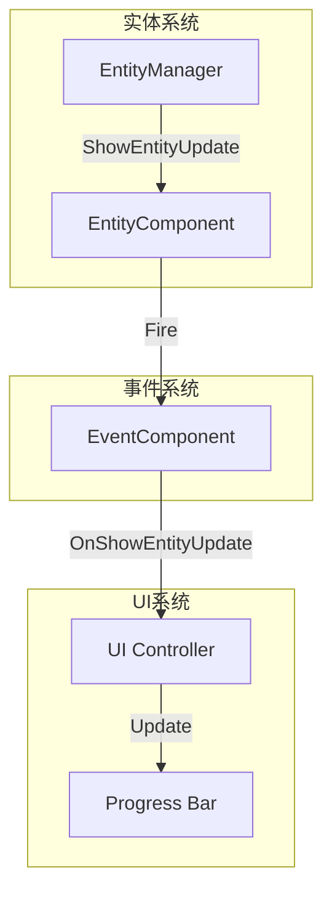
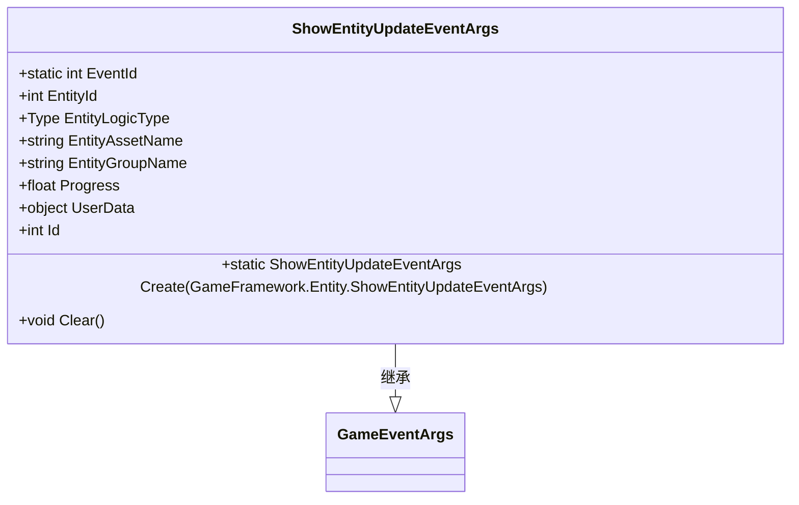
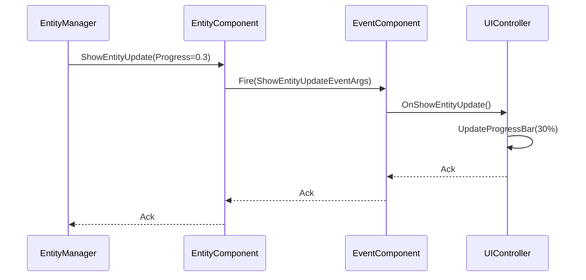
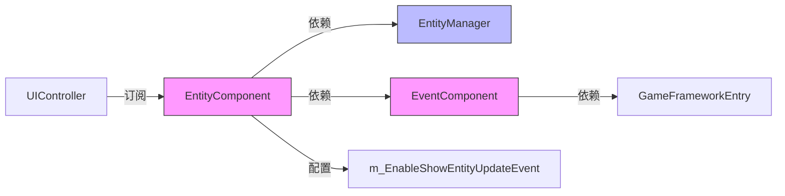
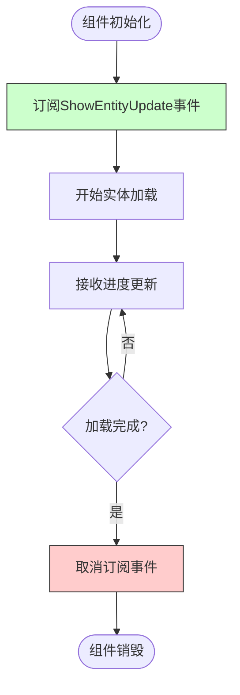

# 实体创建进度更新

<cite>
**Referenced Files in This Document**   
- [ShowEntityUpdateEventArgs.cs](file://Scripts/Runtime/Entity/ShowEntityUpdateEventArgs.cs)
- [EntityComponent.cs](file://Scripts/Runtime/Entity/EntityComponent.cs)
- [EventComponent.cs](file://Scripts/Runtime/Event/EventComponent.cs)
</cite>

## 目录
1. [简介](#简介)
2. [核心组件](#核心组件)
3. [架构概述](#架构概述)
4. [详细组件分析](#详细组件分析)
5. [依赖分析](#依赖分析)
6. [性能考虑](#性能考虑)
7. [故障排除指南](#故障排除指南)
8. [结论](#结论)

## 简介
本文档详细说明了Unity游戏框架中实体创建进度更新机制的实现。重点介绍`ShowEntityUpdateEventArgs`事件类的设计与使用，涵盖其字段定义、更新频率控制、调试信息用途以及在UI进度条中的实际应用。同时，文档还阐述了事件监听器的内存泄漏防护机制和性能影响因素。

## 核心组件
`ShowEntityUpdateEventArgs`类是实体创建进度更新的核心数据载体，封装了实体加载过程中的关键状态信息。该事件通过事件系统在实体加载过程中持续广播，使监听者能够实时获取加载进度。

**Section sources**
- [ShowEntityUpdateEventArgs.cs](file://Scripts/Runtime/Entity/ShowEntityUpdateEventArgs.cs#L16-L131)

## 架构概述
实体创建进度更新系统采用事件驱动架构，由实体组件触发并分发进度事件，通过事件系统通知所有订阅者。该设计实现了加载逻辑与UI更新的解耦，确保系统模块间的低耦合性。

**Diagram sources**
- [EntityComponent.cs](file://Scripts/Runtime/Entity/EntityComponent.cs#L1130-L1145)
- [EventComponent.cs](file://Scripts/Runtime/Event/EventComponent.cs#L95-L134)

## 详细组件分析

### ShowEntityUpdateEventArgs类分析
`ShowEntityUpdateEventArgs`类作为实体加载进度事件的数据容器，提供了丰富的上下文信息用于调试和UI更新。

#### 类结构图

**Diagram sources**
- [ShowEntityUpdateEventArgs.cs](file://Scripts/Runtime/Entity/ShowEntityUpdateEventArgs.cs#L16-L131)

#### Progress字段详解
`Progress`字段表示实体加载的完成百分比，其取值范围为0.0f至1.0f，采用浮点数类型确保精度。该字段的更新频率由底层资源管理系统的异步加载机制决定，通常在每个资源加载完成或达到关键里程碑时更新。

**Section sources**
- [ShowEntityUpdateEventArgs.cs](file://Scripts/Runtime/Entity/ShowEntityUpdateEventArgs.cs#L85-L90)

#### 上下文信息用途
- **EntityId**: 唯一标识正在加载的实体，便于在多实体并发加载时进行区分和追踪
- **EntityAssetName**: 资源名称，用于识别加载的具体资源文件，在调试资源加载问题时至关重要
- **EntityGroupName**: 实体组名称，反映实体的组织结构和分类，有助于理解实体的上下文关系

**Section sources**
- [ShowEntityUpdateEventArgs.cs](file://Scripts/Runtime/Entity/ShowEntityUpdateEventArgs.cs#L65-L83)

### UI进度条更新实现
通过订阅`ShowEntityUpdateEventArgs`事件，可以实现UI加载进度条的动态更新。事件系统确保UI更新在主线程安全执行，避免了多线程访问的复杂性。

#### 事件处理流程

**Diagram sources**
- [EntityComponent.cs](file://Scripts/Runtime/Entity/EntityComponent.cs#L1130-L1132)
- [EventComponent.cs](file://Scripts/Runtime/Event/EventComponent.cs#L118-L122)

## 依赖分析
实体进度更新系统依赖于多个核心组件的协同工作，形成完整的事件处理链条。

**Diagram sources**
- [EntityComponent.cs](file://Scripts/Runtime/Entity/EntityComponent.cs#L32-L32)
- [EventComponent.cs](file://Scripts/Runtime/Event/EventComponent.cs#L17-L133)

## 性能考虑
`m_EnableShowEntityUpdateEvent`配置项控制着进度事件的启用状态，对运行时性能有显著影响：

- **启用时**: 系统会频繁触发事件，可能影响性能，特别是在大量实体同时加载的场景
- **禁用时**: 完全消除事件开销，提升加载性能，但失去进度监控能力

建议在生产环境中根据实际需求权衡启用状态，在调试阶段启用以获取详细的加载信息。

**Section sources**
- [EntityComponent.cs](file://Scripts/Runtime/Entity/EntityComponent.cs#L32-L32)

## 故障排除指南
为防止事件监听器导致的内存泄漏，必须严格遵循正确的事件注册与注销流程。

### 内存泄漏防护范例

**Diagram sources**
- [EventComponent.cs](file://Scripts/Runtime/Event/EventComponent.cs#L88-L94)
- [EventComponent.cs](file://Scripts/Runtime/Event/EventComponent.cs#L95-L97)

**Section sources**
- [EventComponent.cs](file://Scripts/Runtime/Event/EventComponent.cs#L88-L97)

## 结论
`ShowEntityUpdateEventArgs`事件类为实体加载过程提供了精确的进度监控能力。通过合理使用上下文信息和遵循正确的事件管理实践，开发者可以构建响应迅速、用户体验良好的加载界面，同时避免潜在的性能问题和内存泄漏风险。