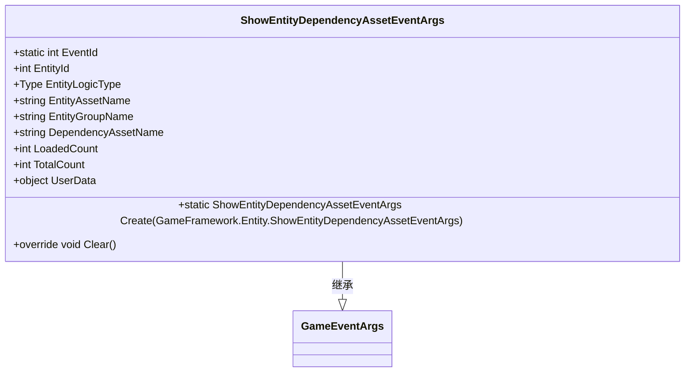
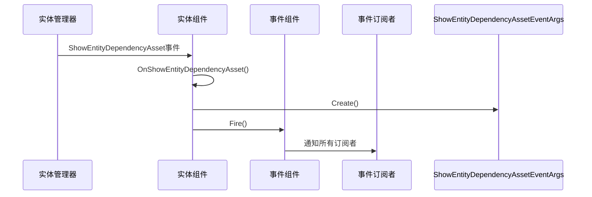
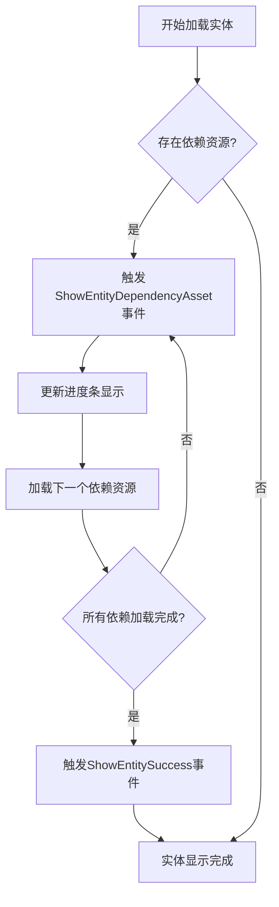
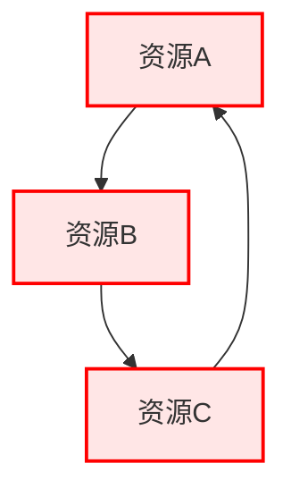

# 实体加载与依赖资源处理

<cite>
**Referenced Files in This Document**   
- [ShowEntityDependencyAssetEventArgs.cs](file://Scripts/Runtime/Entity/ShowEntityDependencyAssetEventArgs.cs)
- [EntityComponent.cs](file://Scripts/Runtime/Entity/EntityComponent.cs)
- [EntityComponentInspector.cs](file://Scripts/Editor/Inspector/EntityComponentInspector.cs)
- [Entity.cs](file://Scripts/Runtime/Entity/Entity.cs)
- [EntityLogic.cs](file://Scripts/Runtime/Entity/EntityLogic.cs)
</cite>

## 目录
1. [事件机制概述](#事件机制概述)
2. [ShowEntityDependencyAssetEventArgs事件详解](#showentitydependencyasseteventargs事件详解)
3. [事件触发与处理流程](#事件触发与处理流程)
4. [事件订阅与进度条实现](#事件订阅与进度条实现)
5. [m_EnableShowEntityDependencyAssetEvent配置项](#m_enableshowentitydependencyassetevent配置项)
6. [最佳实践建议](#最佳实践建议)

## 事件机制概述

在实体加载过程中，框架通过事件驱动机制处理依赖资源的加载。当实体资源存在依赖项时，系统会触发相应的事件来通知外部系统加载进度。这种设计模式实现了加载逻辑与UI反馈的解耦，使得开发者可以灵活地响应资源加载状态。

**Section sources**
- [EntityComponent.cs](file://Scripts/Runtime/Entity/EntityComponent.cs#L91-L132)
- [ShowEntityDependencyAssetEventArgs.cs](file://Scripts/Runtime/Entity/ShowEntityDependencyAssetEventArgs.cs#L16-L155)

## ShowEntityDependencyAssetEventArgs事件详解

`ShowEntityDependencyAssetEventArgs`事件类封装了实体加载依赖资源时的关键信息，为外部系统提供详细的加载状态数据。



**Diagram sources**
- [ShowEntityDependencyAssetEventArgs.cs](file://Scripts/Runtime/Entity/ShowEntityDependencyAssetEventArgs.cs#L16-L155)

该事件包含以下核心属性：

| 属性名称 | 类型 | 说明 |
|---------|------|------|
| EntityId | int | 正在加载的实体编号 |
| EntityLogicType | Type | 实体逻辑类型 |
| EntityAssetName | string | 实体资源名称 |
| EntityGroupName | string | 实体所属组名称 |
| DependencyAssetName | string | 当前正在加载的依赖资源名称 |
| LoadedCount | int | 已加载依赖资源数量 |
| TotalCount | int | 总共需要加载的依赖资源数量 |
| UserData | object | 用户自定义数据 |

**Section sources**
- [ShowEntityDependencyAssetEventArgs.cs](file://Scripts/Runtime/Entity/ShowEntityDependencyAssetEventArgs.cs#L49-L110)

## 事件触发与处理流程

实体组件在加载过程中通过事件订阅机制来触发`ShowEntityDependencyAssetEventArgs`事件。当`m_EnableShowEntityDependencyAssetEvent`配置项启用时，系统会注册相应的事件处理器。



**Diagram sources**
- [EntityComponent.cs](file://Scripts/Runtime/Entity/EntityComponent.cs#L1135-L1138)
- [ShowEntityDependencyAssetEventArgs.cs](file://Scripts/Runtime/Entity/ShowEntityDependencyAssetEventArgs.cs#L112-L139)

事件处理流程如下：
1. 实体管理器在加载依赖资源时触发内部事件
2. 实体组件的`OnShowEntityDependencyAsset`方法接收到事件
3. 调用`ShowEntityDependencyAssetEventArgs.Create()`方法创建事件实例
4. 通过事件组件广播该事件给所有订阅者

**Section sources**
- [EntityComponent.cs](file://Scripts/Runtime/Entity/EntityComponent.cs#L91-L132)

## 事件订阅与进度条实现

开发者可以通过订阅`ShowEntityDependencyAssetEventArgs`事件来实现加载进度条更新或资源预加载提示功能。



**Diagram sources**
- [EntityComponent.cs](file://Scripts/Runtime/Entity/EntityComponent.cs#L485-L494)
- [Entity.cs](file://Scripts/Runtime/Entity/Entity.cs#L100-L120)

典型的应用场景代码示例如下：
- 订阅事件以更新UI进度条
- 显示当前正在加载的资源名称
- 根据已加载数量和总数计算加载百分比
- 提供资源预加载提示信息

**Section sources**
- [EntityComponent.cs](file://Scripts/Runtime/Entity/EntityComponent.cs#L1135-L1138)
- [ShowEntityDependencyAssetEventArgs.cs](file://Scripts/Runtime/Entity/ShowEntityDependencyAssetEventArgs.cs#L112-L139)

## m_EnableShowEntityDependencyAssetEvent配置项

`m_EnableShowEntityDependencyAssetEvent`是实体组件中的一个序列化字段，用于控制是否启用依赖资源加载事件。

```mermaid
classDiagram
class EntityComponent {
-bool m_EnableShowEntityDependencyAssetEvent
+bool EnableShowEntityDependencyAssetEvent {get}
}
EntityComponent --> ShowEntityDependencyAssetEventArgs : 条件触发
```

**Diagram sources**
- [EntityComponent.cs](file://Scripts/Runtime/Entity/EntityComponent.cs#L35-L35)
- [EntityComponentInspector.cs](file://Scripts/Editor/Inspector/EntityComponentInspector.cs#L29-L62)

### 配置项作用

该配置项在实体组件的`Awake`方法中被检查，决定是否注册事件处理器：

```csharp
if (m_EnableShowEntityDependencyAssetEvent)
{
    m_EntityManager.ShowEntityDependencyAsset += OnShowEntityDependencyAsset;
}
```

### 性能影响

启用此配置项会对性能产生以下影响：

| 状态 | 内存开销 | CPU开销 | 适用场景 |
|------|---------|---------|---------|
| 启用 | 较高 | 较高 | 需要精确加载进度反馈 |
| 禁用 | 较低 | 较低 | 对性能要求极高或不需要进度反馈 |

**性能优化建议：**
- 在发布版本中，如果不需要详细的加载进度信息，建议禁用此选项
- 在开发和调试阶段，启用此选项有助于监控资源加载情况
- 可以根据不同的游戏场景动态调整此配置

**Section sources**
- [EntityComponent.cs](file://Scripts/Runtime/Entity/EntityComponent.cs#L91-L132)
- [EntityComponentInspector.cs](file://Scripts/Editor/Inspector/EntityComponentInspector.cs#L29-L62)

## 最佳实践建议

### 避免循环依赖

在设计资源依赖关系时，必须避免出现循环依赖，否则会导致加载死锁。



**正确做法：**
- 建立清晰的资源层级结构
- 使用工具分析资源依赖关系
- 定期检查并清理不必要的依赖

### 资源打包策略

合理的资源打包策略可以有效减少依赖层级，提高加载效率。

| 打包策略 | 优点 | 缺点 | 适用场景 |
|---------|------|------|---------|
| 单一打包 | 加载简单 | 包体积大 | 小型项目 |
| 按功能打包 | 按需加载 | 依赖复杂 | 中型项目 |
| 按使用频率打包 | 热更新方便 | 管理复杂 | 大型项目 |

**推荐做法：**
- 将经常一起使用的资源打包在一起
- 减少跨包依赖
- 使用资源分析工具优化打包方案

**Section sources**
- [EntityComponent.cs](file://Scripts/Runtime/Entity/EntityComponent.cs#L485-L494)
- [ShowEntityDependencyAssetEventArgs.cs](file://Scripts/Runtime/Entity/ShowEntityDependencyAssetEventArgs.cs#L16-L155)