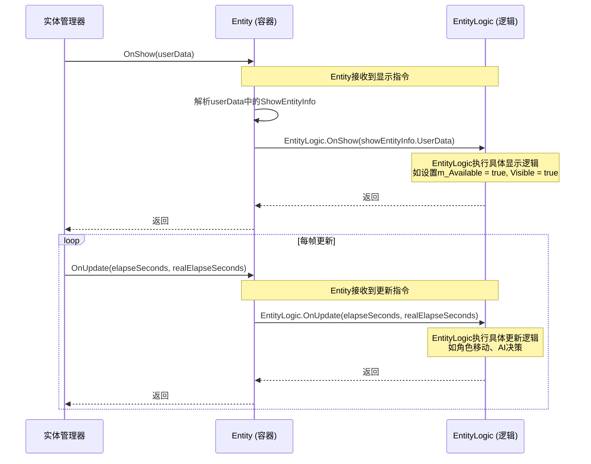

# Entity与EntityLogic的协作机制

<cite>
**Referenced Files in This Document**   
- [Entity.cs](file://Scripts/Runtime/Entity/Entity.cs)
- [EntityLogic.cs](file://Scripts/Runtime/Entity/EntityLogic.cs)
</cite>

## 目录
1. [引言](#引言)
2. [职责分离架构](#职责分离架构)
3. [生命周期与状态管理](#生命周期与状态管理)
4. [组件挂载与上下文传递](#组件挂载与上下文传递)
5. [调用链序列图](#调用链序列图)
6. [最佳实践建议](#最佳实践建议)
7. [常见陷阱与解决方案](#常见陷阱与解决方案)
8. [结论](#结论)

## 引言
在Unity游戏框架中，`Entity`与`EntityLogic`构成了实体系统的核心协作模式。该设计采用职责分离原则，将容器管理与业务逻辑实现解耦，为游戏实体提供了清晰的架构边界。`Entity`作为容器组件，负责实体的生命周期调度、状态管理和基础属性维护；而`EntityLogic`作为逻辑组件，专注于具体业务行为的实现。这种分离不仅提升了代码的可维护性，还增强了系统的灵活性和可扩展性。

## 职责分离架构
### Entity：容器与生命周期管理者
`Entity`类作为实体的容器，承担着核心的管理职责。它继承自`MonoBehaviour`并实现`IEntity`接口，是Unity场景中实体实例的直接载体。其主要职责包括：

- **生命周期调度**：通过`OnInit`、`OnShow`、`OnHide`、`OnRecycle`和`OnUpdate`等方法，统一管理实体的创建、显示、隐藏、回收和更新流程。
- **状态管理**：维护实体的唯一编号（Id）、资源名称（EntityAssetName）、所属实体组（EntityGroup）等核心状态。
- **组件协调**：持有对`EntityLogic`实例的引用，并在生命周期事件中将其转发。

### EntityLogic：业务逻辑实现者
`EntityLogic`是一个抽象基类，为所有具体的实体逻辑提供统一的接口和基础功能。开发者通过继承`EntityLogic`来实现特定的实体行为。其核心职责在于：

- **业务逻辑封装**：子类通过重写`OnShow`、`OnUpdate`等虚方法，实现具体的业务逻辑。
- **环境感知**：提供对`Entity`实例、`CachedTransform`、可见性（Visible）等关键属性的访问，使逻辑层能感知并操作容器状态。
- **行为扩展**：支持实体间的附加（Attach）与解除（Detach）等复杂交互行为。

这种架构模式的优势在于实现了关注点分离。`Entity`保持了通用性和稳定性，而`EntityLogic`则提供了高度的可定制性，使得不同类型的实体（如角色、道具、特效）可以拥有截然不同的行为，而无需修改底层容器逻辑。

**Section sources**
- [Entity.cs](file://Scripts/Runtime/Entity/Entity.cs#L17-L77)
- [EntityLogic.cs](file://Scripts/Runtime/Entity/EntityLogic.cs#L14-L45)

## 生命周期与状态管理
`Entity`组件通过一系列预定义的生命周期方法，精确控制实体的状态流转。这些方法由实体管理器（`EntityComponent`）在适当的时机调用，确保了状态变更的有序性。

- **初始化（OnInit）**：实体首次创建或从对象池中取出时调用。此时`Entity`会根据传入的`userData`中的`EntityLogicType`信息，动态决定挂载哪个`EntityLogic`子类。
- **显示（OnShow）**：当实体需要被激活并显示在场景中时调用。`Entity`将此事件转发给其`EntityLogic`，通常在此时恢复逻辑状态或触发显示动画。
- **隐藏（OnHide）**：当实体需要被停用并从场景中移除时调用。`Entity`会通知`EntityLogic`进行清理，并重置`Available`和`Visible`状态。
- **回收（OnRecycle）**：当实体被放回对象池前调用。`Entity`会调用`EntityLogic`的回收方法，并将自身`Id`重置为0，为下一次复用做准备。
- **轮询（OnUpdate）**：每帧调用，用于处理需要持续更新的逻辑，如移动、动画播放等。

`EntityLogic`通过`Available`和`Visible`属性来管理自身的可用状态。`Available`表示实体逻辑是否处于激活状态，而`Visible`则结合`Available`和`m_Visible`字段，决定实体在场景中的可见性。这种分层的状态管理机制确保了逻辑层和表现层的同步。

**Section sources**
- [Entity.cs](file://Scripts/Runtime/Entity/Entity.cs#L87-L277)
- [EntityLogic.cs](file://Scripts/Runtime/Entity/EntityLogic.cs#L125-L190)

## 组件挂载与上下文传递
### 动态挂载过程
`Entity`与`EntityLogic`的协作始于`OnInit`方法。当`Entity`的`OnInit`被调用时，它会执行以下关键步骤：

1.  **解析逻辑类型**：从`userData`参数中提取`ShowEntityInfo`对象，并获取其中的`EntityLogicType`。
2.  **检查并清理**：如果当前已存在`EntityLogic`实例，且其类型与新类型不匹配，则销毁旧实例。
3.  **动态添加**：使用`gameObject.AddComponent(entityLogicType)`方法，将指定类型的`EntityLogic`脚本动态挂载到`Entity`的`GameObject`上。
4.  **初始化逻辑**：获取新创建的`EntityLogic`实例，并调用其`OnInit`方法，将`userData`中的用户数据传递给它。

这一过程实现了逻辑组件的动态绑定，使得同一个`Entity`预制体可以承载不同类型的`EntityLogic`，极大地提高了资源的复用率。

### 上下文数据传递
`userData`是`Entity`与`EntityLogic`之间传递上下文信息的关键载体。它是一个`object`类型的参数，通常被设计为一个包含丰富信息的结构体（如`ShowEntityInfo`）。在`OnInit`和`OnShow`等方法中，`Entity`会从`userData`中提取出`EntityLogicType`和用户自定义数据（`UserData`），然后将`UserData`转发给`EntityLogic`的相应方法。这种方式允许在实体创建时注入配置、初始化参数或引用，实现了高度的灵活性。

**Section sources**
- [Entity.cs](file://Scripts/Runtime/Entity/Entity.cs#L105-L136)
- [EntityLogic.cs](file://Scripts/Runtime/Entity/EntityLogic.cs#L102-L112)

## 调用链序列图
以下序列图展示了从实体显示到更新的完整调用链，清晰地描绘了`Entity`与`EntityLogic`之间的协作流程。

**Diagram sources**
- [Entity.cs](file://Scripts/Runtime/Entity/Entity.cs#L160-L171)
- [EntityLogic.cs](file://Scripts/Runtime/Entity/EntityLogic.cs#L125-L129)
- [Entity.cs](file://Scripts/Runtime/Entity/Entity.cs#L267-L277)
- [EntityLogic.cs](file://Scripts/Runtime/Entity/EntityLogic.cs#L188-L190)

## 最佳实践建议
### 避免强引用循环
尽管`EntityLogic`通过`Entity`属性持有对`Entity`的引用，但应避免在`Entity`中直接持有对`EntityLogic`子类具体类型的引用。这不仅违反了依赖倒置原则，还可能导致难以察觉的内存泄漏。始终通过`Entity.Logic`的基类引用来操作逻辑组件。

### 推荐使用CachedTransform
`EntityLogic`基类中内置了`m_CachedTransform`字段，并在`OnInit`时自动缓存`transform`。强烈建议在`EntityLogic`的子类中使用`CachedTransform`而非直接访问`transform`。这可以避免因Unity的`GetComponent<Transform>()`调用而产生的性能开销，尤其是在`OnUpdate`等每帧调用的方法中。

### 合理利用对象池
`Entity`的设计与对象池（`ObjectPool`）紧密结合。通过`OnRecycle`和`OnInit`的配对使用，实体可以在不被销毁的情况下反复复用。这能显著减少`GameObject`的创建和销毁带来的性能开销，是优化游戏性能的关键手段。

## 常见陷阱与解决方案
### 陷阱一：在EntityLogic.OnInit中访问Entity属性过早
**问题**：在`EntityLogic`的`OnInit`方法中，有时会发现`Entity`属性为`null`。
**原因**：`Entity`的`OnInit`方法在调用`EntityLogic.OnInit`之前，才通过`GetComponent<Entity>()`来设置`m_Entity`字段。
**解决方案**：确保在`EntityLogic.OnInit`中，对`Entity`属性的访问是安全的，或将其延迟到`OnShow`方法中执行，因为此时`Entity`的初始化已完全完成。

### 陷阱二：忽略异常处理
**问题**：`Entity`在调用`EntityLogic`的方法时，使用了`try-catch`块捕获异常，但开发者可能忽略在`EntityLogic`子类中抛出异常的严重性。
**原因**：虽然框架捕获了异常以防止游戏崩溃，但这可能掩盖了潜在的逻辑错误。
**解决方案**：在`EntityLogic`的子类中，应尽可能避免抛出异常。对于可预见的错误情况，应使用日志记录和状态检查来处理，确保业务逻辑的健壮性。

## 结论
`Entity`与`EntityLogic`的协作模式是Unity游戏框架中一个精妙的设计范例。通过将容器职责与业务逻辑分离，该模式实现了高内聚、低耦合的架构目标。`Entity`作为稳定可靠的容器，管理着实体的生命周期和核心状态；而`EntityLogic`作为灵活可变的逻辑层，承载着丰富的游戏行为。两者通过`userData`进行上下文传递，并在`OnInit`时动态绑定，形成了一个高效、可扩展的实体系统。遵循避免强引用、使用`CachedTransform`和善用对象池等最佳实践，可以充分发挥这一架构的优势，构建出高性能、易维护的游戏项目。