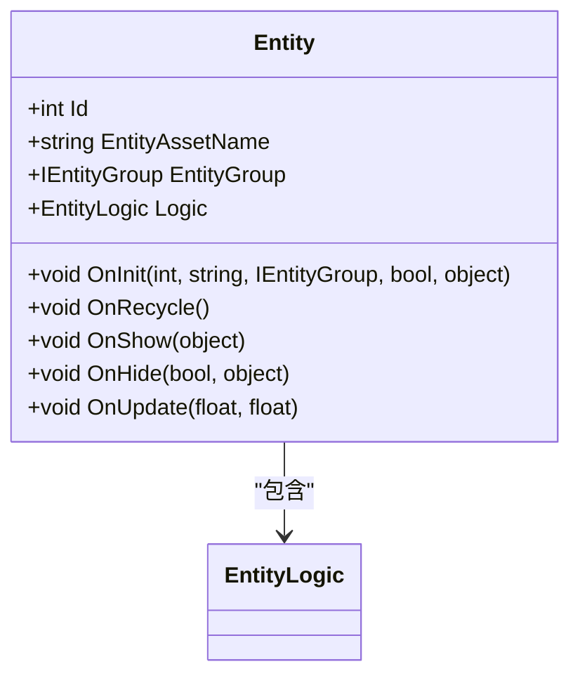
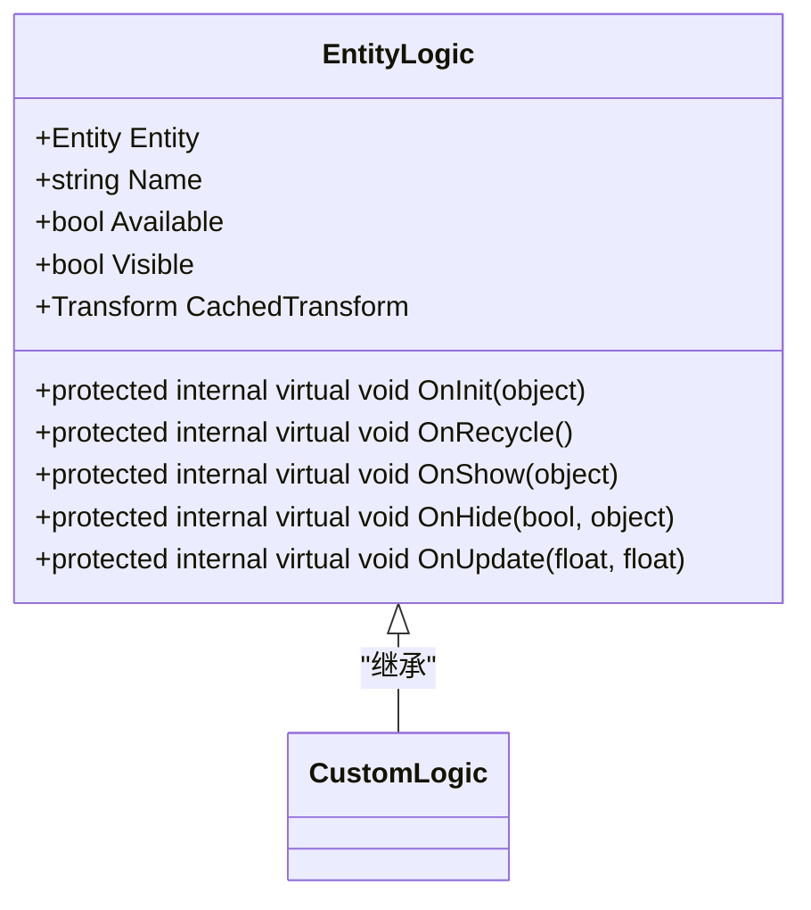
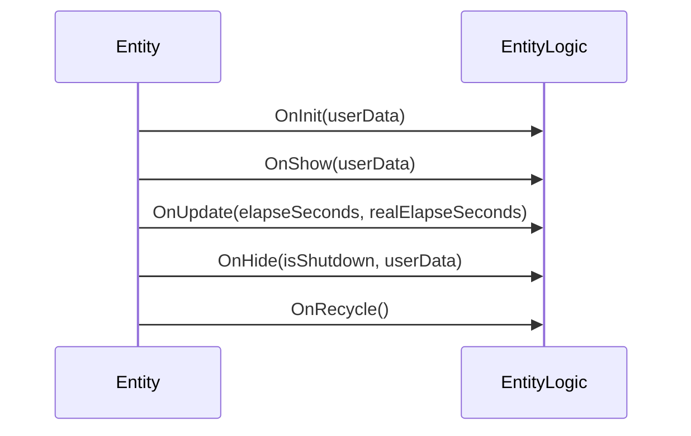

# 实体基类与逻辑组件

<cite>
**Referenced Files in This Document**   
- [Entity.cs](file://Scripts/Runtime/Entity/Entity.cs)
- [EntityLogic.cs](file://Scripts/Runtime/Entity/EntityLogic.cs)
</cite>

## 目录
1. [引言](#引言)
2. [核心组件分析](#核心组件分析)
3. [Entity 类详解](#entity-类详解)
4. [EntityLogic 抽象基类解析](#entitylogic-抽象基类解析)
5. [生命周期方法调用流程](#生命周期方法调用流程)
6. [组件分离设计优势](#组件分离设计优势)
7. [自定义逻辑组件实现](#自定义逻辑组件实现)
8. [实体与逻辑组件交互模式](#实体与逻辑组件交互模式)
9. [结论](#结论)

## 引言

在 Unity 游戏框架中，实体（Entity）系统采用组件分离的设计模式，将实体的生命周期管理与具体业务逻辑解耦。该设计通过 `Entity` 基类和 `EntityLogic` 抽象基类的协作，实现了高内聚、低耦合的架构。`Entity` 类作为 `MonoBehaviour` 的具体实现，负责实体的创建、回收、显示、隐藏等通用生命周期管理；而 `EntityLogic` 类则作为可继承的抽象基类，供开发者实现角色控制、敌人 AI 等具体游戏逻辑。这种分离设计极大地提升了代码的可维护性和可复用性。

## 核心组件分析

本节深入分析 `Entity` 和 `EntityLogic` 两个核心组件的实现与交互。

**Section sources**
- [Entity.cs](file://Scripts/Runtime/Entity/Entity.cs#L17-L278)
- [EntityLogic.cs](file://Scripts/Runtime/Entity/EntityLogic.cs#L14-L200)

## Entity 类详解

`Entity` 类是游戏框架中所有实体的基础，它继承自 `MonoBehaviour`，封装了实体的核心属性和生命周期管理。

### 核心属性

`Entity` 类定义了以下关键属性，用于标识和管理实体：

- **Id**: 实体的唯一编号，用于在系统中快速查找和引用。
- **EntityAssetName**: 实体资源的名称，通常对应于预制体（Prefab）的路径。
- **EntityGroup**: 实体所属的实体组，用于分类管理和批量操作。
- **Logic**: 对 `EntityLogic` 组件的引用，是连接通用实体与具体逻辑的桥梁。



**Diagram sources**
- [Entity.cs](file://Scripts/Runtime/Entity/Entity.cs#L27-L77)

**Section sources**
- [Entity.cs](file://Scripts/Runtime/Entity/Entity.cs#L17-L86)

## EntityLogic 抽象基类解析

`EntityLogic` 是一个抽象基类，为开发者提供了一个可继承的模板，用于实现具体的实体行为。

### 设计意图

`EntityLogic` 的设计旨在提供一个轻量级、可扩展的逻辑容器。它本身不包含具体的游戏逻辑，而是通过一系列可重写的生命周期钩子（Hook）方法，让子类能够注入自定义行为。

### 便捷属性

为了简化开发，`EntityLogic` 提供了多个便捷属性：

- **CachedTransform**: 缓存了 `Transform` 组件，避免了频繁的 `GetComponent<Transform>()` 调用，提升性能。
- **Visible**: 一个封装了可见性逻辑的属性，设置时会自动处理 `GameObject` 的激活状态。
- **Available**: 表示实体逻辑是否处于可用状态，通常在 `OnShow` 时设为 `true`，在 `OnHide` 时设为 `false`。



**Diagram sources**
- [EntityLogic.cs](file://Scripts/Runtime/Entity/EntityLogic.cs#L14-L200)

**Section sources**
- [EntityLogic.cs](file://Scripts/Runtime/Entity/EntityLogic.cs#L14-L62)

## 生命周期方法调用流程

`Entity` 和 `EntityLogic` 通过一套预定义的生命周期方法进行协作，确保逻辑的有序执行。

### 内部调度机制

当 `Entity` 的生命周期方法被调用时，它会将控制权转发给其内部的 `EntityLogic` 组件。例如，当 `Entity.OnShow()` 被触发时，它会从 `userData` 中提取用户数据，并调用 `m_EntityLogic.OnShow()`。



**Diagram sources**
- [Entity.cs](file://Scripts/Runtime/Entity/Entity.cs#L87-L188)
- [EntityLogic.cs](file://Scripts/Runtime/Entity/EntityLogic.cs#L102-L190)

**Section sources**
- [Entity.cs](file://Scripts/Runtime/Entity/Entity.cs#L87-L188)
- [EntityLogic.cs](file://Scripts/Runtime/Entity/EntityLogic.cs#L102-L190)

## 组件分离设计优势

将实体的管理与逻辑分离带来了显著的可维护性优势：

1.  **关注点分离**：`Entity` 专注于资源加载、生命周期管理和性能优化等通用任务，而 `EntityLogic` 则专注于实现特定的游戏玩法。
2.  **代码复用**：不同的 `EntityLogic` 子类可以共享同一个 `Entity` 基础，反之亦然。例如，同一个 `PlayerLogic` 可以应用于不同外观的玩家实体。
3.  **易于测试**：`EntityLogic` 的逻辑可以独立于 Unity 的 `MonoBehaviour` 系统进行单元测试，因为其核心方法不直接依赖于 Unity 的 API（除了 `transform` 等）。
4.  **灵活扩展**：添加新的实体类型只需继承 `EntityLogic` 并实现相应的方法，无需修改 `Entity` 类本身。

## 自定义逻辑组件实现

开发者可以通过继承 `EntityLogic` 来创建自定义的逻辑组件。

### 代码示例

以下是一个简单的角色控制逻辑组件的实现示例：

```csharp
public class PlayerLogic : EntityLogic
{
    private CharacterController m_Controller;
    
    protected internal override void OnInit(object userData)
    {
        base.OnInit(userData);
        m_Controller = GetComponent<CharacterController>();
    }

    protected internal override void OnUpdate(float elapseSeconds, float realElapseSeconds)
    {
        // 处理玩家输入和移动
        float horizontal = Input.GetAxis("Horizontal");
        float vertical = Input.GetAxis("Vertical");
        Vector3 movement = new Vector3(horizontal, 0, vertical) * elapseSeconds * 5f;
        m_Controller.Move(movement);
    }
}
```

**Section sources**
- [EntityLogic.cs](file://Scripts/Runtime/Entity/EntityLogic.cs#L102-L190)

## 实体与逻辑组件交互模式

`Entity` 与 `EntityLogic` 之间通过紧密的引用关系进行交互。

### 引用关系

- **单向引用**：`Entity` 持有对 `EntityLogic` 的强引用（`m_EntityLogic` 字段），而 `EntityLogic` 也持有对 `Entity` 的引用（`m_Entity` 字段）。这形成了一个双向的链接，但 `Entity` 是主导方。
- **动态创建**：`Entity` 在 `OnInit` 方法中根据传入的 `Type` 信息，使用 `gameObject.AddComponent()` 动态地创建 `EntityLogic` 组件。

### 数据交互

数据交互主要通过 `userData` 参数进行。当框架需要显示一个实体时，会创建一个包含 `EntityLogicType` 和用户自定义数据的 `ShowEntityInfo` 对象，并将其作为 `userData` 传递给 `Entity.OnShow()`。`Entity` 随后将这个 `userData` 转发给 `EntityLogic.OnShow()`，从而将上下文信息传递给具体的逻辑实现。

**Section sources**
- [Entity.cs](file://Scripts/Runtime/Entity/Entity.cs#L87-L136)
- [EntityLogic.cs](file://Scripts/Runtime/Entity/EntityLogic.cs#L102-L112)

## 结论

`Entity` 和 `EntityLogic` 构成的组件分离架构是 Unity 游戏框架中的一个核心设计模式。`Entity` 作为 `MonoBehaviour` 的具体实现，提供了稳定、高效的实体管理能力；而 `EntityLogic` 作为抽象基类，则为开发者提供了灵活、可扩展的逻辑实现接口。两者通过清晰的职责划分和严谨的生命周期调度，共同构建了一个既强大又易于维护的游戏实体系统。这种设计模式不仅适用于角色和敌人，也可以广泛应用于 UI 元素、特效、道具等任何需要动态创建和管理的游戏对象。