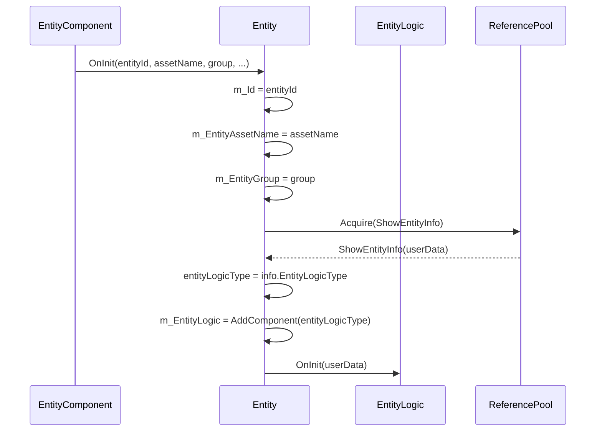

# 实体基类属性详解

<cite>
**Referenced Files in This Document**  
- [Entity.cs](file://Scripts/Runtime/Entity/Entity.cs)
- [EntityLogic.cs](file://Scripts/Runtime/Entity/EntityLogic.cs)
- [EntityComponent.cs](file://Scripts/Runtime/Entity/EntityComponent.cs)
- [ShowEntityInfo.cs](file://Scripts/Runtime/Entity/ShowEntityInfo.cs)
</cite>

## 目录
1. [引言](#引言)
2. [核心属性定义与访问权限](#核心属性定义与访问权限)
3. [属性在实体生命周期中的作用](#属性在实体生命周期中的作用)
4. [运行时安全访问示例](#运行时安全访问示例)
5. [常见误用与问题](#常见误用与问题)
6. [性能建议](#性能建议)
7. [结论](#结论)

## 引言

在Unity游戏框架中，`Entity` 类作为所有可实例化游戏对象的基类，承担着连接资源、逻辑与运行时行为的核心职责。该类通过封装关键属性，实现了对实体的统一管理与高效控制。本文档旨在深入解析 `Entity` 基类中的核心属性——`Id`、`EntityAssetName`、`Handle`、`EntityGroup` 和 `Logic`，阐明其定义、访问方式、生命周期作用及最佳实践。通过结合代码逻辑与使用场景，帮助开发者理解如何正确、高效地利用这些属性构建稳定、可维护的游戏系统。

## 核心属性定义与访问权限

`Entity` 类通过私有字段与公共只读属性的组合，对外暴露其核心状态。所有属性均为 `get` 访问器，确保了外部代码只能读取而不能直接修改其值，从而维护了实体状态的完整性与一致性。

### Id 属性

`Id` 属性是实体在运行时的唯一标识符，用于在对象池和实体管理器中进行快速查找与管理。

**Section sources**
- [Entity.cs](file://Scripts/Runtime/Entity/Entity.cs#L27-L33)

### EntityAssetName 属性

`EntityAssetName` 属性存储了该实体所关联的资源名称，通常指向一个预制件（Prefab）或场景中的资源路径，是资源加载与实例化的关键依据。

**Section sources**
- [Entity.cs](file://Scripts/Runtime/Entity/Entity.cs#L38-L44)

### Handle 属性

`Handle` 属性提供了对实体底层Unity `GameObject` 实例的引用，是桥接框架逻辑与Unity引擎API的桥梁。

**Section sources**
- [Entity.cs](file://Scripts/Runtime/Entity/Entity.cs#L49-L55)

### EntityGroup 属性

`EntityGroup` 属性指明了该实体所属的实体组，实体组用于对具有相似行为或管理需求的实体进行分类和批量操作。

**Section sources**
- [Entity.cs](file://Scripts/Runtime/Entity/Entity.cs#L60-L66)

### Logic 属性

`Logic` 属性是实体行为逻辑的载体，它是一个继承自 `EntityLogic` 的具体类实例，负责处理实体的业务逻辑。

**Section sources**
- [Entity.cs](file://Scripts/Runtime/Entity/Entity.cs#L71-L77)

## 属性在实体生命周期中的作用

实体的生命周期由 `EntityComponent` 管理，并通过一系列回调方法驱动。核心属性在每个阶段都扮演着不可或缺的角色。

### 初始化阶段 (OnInit)

当一个实体被创建或从对象池中取出时，`EntityComponent` 会调用其 `OnInit` 方法。此时，`Id`、`EntityAssetName` 和 `EntityGroup` 被赋予初始值。`Logic` 属性在此阶段被初始化：框架会根据 `ShowEntityInfo` 中提供的 `EntityLogicType`，通过 `gameObject.AddComponent` 动态地为 `GameObject` 添加对应的逻辑脚本。



**Diagram sources**
- [Entity.cs](file://Scripts/Runtime/Entity/Entity.cs#L87-L136)
- [ShowEntityInfo.cs](file://Scripts/Runtime/Entity/ShowEntityInfo.cs#L39-L45)
- [EntityComponent.cs](file://Scripts/Runtime/Entity/EntityComponent.cs#L485-L494)

### 显示与隐藏阶段 (OnShow/OnHide)

当实体需要被激活显示时，`EntityComponent` 调用 `OnShow`。此方法会将 `userData` 传递给 `Logic` 的 `OnShow` 方法，允许逻辑层执行初始化后的业务代码。`Handle` 属性在此阶段被用于设置 `GameObject` 的激活状态（通过 `InternalSetVisible`）。

当实体被隐藏时，`OnHide` 方法被调用。`Logic` 的 `OnHide` 方法会收到通知，`Handle` 的 `GameObject` 会被设置为非激活状态，`Available` 标志被置为 `false`。

**Section sources**
- [Entity.cs](file://Scripts/Runtime/Entity/Entity.cs#L160-L188)
- [EntityLogic.cs](file://Scripts/Runtime/Entity/EntityLogic.cs#L120-L142)

### 回收阶段 (OnRecycle)

当实体不再需要并被放回对象池时，`OnRecycle` 方法被调用。此时，`Logic` 的 `OnRecycle` 方法会被执行，允许其清理临时数据。`Id` 被重置为0，标志着该实体已脱离管理。`Handle` 的 `GameObject` 保持不变，等待下一次被复用。

**Section sources**
- [Entity.cs](file://Scripts/Runtime/Entity/Entity.cs#L141-L154)
- [EntityLogic.cs](file://Scripts/Runtime/Entity/EntityLogic.cs#L105-L108)

## 运行时安全访问示例

在运行时访问这些属性时，必须考虑到实体可能处于不同的生命周期状态。以下是一些安全访问的代码模式。

### 安全访问 Logic 属性

由于 `Logic` 属性在 `OnInit` 之前为 `null`，直接访问其方法可能导致空引用异常。应在调用前进行检查。

```csharp
// 安全的访问方式
if (entity.Logic != null && entity.Logic.Available)
{
    // 执行逻辑操作
    entity.Logic.CustomMethod();
}
else
{
    // 处理实体不可用的情况
    Debug.LogWarning("Entity logic is not available.");
}
```

### 通过 EntityComponent 查找实体

推荐通过 `EntityComponent` 提供的接口来获取实体，而不是直接缓存 `Handle`。这可以避免因实体被销毁或回收而导致的引用失效。

```csharp
// 推荐：通过ID查找
Entity targetEntity = GameEntry.Entity.GetEntity(targetEntityId);
if (targetEntity != null)
{
    // 安全地使用找到的实体
    ProcessEntity(targetEntity);
}
else
{
    // 实体可能已被销毁
    Debug.Log("Target entity not found.");
}
```

**Section sources**
- [EntityComponent.cs](file://Scripts/Runtime/Entity/EntityComponent.cs#L300-L311)

## 常见误用及其引发的问题

### 直接修改私有字段

直接通过反射或其他方式修改 `m_Id` 或 `m_EntityAssetName` 等私有字段，会破坏框架的内部状态一致性，导致对象池管理混乱或资源加载错误。

### 忽略 Logic 的可用性检查

在 `Start` 或 `Update` 等Unity生命周期方法中直接调用 `entity.Logic.SomeMethod()`，而没有检查 `entity.Logic` 是否为 `null` 或 `Available`，是导致 `NullReferenceException` 的常见原因。

### 持有已销毁实体的 Handle

缓存了一个实体的 `Handle`（即 `GameObject`），但在实体被 `Hide` 或回收后，仍然尝试通过该 `Handle` 访问其组件，会导致访问到一个非激活或状态不一致的对象。

## 性能建议

### 避免频繁调用属性Getter

虽然属性 `get` 访问器通常开销很小，但在每帧执行的 `Update` 方法中，应避免不必要的属性访问。

```csharp
// 不推荐：每帧多次访问
void Update()
{
    if (entity.Id > 0) { /* ... */ }
    if (entity.EntityAssetName != null) { /* ... */ }
    entity.Logic.DoWork();
}

// 推荐：缓存引用
private EntityLogic cachedLogic;

void Start()
{
    cachedLogic = entity.Logic;
}

void Update()
{
    // 直接使用缓存的引用
    if (cachedLogic != null && cachedLogic.Available)
    {
        cachedLogic.DoWork();
    }
}
```

### 合理使用 EntityGroup 进行批量操作

当需要对一类实体进行操作时，优先使用 `EntityGroup` 提供的批量方法，而不是遍历所有实体并逐一检查其类型或名称，这能显著提高效率。

**Section sources**
- [EntityComponent.cs](file://Scripts/Runtime/Entity/EntityComponent.cs#L200-L215)

## 结论

`Entity` 基类的五个核心属性构成了一个强大而灵活的实体管理系统。`Id` 提供了唯一标识，`EntityAssetName` 关联了资源，`Handle` 连接了Unity引擎，`EntityGroup` 实现了分类管理，而 `Logic` 则分离了行为逻辑。理解这些属性的定义、生命周期作用及正确使用方式，是开发高效、健壮的Unity游戏应用的基础。遵循安全访问和性能优化的最佳实践，可以有效避免常见错误，提升代码质量和运行效率。