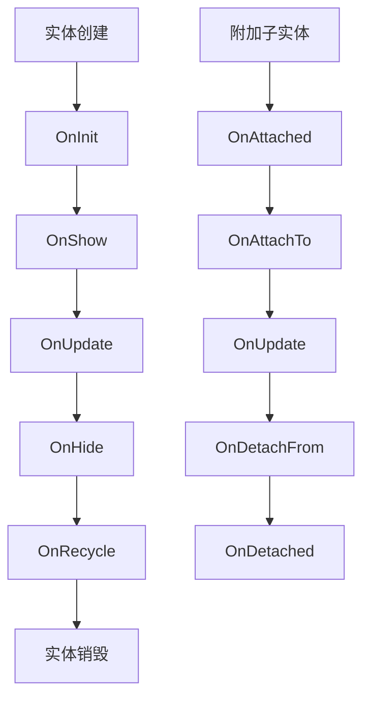
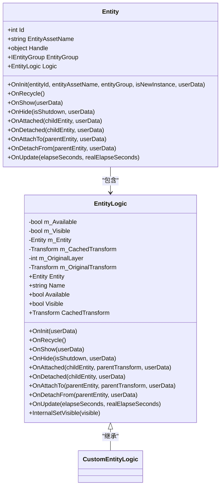

# 实体生命周期方法

<cite>
**Referenced Files in This Document**   
- [Entity.cs](file://Scripts/Runtime/Entity/Entity.cs)
- [EntityLogic.cs](file://Scripts/Runtime/Entity/EntityLogic.cs)
- [ShowEntityInfo.cs](file://Scripts/Runtime/Entity/ShowEntityInfo.cs)
- [AttachEntityInfo.cs](file://Scripts/Runtime/Entity/AttachEntityInfo.cs)
</cite>

## 目录
1. [引言](#引言)
2. [生命周期方法概览](#生命周期方法概览)
3. [核心生命周期方法详解](#核心生命周期方法详解)
4. [父子实体交互方法](#父子实体交互方法)
5. [更新与轮询方法](#更新与轮询方法)
6. [参数传递与userData机制](#参数传递与userdata机制)
7. [异常处理策略](#异常处理策略)
8. [状态管理与资源释放](#状态管理与资源释放)
9. [最佳实践与设计模式](#最佳实践与设计模式)

## 引言

在Unity游戏框架中，实体（Entity）系统采用基于组件的架构模式，通过定义一系列生命周期方法来管理实体从创建到销毁的完整过程。这些生命周期钩子为开发者提供了精确控制实体行为的机制，确保在正确的时间点执行相应的初始化、更新和清理操作。本文档深入解析`Entity`类及其关联的`EntityLogic`基类中的核心生命周期方法，阐述每个方法的调用时机、执行上下文、参数含义以及在状态管理和资源释放中的关键作用。

**Section sources**
- [Entity.cs](file://Scripts/Runtime/Entity/Entity.cs#L87-L277)
- [EntityLogic.cs](file://Scripts/Runtime/Entity/EntityLogic.cs#L102-L190)

## 生命周期方法概览

实体生命周期由一系列预定义的方法组成，这些方法在实体的不同状态转换时被框架自动调用。生命周期方法可分为三大类：初始化与回收、显示与隐藏、以及父子实体交互。这些方法构成了实体行为的核心骨架，开发者通过重写这些方法来实现自定义逻辑。

**Diagram sources**
- [Entity.cs](file://Scripts/Runtime/Entity/Entity.cs#L87-L277)
- [EntityLogic.cs](file://Scripts/Runtime/Entity/EntityLogic.cs#L102-L190)

**Section sources**
- [Entity.cs](file://Scripts/Runtime/Entity/Entity.cs#L87-L277)

## 核心生命周期方法详解

### OnInit 方法

`OnInit`方法在实体首次创建或从对象池中复用时触发，是实体生命周期的起点。该方法负责初始化实体的基本属性，包括实体编号、资源名称和所属实体组。当`isNewInstance`参数为`true`时，表示创建新实例，会设置实体组；否则会验证实体组的一致性。

该方法的核心功能是根据`userData`中的`ShowEntityInfo`创建或激活对应的`EntityLogic`组件。如果`EntityLogic`已存在且类型匹配，则启用组件；否则会销毁旧组件并添加新组件。最后，调用`EntityLogic.OnInit`传递用户数据，完成逻辑层的初始化。

**Section sources**
- [Entity.cs](file://Scripts/Runtime/Entity/Entity.cs#L87-L136)
- [EntityLogic.cs](file://Scripts/Runtime/Entity/EntityLogic.cs#L102-L112)

### OnRecycle 方法

`OnRecycle`方法在实体被回收到对象池时调用，标志着实体生命周期的结束。该方法首先调用`EntityLogic.OnRecycle`进行逻辑层的清理工作，然后禁用`EntityLogic`组件以防止其继续执行更新逻辑。最后，将实体ID重置为0，完成状态清理。

此方法是资源管理的关键环节，确保实体在复用前处于干净状态，避免残留状态导致的逻辑错误。

**Section sources**
- [Entity.cs](file://Scripts/Runtime/Entity/Entity.cs#L141-L154)
- [EntityLogic.cs](file://Scripts/Runtime/Entity/EntityLogic.cs#L117-L119)

### OnShow 方法

`OnShow`方法在实体被激活显示时调用，通常发生在实体从对象池中取出并准备显示时。该方法从`userData`中提取`ShowEntityInfo`，然后调用`EntityLogic.OnShow`传递用户自定义数据。

在`EntityLogic`基类中，`OnShow`默认将实体标记为可用（available）并设置为可见（visible），这是实体进入可交互状态的标准流程。

**Section sources**
- [Entity.cs](file://Scripts/Runtime/Entity/Entity.cs#L160-L171)
- [EntityLogic.cs](file://Scripts/Runtime/Entity/EntityLogic.cs#L125-L129)

### OnHide 方法

`OnHide`方法在实体被隐藏时调用，`isShutdown`参数指示是否因关闭实体管理器而触发。该方法直接调用`EntityLogic.OnHide`，传递关闭标志和用户数据。

在`EntityLogic`基类中，`OnHide`会将游戏对象的层级恢复到原始状态，设置为不可见，并标记为不可用，确保实体在隐藏状态下不会参与游戏逻辑。

**Section sources**
- [Entity.cs](file://Scripts/Runtime/Entity/Entity.cs#L178-L188)
- [EntityLogic.cs](file://Scripts/Runtime/Entity/EntityLogic.cs#L136-L141)

## 父子实体交互方法

### OnAttached 与 OnDetached

`OnAttached`方法在父实体附加子实体时调用，`OnDetached`在解除子实体时调用。这两个方法通过`userData`中的`AttachEntityInfo`获取父变换和用户数据，然后调用`EntityLogic`对应的钩子方法。

这些方法允许父实体在结构变化时执行自定义逻辑，如更新UI、播放音效或调整行为。

**Section sources**
- [Entity.cs](file://Scripts/Runtime/Entity/Entity.cs#L195-L223)
- [EntityLogic.cs](file://Scripts/Runtime/Entity/EntityLogic.cs#L149-L160)

### OnAttachTo 与 OnDetachFrom

`OnAttachTo`方法在子实体被附加到父实体时调用，`OnDetachFrom`在从父实体解除时调用。与`OnAttached`不同，这些方法在子实体上执行，负责调整自身的变换层级。

在`EntityLogic`基类中，`OnAttachTo`将变换的父对象设置为指定的`parentTransform`，而`OnDetachFrom`则恢复到原始父对象。`OnAttachTo`还会释放`AttachEntityInfo`，实现资源的自动管理。

**Section sources**
- [Entity.cs](file://Scripts/Runtime/Entity/Entity.cs#L230-L260)
- [EntityLogic.cs](file://Scripts/Runtime/Entity/EntityLogic.cs#L168-L181)

## 更新与轮询方法

### OnUpdate 方法

`OnUpdate`方法在每帧更新时调用，接收两个时间参数：`elapseSeconds`表示逻辑流逝时间，`realElapseSeconds`表示真实流逝时间。该方法直接调用`EntityLogic.OnUpdate`，为实体提供持续的行为更新能力。

此方法是实现动态行为的核心，如移动、动画、AI决策等，所有需要每帧执行的逻辑都应在重写的`OnUpdate`中实现。

**Section sources**
- [Entity.cs](file://Scripts/Runtime/Entity/Entity.cs#L267-L277)
- [EntityLogic.cs](file://Scripts/Runtime/Entity/EntityLogic.cs#L188-L190)

## 参数传递与userData机制

`userData`参数是生命周期方法中传递自定义数据的核心机制。框架使用特定的包装类来封装不同类型的数据：

- `ShowEntityInfo`：用于`OnShow`和`OnInit`，包含`EntityLogicType`和用户数据
- `AttachEntityInfo`：用于父子实体交互，包含`ParentTransform`和用户数据

这些信息类实现了`IReference`接口，通过引用池（ReferencePool）进行管理，避免频繁的内存分配。`Create`静态方法从引用池获取实例并初始化，而`OnAttachTo`中的`ReferencePool.Release`确保使用后及时归还，实现高效的内存复用。

**Section sources**
- [ShowEntityInfo.cs](file://Scripts/Runtime/Entity/ShowEntityInfo.cs#L12-L52)
- [AttachEntityInfo.cs](file://Scripts/Runtime/Entity/AttachEntityInfo.cs#L12-L52)

## 异常处理策略

所有生命周期方法都包含统一的异常处理机制。在调用`EntityLogic`对应方法时，使用`try-catch`块捕获任何可能的异常，并通过`Log.Error`记录详细的错误信息，包括实体ID、资源名称和异常堆栈。

这种防御性编程确保了即使在自定义逻辑中发生错误，也不会导致整个游戏崩溃，同时提供了足够的调试信息。

**Section sources**
- [Entity.cs](file://Scripts/Runtime/Entity/Entity.cs#L87-L277)

## 状态管理与资源释放

生命周期方法在状态管理中扮演关键角色。`OnInit`和`OnShow`建立实体的初始状态，`OnHide`和`OnRecycle`负责清理和重置状态。`EntityLogic`中的`m_Available`和`m_Visible`字段精确控制实体的可用性和可见性状态。

资源释放主要通过引用池机制实现。`AttachEntityInfo`等临时数据对象在使用后立即释放，避免内存泄漏。`OnRecycle`中的ID重置确保实体在复用时不会携带旧状态。

**Section sources**
- [EntityLogic.cs](file://Scripts/Runtime/Entity/EntityLogic.cs#L102-L190)
- [Entity.cs](file://Scripts/Runtime/Entity/Entity.cs#L141-L154)

## 最佳实践与设计模式

1. **避免在生命周期方法中执行耗时操作**：特别是`OnInit`和`OnShow`，以免影响游戏流畅性
2. **正确管理引用**：在`OnHide`或`OnRecycle`中清理事件监听器和引用，防止内存泄漏
3. **利用userData传递上下文**：将初始化参数、配置数据等通过`userData`传递，提高组件复用性
4. **重写基类方法时调用base**：在重写`OnShow`、`OnHide`等方法时，通常需要调用`base.OnShow`以确保基类功能正常
5. **使用引用池管理临时对象**：对于频繁创建销毁的数据对象，实现`IReference`接口并使用引用池

**Diagram sources**
- [Entity.cs](file://Scripts/Runtime/Entity/Entity.cs#L87-L277)
- [EntityLogic.cs](file://Scripts/Runtime/Entity/EntityLogic.cs#L102-L190)

**Section sources**
- [Entity.cs](file://Scripts/Runtime/Entity/Entity.cs#L87-L277)
- [EntityLogic.cs](file://Scripts/Runtime/Entity/EntityLogic.cs#L102-L190)