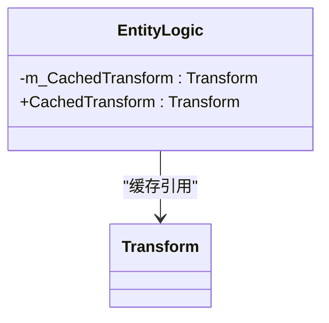
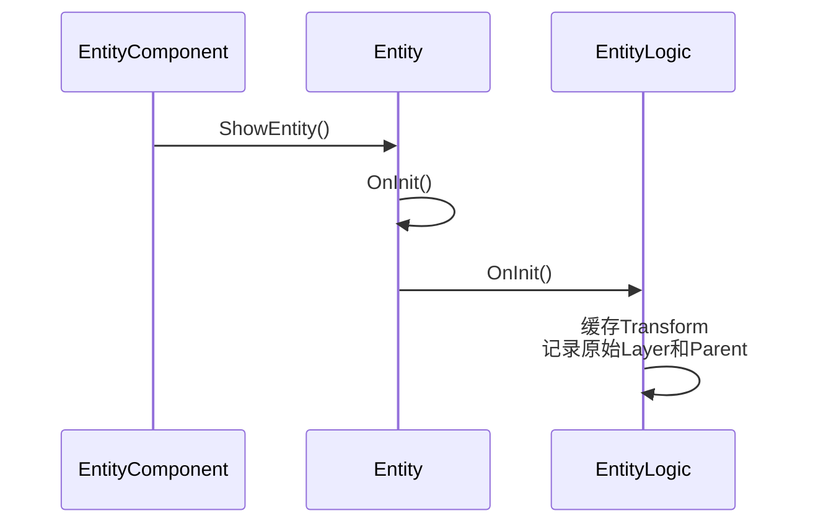
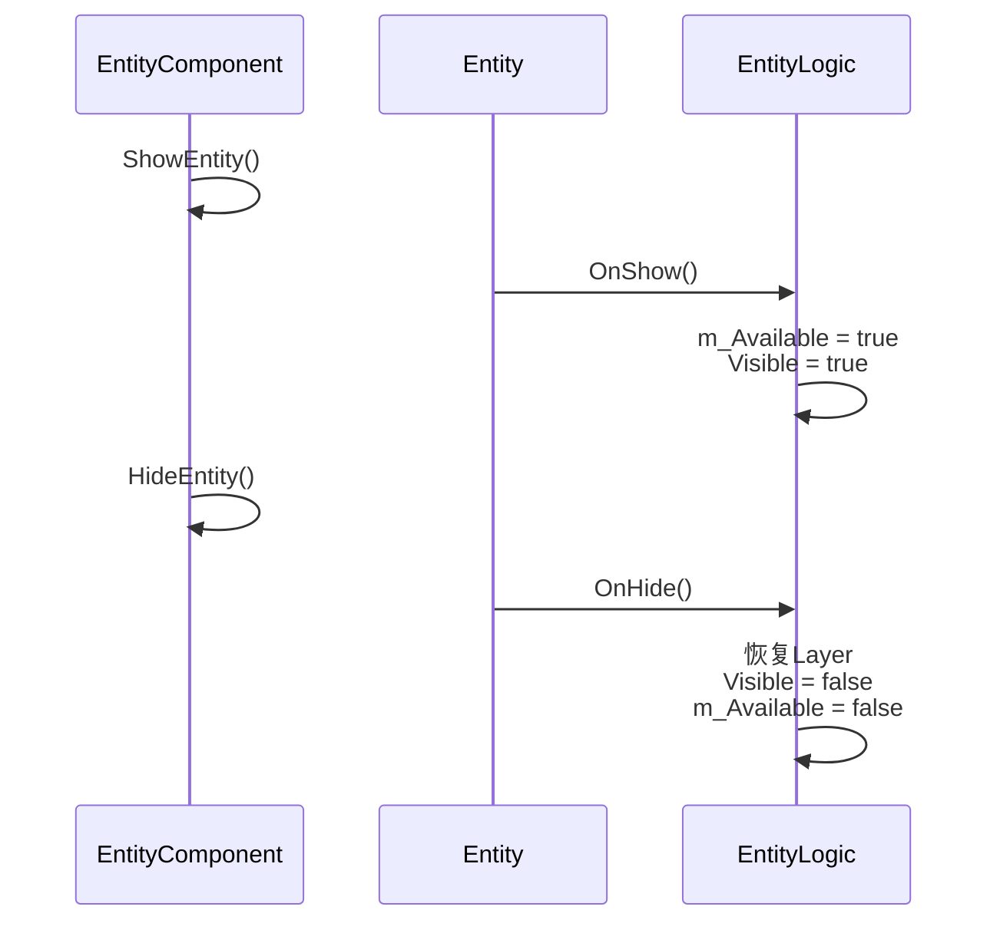
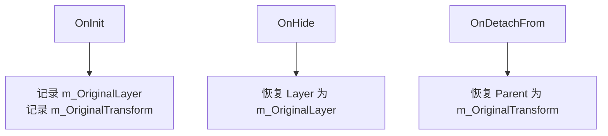

# 实体逻辑基类（EntityLogic）设计与使用

<cite>
**Referenced Files in This Document**   
- [EntityLogic.cs](file://Scripts/Runtime/Entity/EntityLogic.cs)
- [Entity.cs](file://Scripts/Runtime/Entity/Entity.cs)
- [EntityComponent.cs](file://Scripts/Runtime/Entity/EntityComponent.cs)
</cite>

## 目录
1. [引言](#引言)
2. [核心属性设计](#核心属性设计)
3. [生命周期方法](#生命周期方法)
4. [继承与扩展实践](#继承与扩展实践)
5. [层级恢复机制](#层级恢复机制)
6. [自定义可见性控制](#自定义可见性控制)
7. [结论](#结论)

## 引言

`EntityLogic` 是 Unity 游戏框架中的抽象基类，作为所有游戏实体行为逻辑的载体。它继承自 `MonoBehaviour`，为角色、敌人、UI 元素等各类游戏对象提供了一套标准化的生命周期管理和便捷的属性封装。通过定义一系列受保护的虚方法，`EntityLogic` 为开发者提供了清晰的可扩展点，使得在不修改框架核心代码的情况下，能够灵活地实现各种自定义游戏逻辑。

**Section sources**
- [EntityLogic.cs](file://Scripts/Runtime/Entity/EntityLogic.cs#L1-L20)

## 核心属性设计

`EntityLogic` 类封装了多个便捷属性，极大地提升了开发效率，使开发者能够更专注于核心逻辑的实现。

### CachedTransform 属性

`CachedTransform` 属性提供了对 `Transform` 组件的缓存访问。在 Unity 中，直接访问 `transform` 属性会触发一次组件查找，这在性能敏感的 `Update` 循环中会产生不必要的开销。`EntityLogic` 在 `OnInit` 方法中将 `transform` 赋值给私有字段 `m_CachedTransform`，后续所有对 `Transform` 的访问都通过这个缓存字段进行，避免了重复查找，优化了性能。



**Diagram sources**
- [EntityLogic.cs](file://Scripts/Runtime/Entity/EntityLogic.cs#L30-L35)

### Visible 与 Available 属性

`Visible` 和 `Available` 是两个关键的状态属性，共同管理实体的可见性和可用性。

- **Available**: 表示实体是否处于可用状态。这是一个私有字段 `m_Available` 的公开只读属性。当实体被隐藏或回收时，此状态会被设为 `false`。
- **Visible**: 表示实体是否可见。这是一个复合属性，其值为 `m_Available && m_Visible`。这意味着一个实体只有在可用（Available）且被显式设置为可见（m_Visible）时，才是最终可见的。

这种设计模式确保了实体的可见性受到其可用性的制约。例如，当一个实体被 `Hide` 时，`m_Available` 会被设为 `false`，即使 `m_Visible` 仍为 `true`，`Visible` 属性也会返回 `false`，从而防止了对已隐藏实体的误操作。

```mermaid
classDiagram
class EntityLogic {
-m_Available : bool
-m_Visible : bool
+Available : bool
+Visible : bool
}
note right of EntityLogic : : Visible
Visible = Available && m_Visible
end note
```

**Diagram sources**
- [EntityLogic.cs](file://Scripts/Runtime/Entity/EntityLogic.cs#L40-L60)

**Section sources**
- [EntityLogic.cs](file://Scripts/Runtime/Entity/EntityLogic.cs#L40-L60)

## 生命周期方法

`EntityLogic` 定义了一系列受保护的虚方法，这些方法构成了实体的生命周期钩子，是框架为开发者提供的主要可扩展点。

### OnInit 方法

`OnInit` 方法在实体被初始化时调用。这是设置缓存、获取组件引用和记录初始状态的理想位置。`EntityLogic` 的默认实现会缓存 `Transform`，获取 `Entity` 组件，并记录实体的原始层级（Layer）和原始父级 `Transform`。



**Diagram sources**
- [EntityLogic.cs](file://Scripts/Runtime/Entity/EntityLogic.cs#L102-L112)
- [Entity.cs](file://Scripts/Runtime/Entity/Entity.cs#L57-L99)
- [EntityComponent.cs](file://Scripts/Runtime/Entity/EntityComponent.cs#L476-L503)

### OnShow 与 OnHide 方法

- **OnShow**: 在实体被显示时调用。`EntityLogic` 的默认实现会将 `m_Available` 设为 `true`，并调用 `Visible` 属性来显示实体。开发者可以重写此方法，在实体显示时执行自定义逻辑，如播放出现动画、激活AI等。
- **OnHide**: 在实体被隐藏时调用。`EntityLogic` 的默认实现会将实体的层级恢复为初始值，设置 `Visible` 为 `false`，并将 `m_Available` 设为 `false`。这是一个清理资源和重置状态的关键时机。



**Diagram sources**
- [EntityLogic.cs](file://Scripts/Runtime/Entity/EntityLogic.cs#L125-L141)
- [Entity.cs](file://Scripts/Runtime/Entity/Entity.cs#L173-L206)
- [EntityComponent.cs](file://Scripts/Runtime/Entity/EntityComponent.cs#L476-L503)

### OnUpdate 方法

`OnUpdate` 方法在每一帧被调用，用于处理需要持续更新的逻辑，如角色移动、动画播放、AI决策等。`EntityLogic` 提供了一个空的虚方法，开发者必须继承此类并重写 `OnUpdate` 来实现具体的游戏逻辑。

**Section sources**
- [EntityLogic.cs](file://Scripts/Runtime/Entity/EntityLogic.cs#L188-L190)

## 继承与扩展实践

通过继承 `EntityLogic` 并重写其生命周期方法，可以轻松实现各种复杂的游戏功能。

### 角色移动逻辑

```csharp
public class PlayerLogic : EntityLogic
{
    private float moveSpeed = 5f;
    
    protected override void OnUpdate(float elapseSeconds, float realElapseSeconds)
    {
        float horizontal = Input.GetAxis("Horizontal");
        float vertical = Input.GetAxis("Vertical");
        
        Vector3 movement = new Vector3(horizontal, 0, vertical) * moveSpeed * elapseSeconds;
        CachedTransform.Translate(movement, Space.World);
    }
}
```

### 敌人AI逻辑

```csharp
public class EnemyLogic : EntityLogic
{
    private Transform playerTransform;
    private float chaseRange = 10f;
    
    protected override void OnShow(object userData)
    {
        base.OnShow(userData);
        // 获取玩家引用
        playerTransform = GameEntry.GetComponent<EntityComponent>().GetEntity("Player").CachedTransform;
    }
    
    protected override void OnUpdate(float elapseSeconds, float realElapseSeconds)
    {
        if (playerTransform != null && Vector3.Distance(CachedTransform.position, playerTransform.position) < chaseRange)
        {
            // 朝玩家移动
            Vector3 direction = (playerTransform.position - CachedTransform.position).normalized;
            CachedTransform.Translate(direction * 2f * elapseSeconds, Space.World);
        }
    }
}
```

### UI动画控制

```csharp
public class PopupUILogic : EntityLogic
{
    private Animator animator;
    
    protected override void OnInit(object userData)
    {
        base.OnInit(userData);
        animator = GetComponent<Animator>();
    }
    
    protected override void OnShow(object userData)
    {
        base.OnShow(userData);
        animator.SetTrigger("Show");
    }
    
    protected override void OnHide(bool isShutdown, object userData)
    {
        animator.SetTrigger("Hide");
        base.OnHide(isShutdown, userData);
    }
}
```

**Section sources**
- [EntityLogic.cs](file://Scripts/Runtime/Entity/EntityLogic.cs#L114-L190)

## 层级恢复机制

`EntityLogic` 通过 `m_OriginalLayer` 和 `m_OriginalTransform` 两个字段实现了层级恢复机制。

- **m_OriginalLayer**: 在 `OnInit` 时记录实体的初始 `Layer`。当实体被 `Hide` 时，`OnHide` 方法会调用 `gameObject.SetLayerRecursively(m_OriginalLayer)`，将实体及其所有子物体的层级递归地恢复到初始状态。这在实体被临时改变层级（如进入特殊状态）后，确保其能正确地恢复原状。
- **m_OriginalTransform**: 在 `OnInit` 时记录实体的初始父级 `Transform`。当一个实体被附加到另一个实体上时，会调用 `OnAttachTo`，此时 `CachedTransform.SetParent(parentTransform)` 会改变其父级。当需要解除附加时，`OnDetachFrom` 方法会将 `CachedTransform.SetParent(m_OriginalTransform)`，使其回归到原始的层级结构中。



**Diagram sources**
- [EntityLogic.cs](file://Scripts/Runtime/Entity/EntityLogic.cs#L25-L30)
- [EntityLogic.cs](file://Scripts/Runtime/Entity/EntityLogic.cs#L136-L141)
- [EntityLogic.cs](file://Scripts/Runtime/Entity/EntityLogic.cs#L175-L181)

**Section sources**
- [EntityLogic.cs](file://Scripts/Runtime/Entity/EntityLogic.cs#L25-L30)
- [EntityLogic.cs](file://Scripts/Runtime/Entity/EntityLogic.cs#L136-L181)

## 自定义可见性控制

`Visible` 属性的 `set` 访问器在内部调用了 `InternalSetVisible` 方法。这是一个 `protected virtual` 方法，其默认实现是 `gameObject.SetActive(visible)`。

为了实现自定义的可见性控制（例如，不使用 `SetActive` 而是通过修改透明度或缩放来隐藏实体），开发者可以重写 `InternalSetVisible` 方法：

```csharp
public class CustomVisibleLogic : EntityLogic
{
    private Renderer renderer;
    
    protected override void OnInit(object userData)
    {
        base.OnInit(userData);
        renderer = GetComponent<Renderer>();
    }
    
    protected override void InternalSetVisible(bool visible)
    {
        // 不使用SetActive，而是通过修改材质的透明度
        if (renderer != null)
        {
            Color color = renderer.material.color;
            color.a = visible ? 1f : 0f;
            renderer.material.color = color;
        }
    }
}
```

这样，当外部代码调用 `entity.Visible = false` 时，实际执行的是自定义的淡出逻辑，而不是简单的激活/禁用。

**Section sources**
- [EntityLogic.cs](file://Scripts/Runtime/Entity/EntityLogic.cs#L60-L65)
- [EntityLogic.cs](file://Scripts/Runtime/Entity/EntityLogic.cs#L196-L199)

## 结论

`EntityLogic` 抽象基类通过精心设计的属性封装和生命周期钩子，为游戏开发提供了一个强大而灵活的基础。`CachedTransform`、`Visible` 和 `Available` 等属性简化了常见操作，提升了开发效率。`OnInit`、`OnShow`、`OnHide` 和 `OnUpdate` 等受保护的虚方法为开发者提供了清晰的扩展点。`m_OriginalLayer` 和 `m_OriginalTransform` 确保了实体状态的可恢复性。通过重写 `InternalSetVisible`，开发者可以完全自定义实体的显示和隐藏行为。掌握 `EntityLogic` 的设计理念和使用方法，是高效利用该游戏框架的关键。