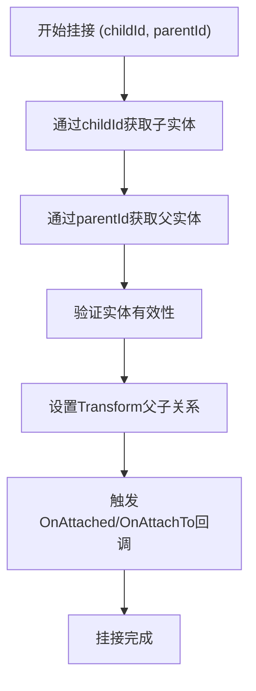
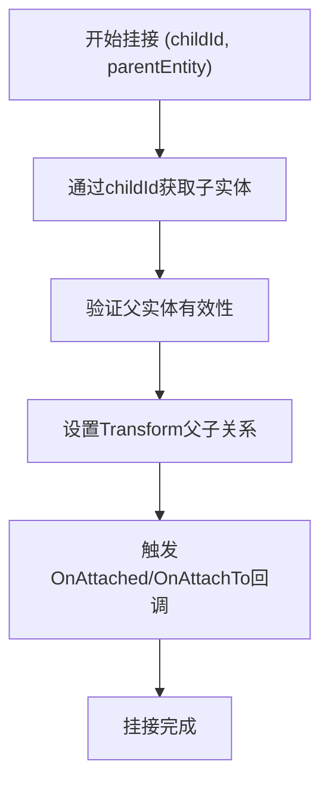
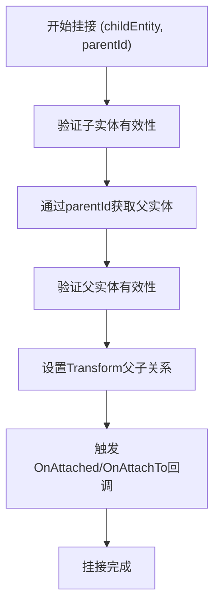
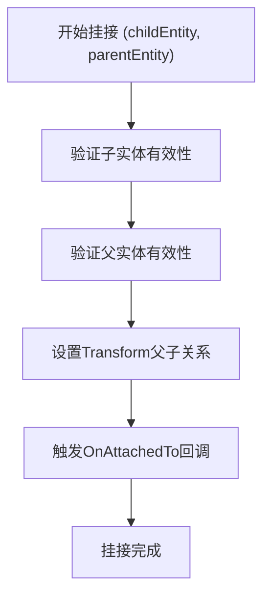
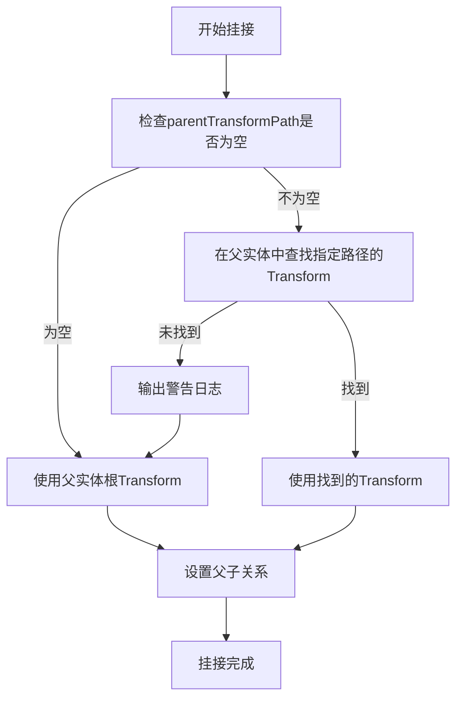
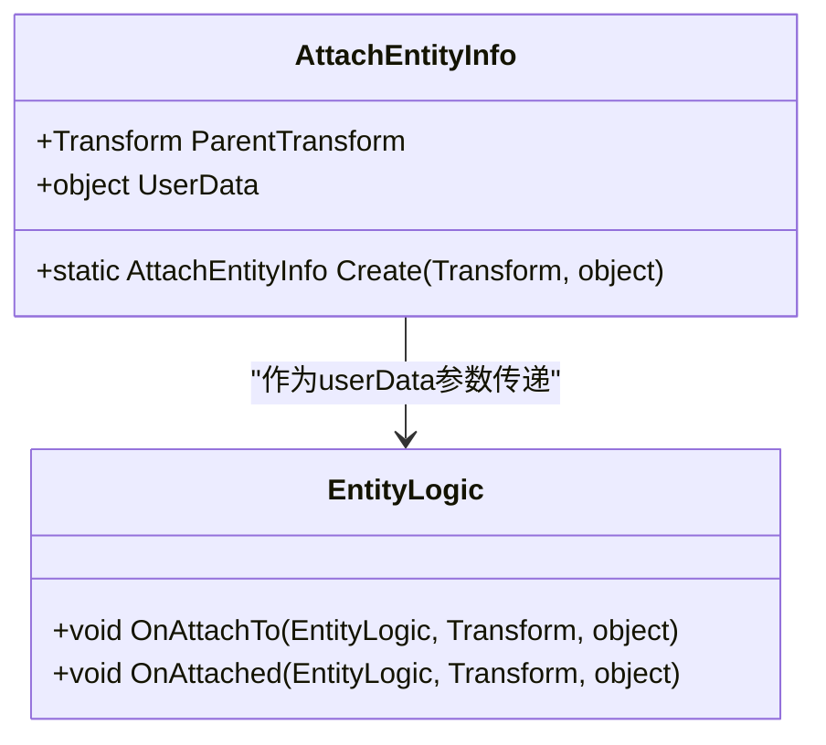

# 实体挂接与层级管理

<cite>
**本文档引用文件**   
- [EntityComponent.cs](file://Scripts/Runtime/Entity/EntityComponent.cs)
- [AttachEntityInfo.cs](file://Scripts/Runtime/Entity/AttachEntityInfo.cs)
- [Entity.cs](file://Scripts/Runtime/Entity/Entity.cs)
- [EntityLogic.cs](file://Scripts/Runtime/Entity/EntityLogic.cs)
</cite>

## 目录
1. [简介](#简介)
2. [核心参数组合解析](#核心参数组合解析)
3. [挂接位置控制机制](#挂接位置控制机制)
4. [用户数据传递与回调](#用户数据传递与回调)
5. [典型用例演示](#典型用例演示)
6. [层级管理与最佳实践](#层级管理与最佳实践)

## 简介
实体挂接系统是Unity游戏框架中用于构建复杂对象层级结构的核心功能。通过`EntityComponent.AttachEntity`系列方法，开发者可以将一个实体（子实体）附加到另一个实体（父实体）上，形成父子层级关系。该系统支持多种参数组合，允许通过实体ID、实体引用、Transform路径或直接Transform对象进行挂接操作。挂接过程中支持传递用户自定义数据，并在挂接完成后触发相应的回调方法，为角色骨骼构建、UI组件嵌套等场景提供了灵活的控制机制。

**Section sources**
- [EntityComponent.cs](file://Scripts/Runtime/Entity/EntityComponent.cs#L690-L1023)

## 核心参数组合解析
`AttachEntity`方法提供了四种基础参数组合，每种组合都支持进一步扩展以包含用户数据。这些组合通过方法重载实现，为不同使用场景提供了便利。

### childId + parentId 组合
这是最基础的挂接方式，通过两个实体的ID进行挂接操作。系统内部会先通过`GetEntity`方法获取对应的实体引用，然后执行挂接。



**Diagram sources**
- [EntityComponent.cs](file://Scripts/Runtime/Entity/EntityComponent.cs#L690-L693)

### childId + parentEntity 组合
当已知子实体ID但拥有父实体引用时，可使用此组合。该方法避免了通过ID查找父实体的开销，提高了性能。



**Diagram sources**
- [EntityComponent.cs](file://Scripts/Runtime/Entity/EntityComponent.cs#L700-L703)

### childEntity + parentId 组合
与上一种组合相反，当已知父实体ID但拥有子实体引用时使用。同样避免了子实体的ID查找过程。



**Diagram sources**
- [EntityComponent.cs](file://Scripts/Runtime/Entity/EntityComponent.cs#L710-L713)

### childEntity + parentEntity 组合
当同时拥有子实体和父实体的引用时，这是最直接和高效的挂接方式，无需任何ID查找操作。



**Diagram sources**
- [EntityComponent.cs](file://Scripts/Runtime/Entity/EntityComponent.cs#L720-L723)

## 挂接位置控制机制
除了基本的父子关系建立，系统还提供了精确的挂接位置控制功能，允许将子实体挂接到父实体的特定Transform节点上。

### parentTransformPath 参数
`parentTransformPath`参数允许通过路径字符串指定挂接位置。路径是相对于父实体根节点的相对路径，遵循Unity的Transform查找规则。

```csharp
// 示例：将武器挂接到角色的右手节点
entityComponent.AttachEntity(weaponEntityId, characterEntityId, "Body/RightHand");
```

当路径为空或null时，子实体将直接挂接到父实体的根节点。如果指定的路径无法找到，系统会输出警告日志并默认挂接到父实体根节点。



**Section sources**
- [EntityComponent.cs](file://Scripts/Runtime/Entity/EntityComponent.cs#L908-L930)

### Transform 直接传参
对于需要最高精度控制的场景，可以直接传入Transform对象作为挂接目标。这种方式提供了最直接的控制，避免了路径查找的开销和潜在的查找失败风险。

```csharp
// 示例：直接指定挂接的Transform
Transform targetTransform = characterEntity.Logic.CachedTransform.Find("Equipment/BackSheath");
entityComponent.AttachEntity(weaponEntity, characterEntity, targetTransform);
```

当传入的Transform为null时，系统会自动使用父实体的根Transform作为挂接点。

**Section sources**
- [EntityComponent.cs](file://Scripts/Runtime/Entity/EntityComponent.cs#L983-L1023)

## 用户数据传递与回调
挂接系统提供了完整的用户数据传递机制，允许在挂接过程中传递自定义数据，并在相关回调中使用这些数据。

### userData 传递机制
`userData`参数可以在所有挂接方法的重载版本中使用。系统通过`AttachEntityInfo`对象包装`parentTransform`和`userData`，然后将此对象作为回调参数传递。



**Diagram sources**
- [AttachEntityInfo.cs](file://Scripts/Runtime/Entity/AttachEntityInfo.cs#L12-L52)
- [EntityLogic.cs](file://Scripts/Runtime/Entity/EntityLogic.cs#L153-L181)

### 回调方法使用
挂接操作会触发两个关键的回调方法：

- **OnAttachTo**: 在子实体上触发，当子实体被附加到父实体时调用。接收父实体引用、挂接Transform和用户数据。
- **OnAttached**: 在父实体上触发，当有子实体被附加到自身时调用。接收子实体引用、挂接Transform和用户数据。

```csharp
// 示例：在子实体逻辑中重写OnAttachTo
protected internal override void OnAttachTo(EntityLogic parentEntity, Transform parentTransform, object userData)
{
    base.OnAttachTo(parentEntity, parentTransform, userData);
    
    // 根据用户数据执行特定逻辑
    if (userData is string equipmentSlot)
    {
        Debug.Log($"武器装备到 {equipmentSlot} 插槽");
    }
    
    // 执行挂接后的初始化
    InitializeWeapon();
}
```

**Section sources**
- [Entity.cs](file://Scripts/Runtime/Entity/Entity.cs#L195-L206)
- [Entity.cs](file://Scripts/Runtime/Entity/Entity.cs#L230-L243)

## 典型用例演示
### 动态构建角色骨骼
在角色创建过程中，动态挂接各个身体部件和装备。

```csharp
// 动态构建角色示例
public void BuildCharacter(Entity characterEntity)
{
    // 挂接头部
    entityComponent.AttachEntity(headEntity, characterEntity, "Body/Head");
    
    // 挂接武器到右手
    entityComponent.AttachEntity(weaponEntity, characterEntity, "Body/RightHand", "RightHandWeapon");
    
    // 挂接盾牌到左手
    entityComponent.AttachEntity(shieldEntity, characterEntity, "Body/LeftHand", "LeftHandShield");
    
    // 挂接背包到背部
    entityComponent.AttachEntity(backpackEntity, characterEntity, "Body/Back");
}
```

### UI组件嵌套
构建复杂的UI层级结构，如将按钮挂接到面板上。

```csharp
// UI组件嵌套示例
public void CreateUIPanel(Entity panelEntity)
{
    // 创建并挂接多个按钮
    for (int i = 0; i < 5; i++)
    {
        Entity buttonEntity = CreateButton(i);
        Vector3 position = new Vector3(0, -i * 60, 0);
        
        // 将按钮挂接到面板
        entityComponent.AttachEntity(buttonEntity, panelEntity);
        
        // 设置按钮的相对位置
        buttonEntity.Logic.CachedTransform.localPosition = position;
    }
}
```

**Section sources**
- [EntityComponent.cs](file://Scripts/Runtime/Entity/EntityComponent.cs#L690-L1023)

## 层级管理与最佳实践
### 挂接操作对Transform层级的影响
挂接操作本质上是修改Unity Transform的父子关系。当一个实体被挂接到另一个实体时：

1. 子实体的Transform将被设置为父实体指定节点的子节点
2. 子实体将继承父实体的位置、旋转和缩放变换
3. 子实体的世界坐标将相对于父实体重新计算
4. 父实体的任何变换都会影响子实体

### 避免层级错乱的指导
为避免常见的层级管理问题，请遵循以下最佳实践：

1. **及时解除挂接**：在不需要父子关系时，及时调用`DetachEntity`方法解除挂接，避免内存泄漏和意外的变换继承。

```csharp
// 正确的挂接-使用-解除模式
entityComponent.AttachEntity(childEntity, parentEntity);
// ... 使用挂接的实体
entityComponent.DetachEntity(childEntity); // 及时解除
```

2. **避免循环挂接**：确保不会将父实体挂接到自己的子实体上，这会导致Transform层级的循环引用。

3. **合理使用用户数据**：通过`userData`参数传递必要的上下文信息，避免在回调中进行复杂的查找操作。

4. **优先使用Transform引用**：在性能敏感的场景中，优先使用Transform直接传参而非路径查找，减少字符串操作和查找开销。

5. **处理挂接失败**：检查系统日志中的警告信息，特别是当指定的Transform路径无法找到时，确保有合理的默认行为。

**Section sources**
- [EntityComponent.cs](file://Scripts/Runtime/Entity/EntityComponent.cs#L983-L1023)
- [EntityLogic.cs](file://Scripts/Runtime/Entity/EntityLogic.cs#L153-L181)