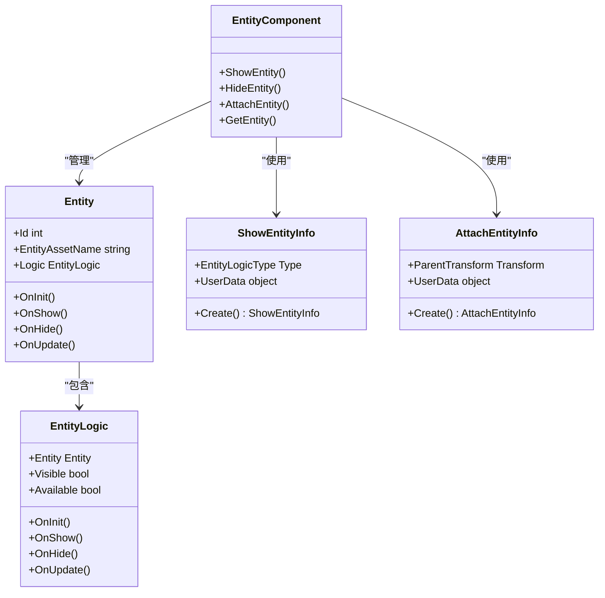
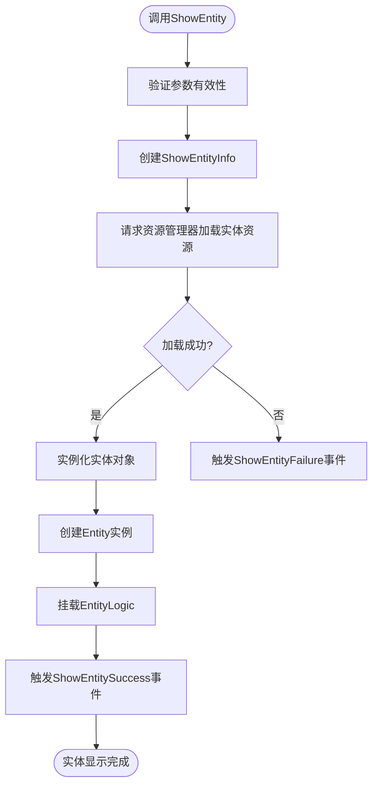
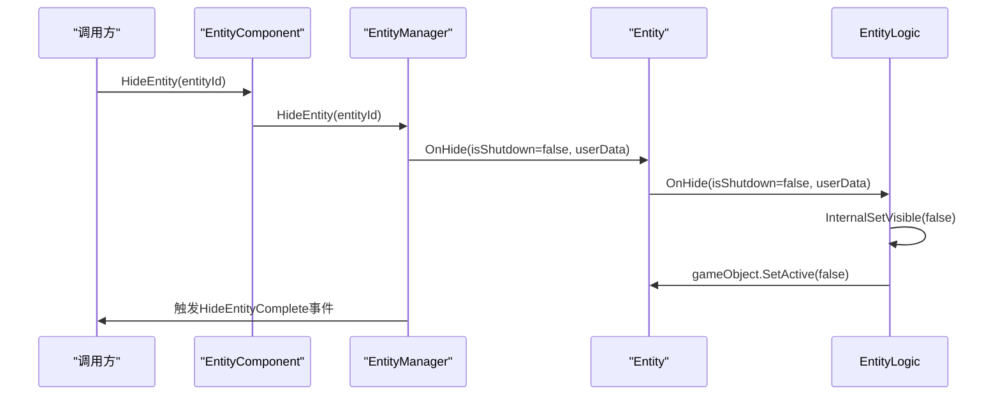
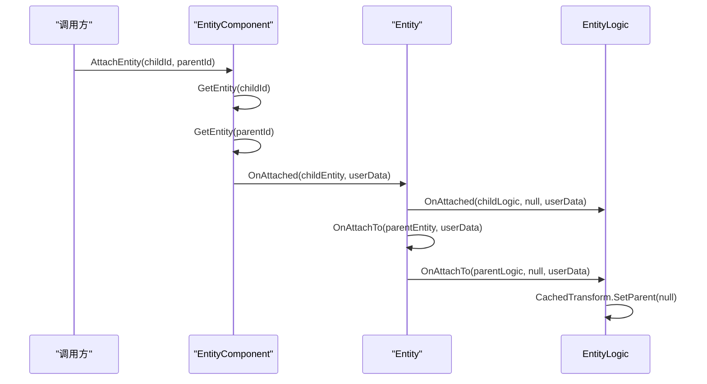
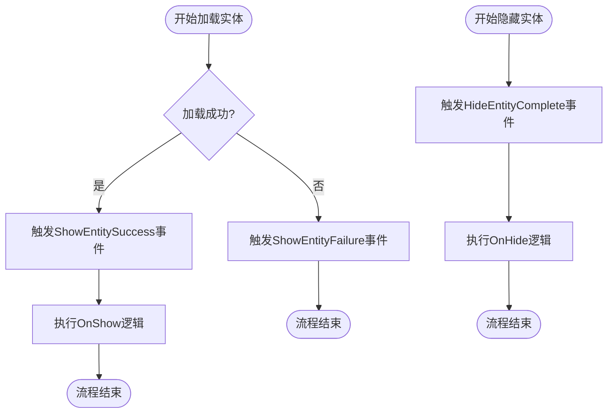
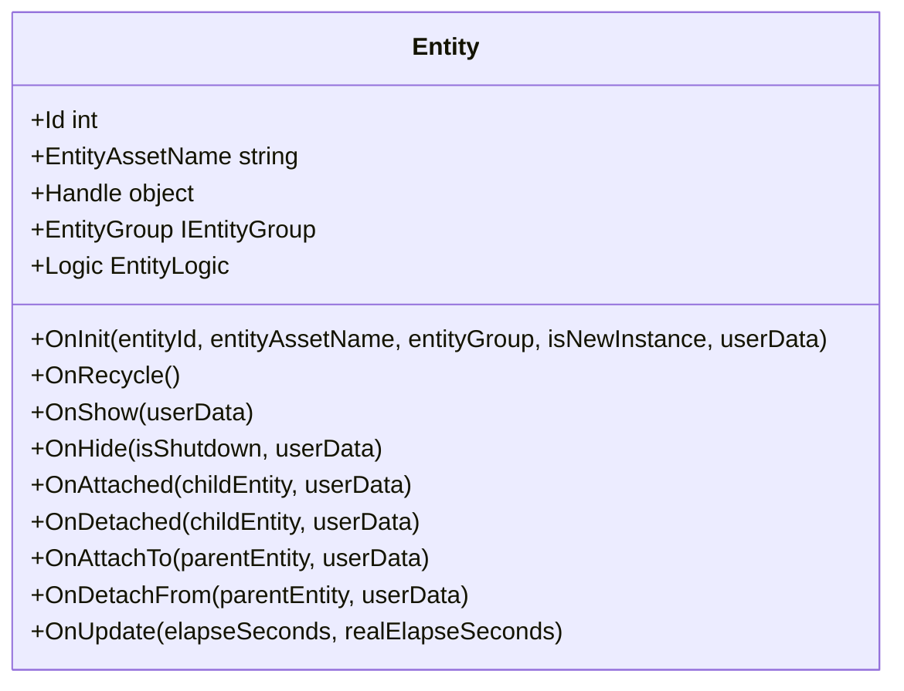
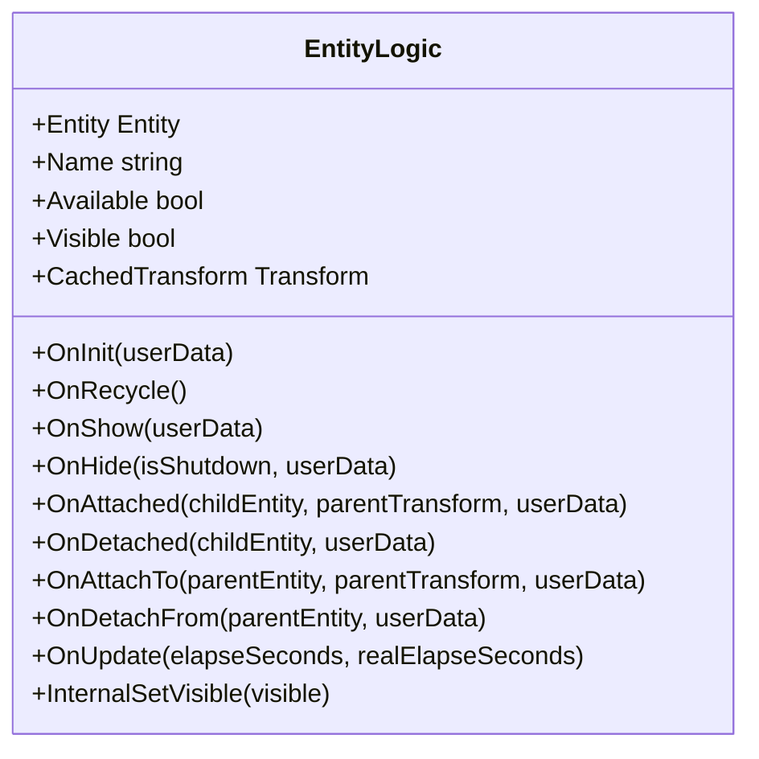
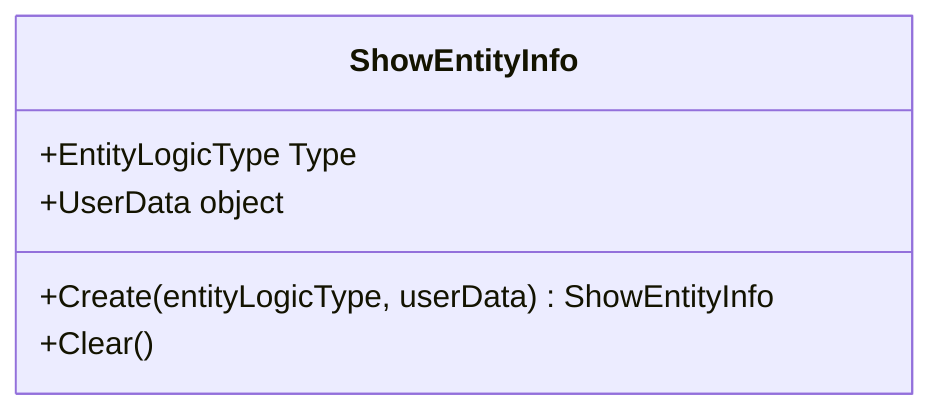
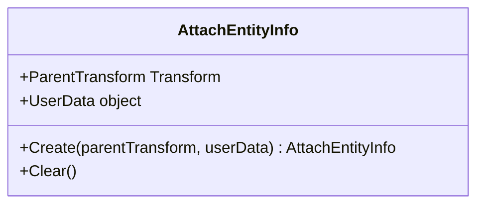
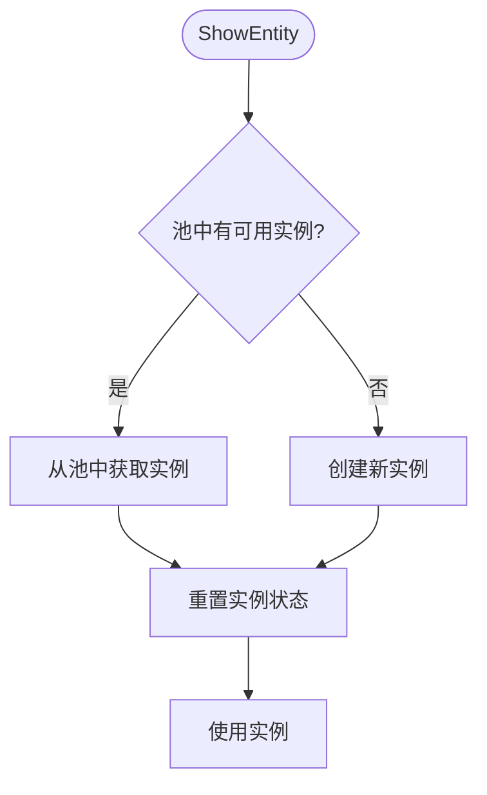

# 实体系统API

<cite>
**Referenced Files in This Document**   
- [EntityComponent.cs](file://Scripts/Runtime/Entity/EntityComponent.cs)
- [Entity.cs](file://Scripts/Runtime/Entity/Entity.cs)
- [EntityLogic.cs](file://Scripts/Runtime/Entity/EntityLogic.cs)
- [ShowEntityInfo.cs](file://Scripts/Runtime/Entity/ShowEntityInfo.cs)
- [ShowEntitySuccessEventArgs.cs](file://Scripts/Runtime/Entity/ShowEntitySuccessEventArgs.cs)
- [HideEntityCompleteEventArgs.cs](file://Scripts/Runtime/Entity/HideEntityCompleteEventArgs.cs)
- [ShowEntityFailureEventArgs.cs](file://Scripts/Runtime/Entity/ShowEntityFailureEventArgs.cs)
- [AttachEntityInfo.cs](file://Scripts/Runtime/Entity/AttachEntityInfo.cs)
- [EntityComponent.EntityGroup.cs](file://Scripts/Runtime/Entity/EntityComponent.EntityGroup.cs)
- [DefaultEntityHelper.cs](file://Scripts/Runtime/Entity/DefaultEntityHelper.cs)
</cite>

## 目录
1. [简介](#简介)
2. [核心组件](#核心组件)
3. [实体创建与显示](#实体创建与显示)
4. [实体隐藏](#实体隐藏)
5. [实体挂接](#实体挂接)
6. [事件系统](#事件系统)
7. [实体基类与逻辑挂载](#实体基类与逻辑挂载)
8. [信息类与回调机制](#信息类与回调机制)
9. [性能优化与实体池](#性能优化与实体池)
10. [示例代码](#示例代码)

## 简介
实体系统是Unity游戏框架中的核心模块，负责管理游戏世界中所有动态对象的生命周期。本API文档详述了以`EntityComponent`为核心的实体管理机制，涵盖实体的创建、显示、隐藏、挂接等关键操作。系统通过`Entity`基类提供通用行为接口，并允许通过继承`EntityLogic`类来挂载自定义逻辑。文档还详细说明了异步加载过程中的信息传递机制、事件通知系统以及基于对象池的性能优化策略。

## 核心组件

实体系统由多个核心组件构成，共同协作完成实体的全生命周期管理。



**Diagram sources**
- [EntityComponent.cs](file://Scripts/Runtime/Entity/EntityComponent.cs#L1-L1147)
- [Entity.cs](file://Scripts/Runtime/Entity/Entity.cs#L1-L281)
- [EntityLogic.cs](file://Scripts/Runtime/Entity/EntityLogic.cs#L1-L203)
- [ShowEntityInfo.cs](file://Scripts/Runtime/Entity/ShowEntityInfo.cs#L1-L55)
- [AttachEntityInfo.cs](file://Scripts/Runtime/Entity/AttachEntityInfo.cs#L1-L55)

**Section sources**
- [EntityComponent.cs](file://Scripts/Runtime/Entity/EntityComponent.cs#L1-L1147)
- [Entity.cs](file://Scripts/Runtime/Entity/Entity.cs#L1-L281)
- [EntityLogic.cs](file://Scripts/Runtime/Entity/EntityLogic.cs#L1-L203)

## 实体创建与显示

`EntityComponent`提供了`ShowEntity`系列方法来异步加载并显示实体。这些方法是创建动态游戏对象的主要入口。

### ShowEntity方法族

`ShowEntity`方法有多个重载版本，允许开发者根据需要指定不同的参数。所有重载最终都会调用同一个核心方法。



**Diagram sources**
- [EntityComponent.cs](file://Scripts/Runtime/Entity/EntityComponent.cs#L485-L494)
- [Entity.cs](file://Scripts/Runtime/Entity/Entity.cs#L17-L278)
- [ShowEntityInfo.cs](file://Scripts/Runtime/Entity/ShowEntityInfo.cs#L12-L52)

#### 参数配置

| 参数 | 类型 | 说明 |
| :--- | :--- | :--- |
| `entityId` | int | 实体的唯一标识符，用于后续操作 |
| `entityAssetName` | string | 实体资源的名称，用于从资源系统加载 |
| `entityGroupName` | string | 实体所属的组名，用于分类管理 |
| `priority` | int | 加载资源的优先级，影响加载顺序 |
| `userData` | object | 用户自定义数据，将在回调中传递 |

#### 执行效果

调用`ShowEntity`后，系统会：
1. 通过`ResourceManager`异步加载指定名称的实体资源
2. 资源加载成功后，使用`DefaultEntityHelper`实例化GameObject
3. 为实例化的GameObject添加`Entity`组件
4. 根据`ShowEntityInfo`中的`EntityLogicType`，在`Entity`上挂载相应的逻辑脚本
5. 触发`ShowEntitySuccess`事件，通知调用方实体已成功显示

**Section sources**
- [EntityComponent.cs](file://Scripts/Runtime/Entity/EntityComponent.cs#L485-L494)
- [DefaultEntityHelper.cs](file://Scripts/Runtime/Entity/DefaultEntityHelper.cs#L1-L74)

## 实体隐藏

`HideEntity`方法用于隐藏或销毁已显示的实体。

### HideEntity方法族



**Diagram sources**
- [EntityComponent.cs](file://Scripts/Runtime/Entity/EntityComponent.cs#L500-L503)
- [Entity.cs](file://Scripts/Runtime/Entity/Entity.cs#L17-L278)
- [EntityLogic.cs](file://Scripts/Runtime/Entity/EntityLogic.cs#L14-L200)

#### 参数配置

| 参数 | 类型 | 说明 |
| :--- | :--- | :--- |
| `entityId` | int | 要隐藏的实体编号 |
| `entity` | Entity | 要隐藏的实体对象 |
| `userData` | object | 用户自定义数据，将在回调中传递 |

#### 执行效果

调用`HideEntity`后，系统会：
1. 调用实体的`OnHide`方法
2. 在`EntityLogic`中将`Visible`属性设置为`false`
3. 将GameObject的`Active`状态设置为`false`
4. 如果实体组配置了对象池，实体将被回收到池中；否则将被销毁
5. 触发`HideEntityComplete`事件

**Section sources**
- [EntityComponent.cs](file://Scripts/Runtime/Entity/EntityComponent.cs#L500-L532)
- [Entity.cs](file://Scripts/Runtime/Entity/Entity.cs#L17-L278)

## 实体挂接

`AttachEntity`方法用于建立父子实体关系，常用于将武器挂接到角色手上，或将子部件挂接到主实体上。

### AttachEntity方法族



**Diagram sources**
- [EntityComponent.cs](file://Scripts/Runtime/Entity/EntityComponent.cs#L690-L723)
- [Entity.cs](file://Scripts/Runtime/Entity/Entity.cs#L17-L278)
- [EntityLogic.cs](file://Scripts/Runtime/Entity/EntityLogic.cs#L14-L200)

#### 参数配置

| 参数 | 类型 | 说明 |
| :--- | :--- | :--- |
| `childEntityId` | int | 子实体的编号 |
| `parentEntityId` | int | 父实体的编号 |
| `parentTransformPath` | string | 相对于父实体的挂接位置路径 |
| `parentTransform` | Transform | 相对于父实体的挂接位置Transform |
| `userData` | object | 用户自定义数据，将在回调中传递 |

#### 执行效果

调用`AttachEntity`后，系统会：
1. 获取子实体和父实体的引用
2. 调用子实体的`OnAttached`方法
3. 调用父实体的`OnAttachTo`方法
4. 将子实体的Transform挂接到父实体的指定位置
5. 完成父子关系的建立

**Section sources**
- [EntityComponent.cs](file://Scripts/Runtime/Entity/EntityComponent.cs#L690-L833)
- [AttachEntityInfo.cs](file://Scripts/Runtime/Entity/AttachEntityInfo.cs#L1-L55)

## 事件系统

实体系统通过事件机制通知外部系统实体状态的变化。

### 事件类定义

| 事件类 | 字段 | 触发时机 |
| :--- | :--- | :--- |
| `ShowEntitySuccessEventArgs` | `EntityLogicType`<br>`Entity`<br>`Duration`<br>`UserData` | 实体成功显示后触发 |
| `ShowEntityFailureEventArgs` | `EntityId`<br>`EntityLogicType`<br>`EntityAssetName`<br>`EntityGroupName`<br>`ErrorMessage`<br>`UserData` | 实体显示失败后触发 |
| `HideEntityCompleteEventArgs` | `EntityId`<br>`EntityAssetName`<br>`EntityGroup`<br>`UserData` | 实体隐藏完成后触发 |

### 事件触发流程



**Diagram sources**
- [ShowEntitySuccessEventArgs.cs](file://Scripts/Runtime/Entity/ShowEntitySuccessEventArgs.cs#L16-L108)
- [ShowEntityFailureEventArgs.cs](file://Scripts/Runtime/Entity/ShowEntityFailureEventArgs.cs#L16-L132)
- [HideEntityCompleteEventArgs.cs](file://Scripts/Runtime/Entity/HideEntityCompleteEventArgs.cs#L16-L106)

**Section sources**
- [ShowEntitySuccessEventArgs.cs](file://Scripts/Runtime/Entity/ShowEntitySuccessEventArgs.cs#L16-L108)
- [ShowEntityFailureEventArgs.cs](file://Scripts/Runtime/Entity/ShowEntityFailureEventArgs.cs#L16-L132)
- [HideEntityCompleteEventArgs.cs](file://Scripts/Runtime/Entity/HideEntityCompleteEventArgs.cs#L16-L106)

## 实体基类与逻辑挂载

`Entity`类是所有游戏实体的基础，而`EntityLogic`是自定义逻辑的挂载点。

### Entity基类

`Entity`类实现了`IEntity`接口，提供了实体的通用行为接口。



**Diagram sources**
- [Entity.cs](file://Scripts/Runtime/Entity/Entity.cs#L17-L278)

### EntityLogic自定义逻辑

`EntityLogic`是抽象基类，开发者应继承此类来实现自定义逻辑。



**Diagram sources**
- [EntityLogic.cs](file://Scripts/Runtime/Entity/EntityLogic.cs#L14-L200)

**Section sources**
- [Entity.cs](file://Scripts/Runtime/Entity/Entity.cs#L17-L278)
- [EntityLogic.cs](file://Scripts/Runtime/Entity/EntityLogic.cs#L14-L200)

## 信息类与回调机制

`ShowEntityInfo`和`AttachEntityInfo`是内部使用的数据传递类，用于在异步操作中传递上下文信息。

### ShowEntityInfo

`ShowEntityInfo`在`ShowEntity`调用时创建，用于存储实体逻辑类型和用户数据。



**Diagram sources**
- [ShowEntityInfo.cs](file://Scripts/Runtime/Entity/ShowEntityInfo.cs#L12-L52)

### AttachEntityInfo

`AttachEntityInfo`在`AttachEntity`调用时创建，用于存储挂接位置和用户数据。



**Diagram sources**
- [AttachEntityInfo.cs](file://Scripts/Runtime/Entity/AttachEntityInfo.cs#L12-L52)

**Section sources**
- [ShowEntityInfo.cs](file://Scripts/Runtime/Entity/ShowEntityInfo.cs#L12-L52)
- [AttachEntityInfo.cs](file://Scripts/Runtime/Entity/AttachEntityInfo.cs#L12-L52)

## 性能优化与实体池

实体系统内置了对象池机制，通过复用实体实例来避免频繁的内存分配和垃圾回收。

### 实体池配置

实体池的配置在`EntityComponent`的Inspector中设置，包括：

| 配置项 | 说明 |
| :--- | :--- |
| `InstanceAutoReleaseInterval` | 对象池自动释放可释放对象的间隔秒数 |
| `InstanceCapacity` | 对象池的容量 |
| `InstanceExpireTime` | 对象池中对象的过期秒数 |
| `InstancePriority` | 对象池的优先级 |

### 复用机制

当调用`HideEntity`时，如果实体所属的组启用了对象池，实体不会被销毁，而是被回收到池中。下次调用`ShowEntity`时，系统会优先从池中获取可用的实例，而不是创建新的实例。



**Diagram sources**
- [EntityComponent.EntityGroup.cs](file://Scripts/Runtime/Entity/EntityComponent.EntityGroup.cs#L1-L75)
- [DefaultEntityHelper.cs](file://Scripts/Runtime/Entity/DefaultEntityHelper.cs#L1-L74)

**Section sources**
- [EntityComponent.EntityGroup.cs](file://Scripts/Runtime/Entity/EntityComponent.EntityGroup.cs#L1-L75)
- [DefaultEntityHelper.cs](file://Scripts/Runtime/Entity/DefaultEntityHelper.cs#L1-L74)

## 示例代码

以下示例演示了如何动态创建角色实体、挂接子实体以及处理加载完成后的逻辑初始化。

```csharp
// 1. 定义自定义实体逻辑
public class PlayerLogic : EntityLogic
{
    private Animator m_Animator = null;
    
    protected internal override void OnInit(object userData)
    {
        base.OnInit(userData);
        m_Animator = GetComponent<Animator>();
    }
    
    protected internal override void OnShow(object userData)
    {
        base.OnShow(userData);
        // 初始化角色状态
        if (userData is PlayerData data)
        {
            Name = data.Name;
            // 设置角色属性
        }
    }
    
    protected internal override void OnHide(bool isShutdown, object userData)
    {
        base.OnHide(isShutdown, userData);
        // 清理角色状态
    }
}

// 2. 显示角色实体
private void ShowPlayer()
{
    int playerId = 1001;
    string assetName = "Assets/Entities/Player.prefab";
    string groupName = "PlayerGroup";
    
    // 用户自定义数据
    var playerData = new PlayerData { Name = "Hero" };
    
    // 订阅成功事件
    GameEntry.Event.Subscribe<ShowEntitySuccessEventArgs>(OnShowPlayerSuccess);
    
    // 显示实体
    GameEntry.Entity.ShowEntity<PlayerLogic>(playerId, assetName, groupName, playerData);
}

private void OnShowPlayerSuccess(object sender, GameEventArgs e)
{
    var ne = (ShowEntitySuccessEventArgs)e;
    if (ne.EntityLogicType == typeof(PlayerLogic))
    {
        // 实体加载成功，进行额外初始化
        PlayerLogic playerLogic = (PlayerLogic)ne.Entity.Logic;
        playerLogic.m_Animator.SetTrigger("Spawn");
        
        // 取消订阅
        GameEntry.Event.Unsubscribe<ShowEntitySuccessEventArgs>(OnShowPlayerSuccess);
    }
}

// 3. 挂接武器实体
private void AttachWeapon(Entity playerEntity)
{
    int weaponId = 2001;
    string weaponAsset = "Assets/Entities/Weapon.prefab";
    string weaponGroup = "WeaponGroup";
    
    // 先显示武器
    GameEntry.Entity.ShowEntity<WeaponLogic>(weaponId, weaponAsset, weaponGroup);
    
    // 等待武器加载完成
    GameEntry.Event.Subscribe<ShowEntitySuccessEventArgs>(OnShowWeaponSuccess);
}

private void OnShowWeaponSuccess(object sender, GameEventArgs e)
{
    var ne = (ShowEntitySuccessEventArgs)e;
    if (ne.EntityLogicType == typeof(WeaponLogic))
    {
        Entity weaponEntity = ne.Entity;
        Entity playerEntity = GameEntry.Entity.GetEntity(1001);
        
        // 挂接到角色右手
        Transform rightHand = playerEntity.CachedTransform.Find("RightHand");
        GameEntry.Entity.AttachEntity(weaponEntity, playerEntity, rightHand);
        
        GameEntry.Event.Unsubscribe<ShowEntitySuccessEventArgs>(OnShowWeaponSuccess);
    }
}
```

**Section sources**
- [EntityComponent.cs](file://Scripts/Runtime/Entity/EntityComponent.cs#L485-L494)
- [Entity.cs](file://Scripts/Runtime/Entity/Entity.cs#L17-L278)
- [EntityLogic.cs](file://Scripts/Runtime/Entity/EntityLogic.cs#L14-L200)