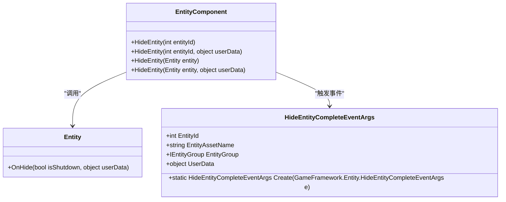
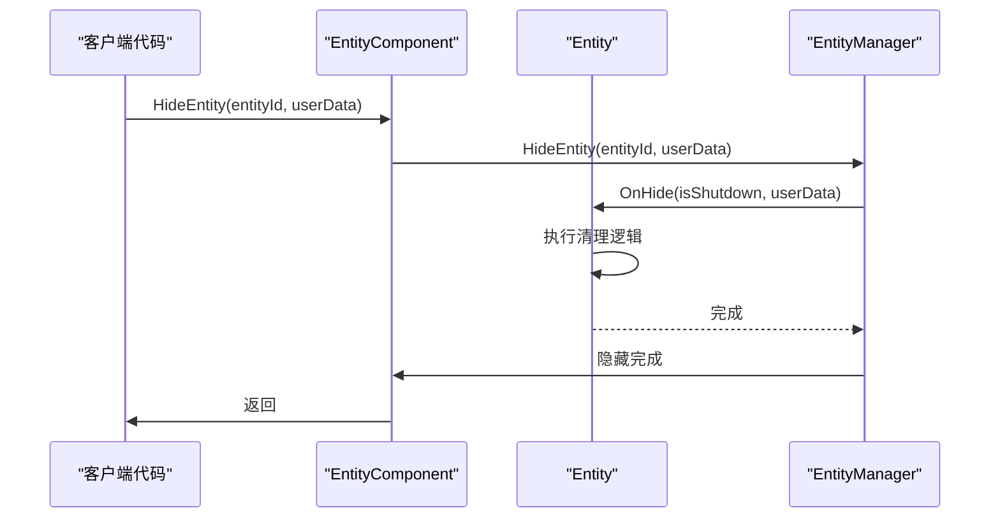
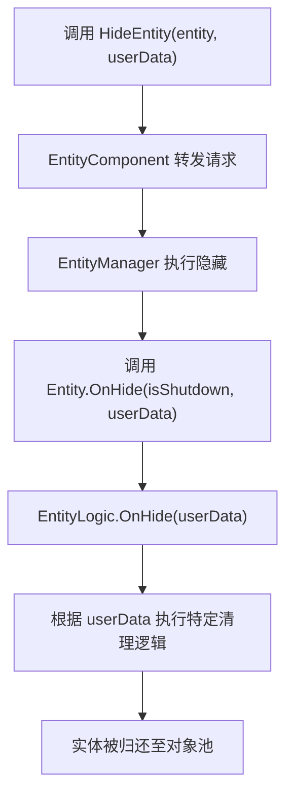

# 实体隐藏与回收

<cite>
**Referenced Files in This Document**   
- [EntityComponent.cs](file://Scripts/Runtime/Entity/EntityComponent.cs)
- [HideEntityCompleteEventArgs.cs](file://Scripts/Runtime/Entity/HideEntityCompleteEventArgs.cs)
- [Entity.cs](file://Scripts/Runtime/Entity/Entity.cs)
</cite>

## 目录
1. [简介](#简介)
2. [核心方法族](#核心方法族)
3. [隐藏操作的本质](#隐藏操作的本质)
4. [OnHide生命周期方法](#onhide生命周期方法)
5. [userData参数的传递与作用](#userdata参数的传递与作用)
6. [HideEntityCompleteEventArgs事件](#hideentitycompleteeventargs事件)
7. [HideEntity与Destroy的对比](#hideentity与destroy的对比)
8. [资源管理最佳实践](#资源管理最佳实践)

## 简介

本文档详细阐述了Unity游戏框架中实体隐藏与回收的核心机制。重点聚焦于`EntityComponent.HideEntity`方法族，解释了隐藏操作的本质是将实体归还至对象池而非销毁，以及`OnHide`生命周期方法的调用时机。文档还详细说明了`userData`参数在隐藏流程中的传递作用，以及如何用于执行清理逻辑。同时，文档化了`HideEntityCompleteEventArgs`事件的结构与触发条件，并提供了事件监听与处理的代码示例。最后，通过对比`HideEntity`与`Destroy`的差异，强调了使用`HideEntity`进行性能优化的重要性，并给出了资源管理的最佳实践建议。

## 核心方法族

`EntityComponent`类提供了四个重载的`HideEntity`方法，允许开发者通过实体ID或实体对象本身来触发隐藏操作，并可选择性地传递用户自定义数据。



**Diagram sources**
- [EntityComponent.cs](file://Scripts/Runtime/Entity/EntityComponent.cs#L490-L540)
- [Entity.cs](file://Scripts/Runtime/Entity/Entity.cs#L170-L190)
- [HideEntityCompleteEventArgs.cs](file://Scripts/Runtime/Entity/HideEntityCompleteEventArgs.cs#L10-L108)

**Section sources**
- [EntityComponent.cs](file://Scripts/Runtime/Entity/EntityComponent.cs#L490-L540)

## 隐藏操作的本质

隐藏实体操作的本质是将实体从当前场景中移除，并将其归还至对象池（Object Pool）中，而不是将其彻底销毁。这一机制是性能优化的关键，因为它避免了频繁创建和销毁GameObject所带来的高昂性能开销。

当调用`HideEntity`方法时，`EntityComponent`会委托给底层的`m_EntityManager`来执行实际的隐藏逻辑。该操作会将实体的`GameObject`设置为非激活状态，并将其管理权交还给对象池系统。这样，当未来需要一个相同类型的实体时，可以直接从对象池中取出并重新激活，从而极大地提升了运行效率。

**Section sources**
- [EntityComponent.cs](file://Scripts/Runtime/Entity/EntityComponent.cs#L490-L540)

## OnHide生命周期方法

`OnHide`是实体生命周期中的一个重要回调方法，它在实体被隐藏时被调用。此方法的执行时机是在实体被归还至对象池之前，为开发者提供了执行清理逻辑的机会。

`OnHide`方法接收两个参数：`isShutdown`和`userData`。`isShutdown`是一个布尔值，指示此次隐藏是否是由于关闭实体管理器而触发的。`userData`则是从`HideEntity`调用时传递过来的用户自定义数据，可用于指导清理工作。



**Diagram sources**
- [EntityComponent.cs](file://Scripts/Runtime/Entity/EntityComponent.cs#L490-L540)
- [Entity.cs](file://Scripts/Runtime/Entity/Entity.cs#L170-L190)

**Section sources**
- [Entity.cs](file://Scripts/Runtime/Entity/Entity.cs#L170-L190)

## userData参数的传递与作用

`userData`参数在隐藏流程中扮演着至关重要的角色。它允许开发者在调用`HideEntity`时传递任意的上下文信息，这些信息会通过`OnHide`方法传递给实体的逻辑组件，从而实现定制化的清理行为。

例如，一个UI实体在被隐藏时，可能需要根据`userData`中的信息来决定是否保存当前的表单数据，或者一个敌人实体可能需要根据`userData`来记录其死亡时的特殊状态。



**Diagram sources**
- [EntityComponent.cs](file://Scripts/Runtime/Entity/EntityComponent.cs#L490-L540)
- [Entity.cs](file://Scripts/Runtime/Entity/Entity.cs#L170-L190)

**Section sources**
- [EntityComponent.cs](file://Scripts/Runtime/Entity/EntityComponent.cs#L490-L540)
- [Entity.cs](file://Scripts/Runtime/Entity/Entity.cs#L170-L190)

## HideEntityCompleteEventArgs事件

`HideEntityCompleteEventArgs`事件在实体成功隐藏后被触发。该事件封装了关于被隐藏实体的关键信息，包括实体ID、资源名称、所属实体组以及从`HideEntity`调用时传递的`userData`。

此事件可用于监听实体隐藏的完成状态，以便执行后续操作，如更新UI、释放相关资源或记录日志。

### 事件结构

| 属性 | 类型 | 描述 |
| :--- | :--- | :--- |
| `EntityId` | `int` | 被隐藏实体的唯一编号。 |
| `EntityAssetName` | `string` | 被隐藏实体的资源名称。 |
| `EntityGroup` | `IEntityGroup` | 被隐藏实体所属的实体组。 |
| `UserData` | `object` | 从`HideEntity`调用时传递的用户自定义数据。 |

### 事件监听与处理

```csharp
// 订阅隐藏实体完成事件
GameEntry.Event.Subscribe(HideEntityCompleteEventArgs.EventId, OnHideEntityComplete);

private void OnHideEntityComplete(object sender, GameEventArgs e)
{
    HideEntityCompleteEventArgs ne = (HideEntityCompleteEventArgs)e;
    Log.Info($"实体 {ne.EntityId} 已成功隐藏。");
    
    // 根据 UserData 执行特定逻辑
    if (ne.UserData is string action)
    {
        if (action == "SAVE_DATA")
        {
            // 执行保存数据的逻辑
        }
    }
}

// 在不再需要时取消订阅
GameEntry.Event.Unsubscribe(HideEntityCompleteEventArgs.EventId, OnHideEntityComplete);
```

**Section sources**
- [HideEntityCompleteEventArgs.cs](file://Scripts/Runtime/Entity/HideEntityCompleteEventArgs.cs#L10-L108)
- [EntityComponent.cs](file://Scripts/Runtime/Entity/EntityComponent.cs#L1140-L1143)

## HideEntity与Destroy的对比

| 特性 | `HideEntity` | `Destroy` |
| :--- | :--- | :--- |
| **对象状态** | 将实体归还至对象池，保持其状态。 | 彻底销毁GameObject及其所有组件。 |
| **性能开销** | 极低，仅涉及激活/非激活和池管理。 | 极高，涉及内存释放、GC等。 |
| **复用性** | 可快速复用，无需重新加载资源。 | 不可复用，下次使用需重新创建。 |
| **资源管理** | 推荐用于频繁出现/消失的实体。 | 仅用于确定不再需要的实体。 |
| **最佳实践** | 用于UI、敌人、子弹等。 | 用于一次性任务或场景切换时。 |

**Section sources**
- [EntityComponent.cs](file://Scripts/Runtime/Entity/EntityComponent.cs#L490-L540)
- [Entity.cs](file://Scripts/Runtime/Entity/Entity.cs#L170-L190)

## 资源管理最佳实践

1.  **优先使用`HideEntity`**：对于所有可能重复使用的实体（如UI面板、敌人、道具），应始终使用`HideEntity`而非`Destroy`。
2.  **合理利用`userData`**：在`HideEntity`调用中充分利用`userData`参数，为`OnHide`方法提供必要的上下文，以执行精准的清理工作。
3.  **及时清理事件监听**：在`OnHide`方法中，务必清理实体自身注册的所有事件监听，防止内存泄漏。
4.  **监听`HideEntityCompleteEventArgs`**：利用此事件来协调系统间的操作，例如，在一个实体隐藏后，通知其他系统进行状态更新。
5.  **避免在`OnHide`中执行耗时操作**：`OnHide`应在短时间内完成，避免阻塞对象池的回收流程。

通过遵循这些最佳实践，可以构建出高效、稳定且易于维护的游戏系统。