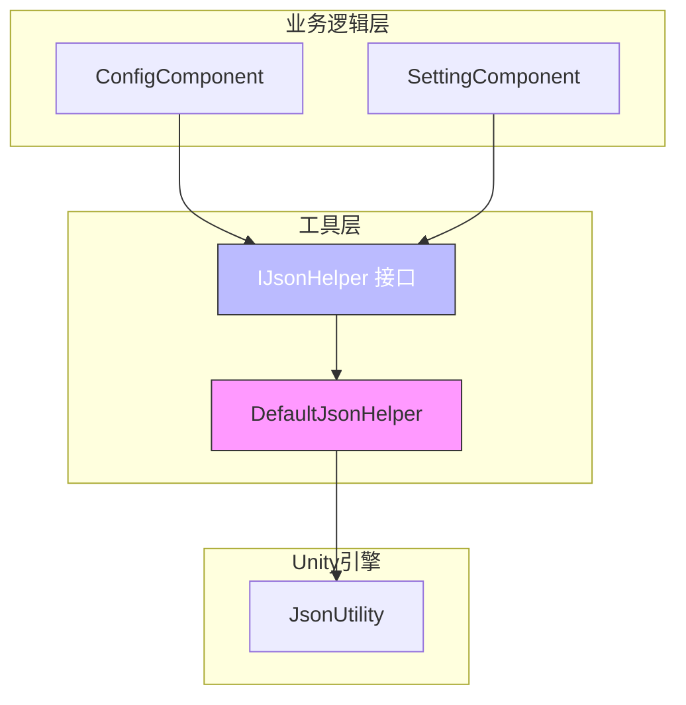
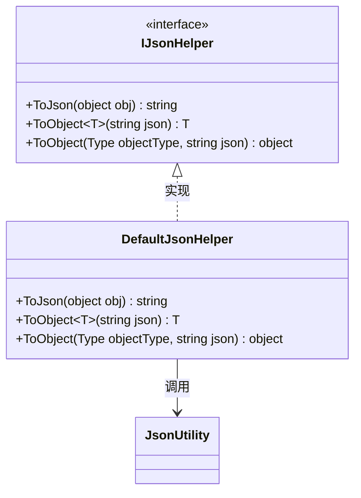
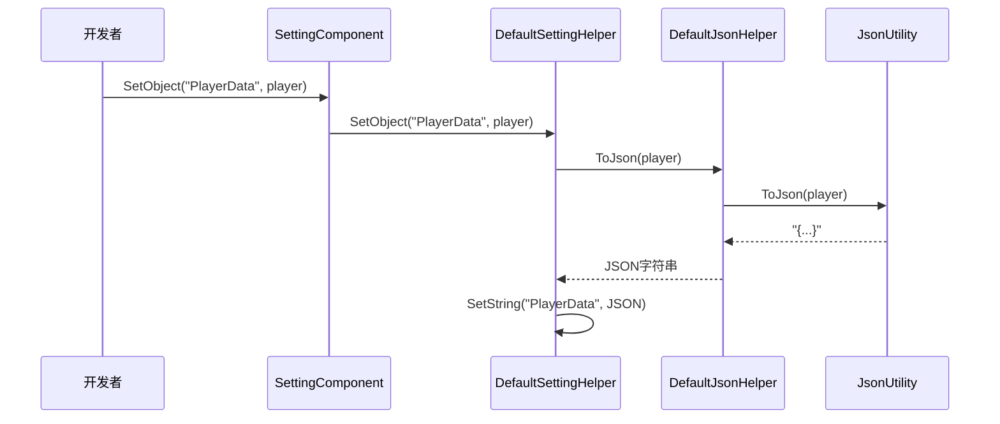
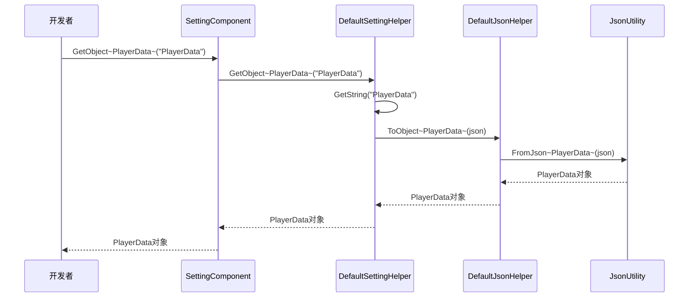
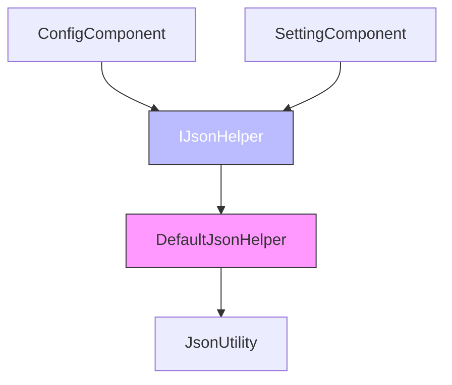

# JSON序列化工具API

<cite>
**Referenced Files in This Document**   
- [DefaultJsonHelper.cs](file://Scripts/Runtime/Utility/DefaultJsonHelper.cs)
- [SettingComponent.cs](file://Scripts/Runtime/Setting/SettingComponent.cs)
- [ConfigComponent.cs](file://Scripts/Runtime/Config/ConfigComponent.cs)
- [DefaultSettingHelper.cs](file://Scripts/Runtime/Setting/DefaultSettingHelper.cs)
- [DefaultConfigHelper.cs](file://Scripts/Runtime/Config/DefaultConfigHelper.cs)
- [DefaultSetting.cs](file://Scripts/Runtime/Setting/DefaultSetting.cs)
</cite>

## 目录
1. [简介](#简介)
2. [核心组件](#核心组件)
3. [架构概述](#架构概述)
4. [详细组件分析](#详细组件分析)
5. [依赖分析](#依赖分析)
6. [性能考量](#性能考量)
7. [故障排除指南](#故障排除指南)
8. [结论](#结论)

## 简介
本文档详细说明了`DefaultJsonHelper`类的API，该类作为JSON序列化策略接口的默认实现，在Unity游戏框架中扮演着核心角色。它通过封装Unity内置的`JsonUtility`，为框架的`ConfigComponent`和`SettingComponent`等模块提供统一的序列化与反序列化服务。本文档将深入探讨其功能、与其他模块的协同工作方式、支持的数据类型、异常处理机制，并提供使用示例和性能优化建议。

## 核心组件
`DefaultJsonHelper`是框架中负责JSON序列化的核心工具类，它实现了`Utility.Json.IJsonHelper`接口，为上层组件提供`ToJson`和`ToObject`方法。该类本身不包含复杂的逻辑，而是作为Unity原生`JsonUtility`的直接代理，确保了序列化操作的稳定性和一致性。其主要职责是作为序列化策略的默认实现，被`ConfigComponent`和`SettingComponent`等需要持久化数据的模块所依赖。

**Section sources**
- [DefaultJsonHelper.cs](file://Scripts/Runtime/Utility/DefaultJsonHelper.cs#L16-L49)

## 架构概述
`DefaultJsonHelper`是整个框架数据持久化架构中的一个关键环节。它位于工具层（Utility），向上为配置（Config）和设置（Setting）等业务组件提供服务，向下则依赖于Unity引擎的底层序列化能力。这种分层设计使得框架的序列化逻辑与具体实现解耦，允许开发者通过替换`IJsonHelper`的实现来集成第三方JSON库。

**Diagram sources **
- [DefaultJsonHelper.cs](file://Scripts/Runtime/Utility/DefaultJsonHelper.cs#L16-L49)
- [SettingComponent.cs](file://Scripts/Runtime/Setting/SettingComponent.cs#L18-L321)
- [ConfigComponent.cs](file://Scripts/Runtime/Config/ConfigComponent.cs#L17-L406)

## 详细组件分析

### DefaultJsonHelper 分析
`DefaultJsonHelper`类是`IJsonHelper`接口的默认实现，其设计简洁而高效。它通过直接调用Unity的`JsonUtility`来完成所有序列化和反序列化工作，避免了不必要的中间处理，从而保证了性能。

#### 类结构与方法
该类提供了三个核心方法，分别对应序列化和反序列化的不同使用场景。

**Diagram sources **
- [DefaultJsonHelper.cs](file://Scripts/Runtime/Utility/DefaultJsonHelper.cs#L16-L49)

**Section sources**
- [DefaultJsonHelper.cs](file://Scripts/Runtime/Utility/DefaultJsonHelper.cs#L16-L49)

### 与 SettingComponent 的协同工作
`SettingComponent`负责管理游戏的运行时设置，这些设置需要在游戏关闭后持久化，并在下次启动时恢复。`DefaultJsonHelper`在此过程中扮演了关键角色，特别是在处理复杂对象的序列化时。

#### 序列化流程
当`SettingComponent`需要保存一个对象类型的设置项时，其调用流程如下：
1.  开发者调用`SettingComponent.SetObject<T>(settingName, obj)`。
2.  `SettingComponent`内部调用`DefaultSettingHelper.SetObject<T>`。
3.  `DefaultSettingHelper`使用`Utility.Json.ToJson(obj)`将对象序列化为JSON字符串。
4.  `Utility.Json.ToJson`最终调用`DefaultJsonHelper.ToJson`，通过`JsonUtility.ToJson`生成JSON。
5.  生成的JSON字符串被存储在`DefaultSetting`的字典中，最终通过二进制流保存到文件。

**Diagram sources **
- [SettingComponent.cs](file://Scripts/Runtime/Setting/SettingComponent.cs#L307-L310)
- [DefaultSettingHelper.cs](file://Scripts/Runtime/Setting/DefaultSettingHelper.cs#L348-L352)
- [DefaultJsonHelper.cs](file://Scripts/Runtime/Utility/DefaultJsonHelper.cs#L20-L24)

#### 反序列化流程
当`SettingComponent`需要读取一个对象类型的设置项时，其调用流程如下：
1.  开发者调用`SettingComponent.GetObject<T>("PlayerData")`。
2.  `SettingComponent`内部调用`DefaultSettingHelper.GetObject<T>`。
3.  `DefaultSettingHelper`通过`GetString`获取之前存储的JSON字符串。
4.  使用`Utility.Json.ToObject<T>(json)`将JSON字符串反序列化为对象。
5.  `Utility.Json.ToObject<T>`最终调用`DefaultJsonHelper.ToObject<T>`，通过`JsonUtility.FromJson<T>`完成反序列化。

**Diagram sources **
- [SettingComponent.cs](file://Scripts/Runtime/Setting/SettingComponent.cs#L272-L275)
- [DefaultSettingHelper.cs](file://Scripts/Runtime/Setting/DefaultSettingHelper.cs#L338-L342)
- [DefaultJsonHelper.cs](file://Scripts/Runtime/Utility/DefaultJsonHelper.cs#L27-L31)

### 与 ConfigComponent 的协同工作
`ConfigComponent`用于加载和解析全局配置文件。虽然其主要处理的是键值对形式的配置，但在解析二进制格式的配置时，`DefaultJsonHelper`也间接参与其中。`DefaultConfigHelper`在解析二进制配置流时，会直接调用`ConfigManager.ParseData`，而`ParseData`方法内部可能会处理包含JSON字符串的字段，尽管`DefaultJsonHelper`本身不直接参与此过程，但它为整个框架提供了统一的JSON处理能力。

## 依赖分析
`DefaultJsonHelper`的设计遵循了依赖倒置原则，它实现了`IJsonHelper`接口，使得上层组件不直接依赖于具体的序列化实现。这为框架的扩展性提供了极大的便利。

**Diagram sources **
- [DefaultJsonHelper.cs](file://Scripts/Runtime/Utility/DefaultJsonHelper.cs#L16-L49)
- [SettingComponent.cs](file://Scripts/Runtime/Setting/SettingComponent.cs#L18-L321)
- [ConfigComponent.cs](file://Scripts/Runtime/Config/ConfigComponent.cs#L17-L406)

**Section sources**
- [DefaultJsonHelper.cs](file://Scripts/Runtime/Utility/DefaultJsonHelper.cs#L16-L49)
- [SettingComponent.cs](file://Scripts/Runtime/Setting/SettingComponent.cs#L18-L321)
- [ConfigComponent.cs](file://Scripts/Runtime/Config/ConfigComponent.cs#L17-L406)

## 性能考量
`DefaultJsonHelper`的性能与Unity的`JsonUtility`完全一致。`JsonUtility`是Unity内置的序列化工具，其优点是稳定、安全，并且与Unity的序列化系统深度集成。然而，它也有一些局限性：
*   **速度**：`JsonUtility`的序列化和反序列化速度相对较慢，尤其是在处理大型或复杂对象时。
*   **内存占用**：在序列化过程中会创建临时的字符串和对象，可能导致短暂的内存峰值。
*   **功能限制**：不支持私有字段、非Unity序列化属性的字段、接口、抽象类以及泛型集合（如`List<T>`）的直接序列化。

与`Newtonsoft.Json`等第三方库相比，`JsonUtility`在功能和性能上通常处于劣势。`Newtonsoft.Json`功能更强大，支持更多数据类型和自定义序列化逻辑，且性能通常更优。因此，对于需要高性能或复杂序列化需求的项目，建议替换`DefaultJsonHelper`的实现。

## 故障排除指南
*   **序列化失败**：最常见的原因是尝试序列化的类或其字段缺少`[Serializable]`或`[SerializeField]`属性。请确保所有需要序列化的类和字段都正确标记。
*   **反序列化后数据为空**：检查JSON字符串是否格式正确，以及目标类的字段名称是否与JSON中的键完全匹配（区分大小写）。
*   **类型转换错误**：在使用`ToObject(Type objectType, string json)`时，确保传入的`Type`与JSON数据的实际类型匹配。

**Section sources**
- [DefaultJsonHelper.cs](file://Scripts/Runtime/Utility/DefaultJsonHelper.cs#L16-L49)
- [DefaultSettingHelper.cs](file://Scripts/Runtime/Setting/DefaultSettingHelper.cs#L338-L352)

## 结论
`DefaultJsonHelper`作为框架的默认JSON序列化实现，提供了一个稳定、可靠的基础。它通过简洁的设计和对`JsonUtility`的直接封装，确保了核心功能的可用性。其接口化的设计为未来的扩展和优化铺平了道路。开发者可以根据项目需求，选择继续使用默认实现，或通过实现`IJsonHelper`接口来集成更强大的第三方JSON库，以获得更好的性能和功能支持。