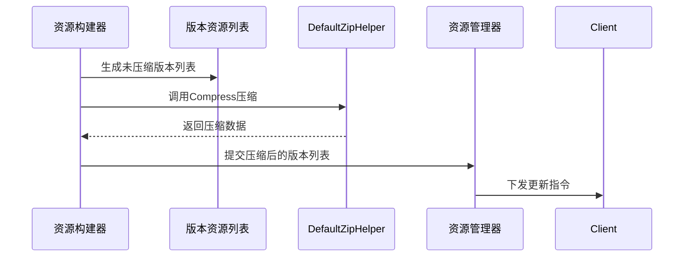

# 压缩解压工具API

<cite>
**Referenced Files in This Document**   
- [DefaultZipHelper.cs](file://Scripts/Runtime/Utility/DefaultZipHelper.cs)
- [ResourceComponent.cs](file://Scripts/Runtime/Resource/ResourceComponent.cs)
</cite>

## 目录
1. [简介](#简介)
2. [核心功能](#核心功能)
3. [压缩与解压缩方法](#压缩与解压缩方法)
4. [应用场景](#应用场景)
5. [使用示例](#使用示例)
6. [性能分析与优化建议](#性能分析与优化建议)
7. [常见陷阱与规避方法](#常见陷阱与规避方法)
8. [结论](#结论)

## 简介

`DefaultZipHelper` 是 Unity 游戏框架中的默认压缩解压缩辅助类，实现了 `IZipHelper` 接口，为资源更新、数据打包等场景提供高效的 GZip 压缩算法支持。该类在资源热更新流程中扮演关键角色，负责处理压缩包的生成与解压，确保资源传输的效率与完整性。

**Section sources**
- [DefaultZipHelper.cs](file://Scripts/Runtime/Utility/DefaultZipHelper.cs#L17-L210)

## 核心功能

`DefaultZipHelper` 类提供了完整的流式压缩解压能力，支持对字节数组和文件流进行操作。其核心功能包括：
- **流式处理**：通过固定大小的缓存字节数组（`m_CachedBytes`，长度为 4096 字节）实现流式读写，避免一次性加载大文件到内存。
- **错误恢复**：所有操作均包含异常捕获机制，确保在压缩或解压失败时能安全返回 `false` 而不会导致程序崩溃。
- **头部处理**：在压缩完成后调用 `ProcessHeader` 方法修改压缩流的特定字节，可能用于自定义校验或标识。

**Section sources**
- [DefaultZipHelper.cs](file://Scripts/Runtime/Utility/DefaultZipHelper.cs#L17-L210)

## 压缩与解压缩方法

### Compress 方法

`DefaultZipHelper` 提供了两个重载的 `Compress` 方法，分别用于压缩字节数组和流。

#### 压缩字节数组
```csharp
public bool Compress(byte[] bytes, int offset, int length, Stream compressedStream)
```
- **参数说明**：
  - `bytes`：要压缩的原始数据字节数组。
  - `offset`：数据在字节数组中的起始偏移量。
  - `length`：要压缩的数据长度。
  - `compressedStream`：输出压缩数据的目标流。
- **功能**：将指定范围的字节数组压缩后写入目标流。
- **验证**：方法首先验证输入参数的有效性，包括空值检查和边界检查。

[SPEC SYMBOL](file://Scripts/Runtime/Utility/DefaultZipHelper.cs#L30-L59)

#### 压缩流
```csharp
public bool Compress(Stream stream, Stream compressedStream)
```
- **参数说明**：
  - `stream`：包含原始数据的输入流。
  - `compressedStream`：输出压缩数据的目标流。
- **功能**：从输入流中分块读取数据，逐块压缩并写入输出流，实现对大文件的流式压缩。
- **资源管理**：在 `finally` 块中清空缓存字节数组，防止内存残留。

[SPEC SYMBOL](file://Scripts/Runtime/Utility/DefaultZipHelper.cs#L67-L100)

### Decompress 方法

`DefaultZipHelper` 提供了两个重载的 `Decompress` 方法，分别用于解压缩字节数组和流。

#### 解压缩字节数组
```csharp
public bool Decompress(byte[] bytes, int offset, int length, Stream decompressedStream)
```
- **参数说明**：
  - `bytes`：包含压缩数据的字节数组。
  - `offset`：压缩数据在字节数组中的起始偏移量。
  - `length`：压缩数据的长度。
  - `decompressedStream`：输出解压数据的目标流。
- **功能**：将指定范围的压缩字节数组解压后写入目标流。
- **资源管理**：创建 `MemoryStream` 包装输入字节数组，并在 `finally` 块中正确释放资源。

[SPEC SYMBOL](file://Scripts/Runtime/Utility/DefaultZipHelper.cs#L110-L156)

#### 解压缩流
```csharp
public bool Decompress(Stream stream, Stream decompressedStream)
```
- **参数说明**：
  - `stream`：包含压缩数据的输入流。
  - `decompressedStream`：输出解压数据的目标流。
- **功能**：从压缩流中分块读取并解压数据，逐块写入输出流，实现流式解压。
- **资源管理**：在 `finally` 块中清空缓存字节数组。

[SPEC SYMBOL](file://Scripts/Runtime/Utility/DefaultZipHelper.cs#L164-L195)

## 应用场景

`DefaultZipHelper` 主要应用于资源更新和数据打包场景，特别是在资源热更新流程中。

### 资源热更新中的压缩包处理

在资源热更新流程中，`DefaultZipHelper` 与 `ResourceComponent` 协同工作。当需要更新版本资源列表时，系统会先生成未压缩的版本列表文件，然后调用 `Utility.Zip.Compress` 方法（内部使用 `DefaultZipHelper`）对其进行压缩，同时计算压缩前后的大小和哈希值，这些信息会被包含在更新事件中。



**Diagram sources**
- [DefaultZipHelper.cs](file://Scripts/Runtime/Utility/DefaultZipHelper.cs#L17-L210)
- [ResourceBuilderController.cs](file://Scripts/Editor/ResourceBuilder/ResourceBuilderController.cs#L1164-L1181)

**Section sources**
- [DefaultZipHelper.cs](file://Scripts/Runtime/Utility/DefaultZipHelper.cs#L17-L210)
- [ResourceComponent.cs](file://Scripts/Runtime/Resource/ResourceComponent.cs#L20-L1365)

## 使用示例

### 压缩字节数组

```csharp
byte[] rawData = File.ReadAllBytes("data.txt");
using (MemoryStream compressedStream = new MemoryStream())
{
    bool success = zipHelper.Compress(rawData, 0, rawData.Length, compressedStream);
    if (success)
    {
        byte[] compressedData = compressedStream.ToArray();
        // 处理压缩后的数据
    }
}
```

### 压缩文件流

```csharp
using (FileStream inputStream = File.OpenRead("largefile.dat"))
using (FileStream outputStream = File.Create("largefile.dat.gz"))
{
    bool success = zipHelper.Compress(inputStream, outputStream);
    // 压缩完成
}
```

### 集成到ResourceComponent更新流程

虽然 `DefaultZipHelper` 通常由框架内部调用，但理解其在 `ResourceComponent` 中的角色至关重要。当 `ResourceComponent` 执行资源更新时，它会处理包含 `ZipLength` 和 `ZipLength` 属性的事件，这些属性直接反映了 `DefaultZipHelper` 的压缩结果。

```csharp
// 在事件监听中获取压缩信息
private void OnResourceUpdateSuccess(object sender, ResourceUpdateSuccessEventArgs e)
{
    Debug.Log($"资源 {e.Name} 更新成功，原始大小: {e.Length}，压缩后大小: {e.ZipLength}");
}
```

**Section sources**
- [DefaultZipHelper.cs](file://Scripts/Runtime/Utility/DefaultZipHelper.cs#L17-L210)
- [ResourceComponent.cs](file://Scripts/Runtime/Resource/ResourceComponent.cs#L20-L1365)

## 性能分析与优化建议

### 性能表现

`DefaultZipHelper` 采用流式处理和固定缓存，具有良好的内存效率，适合处理大型资源文件。其性能特点包括：
- **内存占用低**：仅使用 4KB 的固定缓存，不会随文件大小线性增长。
- **CPU开销**：GZip 压缩是 CPU 密集型操作，压缩比越高，CPU 开销越大。

### 异步调用模式

对于大型资源处理，强烈建议采用异步调用模式，避免阻塞主线程。

```csharp
public async Task<bool> CompressAsync(byte[] data, Stream output)
{
    return await Task.Run(() => zipHelper.Compress(data, 0, data.Length, output));
}
```

**Section sources**
- [DefaultZipHelper.cs](file://Scripts/Runtime/Utility/DefaultZipHelper.cs#L17-L210)

## 常见陷阱与规避方法

### 内存溢出规避

**陷阱**：尝试将整个大文件一次性读入内存进行压缩。

**规避方法**：
1. 始终使用流式方法 `Compress(Stream, Stream)` 处理大文件。
2. 避免在主线程中执行长时间的压缩操作，使用异步任务。
3. 确保在使用后正确释放 `Stream` 资源。

```csharp
// 正确做法：使用 using 语句确保资源释放
using (var input = new FileStream("input.dat", FileMode.Open))
using (var output = new FileStream("output.dat.gz", FileMode.Create))
{
    zipHelper.Compress(input, output);
}
```

**Section sources**
- [DefaultZipHelper.cs](file://Scripts/Runtime/Utility/DefaultZipHelper.cs#L17-L210)

## 结论

`DefaultZipHelper` 是一个高效、可靠的压缩解压工具，专为游戏资源管理设计。它通过流式处理和异常安全的设计，为资源热更新等关键场景提供了坚实的基础。开发者在使用时应优先考虑流式 API 和异步调用，以确保应用的性能和稳定性。