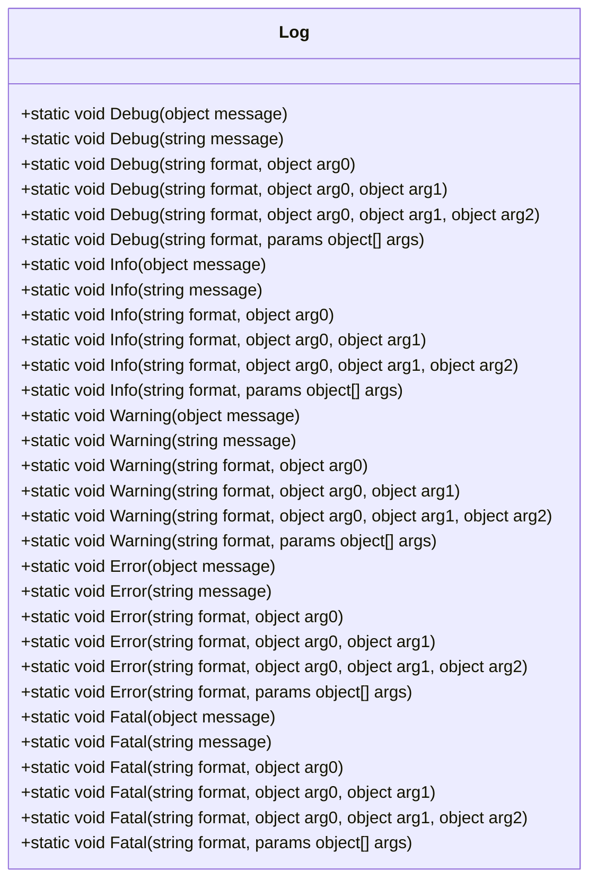
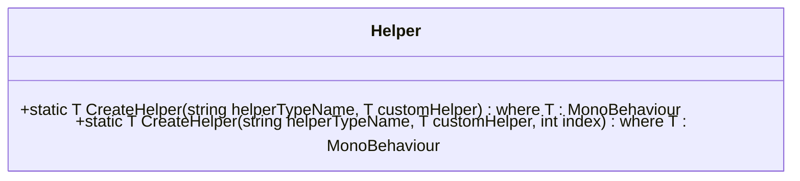
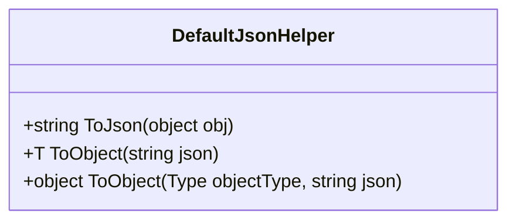
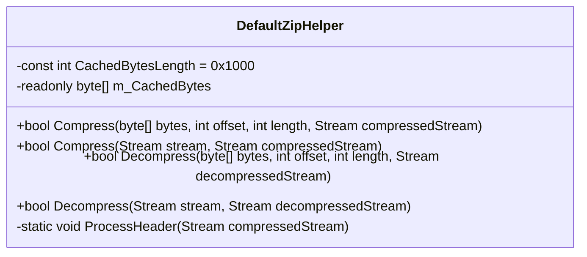
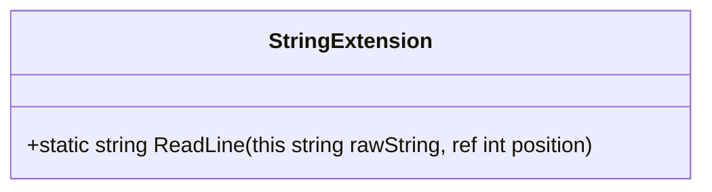
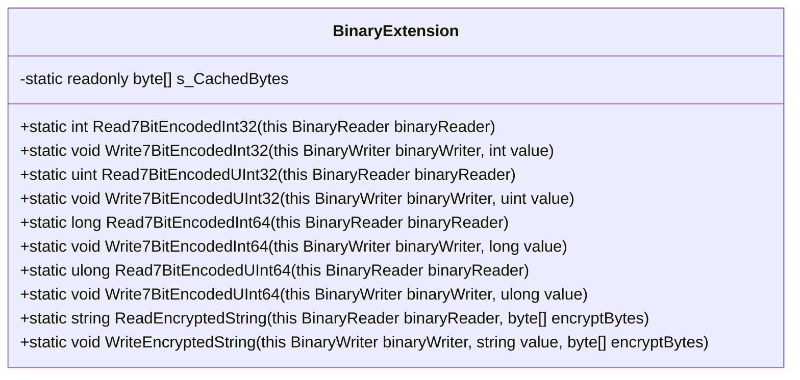
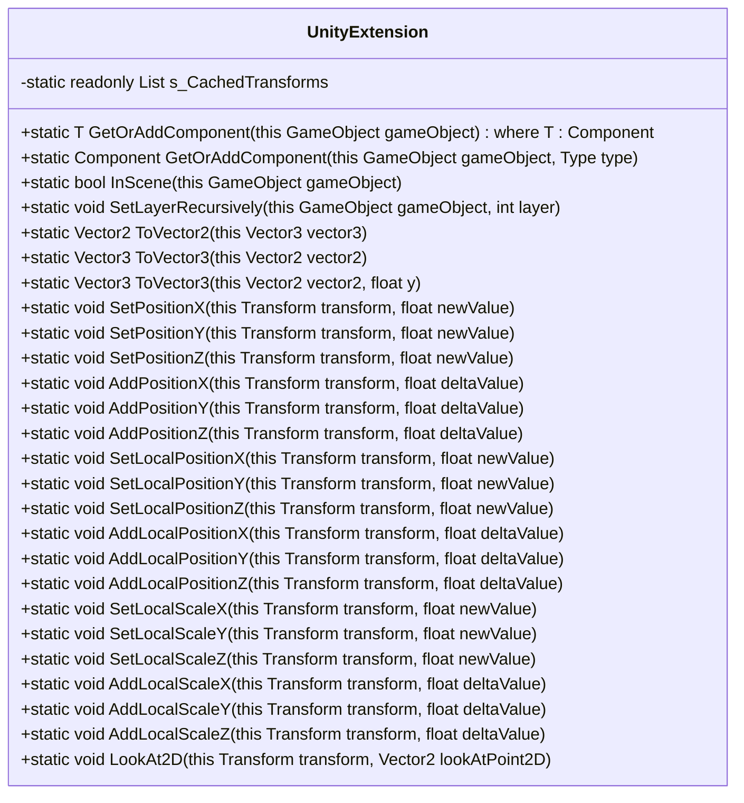

# 工具类API

<cite>
**Referenced Files in This Document**   
- [Log.cs](file://Scripts/Runtime/Utility/Log.cs)
- [Helper.cs](file://Scripts/Runtime/Utility/Helper.cs)
- [DefaultJsonHelper.cs](file://Scripts/Runtime/Utility/DefaultJsonHelper.cs)
- [DefaultZipHelper.cs](file://Scripts/Runtime/Utility/DefaultZipHelper.cs)
- [StringExtension.cs](file://Scripts/Runtime/Utility/StringExtension.cs)
- [BinaryExtension.cs](file://Scripts/Runtime/Utility/BinaryExtension.cs)
- [UnityExtension.cs](file://Scripts/Runtime/Utility/UnityExtension.cs)
</cite>

## 目录
1. [简介](#简介)
2. [日志工具类](#日志工具类)
3. [辅助器工具类](#辅助器工具类)
4. [序列化与压缩工具类](#序列化与压缩工具类)
5. [扩展方法工具类](#扩展方法工具类)
6. [使用示例](#使用示例)
7. [总结](#总结)

## 简介

本文档旨在全面介绍Unity游戏框架中的核心工具类API，涵盖日志记录、辅助器创建、数据序列化、压缩解压以及各类扩展方法。这些工具类为开发者提供了便捷的开发支持，能够显著提升开发效率和代码质量。文档详细说明了各个工具类的功能、使用方法和实际应用场景，帮助开发者更好地理解和使用这些工具。

**Section sources**
- [Log.cs](file://Scripts/Runtime/Utility/Log.cs#L15-L501)
- [Helper.cs](file://Scripts/Runtime/Utility/Helper.cs#L15-L73)
- [DefaultJsonHelper.cs](file://Scripts/Runtime/Utility/DefaultJsonHelper.cs#L16-L49)
- [DefaultZipHelper.cs](file://Scripts/Runtime/Utility/DefaultZipHelper.cs#L17-L210)
- [StringExtension.cs](file://Scripts/Runtime/Utility/StringExtension.cs#L10-L65)
- [BinaryExtension.cs](file://Scripts/Runtime/Utility/BinaryExtension.cs#L14-L196)
- [UnityExtension.cs](file://Scripts/Runtime/Utility/UnityExtension.cs#L14-L346)

## 日志工具类

日志工具类`Log`提供了多级别的日志输出功能，包括调试、信息、警告、错误和严重错误级别。这些日志级别帮助开发者在不同场景下记录和追踪程序运行状态，便于调试和问题排查。

### 日志级别说明

- **Debug**: 用于记录调试类日志信息，仅在带有DEBUG预编译选项且带有ENABLE_LOG、ENABLE_DEBUG_LOG或ENABLE_DEBUG_AND_ABOVE_LOG预编译选项时生效。
- **Info**: 用于记录程序正常运行日志信息，仅在带有ENABLE_LOG、ENABLE_INFO_LOG、ENABLE_DEBUG_AND_ABOVE_LOG或ENABLE_INFO_AND_ABOVE_LOG预编译选项时生效。
- **Warning**: 建议在发生局部功能逻辑错误，但尚不会导致游戏崩溃或异常时使用，仅在带有ENABLE_LOG、ENABLE_INFO_LOG、ENABLE_DEBUG_AND_ABOVE_LOG、ENABLE_INFO_AND_ABOVE_LOG或ENABLE_WARNING_AND_ABOVE_LOG预编译选项时生效。
- **Error**: 建议在发生功能逻辑错误，但尚不会导致游戏崩溃或异常时使用，仅在带有ENABLE_LOG、ENABLE_INFO_LOG、ENABLE_DEBUG_AND_ABOVE_LOG、ENABLE_INFO_AND_ABOVE_LOG、ENABLE_WARNING_AND_ABOVE_LOG或ENABLE_ERROR_AND_ABOVE_LOG预编译选项时生效。
- **Fatal**: 建议在发生严重错误，可能导致游戏崩溃或异常时使用，此时应尝试重启进程或重建游戏框架，仅在带有ENABLE_LOG、ENABLE_INFO_LOG、ENABLE_DEBUG_AND_ABOVE_LOG、ENABLE_INFO_AND_ABOVE_LOG、ENABLE_WARNING_AND_ABOVE_LOG、ENABLE_ERROR_AND_ABOVE_LOG或ENABLE_FATAL_AND_ABOVE_LOG预编译选项时生效。

### 格式化参数

日志方法支持格式化字符串，允许开发者在日志消息中插入变量值。例如，`Log.Info("玩家 {0} 的等级为 {1}", playerName, level)`会将`playerName`和`level`的值插入到日志消息中。



**Diagram sources**
- [Log.cs](file://Scripts/Runtime/Utility/Log.cs#L15-L501)

**Section sources**
- [Log.cs](file://Scripts/Runtime/Utility/Log.cs#L15-L501)

## 辅助器工具类

辅助器工具类`Helper`提供了创建辅助器的静态方法，简化了辅助器的创建过程。通过指定辅助器类型名称或自定义辅助器，开发者可以灵活地创建所需的辅助器实例。

### 创建辅助器

`CreateHelper`方法允许开发者通过类型名称或自定义辅助器创建辅助器实例。如果指定了类型名称，则会尝试通过反射创建该类型的实例；如果未指定类型名称但提供了自定义辅助器，则会使用该自定义辅助器。



**Diagram sources**
- [Helper.cs](file://Scripts/Runtime/Utility/Helper.cs#L15-L73)

**Section sources**
- [Helper.cs](file://Scripts/Runtime/Utility/Helper.cs#L15-L73)

## 序列化与压缩工具类

序列化与压缩工具类提供了默认的JSON序列化和GZip压缩解压功能，简化了数据的持久化和传输过程。

### DefaultJsonHelper

`DefaultJsonHelper`实现了`IJsonHelper`接口，提供了将对象序列化为JSON字符串和将JSON字符串反序列化为对象的功能。它使用Unity的`JsonUtility`进行序列化和反序列化操作。



**Diagram sources**
- [DefaultJsonHelper.cs](file://Scripts/Runtime/Utility/DefaultJsonHelper.cs#L16-L49)

### DefaultZipHelper

`DefaultZipHelper`实现了`IZipHelper`接口，提供了压缩和解压缩数据的功能。它使用`ICSharpCode.SharpZipLib.GZip`库进行GZip压缩和解压操作，支持对字节数组和流进行操作。



**Diagram sources**
- [DefaultZipHelper.cs](file://Scripts/Runtime/Utility/DefaultZipHelper.cs#L17-L210)

**Section sources**
- [DefaultJsonHelper.cs](file://Scripts/Runtime/Utility/DefaultJsonHelper.cs#L16-L49)
- [DefaultZipHelper.cs](file://Scripts/Runtime/Utility/DefaultZipHelper.cs#L17-L210)

## 扩展方法工具类

扩展方法工具类提供了对字符串、二进制流和Unity对象的扩展方法，简化了常见操作的实现。

### StringExtension

`StringExtension`提供了从字符串中读取一行的功能，支持指定起始位置并返回下一行的起始位置。



**Diagram sources**
- [StringExtension.cs](file://Scripts/Runtime/Utility/StringExtension.cs#L10-L65)

### BinaryExtension

`BinaryExtension`提供了对`BinaryReader`和`BinaryWriter`的扩展方法，支持读取和写入编码后的整数以及读取和写入加密字符串。



**Diagram sources**
- [BinaryExtension.cs](file://Scripts/Runtime/Utility/BinaryExtension.cs#L14-L196)

### UnityExtension

`UnityExtension`提供了对Unity对象的扩展方法，包括获取或增加组件、检查GameObject是否在场景中、递归设置游戏对象的层次、向量转换和Transform操作等。



**Diagram sources**
- [UnityExtension.cs](file://Scripts/Runtime/Utility/UnityExtension.cs#L14-L346)

**Section sources**
- [StringExtension.cs](file://Scripts/Runtime/Utility/StringExtension.cs#L10-L65)
- [BinaryExtension.cs](file://Scripts/Runtime/Utility/BinaryExtension.cs#L14-L196)
- [UnityExtension.cs](file://Scripts/Runtime/Utility/UnityExtension.cs#L14-L346)

## 使用示例

以下是一些使用这些工具类的实际示例，展示了如何在开发中应用这些工具。

### 日志记录示例

```csharp
// 记录信息级别日志
Log.Info("游戏启动成功");

// 记录带有格式化参数的信息级别日志
string playerName = "Player1";
int level = 10;
Log.Info("玩家 {0} 的等级为 {1}", playerName, level);

// 记录警告级别日志
Log.Warning("资源加载缓慢");

// 记录错误级别日志
Log.Error("无法连接到服务器");
```

### JSON序列化示例

```csharp
// 创建一个简单的数据类
public class PlayerData
{
    public string Name;
    public int Level;
    public float Health;
}

// 创建数据实例
PlayerData player = new PlayerData
{
    Name = "Player1",
    Level = 10,
    Health = 100.0f
};

// 序列化为JSON字符串
DefaultJsonHelper jsonHelper = new DefaultJsonHelper();
string json = jsonHelper.ToJson(player);
Log.Info("序列化后的JSON: {0}", json);

// 反序列化为对象
PlayerData deserializedPlayer = jsonHelper.ToObject<PlayerData>(json);
Log.Info("反序列化后的玩家名称: {0}", deserializedPlayer.Name);
```

### 字符串处理示例

```csharp
// 使用StringExtension读取多行字符串
string text = "第一行\r\n第二行\n第三行";
int position = 0;
string line;
while ((line = text.ReadLine(ref position)) != null)
{
    Log.Info("读取到的行: {0}", line);
}
```

### Unity对象操作示例

```csharp
// 获取或增加组件
GameObject gameObject = new GameObject("TestObject");
Transform transform = gameObject.GetOrAddComponent<Transform>();

// 设置绝对位置
transform.SetPositionX(10.0f);
transform.SetPositionY(5.0f);
transform.SetPositionZ(0.0f);

// 增加相对位置
transform.AddLocalPositionX(2.0f);
transform.AddLocalPositionY(1.0f);

// 二维空间下使Transform指向目标点
Vector2 targetPoint = new Vector2(20.0f, 10.0f);
transform.LookAt2D(targetPoint);
```

**Section sources**
- [Log.cs](file://Scripts/Runtime/Utility/Log.cs#L15-L501)
- [DefaultJsonHelper.cs](file://Scripts/Runtime/Utility/DefaultJsonHelper.cs#L16-L49)
- [StringExtension.cs](file://Scripts/Runtime/Utility/StringExtension.cs#L10-L65)
- [UnityExtension.cs](file://Scripts/Runtime/Utility/UnityExtension.cs#L14-L346)

## 总结

本文档详细介绍了Unity游戏框架中的核心工具类API，包括日志记录、辅助器创建、数据序列化、压缩解压以及各类扩展方法。这些工具类为开发者提供了丰富的功能，能够显著提升开发效率和代码质量。通过合理使用这些工具类，开发者可以更加专注于游戏逻辑的实现，而无需关心底层的技术细节。希望本文档能够帮助开发者更好地理解和使用这些工具类，提升开发体验。