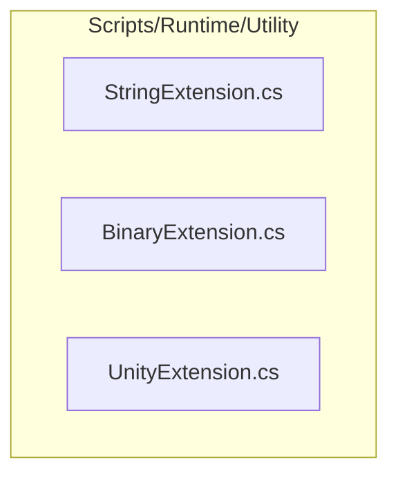
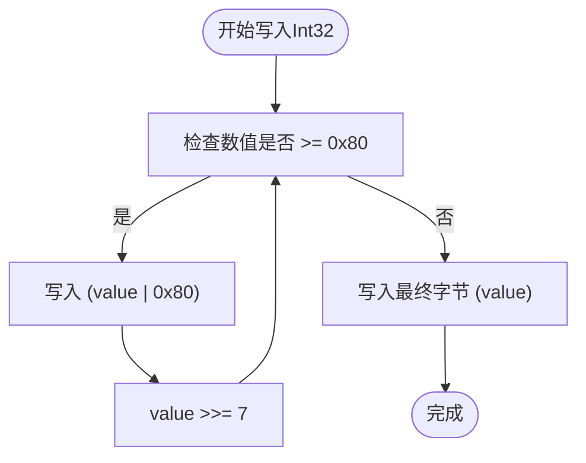
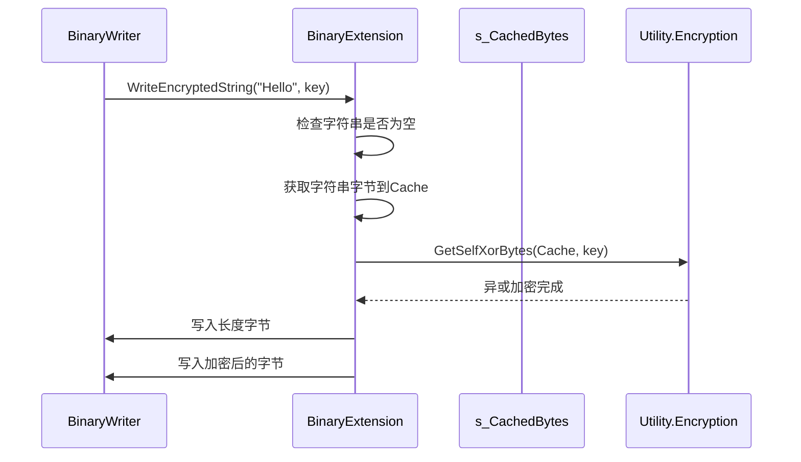
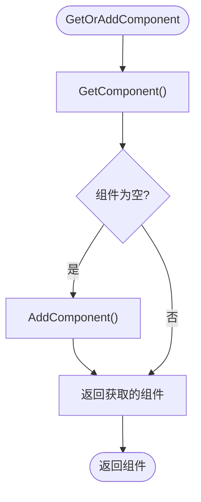
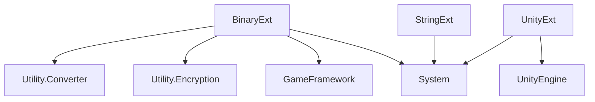

# 扩展方法API

<cite>
**Referenced Files in This Document**   
- [StringExtension.cs](file://Scripts/Runtime/Utility/StringExtension.cs)
- [BinaryExtension.cs](file://Scripts/Runtime/Utility/BinaryExtension.cs)
- [UnityExtension.cs](file://Scripts/Runtime/Utility/UnityExtension.cs)
</cite>

## 目录
1. [简介](#简介)
2. [项目结构](#项目结构)
3. [核心组件](#核心组件)
4. [架构概述](#架构概述)
5. [详细组件分析](#详细组件分析)
6. [依赖分析](#依赖分析)
7. [性能考虑](#性能考虑)
8. [故障排除指南](#故障排除指南)
9. [结论](#结论)

## 简介
本文档全面介绍了Unity游戏框架中的三个核心扩展类：`StringExtension`、`BinaryExtension`和`UnityExtension`。这些扩展方法旨在提升代码的可读性、简洁性和开发效率。文档详细说明了每个扩展方法的作用域、参数和返回值，并通过代码示例展示其在实际开发中的应用。同时，解释了扩展方法的调用机制、命名空间引入要求，以及潜在的性能影响和最佳使用场景。

## 项目结构
扩展方法模块位于项目的`Scripts/Runtime/Utility/`目录下，包含三个独立的C#文件，分别对应字符串、二进制流和Unity对象的扩展功能。这种按功能分类的组织方式使得代码结构清晰，易于维护和扩展。



**Diagram sources**
- [StringExtension.cs](file://Scripts/Runtime/Utility/StringExtension.cs)
- [BinaryExtension.cs](file://Scripts/Runtime/Utility/BinaryExtension.cs)
- [UnityExtension.cs](file://Scripts/Runtime/Utility/UnityExtension.cs)

**Section sources**
- [StringExtension.cs](file://Scripts/Runtime/Utility/StringExtension.cs)
- [BinaryExtension.cs](file://Scripts/Runtime/Utility/BinaryExtension.cs)
- [UnityExtension.cs](file://Scripts/Runtime/Utility/UnityExtension.cs)

## 核心组件
本模块的核心由三个静态扩展类构成：
- `StringExtension`：提供对`string`类型的扩展，主要用于字符串的解析和处理。
- `BinaryExtension`：提供对`BinaryReader`和`BinaryWriter`的扩展，用于高效、安全地读写编码和加密的二进制数据。
- `UnityExtension`：提供对Unity引擎核心类（如`GameObject`、`Transform`、`Vector3`）的扩展，极大地简化了常见的游戏开发操作。

**Section sources**
- [StringExtension.cs](file://Scripts/Runtime/Utility/StringExtension.cs)
- [BinaryExtension.cs](file://Scripts/Runtime/Utility/BinaryExtension.cs)
- [UnityExtension.cs](file://Scripts/Runtime/Utility/UnityExtension.cs)

## 架构概述
该扩展方法模块采用典型的静态扩展类模式，遵循单一职责原则。每个类都专注于一个特定领域（字符串、二进制、Unity对象），并通过`this`关键字为现有类型添加新的实例方法。这种设计无需修改原始类型，即可为它们注入新的功能，是C#语言中实现功能增强的优雅方式。

```mermaid
classDiagram
class StringExtension {
+ReadLine(rawString, position) string
}
class BinaryExtension {
+Read7BitEncodedInt32(binaryReader) int
+Write7BitEncodedInt32(binaryWriter, value) void
+ReadEncryptedString(binaryReader, encryptBytes) string
+WriteEncryptedString(binaryWriter, value, encryptBytes) void
}
class UnityExtension {
+GetOrAddComponent~T~(gameObject) T
+SetLayerRecursively(gameObject, layer) void
+ToVector2(vector3) Vector2
+SetPositionX(transform, newValue) void
+LookAt2D(transform, lookAtPoint2D) void
}
note right of StringExtension
为string类型提供
行读取功能
end note
note right of BinaryExtension
为BinaryReader/Writer提供
变长编码和加密字符串
读写功能
end note
note right of UnityExtension
为GameObject、Transform等
Unity核心类型提供便捷操作
end note
```

**Diagram sources**
- [StringExtension.cs](file://Scripts/Runtime/Utility/StringExtension.cs)
- [BinaryExtension.cs](file://Scripts/Runtime/Utility/BinaryExtension.cs)
- [UnityExtension.cs](file://Scripts/Runtime/Utility/UnityExtension.cs)

## 详细组件分析

### StringExtension 分析
`StringExtension`类为`string`类型提供了一个名为`ReadLine`的扩展方法。该方法允许开发者从一个长字符串中逐行读取内容，类似于从文件流中读取文本。它通过一个`ref int`类型的`position`参数来跟踪当前读取的位置，非常适合解析配置文件或日志文本。

**Section sources**
- [StringExtension.cs](file://Scripts/Runtime/Utility/StringExtension.cs#L18-L64)

### BinaryExtension 分析
`BinaryExtension`类为`BinaryReader`和`BinaryWriter`提供了强大的扩展功能，主要分为两大类：变长编码整数和加密字符串。

#### 变长编码整数
此类方法（如`Read7BitEncodedInt32`和`Write7BitEncodedInt32`）实现了7位编码（也称Varint），用于高效存储整数。小数值占用更少的字节，从而节省存储空间和网络带宽。这对于序列化大量整数数据（如游戏存档、网络消息）非常有用。



**Diagram sources**
- [BinaryExtension.cs](file://Scripts/Runtime/Utility/BinaryExtension.cs#L23-L58)

#### 加密字符串
`ReadEncryptedString`和`WriteEncryptedString`方法提供了对字符串的简单加密和解密功能。它使用一个密钥字节数组（`encryptBytes`）与字符串数据进行异或（XOR）运算，实现基本的数据保护。这可以防止游戏资源中的字符串被轻易地通过十六进制编辑器查看。



**Diagram sources**
- [BinaryExtension.cs](file://Scripts/Runtime/Utility/BinaryExtension.cs#L148-L195)

**Section sources**
- [BinaryExtension.cs](file://Scripts/Runtime/Utility/BinaryExtension.cs)

### UnityExtension 分析
`UnityExtension`类极大地简化了Unity开发中的常见任务，提供了大量便捷的扩展方法。

#### 组件与对象操作
`GetOrAddComponent<T>`方法是`GetComponent<T>`的增强版。它会先尝试获取组件，如果不存在则自动添加，避免了繁琐的空值检查和`AddComponent`调用。



**Diagram sources**
- [UnityExtension.cs](file://Scripts/Runtime/Utility/UnityExtension.cs#L68-L77)

#### Transform 操作
该类提供了丰富的`Transform`操作方法，分为设置（`Set`）和增加（`Add`）两类，分别用于绝对赋值和相对增量。例如，`SetPositionX`直接设置X坐标，而`AddPositionY`则在当前Y坐标上增加一个值。此外，`LookAt2D`方法专门用于2D场景，使一个物体朝向目标点。

**Section sources**
- [UnityExtension.cs](file://Scripts/Runtime/Utility/UnityExtension.cs)

## 依赖分析
这三个扩展类主要依赖于.NET基础库和Unity引擎的核心API。`BinaryExtension`还依赖于项目内部的`Utility.Encryption`和`Utility.Converter`工具类来完成加密和编码转换。它们之间没有相互依赖，保持了模块的独立性。



**Diagram sources**
- [BinaryExtension.cs](file://Scripts/Runtime/Utility/BinaryExtension.cs)
- [UnityExtension.cs](file://Scripts/Runtime/Utility/UnityExtension.cs)

**Section sources**
- [BinaryExtension.cs](file://Scripts/Runtime/Utility/BinaryExtension.cs)
- [UnityExtension.cs](file://Scripts/Runtime/Utility/UnityExtension.cs)

## 性能考虑
- **StringExtension.ReadLine**: 该方法在内部使用`Substring`，会创建新的字符串对象。在处理大文本时，频繁调用可能导致内存分配压力。建议在性能敏感的场景下考虑使用`StringBuilder`或流式处理。
- **BinaryExtension**: 变长编码在读写小整数时非常高效，但读取大整数时需要多次读取字节，可能比直接读取固定长度整数稍慢。加密方法使用了静态缓存数组`s_CachedBytes`，避免了频繁的内存分配，是一个良好的性能优化。
- **UnityExtension**: 大多数方法（如`SetPositionX`）只是对`Vector3`的封装，性能开销极小。但`SetLayerRecursively`会调用`GetComponentsInChildren`并遍历所有子物体，在层级很深或子物体很多时可能成为性能瓶颈，应谨慎使用。

## 故障排除指南
- **方法无法调用**: 确保在C#脚本的顶部使用`using`语句引入了`GameFramework.Utility`命名空间。
- **加密字符串读取失败**: 检查读取和写入时使用的`encryptBytes`密钥是否完全一致。
- **7位编码整数异常**: 确保写入和读取的编码方式匹配（如都使用`Write7BitEncodedInt32`和`Read7BitEncodedInt32`）。
- **SetLayerRecursively不生效**: 确认传入的`GameObject`是有效的场景实例，而非Prefab。

**Section sources**
- [StringExtension.cs](file://Scripts/Runtime/Utility/StringExtension.cs)
- [BinaryExtension.cs](file://Scripts/Runtime/Utility/BinaryExtension.cs)
- [UnityExtension.cs](file://Scripts/Runtime/Utility/UnityExtension.cs)

## 结论
`StringExtension`、`BinaryExtension`和`UnityExtension`这三个扩展类是Unity游戏框架中非常实用的工具集。它们通过扩展方法模式，为开发者提供了简洁、安全且高效的API，显著提升了代码的可读性和开发效率。合理利用这些扩展方法，可以减少样板代码，避免常见错误，并专注于核心游戏逻辑的开发。