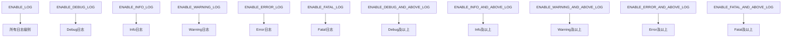
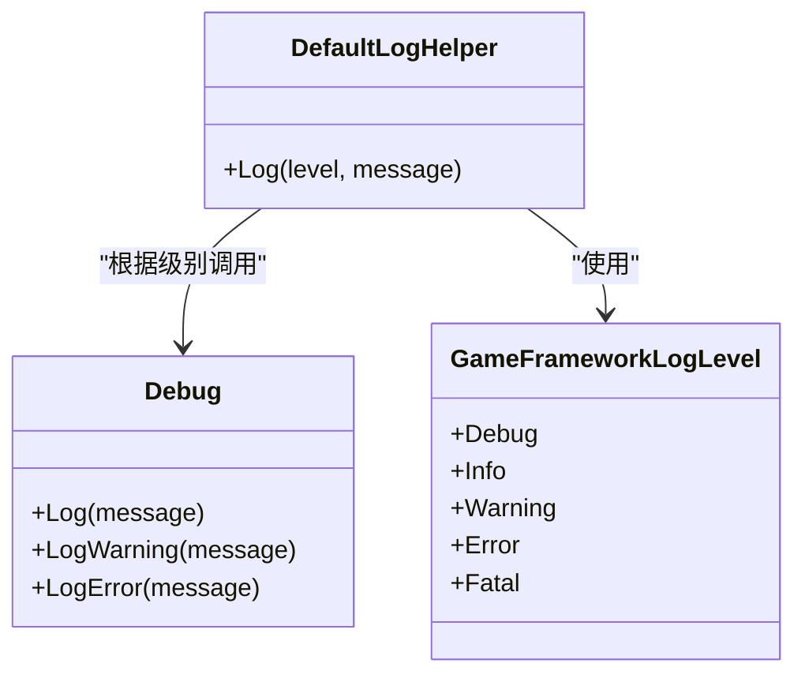
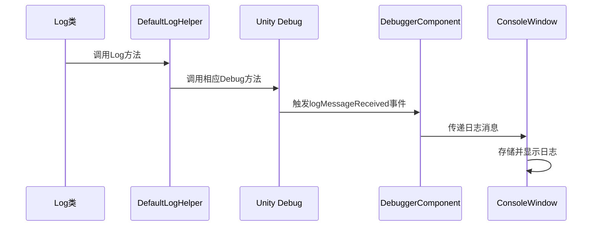

# 日志工具API

<cite>
**Referenced Files in This Document**   
- [Log.cs](file://Scripts/Runtime/Utility/Log.cs)
- [DefaultLogHelper.cs](file://Scripts/Runtime/Utility/DefaultLogHelper.cs)
- [LogScriptingDefineSymbols.cs](file://Scripts/Editor/Misc/LogScriptingDefineSymbols.cs)
- [DebuggerComponent.ConsoleWindow.cs](file://Scripts/Runtime/Debugger/DebuggerComponent.ConsoleWindow.cs)
</cite>

## 目录
1. [简介](#简介)
2. [核心组件](#核心组件)
3. [日志级别与控制逻辑](#日志级别与控制逻辑)
4. [日志输出目标配置](#日志输出目标配置)
5. [DefaultLogHelper扩展点](#defaultloghelper扩展点)
6. [实际使用示例](#实际使用示例)
7. [与DebuggerComponent集成](#与debuggercomponent集成)
8. [常见问题排查](#常见问题排查)

## 简介
日志工具API为Unity游戏框架提供了一套完整的日志记录解决方案，包含日志级别管理、条件编译控制、输出格式化和调试器集成等功能。该系统通过静态`Log`类提供简洁的API接口，并通过`DefaultLogHelper`实现具体的日志处理逻辑，支持灵活的扩展和定制。

## 核心组件

日志系统主要由两个核心组件构成：`Log`静态工具类和`DefaultLogHelper`默认日志处理器。

`Log`类作为开发者的主要接口，提供了`Info`、`Warning`、`Error`、`Debug`等静态方法，封装了日志记录的复杂性，使开发者能够以简单的方式输出不同级别的日志信息。

`DefaultLogHelper`类实现了`GameFrameworkLog.ILogHelper`接口，是日志输出的具体执行者，负责将日志消息传递给Unity的`Debug`系统，并根据日志级别应用不同的输出格式。

**Section sources**
- [Log.cs](file://Scripts/Runtime/Utility/Log.cs#L15-L501)
- [DefaultLogHelper.cs](file://Scripts/Runtime/Utility/DefaultLogHelper.cs#L15-L46)

## 日志级别与控制逻辑

日志系统定义了五个主要的日志级别：`Debug`、`Info`、`Warning`、`Error`和`Fatal`，每个级别对应不同的使用场景和重要性。

日志级别的控制通过C#的`[Conditional]`特性实现，这是一种编译时的条件控制机制。每个日志方法都标记了多个`[Conditional]`特性，只有当相应的预编译符号被定义时，日志调用才会被包含在编译后的代码中。



**Diagram sources**
- [Log.cs](file://Scripts/Runtime/Utility/Log.cs#L15-L501)

日志级别控制逻辑允许开发者通过定义不同的预编译符号来精细控制哪些日志会被输出。例如，定义`ENABLE_INFO_AND_ABOVE_LOG`将启用`Info`、`Warning`、`Error`和`Fatal`级别的日志，但会排除`Debug`级别的日志。

编辑器工具`LogScriptingDefineSymbols`提供了便捷的菜单项来设置这些预编译符号，开发者可以通过Unity编辑器的菜单快速切换不同的日志配置。

**Section sources**
- [LogScriptingDefineSymbols.cs](file://Scripts/Editor/Misc/LogScriptingDefineSymbols.cs#L120-L151)

## 日志输出目标配置

日志输出目标主要由`DefaultLogHelper`类配置，该类实现了`ILogHelper`接口的`Log`方法，根据日志级别将消息输出到不同的Unity `Debug`方法。



**Diagram sources**
- [DefaultLogHelper.cs](file://Scripts/Runtime/Utility/DefaultLogHelper.cs#L15-L46)

具体配置逻辑如下：
- `Debug`级别日志通过`Debug.Log`输出，并使用灰色HTML颜色标签`<color=#888888>`进行格式化，使其在控制台中显示为灰色文本
- `Info`级别日志通过`Debug.Log`输出，显示为正常白色文本
- `Warning`级别日志通过`Debug.LogWarning`输出，显示为黄色警告文本
- `Error`级别日志通过`Debug.LogError`输出，显示为红色错误文本

这种配置确保了不同级别的日志在Unity编辑器控制台中具有明显的视觉区分，便于开发者快速识别问题的严重程度。

**Section sources**
- [DefaultLogHelper.cs](file://Scripts/Runtime/Utility/DefaultLogHelper.cs#L22-L45)

## DefaultLogHelper扩展点

`DefaultLogHelper`作为默认日志处理实现，为开发者提供了重要的扩展点。通过实现`GameFrameworkLog.ILogHelper`接口，开发者可以创建自定义的日志处理器来替代或扩展默认行为。

扩展`DefaultLogHelper`的主要场景包括：
- 将日志输出到文件而非控制台
- 将日志发送到远程服务器进行集中管理
- 添加额外的日志格式化信息，如时间戳、线程ID等
- 实现日志分级存储，将不同级别的日志保存到不同的文件中
- 集成第三方日志框架

要创建自定义日志处理器，开发者需要：
1. 创建一个新类实现`ILogHelper`接口
2. 实现`Log`方法，定义自定义的日志处理逻辑
3. 在游戏初始化时，通过`GameFrameworkLog.SetLogHelper`方法注册自定义的日志处理器

这种设计模式遵循了依赖倒置原则，使得日志系统的具体实现可以灵活替换，而不会影响到使用日志API的业务代码。

**Section sources**
- [DefaultLogHelper.cs](file://Scripts/Runtime/Utility/DefaultLogHelper.cs#L15-L46)

## 实际使用示例

### 基本日志输出
```csharp
// 输出信息级别日志
Log.Info("游戏启动完成");

// 输出带格式化的信息日志
Log.Info("玩家 {0} 的等级为 {1}", playerName, level);

// 输出警告日志
Log.Warning("资源加载超时");

// 输出错误日志
Log.Error("无法连接到服务器: {0}", errorMessage);
```

### 结构化日志
```csharp
// 使用对象作为日志参数，输出结构化信息
var playerData = new { Name = "Player1", Level = 10, Health = 100 };
Log.Info("玩家状态: {0}", playerData);
```

### 条件日志
```csharp
// 仅在调试版本中输出调试日志
#if DEBUG
Log.Debug("当前帧率: {0}", Time.frameCount);
#endif

// 根据配置决定是否输出详细日志
if (config.EnableVerboseLogging)
{
    Log.Debug("详细操作步骤: {0}", detailedInfo);
}
```

### 性能追踪日志
```csharp
// 记录性能关键点
var startTime = Time.realtimeSinceStartup;
// 执行耗时操作
PerformHeavyOperation();
var endTime = Time.realtimeSinceStartup;
Log.Info("操作耗时: {0:F3}秒", endTime - startTime);
```

**Section sources**
- [Log.cs](file://Scripts/Runtime/Utility/Log.cs#L15-L501)

## 与DebuggerComponent集成

日志系统与`DebuggerComponent`紧密集成，提供了强大的运行时调试功能。`DebuggerComponent`中的`ConsoleWindow`类监听Unity的`Application.logMessageReceived`事件，捕获所有通过`Debug`系统输出的日志消息。



**Diagram sources**
- [Log.cs](file://Scripts/Runtime/Utility/Log.cs#L15-L501)
- [DefaultLogHelper.cs](file://Scripts/Runtime/Utility/DefaultLogHelper.cs#L15-L46)
- [DebuggerComponent.ConsoleWindow.cs](file://Scripts/Runtime/Debugger/DebuggerComponent.ConsoleWindow.cs#L15-L517)

`ConsoleWindow`提供了以下功能：
- 日志过滤：允许按级别（Info、Warning、Error、Fatal）过滤显示的日志
- 日志锁定：自动滚动到最新日志或锁定当前视图
- 日志复制：支持将日志及其堆栈跟踪复制到剪贴板
- 日志计数：显示各级别日志的数量统计
- 历史记录：保存最近的日志消息，便于回顾

这种集成使得开发者可以在游戏运行时实时监控日志输出，而无需依赖Unity编辑器的控制台窗口。

**Section sources**
- [DebuggerComponent.ConsoleWindow.cs](file://Scripts/Runtime/Debugger/DebuggerComponent.ConsoleWindow.cs#L15-L517)

## 常见问题排查

### 日志丢失
**问题描述**：调用`Log.Info()`等方法后，控制台没有输出相应的日志。

**排查方案**：
1. 检查是否定义了`ENABLE_LOG`预编译符号
2. 检查日志级别对应的预编译符号是否正确设置（如`ENABLE_INFO_LOG`）
3. 使用`LogScriptingDefineSymbols`菜单项检查当前的日志配置
4. 确认`DefaultLogHelper`是否正确注册为日志处理器

### 日志级别不生效
**问题描述**：设置了`ENABLE_WARNING_AND_ABOVE_LOG`，但`Info`级别的日志仍然输出。

**排查方案**：
1. 检查是否同时定义了`ENABLE_INFO_LOG`或`ENABLE_INFO_AND_ABOVE_LOG`
2. 在项目设置中检查所有相关的预编译符号
3. 使用`DisableAllLogs()`方法清除所有日志配置，然后重新设置

### 调试器不显示日志
**问题描述**：Unity编辑器控制台有日志输出，但`DebuggerComponent`的控制台窗口没有显示。

**排查方案**：
1. 确认`DebuggerComponent`已正确添加到场景中
2. 检查`Application.logMessageReceived`事件是否被正确订阅
3. 验证`ConsoleWindow.Initialize()`方法是否被调用

### 性能问题
**问题描述**：大量日志输出导致游戏性能下降。

**优化建议**：
1. 在发布版本中禁用`Debug`级别的日志
2. 使用条件编译避免在运行时进行字符串格式化
3. 限制日志输出频率，避免每帧都输出日志
4. 考虑将日志输出到文件而非实时显示

**Section sources**
- [LogScriptingDefineSymbols.cs](file://Scripts/Editor/Misc/LogScriptingDefineSymbols.cs#L120-L151)
- [DebuggerComponent.ConsoleWindow.cs](file://Scripts/Runtime/Debugger/DebuggerComponent.ConsoleWindow.cs#L15-L517)