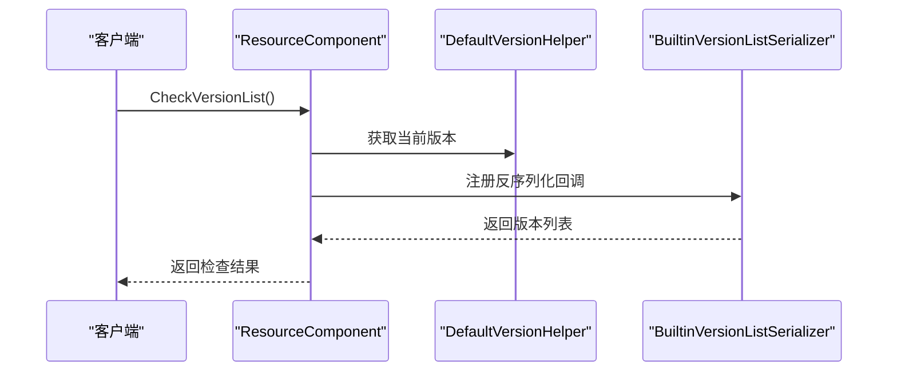
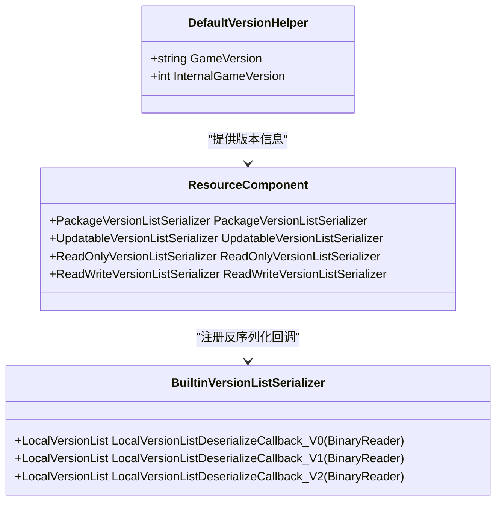
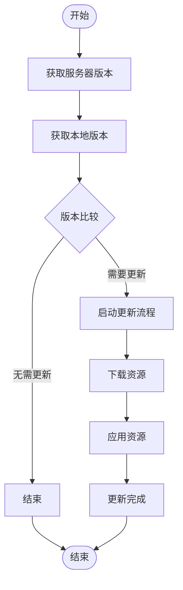

# 版本处理工具API

<cite>
**本文档引用的文件**  
- [DefaultVersionHelper.cs](file://Scripts/Runtime/Utility/DefaultVersionHelper.cs)
- [ResourceComponent.cs](file://Scripts/Runtime/Resource/ResourceComponent.cs)
- [BuiltinVersionListSerializer.cs](file://Scripts/Runtime/Resource/BuiltinVersionListSerializer.cs)
</cite>

## 目录
1. [简介](#简介)
2. [核心功能概述](#核心功能概述)
3. [DefaultVersionHelper类详解](#defaultversionhelper类详解)
4. [与ResourceComponent的集成](#与resourcecomponent的集成)
5. [版本列表序列化器协同工作](#版本列表序列化器协同工作)
6. [版本号格式与语义化支持](#版本号格式与语义化支持)
7. [热更新判断逻辑](#热更新判断逻辑)
8. [扩展机制与自定义比较规则](#扩展机制与自定义比较规则)
9. [使用示例](#使用示例)
10. [结论](#结论)

## 简介
`DefaultVersionHelper` 是 Unity 游戏框架中的一个核心工具类，用于处理游戏和资源的版本管理。它实现了 `IVersionHelper` 接口，提供获取游戏版本号和内部版本号的功能。该类在资源热更新、版本兼容性判断和资源包应用等场景中起着关键作用。通过与 `ResourceComponent` 和版本列表序列化器的协同工作，`DefaultVersionHelper` 确保了游戏资源的正确加载和更新。

## 核心功能概述
`DefaultVersionHelper` 的主要功能包括：
- 获取当前游戏的版本号（`GameVersion`）
- 获取内部游戏版本号（`InternalGameVersion`）
- 作为版本比较和解析的基础工具
- 支持资源热更新流程中的版本判断
- 与资源管理组件协同工作，确保版本一致性

这些功能使得开发者能够有效地管理游戏资源的版本，实现平滑的热更新和资源升级。

## DefaultVersionHelper类详解
`DefaultVersionHelper` 类实现了 `Version.IVersionHelper` 接口，提供了两个核心属性：

### GameVersion 属性
该属性返回当前游戏的版本号，通过 Unity 的 `Application.version` 获取。这个版本号通常在 Unity 编辑器的 Player Settings 中设置，用于标识游戏的发布版本。

### InternalGameVersion 属性
该属性返回内部游戏版本号，目前固定返回 0。这个值可以被扩展以支持更复杂的内部版本管理逻辑，用于判断资源兼容性和更新需求。

```csharp
public class DefaultVersionHelper : Version.IVersionHelper
{
    public string GameVersion
    {
        get
        {
            return Application.version;
        }
    }

    public int InternalGameVersion
    {
        get
        {
            return 0;
        }
    }
}
```

**Section sources**
- [DefaultVersionHelper.cs](file://Scripts/Runtime/Utility/DefaultVersionHelper.cs#L15-L38)

## 与ResourceComponent的集成
`DefaultVersionHelper` 与 `ResourceComponent` 紧密集成，共同管理游戏资源的版本和更新流程。

### 资源模式管理
`ResourceComponent` 通过 `SetResourceMode` 方法设置资源模式（单机模式或可更新模式），并根据模式注册相应的版本列表反序列化回调函数。这些回调函数由 `BuiltinVersionListSerializer` 提供，用于处理不同版本的资源列表。

### 版本检查与更新
在可更新模式下，`ResourceComponent` 使用 `CheckVersionList` 和 `UpdateVersionList` 方法检查和更新版本资源列表。这些操作依赖于 `DefaultVersionHelper` 提供的版本信息来判断是否需要更新资源。

### 资源组管理
`ResourceComponent` 管理多个资源组，每个资源组可以独立更新。`DefaultVersionHelper` 提供的版本信息用于判断哪些资源组需要更新，以及更新的优先级。



**Diagram sources**
- [ResourceComponent.cs](file://Scripts/Runtime/Resource/ResourceComponent.cs#L20-L1365)
- [DefaultVersionHelper.cs](file://Scripts/Runtime/Utility/DefaultVersionHelper.cs#L15-L38)

**Section sources**
- [ResourceComponent.cs](file://Scripts/Runtime/Resource/ResourceComponent.cs#L20-L1365)

## 版本列表序列化器协同工作
`DefaultVersionHelper` 与多个版本列表序列化器协同工作，确保不同模式下的资源版本正确处理。

### PackageVersionListSerializer
用于单机模式下的版本资源列表序列化。当资源模式为 `Package` 时，`ResourceComponent` 会注册相应的反序列化回调函数。

### UpdatableVersionListSerializer
用于可更新模式下的版本资源列表序列化。支持多个版本的反序列化回调，确保向后兼容性。

### LocalVersionListSerializer
用于本地只读区和读写区的版本资源列表序列化。支持不同版本的资源列表格式。



**Diagram sources**
- [ResourceComponent.cs](file://Scripts/Runtime/Resource/ResourceComponent.cs#L155-L172)
- [BuiltinVersionListSerializer.cs](file://Scripts/Runtime/Resource/BuiltinVersionListSerializer.cs#L15-L102)

**Section sources**
- [BuiltinVersionListSerializer.cs](file://Scripts/Runtime/Resource/BuiltinVersionListSerializer.cs#L15-L102)

## 版本号格式与语义化支持
`DefaultVersionHelper` 支持标准的版本号格式（x.y.z），并可以通过扩展支持语义化版本。

### 版本号格式
- 主版本号（x）：重大更新，可能包含不兼容的API变更
- 次版本号（y）：向后兼容的功能新增
- 修订号（z）：向后兼容的问题修复

### 兼容性判断
通过比较版本号的各个部分，可以判断版本之间的兼容性：
- 主版本号不同：不兼容
- 主版本号相同，次版本号不同：向后兼容
- 主版本号和次版本号相同：完全兼容

### 版本比较逻辑
```csharp
// 伪代码示例
int CompareVersion(string version1, string version2)
{
    var v1 = ParseVersion(version1);
    var v2 = ParseVersion(version2);
    
    if (v1.Major != v2.Major) return v1.Major.CompareTo(v2.Major);
    if (v1.Minor != v2.Minor) return v1.Minor.CompareTo(v2.Minor);
    return v1.Patch.CompareTo(v2.Patch);
}
```

## 热更新判断逻辑
`DefaultVersionHelper` 在热更新流程中起着关键作用，通过以下逻辑判断是否需要更新：

### 更新判断流程
1. 获取服务器上的最新版本信息
2. 使用 `DefaultVersionHelper` 获取本地版本信息
3. 比较版本号，判断是否需要更新
4. 如果需要更新，启动资源更新流程

### 版本降级处理
在某些情况下，可能需要处理版本降级：
- 检测到新版本存在严重问题
- 用户需要回滚到稳定版本
- 测试不同版本的功能

### 更新策略
- **强制更新**：当版本差异较大时，强制用户更新
- **推荐更新**：提示用户有新版本可用
- **静默更新**：在后台下载更新，不影响用户体验



**Diagram sources**
- [ResourceComponent.cs](file://Scripts/Runtime/Resource/ResourceComponent.cs#L20-L1365)

## 扩展机制与自定义比较规则
`DefaultVersionHelper` 提供了扩展机制，允许开发者自定义版本比较规则以适应特定的发布策略。

### 自定义版本比较
开发者可以通过继承 `IVersionHelper` 接口创建自定义的版本辅助器，实现特定的版本比较逻辑。

### 发布策略适配
- **灰度发布**：根据用户分组应用不同的版本比较规则
- **区域发布**：根据不同地区应用不同的版本策略
- **A/B测试**：同时维护多个版本，根据测试需求切换

### 扩展示例
```csharp
public class CustomVersionHelper : Version.IVersionHelper
{
    public string GameVersion { get; private set; }
    public int InternalGameVersion { get; private set; }
    
    public int CompareVersion(string version1, string version2)
    {
        // 自定义比较逻辑
    }
}
```

## 使用示例
以下示例展示了如何使用 `DefaultVersionHelper` 进行版本管理和热更新判断。

### 解析服务器版本信息
```csharp
// 从服务器响应中解析版本信息
string serverVersion = response["version"];
int serverInternalVersion = int.Parse(response["internalVersion"]);
```

### 判断是否需要更新
```csharp
var versionHelper = new DefaultVersionHelper();
string localVersion = versionHelper.GameVersion;
int localInternalVersion = versionHelper.InternalGameVersion;

if (serverInternalVersion > localInternalVersion)
{
    // 需要更新
    resourceComponent.UpdateResources(callback);
}
```

### 处理版本降级
```csharp
if (serverInternalVersion < localInternalVersion)
{
    // 处理版本降级
    ShowWarning("检测到版本降级，是否继续？");
}
```

### 自定义版本比较
```csharp
public class SemanticVersionHelper : Version.IVersionHelper
{
    public string GameVersion { get; set; }
    public int InternalGameVersion { get; set; }
    
    public bool IsCompatible(string current, string target)
    {
        // 实现语义化版本兼容性判断
        var currentVer = new SemanticVersion(current);
        var targetVer = new SemanticVersion(target);
        
        return currentVer.Major == targetVer.Major && 
               currentVer.Minor <= targetVer.Minor;
    }
}
```

**Section sources**
- [DefaultVersionHelper.cs](file://Scripts/Runtime/Utility/DefaultVersionHelper.cs#L15-L38)
- [ResourceComponent.cs](file://Scripts/Runtime/Resource/ResourceComponent.cs#L20-L1365)

## 结论
`DefaultVersionHelper` 作为 Unity 游戏框架中的版本管理核心工具，提供了基础的版本号获取和比较功能。通过与 `ResourceComponent` 和版本列表序列化器的紧密集成，它支持复杂的资源热更新流程，包括版本检查、资源更新和版本降级处理。其扩展机制允许开发者根据特定的发布策略自定义版本比较规则，适应不同的业务需求。该工具的设计体现了模块化和可扩展性的原则，为游戏资源管理提供了可靠的基础。