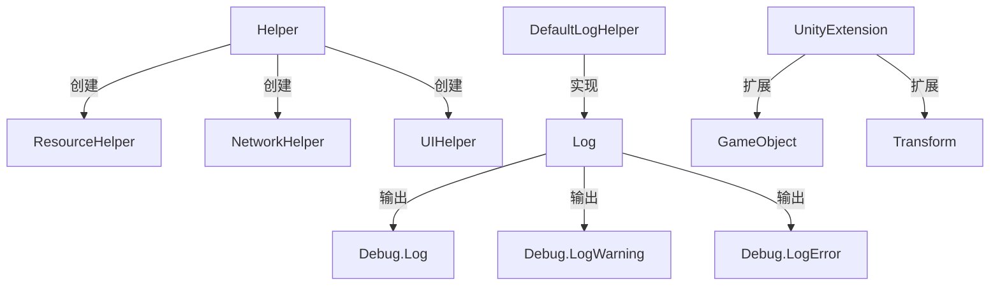
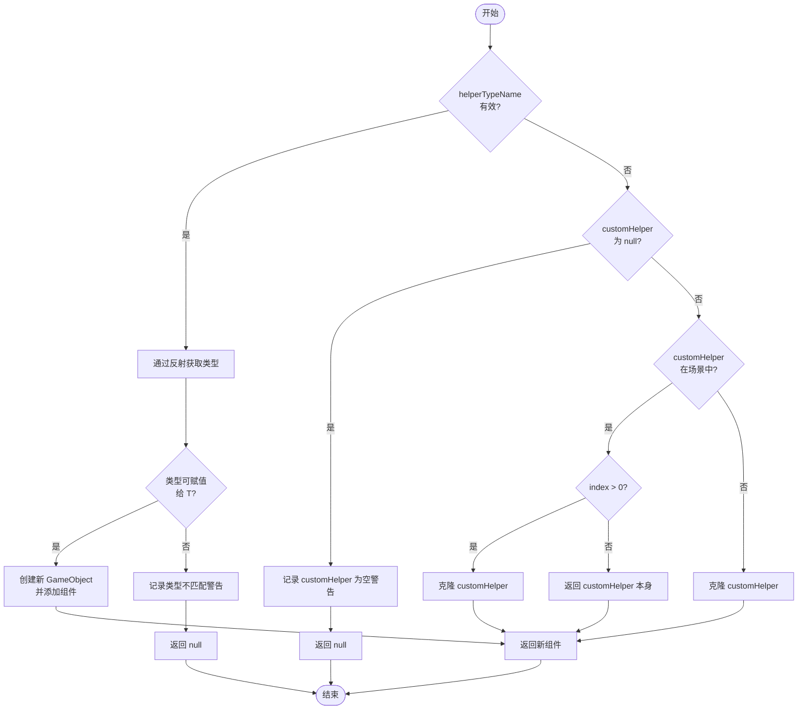

# 通用辅助工具API

<cite>
**Referenced Files in This Document**   
- [Helper.cs](file://Scripts/Runtime/Utility/Helper.cs)
- [Log.cs](file://Scripts/Runtime/Utility/Log.cs)
- [UnityExtension.cs](file://Scripts/Runtime/Utility/UnityExtension.cs)
- [DefaultLogHelper.cs](file://Scripts/Runtime/Utility/DefaultLogHelper.cs)
</cite>

## 目录
1. [简介](#简介)
2. [核心功能概览](#核心功能概览)
3. [辅助器创建功能](#辅助器创建功能)
4. [日志记录功能](#日志记录功能)
5. [Unity扩展功能](#unity扩展功能)
6. [性能与线程安全](#性能与线程安全)
7. [使用示例](#使用示例)
8. [结论](#结论)

## 简介

`Helper` 类是 UnityGameFramework 框架中的一个核心静态工具类，位于 `UnityGameFramework.Runtime` 命名空间下。它主要提供辅助器（Helper）的创建功能，是框架中组件化设计的重要支撑。该类通过反射和 Unity 的组件系统，实现了运行时动态创建特定类型的 MonoBehaviour 组件，极大地简化了框架内部各功能模块（如资源管理、网络、UI等）的初始化和配置流程。

`Helper` 类的设计体现了框架的灵活性和可扩展性，允许开发者通过配置指定具体的辅助器实现类，或在运行时动态创建实例。它与 `UnityExtension` 和 `Log` 等工具类共同构成了框架的底层工具集，为上层业务逻辑提供了稳定、高效的基础支持。

**Section sources**
- [Helper.cs](file://Scripts/Runtime/Utility/Helper.cs#L1-L75)

## 核心功能概览

`Helper` 类的核心功能是创建辅助器实例。在 UnityGameFramework 中，许多系统（如 `ResourceComponent`、`NetworkComponent`）都需要特定的辅助器（Helper）来执行平台相关的底层操作。`Helper` 类通过 `CreateHelper` 方法族，统一了这些辅助器的创建逻辑。

除了 `Helper` 类，`Scripts/Runtime/Utility` 目录下还包含了一系列强大的工具类，它们共同构成了框架的通用工具库：
- **`Log`**: 提供多级别的日志输出功能，支持条件编译以优化发布版本的性能。
- **`UnityExtension`**: 为 Unity 的 `GameObject` 和 `Transform` 等核心类提供了丰富的扩展方法，简化了常见的操作。
- **`DefaultLogHelper`**: 实现了 `GameFramework` 日志系统的具体输出逻辑，将日志重定向到 Unity 的 `Debug.Log` 等。

这些工具类被框架的各个模块广泛调用，是开发高效、可维护的 Unity 项目不可或缺的组成部分。



**Diagram sources**
- [Helper.cs](file://Scripts/Runtime/Utility/Helper.cs#L15-L75)
- [Log.cs](file://Scripts/Runtime/Utility/Log.cs#L15-L501)
- [UnityExtension.cs](file://Scripts/Runtime/Utility/UnityExtension.cs#L1-L347)
- [DefaultLogHelper.cs](file://Scripts/Runtime/Utility/DefaultLogHelper.cs#L22-L45)

**Section sources**
- [Helper.cs](file://Scripts/Runtime/Utility/Helper.cs#L1-L75)
- [Log.cs](file://Scripts/Runtime/Utility/Log.cs#L1-L504)
- [UnityExtension.cs](file://Scripts/Runtime/Utility/UnityExtension.cs#L1-L347)

## 辅助器创建功能

`Helper` 类的核心是两个重载的 `CreateHelper` 静态方法，它们负责创建指定类型的辅助器实例。

### 方法定义

#### `CreateHelper<T>(string helperTypeName, T customHelper)`

此方法是主要的入口点，它接受一个类型名称和一个自定义实例作为参数。

**参数说明**:
- `helperTypeName` (`string`): 要创建的辅助器类型的完全限定名（如 `"UnityGameFramework.Runtime.DefaultResourceHelper"`）。如果此参数为空或无效，方法将回退到使用 `customHelper`。
- `customHelper` (`T`): 一个 `T` 类型的 MonoBehaviour 实例。当 `helperTypeName` 无效时，将使用此实例的克隆（`Object.Instantiate`）。如果 `customHelper` 本身为 `null`，方法将返回 `null` 并记录警告。

**返回值**:
- 返回一个 `T` 类型的新创建或克隆的 MonoBehaviour 实例，如果创建失败则返回 `null`。

**Section sources**
- [Helper.cs](file://Scripts/Runtime/Utility/Helper.cs#L15-L30)

#### `CreateHelper<T>(string helperTypeName, T customHelper, int index)`

这是上述方法的重载，增加了一个 `index` 参数，用于控制克隆行为。

**参数说明**:
- `index` (`int`): 克隆索引。当 `helperTypeName` 无效且需要克隆 `customHelper` 时，如果 `index` 大于 0，会创建一个新实例；如果 `index` 为 0，则直接返回 `customHelper` 本身（前提是它已在场景中）。

**返回值**:
- 返回一个 `T` 类型的新创建或克隆的 MonoBehaviour 实例，如果创建失败则返回 `null`。

**Section sources**
- [Helper.cs](file://Scripts/Runtime/Utility/Helper.cs#L32-L75)

### 创建流程

1.  **通过类型名创建**: 如果 `helperTypeName` 有效，方法会使用 `Utility.Assembly.GetType(helperTypeName)` 通过反射获取类型。然后检查该类型是否可以赋值给泛型类型 `T`，最后使用 `new GameObject().AddComponent(helperType)` 动态创建一个空 GameObject 并添加该组件。
2.  **通过自定义实例克隆**: 如果 `helperTypeName` 无效，方法会检查 `customHelper`。如果 `customHelper` 不为 `null`，则根据 `index` 参数决定是直接返回场景中的实例还是创建一个新克隆。
3.  **失败处理**: 在任何一步失败时（如类型找不到、类型不匹配、`customHelper` 为 `null`），方法都会返回 `null` 并通过 `Log.Warning` 记录一条警告信息。



**Diagram sources**
- [Helper.cs](file://Scripts/Runtime/Utility/Helper.cs#L15-L75)

## 日志记录功能

`Log` 类是一个功能完备的静态日志工具，它封装了 `GameFrameworkLog`，为开发者提供了清晰、结构化的日志输出接口。

### 日志级别

`Log` 类支持五个标准的日志级别，每个级别都有对应的静态方法：
- **`Debug`**: 用于记录调试信息，通常在开发阶段使用。
- **`Info`**: 用于记录程序正常运行的信息。
- **`Warning`**: 用于记录潜在的问题或非致命错误。
- **`Error`**: 用于记录功能逻辑错误。
- **`Fatal`**: 用于记录可能导致程序崩溃的严重错误。

### 条件编译

为了优化发布版本的性能，`Log` 类的方法使用了 `[Conditional]` 特性。这意味着日志方法的调用可以在编译时被完全移除。例如，`Debug` 方法只有在定义了 `ENABLE_LOG`、`ENABLE_DEBUG_LOG` 或 `ENABLE_DEBUG_AND_ABOVE_LOG` 预编译符号时才会生效。这使得开发者可以在发布版本中关闭调试日志，而无需修改代码。

### 方法重载

每个日志级别都提供了多个重载方法，支持直接传入对象、字符串，或使用格式化字符串（类似 `string.Format`）。

**Section sources**
- [Log.cs](file://Scripts/Runtime/Utility/Log.cs#L15-L501)

## Unity扩展功能

`UnityExtension` 类为 Unity 的核心类提供了大量实用的扩展方法，极大地提升了开发效率。

### GameObject 扩展

- **`GetOrAddComponent<T>()`**: 一个非常常用的方法，它会先尝试获取组件，如果不存在则自动添加。这避免了繁琐的 `GetComponent` + `AddComponent` 检查。
- **`InScene()`**: 判断一个 GameObject 是场景中的实例还是 Prefab 资源。这是通过检查 `gameObject.scene.name` 是否为 `null` 来实现的。
- **`SetLayerRecursively()`**: 递归地为 GameObject 及其所有子对象设置图层。

### Transform 扩展

- **位置/缩放操作**: 提供了 `SetPositionX/Y/Z`、`AddPositionX/Y/Z`、`SetLocalScaleX/Y/Z` 等一系列方法，可以方便地单独修改 Transform 的某个分量，而无需手动创建 `Vector3`。
- **二维空间朝向**: `LookAt2D` 方法可以方便地让一个 Transform 在 2D 空间中朝向一个目标点。

**Section sources**
- [UnityExtension.cs](file://Scripts/Runtime/Utility/UnityExtension.cs#L1-L347)

## 性能与线程安全

### 性能考量

- **`Helper.CreateHelper`**: 使用了反射 (`GetType`)，这在性能上是有开销的。因此，辅助器的创建通常只在游戏启动或系统初始化时进行一次，而不是在每帧中频繁调用。
- **`UnityExtension.SetLayerRecursively`**: 该方法会遍历所有子对象，对于层级很深的 GameObject，可能会有性能影响。建议在必要时才使用。
- **`Log` 类**: 由于使用了条件编译，在发布版本中关闭日志可以显著减少性能开销。但在开启日志的情况下，频繁调用日志方法仍会影响性能。

### 线程安全

根据 Unity 的运行时特性，这些工具类的方法**不是线程安全的**。它们设计用于在 Unity 的主线程（Main Thread）中调用。在 Unity 中，绝大多数 API（包括 GameObject、Component、Transform 的操作）都只能在主线程中安全执行。在协程或异步任务中使用这些方法时，必须确保操作被调度回主线程。

## 使用示例

### 创建资源辅助器

```csharp
// 假设 ResourceComponent 需要一个 ResourceHelper
string helperTypeName = "UnityGameFramework.Runtime.DefaultResourceHelper";
DefaultResourceHelper customHelper = GetComponent<DefaultResourceHelper>();

ResourceHelper helper = Helper.CreateHelper<ResourceHelper>(helperTypeName, customHelper);
if (helper != null)
{
    // 成功创建，可以使用 helper
    Log.Info("Resource helper created successfully.");
}
else
{
    Log.Error("Failed to create resource helper.");
}
```

### 使用日志

```csharp
// 记录不同级别的日志
Log.Debug("This is a debug message with value: {0}", someValue);
Log.Info("Game started.");
Log.Warning("Resource '{0}' is missing.", resourceName);
Log.Error("Failed to connect to server.");
Log.Fatal("Critical error, restarting game...");
```

### 使用 Unity 扩展

```csharp
// 获取或添加组件
var rigidbody = gameObject.GetOrAddComponent<Rigidbody>();

// 递归设置图层
gameObject.SetLayerRecursively(LayerMask.NameToLayer("UI"));

// 修改 Transform 的 Y 坐标
transform.SetPositionY(transform.position.y + 1f);

// 2D 朝向
transform.LookAt2D(targetPosition);
```

## 结论

`Helper` 类及其相关的工具集（`Log`、`UnityExtension`）是 UnityGameFramework 框架的基石。它们通过提供简洁、高效的 API，极大地简化了开发流程，减少了重复代码。`Helper` 类的动态创建机制保证了框架的灵活性和可配置性；`Log` 类提供了强大的日志支持；而 `UnityExtension` 则填补了 Unity 原生 API 的空白，提升了开发体验。

在使用这些工具时，开发者应了解其内部实现和性能特点，避免在性能敏感的代码路径中滥用反射或频繁的日志输出。同时，必须牢记它们的线程安全限制，确保在正确的线程中调用。正确地使用这些通用辅助工具，能够显著提升项目的开发效率和代码质量。