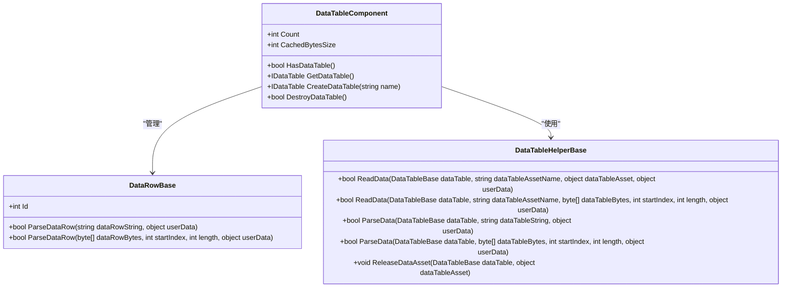
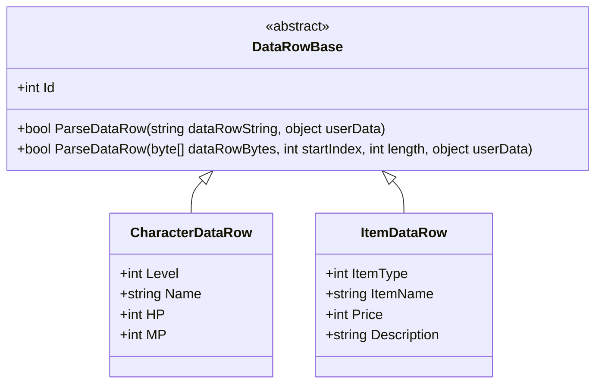
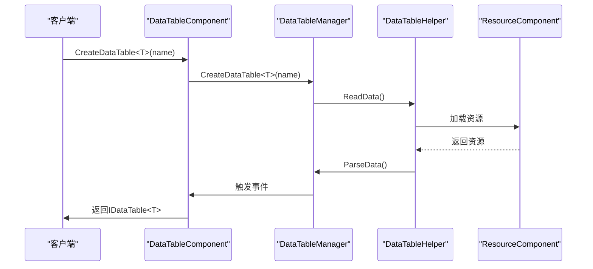
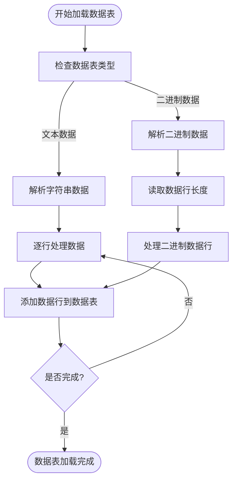
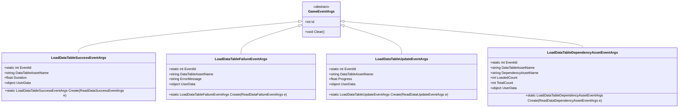
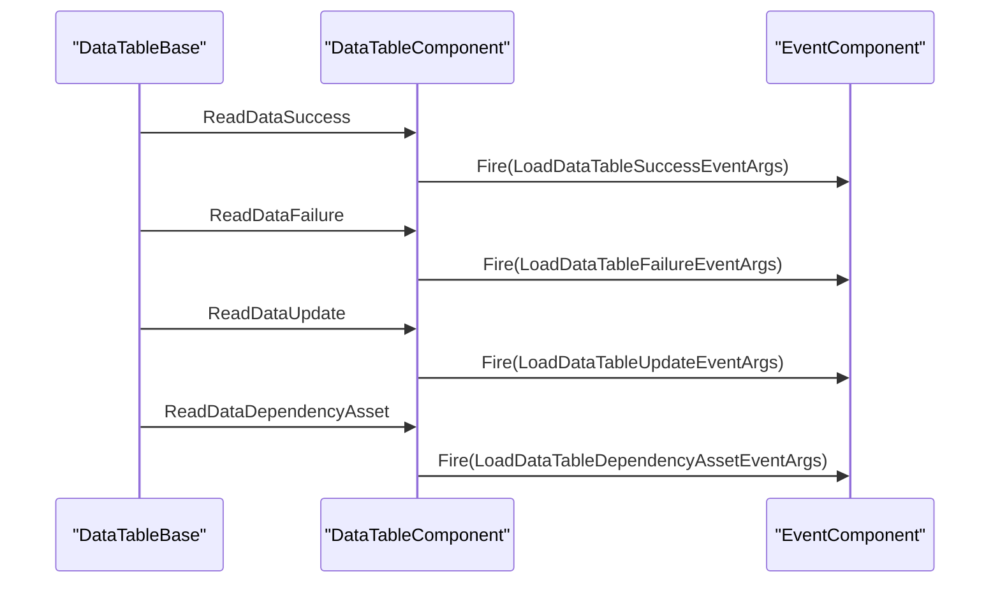
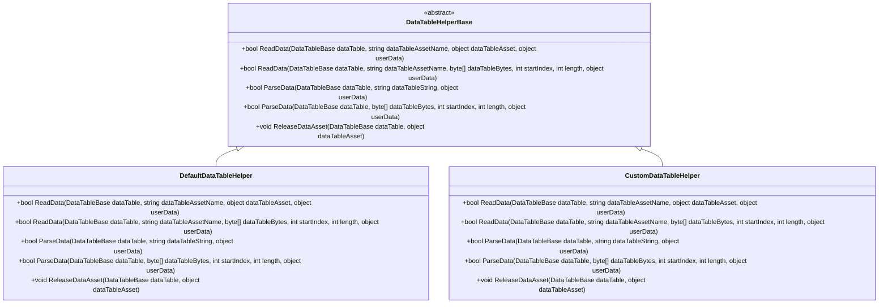
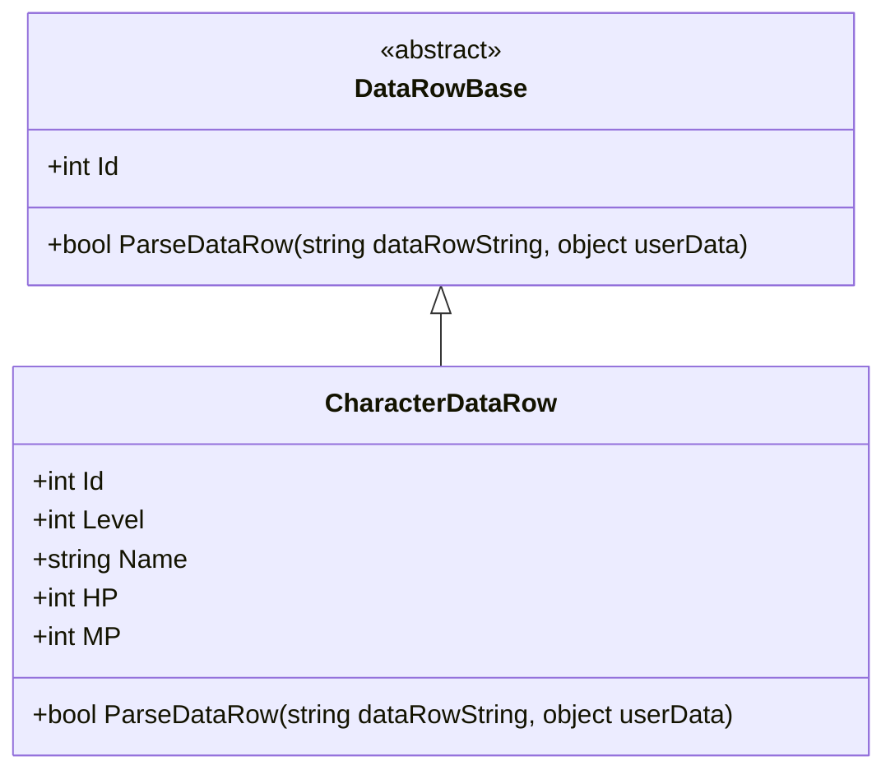
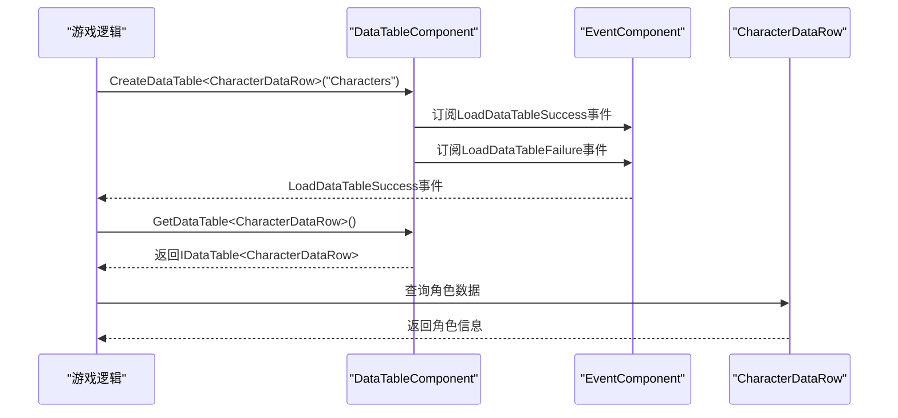

# 数据表API

<cite>
**本文档引用的文件**
- [DataTableComponent.cs](file://Scripts/Runtime/DataTable/DataTableComponent.cs)
- [DataRowBase.cs](file://Scripts/Runtime/DataTable/DataRowBase.cs)
- [DataTableHelperBase.cs](file://Scripts/Runtime/DataTable/DataTableHelperBase.cs)
- [DefaultDataTableHelper.cs](file://Scripts/Runtime/DataTable/DefaultDataTableHelper.cs)
- [LoadDataTableSuccessEventArgs.cs](file://Scripts/Runtime/DataTable/LoadDataTableSuccessEventArgs.cs)
- [LoadDataTableFailureEventArgs.cs](file://Scripts/Runtime/DataTable/LoadDataTableFailureEventArgs.cs)
- [LoadDataTableUpdateEventArgs.cs](file://Scripts/Runtime/DataTable/LoadDataTableUpdateEventArgs.cs)
- [LoadDataTableDependencyAssetEventArgs.cs](file://Scripts/Runtime/DataTable/LoadDataTableDependencyAssetEventArgs.cs)
</cite>

## 目录
1. [简介](#简介)
2. [核心组件](#核心组件)
3. [数据表加载流程](#数据表加载流程)
4. [事件系统](#事件系统)
5. [扩展点](#扩展点)
6. [完整示例](#完整示例)

## 简介
数据表系统是Unity游戏框架中的核心组件之一，用于管理游戏中的配置数据。该系统通过DataTableComponent提供统一的API接口，支持从CSV、JSON等格式加载数据，并提供事件通知机制和可扩展的解析逻辑。本文档详细说明了数据表系统的使用方法和内部机制。

## 核心组件

### DataTableComponent
DataTableComponent是数据表系统的核心组件，负责管理所有数据表的生命周期。它提供了创建、获取、销毁数据表的API，并处理数据加载过程中的事件分发。

**图表来源**
- [DataTableComponent.cs](file://Scripts/Runtime/DataTable/DataTableComponent.cs#L147-L375)
- [DataRowBase.cs](file://Scripts/Runtime/DataTable/DataRowBase.cs#L14-L49)
- [DataTableHelperBase.cs](file://Scripts/Runtime/DataTable/DataTableHelperBase.cs#L16-L66)

**本节来源**
- [DataTableComponent.cs](file://Scripts/Runtime/DataTable/DataTableComponent.cs#L1-L400)
- [DataRowBase.cs](file://Scripts/Runtime/DataTable/DataRowBase.cs#L1-L51)
- [DataTableHelperBase.cs](file://Scripts/Runtime/DataTable/DataTableHelperBase.cs#L1-L68)

### DataRowBase
DataRowBase是所有数据表行类的基类，定义了数据表行的基本结构和解析接口。开发者需要继承此类来定义具体的数据结构。

**图表来源**
- [DataRowBase.cs](file://Scripts/Runtime/DataTable/DataRowBase.cs#L14-L49)

**本节来源**
- [DataRowBase.cs](file://Scripts/Runtime/DataTable/DataRowBase.cs#L1-L51)

## 数据表加载流程

### LoadDataTable方法
DataTableComponent的CreateDataTable方法用于加载数据表，支持指定数据表名称、行类类型和加载回调等参数。

**图表来源**
- [DataTableComponent.cs](file://Scripts/Runtime/DataTable/DataTableComponent.cs#L269-L287)
- [DefaultDataTableHelper.cs](file://Scripts/Runtime/DataTable/DefaultDataTableHelper.cs#L19-L169)

**本节来源**
- [DataTableComponent.cs](file://Scripts/Runtime/DataTable/DataTableComponent.cs#L248-L287)
- [DefaultDataTableHelper.cs](file://Scripts/Runtime/DataTable/DefaultDataTableHelper.cs#L1-L171)

### 数据解析流程
数据表的解析分为两个阶段：读取和解析。读取阶段从资源系统获取原始数据，解析阶段将原始数据转换为数据表行对象。

**图表来源**
- [DefaultDataTableHelper.cs](file://Scripts/Runtime/DataTable/DefaultDataTableHelper.cs#L47-L169)

**本节来源**
- [DefaultDataTableHelper.cs](file://Scripts/Runtime/DataTable/DefaultDataTableHelper.cs#L1-L171)

## 事件系统

### 事件类结构
数据表系统提供了完整的事件机制，用于通知数据加载过程中的各种状态变化。

**图表来源**
- [LoadDataTableSuccessEventArgs.cs](file://Scripts/Runtime/DataTable/LoadDataTableSuccessEventArgs.cs#L15-L93)
- [LoadDataTableFailureEventArgs.cs](file://Scripts/Runtime/DataTable/LoadDataTableFailureEventArgs.cs#L15-L93)
- [LoadDataTableUpdateEventArgs.cs](file://Scripts/Runtime/DataTable/LoadDataTableUpdateEventArgs.cs#L15-L93)
- [LoadDataTableDependencyAssetEventArgs.cs](file://Scripts/Runtime/DataTable/LoadDataTableDependencyAssetEventArgs.cs#L15-L117)

**本节来源**
- [LoadDataTableSuccessEventArgs.cs](file://Scripts/Runtime/DataTable/LoadDataTableSuccessEventArgs.cs#L1-L95)
- [LoadDataTableFailureEventArgs.cs](file://Scripts/Runtime/DataTable/LoadDataTableFailureEventArgs.cs#L1-L95)
- [LoadDataTableUpdateEventArgs.cs](file://Scripts/Runtime/DataTable/LoadDataTableUpdateEventArgs.cs#L1-L95)
- [LoadDataTableDependencyAssetEventArgs.cs](file://Scripts/Runtime/DataTable/LoadDataTableDependencyAssetEventArgs.cs#L1-L119)

### 事件触发流程
当数据表加载过程发生状态变化时，系统会自动触发相应的事件。

**图表来源**
- [DataTableComponent.cs](file://Scripts/Runtime/DataTable/DataTableComponent.cs#L384-L400)
- [LoadDataTableSuccessEventArgs.cs](file://Scripts/Runtime/DataTable/LoadDataTableSuccessEventArgs.cs#L75-L82)
- [LoadDataTableFailureEventArgs.cs](file://Scripts/Runtime/DataTable/LoadDataTableFailureEventArgs.cs#L75-L82)
- [LoadDataTableUpdateEventArgs.cs](file://Scripts/Runtime/DataTable/LoadDataTableUpdateEventArgs.cs#L75-L82)
- [LoadDataTableDependencyAssetEventArgs.cs](file://Scripts/Runtime/DataTable/LoadDataTableDependencyAssetEventArgs.cs#L95-L104)

**本节来源**
- [DataTableComponent.cs](file://Scripts/Runtime/DataTable/DataTableComponent.cs#L384-L400)
- [LoadDataTableSuccessEventArgs.cs](file://Scripts/Runtime/DataTable/LoadDataTableSuccessEventArgs.cs#L1-L95)
- [LoadDataTableFailureEventArgs.cs](file://Scripts/Runtime/DataTable/LoadDataTableFailureEventArgs.cs#L1-L95)
- [LoadDataTableUpdateEventArgs.cs](file://Scripts/Runtime/DataTable/LoadDataTableUpdateEventArgs.cs#L1-L95)
- [LoadDataTableDependencyAssetEventArgs.cs](file://Scripts/Runtime/DataTable/LoadDataTableDependencyAssetEventArgs.cs#L1-L119)

## 扩展点

### DataTableHelperBase
DataTableHelperBase是数据表加载与解析逻辑的扩展点，开发者可以通过继承此类来自定义数据表的加载和解析行为。

**图表来源**
- [DataTableHelperBase.cs](file://Scripts/Runtime/DataTable/DataTableHelperBase.cs#L16-L66)
- [DefaultDataTableHelper.cs](file://Scripts/Runtime/DataTable/DefaultDataTableHelper.cs#L19-L169)

**本节来源**
- [DataTableHelperBase.cs](file://Scripts/Runtime/DataTable/DataTableHelperBase.cs#L1-L68)
- [DefaultDataTableHelper.cs](file://Scripts/Runtime/DataTable/DefaultDataTableHelper.cs#L1-L171)

## 完整示例

### 定义数据结构
首先定义具体的数据表行类，继承DataRowBase并实现必要的属性和解析逻辑。

**图表来源**
- [DataRowBase.cs](file://Scripts/Runtime/DataTable/DataRowBase.cs#L14-L49)

**本节来源**
- [DataRowBase.cs](file://Scripts/Runtime/DataTable/DataRowBase.cs#L1-L51)

### 加载和使用数据表
展示从加载数据表到在游戏逻辑中查询使用的完整流程。

**图表来源**
- [DataTableComponent.cs](file://Scripts/Runtime/DataTable/DataTableComponent.cs#L269-L287)
- [LoadDataTableSuccessEventArgs.cs](file://Scripts/Runtime/DataTable/LoadDataTableSuccessEventArgs.cs#L75-L82)

**本节来源**
- [DataTableComponent.cs](file://Scripts/Runtime/DataTable/DataTableComponent.cs#L1-L400)
- [LoadDataTableSuccessEventArgs.cs](file://Scripts/Runtime/DataTable/LoadDataTableSuccessEventArgs.cs#L1-L95)