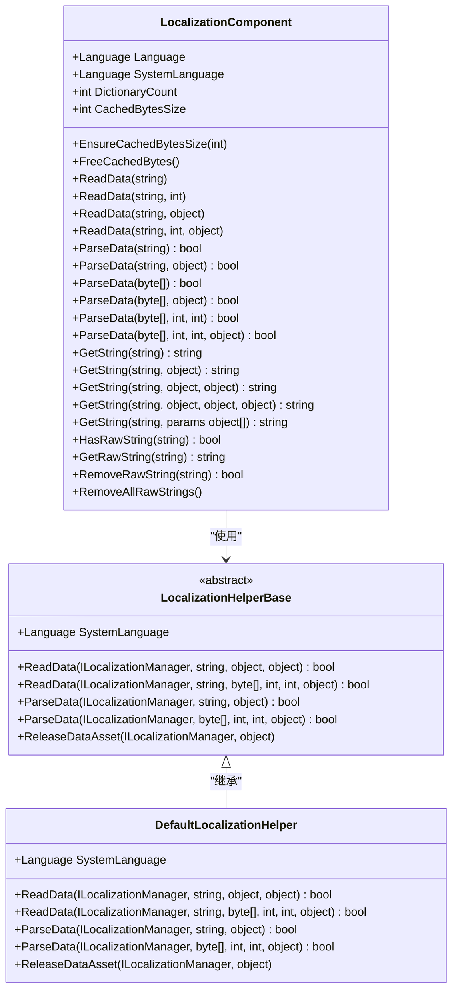
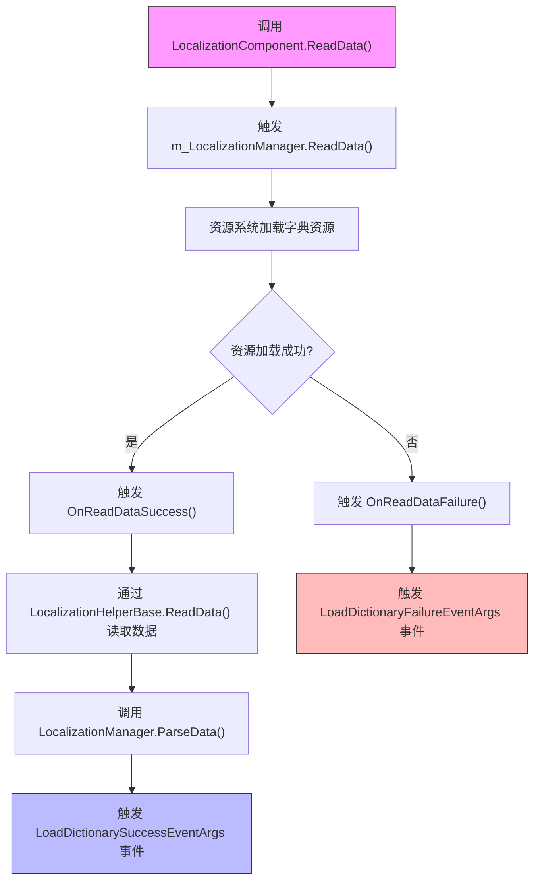
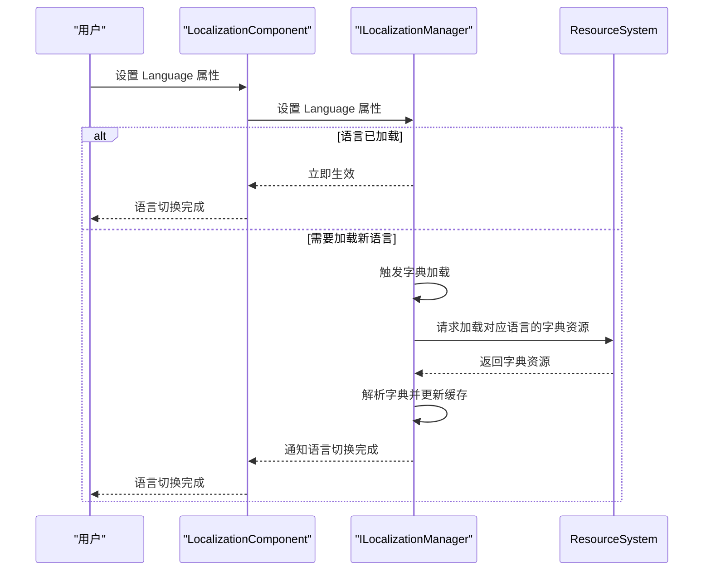
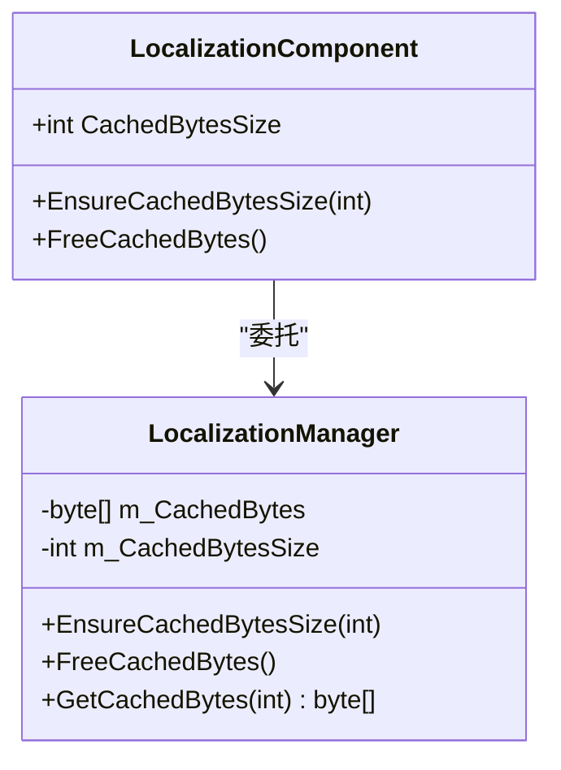
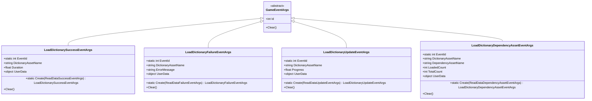
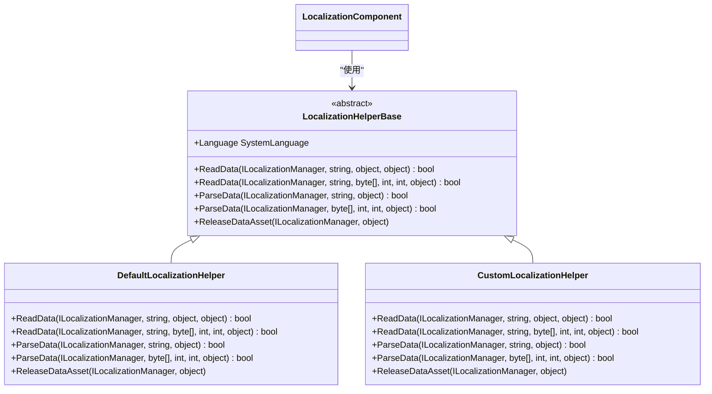

# 本地化API

<cite>
**Referenced Files in This Document**   
- [LocalizationComponent.cs](file://Scripts/Runtime/Localization/LocalizationComponent.cs)
- [LocalizationHelperBase.cs](file://Scripts/Runtime/Localization/LocalizationHelperBase.cs)
- [DefaultLocalizationHelper.cs](file://Scripts/Runtime/Localization/DefaultLocalizationHelper.cs)
- [LoadDictionarySuccessEventArgs.cs](file://Scripts/Runtime/Localization/LoadDictionarySuccessEventArgs.cs)
- [LoadDictionaryFailureEventArgs.cs](file://Scripts/Runtime/Localization/LoadDictionaryFailureEventArgs.cs)
- [LoadDictionaryUpdateEventArgs.cs](file://Scripts/Runtime/Localization/LoadDictionaryUpdateEventArgs.cs)
- [LoadDictionaryDependencyAssetEventArgs.cs](file://Scripts/Runtime/Localization/LoadDictionaryDependencyAssetEventArgs.cs)
</cite>

## 目录
1. [简介](#简介)
2. [核心组件](#核心组件)
3. [多语言资源加载流程](#多语言资源加载流程)
4. [语言切换机制](#语言切换机制)
5. [缓存策略](#缓存策略)
6. [事件系统](#事件系统)
7. [扩展点：LocalizationHelperBase](#扩展点localizationhelperbase)
8. [示例代码](#示例代码)
9. [结论](#结论)

## 简介

本地化API为Unity游戏框架提供了一套完整的多语言支持解决方案。该系统允许开发者轻松实现文本资源的多语言管理，支持从本地或远程服务器加载字典文件，并提供灵活的扩展机制。核心功能包括字典加载（LoadDictionary）、字符串获取（GetString）、语言切换、事件通知和自定义解析器等。本文档将深入解析这些功能的实现原理和使用方法。

## 核心组件

本地化系统由多个核心组件构成，它们协同工作以实现完整的本地化功能。主要组件包括`LocalizationComponent`、`LocalizationHelperBase`及其默认实现`DefaultLocalizationHelper`。

**Section sources**
- [LocalizationComponent.cs](file://Scripts/Runtime/Localization/LocalizationComponent.cs#L1-L404)
- [LocalizationHelperBase.cs](file://Scripts/Runtime/Localization/LocalizationHelperBase.cs#L1-L76)
- [DefaultLocalizationHelper.cs](file://Scripts/Runtime/Localization/DefaultLocalizationHelper.cs#L1-L238)

### 组件关系图



**Diagram sources**
- [LocalizationComponent.cs](file://Scripts/Runtime/Localization/LocalizationComponent.cs#L1-L404)
- [LocalizationHelperBase.cs](file://Scripts/Runtime/Localization/LocalizationHelperBase.cs#L1-L76)
- [DefaultLocalizationHelper.cs](file://Scripts/Runtime/Localization/DefaultLocalizationHelper.cs#L1-L238)

## 多语言资源加载流程

本地化系统的资源加载流程是一个分阶段的异步过程，确保了资源加载的高效性和可靠性。流程从调用`ReadData`方法开始，经过资源加载、数据读取、字典解析等多个步骤。

### 加载流程图



**Diagram sources**
- [LocalizationComponent.cs](file://Scripts/Runtime/Localization/LocalizationComponent.cs#L200-L250)
- [DefaultLocalizationHelper.cs](file://Scripts/Runtime/Localization/DefaultLocalizationHelper.cs#L80-L150)

**Section sources**
- [LocalizationComponent.cs](file://Scripts/Runtime/Localization/LocalizationComponent.cs#L200-L250)
- [DefaultLocalizationHelper.cs](file://Scripts/Runtime/Localization/DefaultLocalizationHelper.cs#L80-L150)

## 语言切换机制

语言切换机制是本地化系统的核心功能之一，允许在运行时动态改变应用程序的语言。系统通过`Language`属性实现语言的获取和设置，自动处理相关资源的加载和更新。

### 语言切换流程



**Diagram sources**
- [LocalizationComponent.cs](file://Scripts/Runtime/Localization/LocalizationComponent.cs#L45-L55)
- [LocalizationComponent.cs](file://Scripts/Runtime/Localization/LocalizationComponent.cs#L100-L150)

**Section sources**
- [LocalizationComponent.cs](file://Scripts/Runtime/Localization/LocalizationComponent.cs#L45-L55)

## 缓存策略

本地化系统采用高效的缓存策略来提升性能和用户体验。系统维护一个二进制流缓存池，避免频繁的内存分配和垃圾回收。

### 缓存管理



**Diagram sources**
- [LocalizationComponent.cs](file://Scripts/Runtime/Localization/LocalizationComponent.cs#L70-L80)
- [LocalizationComponent.cs](file://Scripts/Runtime/Localization/LocalizationComponent.cs#L160-L180)

**Section sources**
- [LocalizationComponent.cs](file://Scripts/Runtime/Localization/LocalizationComponent.cs#L70-L80)

## 事件系统

本地化系统提供了丰富的事件通知机制，使开发者能够监控字典加载的各个阶段。这些事件基于游戏框架的事件系统实现，确保了低耦合和高可扩展性。

### 事件类型

| 事件类型 | 用途 | 触发条件 |
|---------|------|---------|
| LoadDictionarySuccessEventArgs | 字典加载成功 | 资源成功加载并解析 |
| LoadDictionaryFailureEventArgs | 字典加载失败 | 资源加载或解析失败 |
| LoadDictionaryUpdateEventArgs | 字典加载进度更新 | 加载过程中进度变化 |
| LoadDictionaryDependencyAssetEventArgs | 依赖资源加载 | 加载字典时需要加载依赖资源 |



**Diagram sources**
- [LoadDictionarySuccessEventArgs.cs](file://Scripts/Runtime/Localization/LoadDictionarySuccessEventArgs.cs#L1-L95)
- [LoadDictionaryFailureEventArgs.cs](file://Scripts/Runtime/Localization/LoadDictionaryFailureEventArgs.cs#L1-L95)
- [LoadDictionaryUpdateEventArgs.cs](file://Scripts/Runtime/Localization/LoadDictionaryUpdateEventArgs.cs#L1-L95)
- [LoadDictionaryDependencyAssetEventArgs.cs](file://Scripts/Runtime/Localization/LoadDictionaryDependencyAssetEventArgs.cs#L1-L119)

**Section sources**
- [LoadDictionarySuccessEventArgs.cs](file://Scripts/Runtime/Localization/LoadDictionarySuccessEventArgs.cs#L1-L95)
- [LoadDictionaryFailureEventArgs.cs](file://Scripts/Runtime/Localization/LoadDictionaryFailureEventArgs.cs#L1-L95)

## 扩展点：LocalizationHelperBase

`LocalizationHelperBase`是本地化系统的关键扩展点，允许开发者自定义字典的加载和解析方式。通过继承此抽象类，可以实现从服务器动态获取字典、使用不同的文件格式或加密字典等高级功能。

### 扩展机制



**Diagram sources**
- [LocalizationHelperBase.cs](file://Scripts/Runtime/Localization/LocalizationHelperBase.cs#L1-L76)
- [DefaultLocalizationHelper.cs](file://Scripts/Runtime/Localization/DefaultLocalizationHelper.cs#L1-L238)

**Section sources**
- [LocalizationHelperBase.cs](file://Scripts/Runtime/Localization/LocalizationHelperBase.cs#L1-L76)

## 示例代码

以下示例展示了如何使用本地化API实现常见的本地化功能。

### 加载不同语言的文本资源

```csharp
// 加载中文字典
LocalizationComponent localization = GameEntry.GetComponent<LocalizationComponent>();
localization.ReadData("Localization/zh-CN");

// 加载英文字典
localization.ReadData("Localization/en-US");
```

### 在UI中动态显示本地化字符串

```csharp
// 获取本地化字符串
string welcomeText = localization.GetString("WelcomeMessage", playerName);
string scoreText = localization.GetString("ScoreFormat", currentScore, maxScore);

// 更新UI文本
uiText.text = welcomeText;
scoreLabel.text = scoreText;
```

### 实现运行时语言切换功能

```csharp
// 切换到英文
localization.Language = Language.English;

// 切换到中文
localization.Language = Language.ChineseSimplified;

// 监听语言切换完成事件
GameEntry.Event.Subscribe<LoadDictionarySuccessEventArgs>(OnLanguageChanged);

private void OnLanguageChanged(object sender, LoadDictionarySuccessEventArgs e)
{
    // 更新所有UI文本
    UpdateAllUITexts();
}
```

**Section sources**
- [LocalizationComponent.cs](file://Scripts/Runtime/Localization/LocalizationComponent.cs#L300-L350)
- [LocalizationComponent.cs](file://Scripts/Runtime/Localization/LocalizationComponent.cs#L45-L55)

## 结论

本地化API为Unity游戏框架提供了一套强大而灵活的多语言支持系统。通过`LocalizationComponent`的`LoadDictionary`和`GetString`方法，开发者可以轻松实现文本资源的加载和获取。系统内置的语言切换机制和事件通知系统使得多语言功能的实现更加直观和可靠。`LocalizationHelperBase`扩展点为开发者提供了自定义字典加载和解析方式的能力，支持从服务器动态获取字典等高级场景。结合缓存策略和高效的资源管理，该系统能够满足大多数游戏项目的本地化需求。