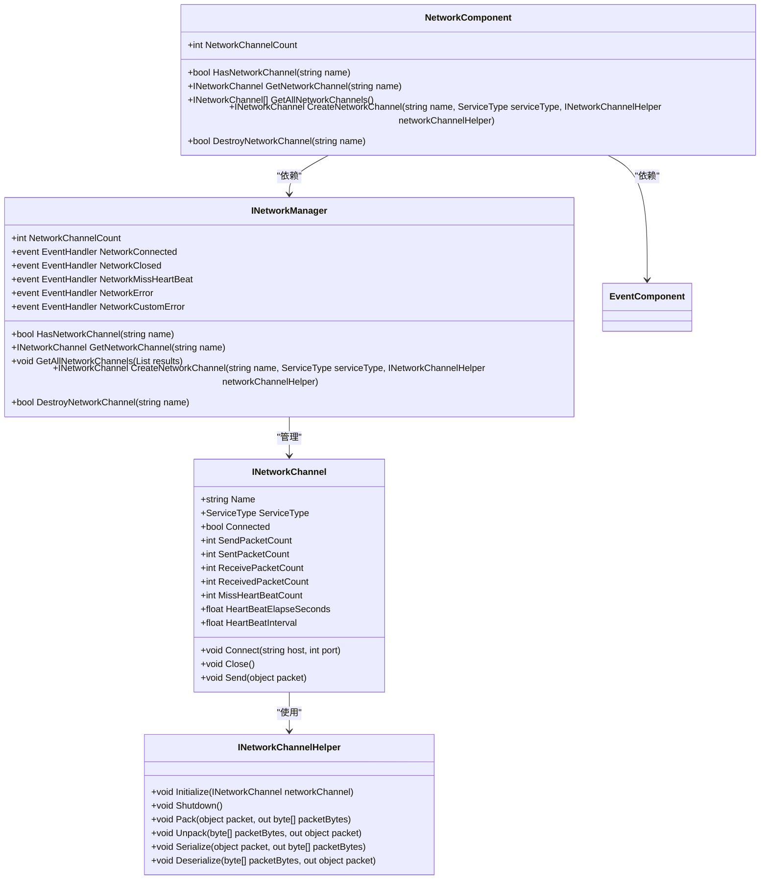
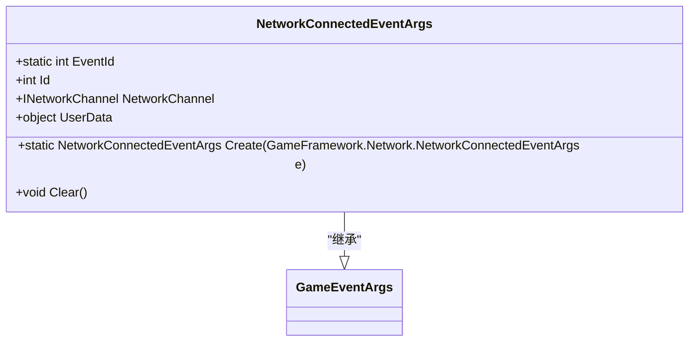
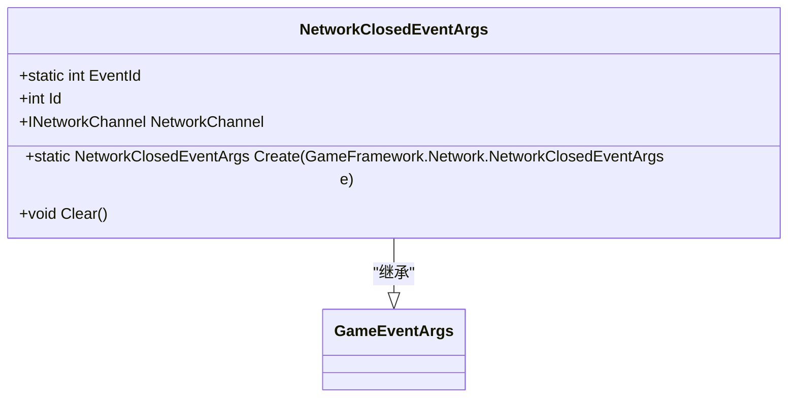
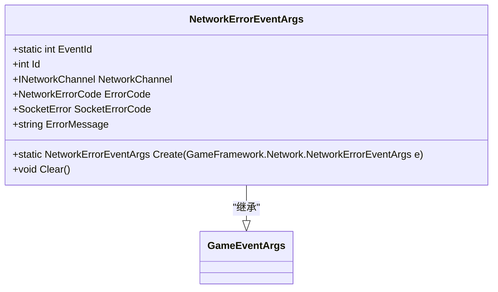
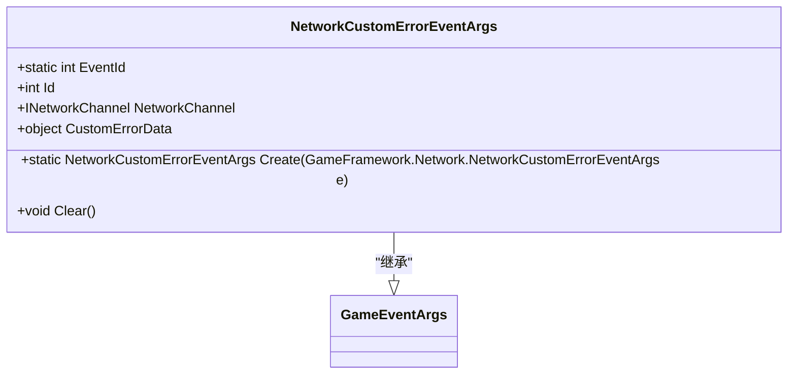
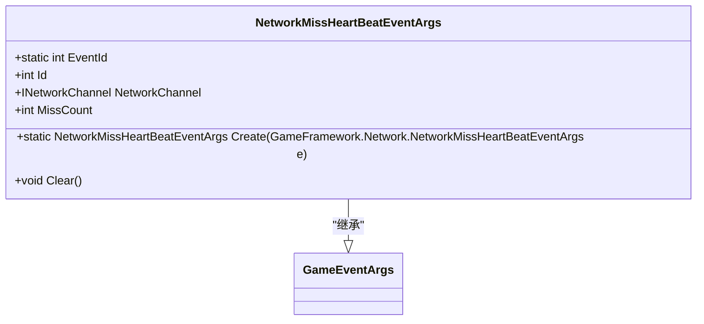
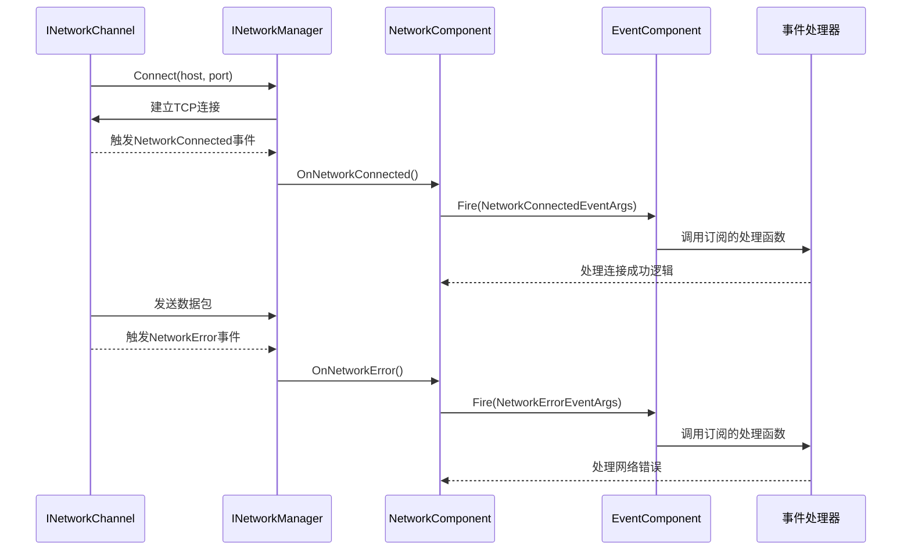

# 网络通信API

<cite>
**Referenced Files in This Document**   
- [NetworkComponent.cs](file://Scripts/Runtime/Network/NetworkComponent.cs)
- [NetworkConnectedEventArgs.cs](file://Scripts/Runtime/Network/NetworkConnectedEventArgs.cs)
- [NetworkClosedEventArgs.cs](file://Scripts/Runtime/Network/NetworkClosedEventArgs.cs)
- [NetworkErrorEventArgs.cs](file://Scripts/Runtime/Network/NetworkErrorEventArgs.cs)
- [NetworkCustomErrorEventArgs.cs](file://Scripts/Runtime/Network/NetworkCustomErrorEventArgs.cs)
- [NetworkMissHeartBeatEventArgs.cs](file://Scripts/Runtime/Network/NetworkMissHeartBeatEventArgs.cs)
- [GameEntry.cs](file://Scripts/Runtime/Base/GameEntry.cs)
- [EventComponent.cs](file://Scripts/Runtime/Event/EventComponent.cs)
- [NetworkComponentInspector.cs](file://Scripts/Editor/Inspector/NetworkComponentInspector.cs)
</cite>

## 目录
1. [简介](#简介)
2. [核心组件](#核心组件)
3. [网络事件系统](#网络事件系统)
4. [事件驱动架构](#事件驱动架构)
5. [使用示例](#使用示例)
6. [异常处理与重连策略](#异常处理与重连策略)
7. [调试与监控](#调试与监控)

## 简介

本API文档旨在为开发者提供一个全面的指南，用于在Unity游戏框架中实现健壮的网络通信功能。文档以`NetworkComponent`为核心，详细阐述了其连接、断开、发送消息等方法的使用方式。同时，文档化了所有网络事件类（如`NetworkConnectedEventArgs`等）的触发条件与数据内容，帮助开发者构建可靠的网络状态机。通过事件系统实现网络逻辑的解耦，并提供完整的示例代码，涵盖TCP连接建立、连接状态处理、数据包收发以及心跳检测机制。

**Section sources**
- [NetworkComponent.cs](file://Scripts/Runtime/Network/NetworkComponent.cs#L17-L150)

## 核心组件

`NetworkComponent`是网络功能的核心管理器，负责创建和管理网络频道（`INetworkChannel`），并作为事件的中转站。它通过`INetworkManager`模块与底层网络系统交互，并利用`EventComponent`将网络事件分发给订阅者。

该组件提供了以下核心功能：
- **网络频道管理**：创建、获取、销毁网络频道
- **连接状态查询**：检查网络频道是否存在，获取连接状态
- **事件转发**：将底层网络事件包装并转发到事件系统



**Diagram sources**
- [NetworkComponent.cs](file://Scripts/Runtime/Network/NetworkComponent.cs#L17-L150)
- [NetworkComponentInspector.cs](file://Scripts/Editor/Inspector/NetworkComponentInspector.cs#L35-L75)

**Section sources**
- [NetworkComponent.cs](file://Scripts/Runtime/Network/NetworkComponent.cs#L17-L150)

## 网络事件系统

网络事件系统通过一系列事件参数类来通知应用程序网络状态的变化。这些事件由`NetworkComponent`捕获并转发到事件系统，开发者可以订阅这些事件来响应网络状态。

### 网络连接成功事件 (NetworkConnectedEventArgs)

当网络频道成功建立连接时触发。

**触发条件**:
- 调用`INetworkChannel.Connect()`方法后，TCP三次握手成功完成。

**数据内容**:
- `NetworkChannel`: 触发此事件的网络频道实例。
- `UserData`: 用户自定义数据，可用于关联连接上下文。



**Diagram sources**
- [NetworkConnectedEventArgs.cs](file://Scripts/Runtime/Network/NetworkConnectedEventArgs.cs#L16-L82)

**Section sources**
- [NetworkConnectedEventArgs.cs](file://Scripts/Runtime/Network/NetworkConnectedEventArgs.cs#L16-L82)

### 网络连接关闭事件 (NetworkClosedEventArgs)

当网络频道被关闭时触发，无论是主动关闭还是因网络问题断开。

**触发条件**:
- 调用`INetworkChannel.Close()`方法。
- 对端主动关闭连接（收到FIN包）。
- 网络连接因异常中断。

**数据内容**:
- `NetworkChannel`: 被关闭的网络频道实例。



**Diagram sources**
- [NetworkClosedEventArgs.cs](file://Scripts/Runtime/Network/NetworkClosedEventArgs.cs#L16-L70)

**Section sources**
- [NetworkClosedEventArgs.cs](file://Scripts/Runtime/Network/NetworkClosedEventArgs.cs#L16-L70)

### 网络错误事件 (NetworkErrorEventArgs)

当网络通信过程中发生错误时触发。

**触发条件**:
- Socket底层错误（如连接超时、主机不可达等）。
- 数据包发送或接收失败。

**数据内容**:
- `NetworkChannel`: 发生错误的网络频道。
- `ErrorCode`: 错误码（`NetworkErrorCode`枚举）。
- `SocketErrorCode`: 原始的Socket错误码。
- `ErrorMessage`: 错误信息字符串。



**Diagram sources**
- [NetworkErrorEventArgs.cs](file://Scripts/Runtime/Network/NetworkErrorEventArgs.cs#L17-L105)

**Section sources**
- [NetworkErrorEventArgs.cs](file://Scripts/Runtime/Network/NetworkErrorEventArgs.cs#L17-L105)

### 用户自定义网络错误事件 (NetworkCustomErrorEventArgs)

当网络频道发生用户自定义错误时触发。

**触发条件**:
- 网络频道辅助器（`INetworkChannelHelper`）报告自定义错误。

**数据内容**:
- `NetworkChannel`: 发生错误的网络频道。
- `CustomErrorData`: 用户自定义的错误数据对象。



**Diagram sources**
- [NetworkCustomErrorEventArgs.cs](file://Scripts/Runtime/Network/NetworkCustomErrorEventArgs.cs#L16-L82)

**Section sources**
- [NetworkCustomErrorEventArgs.cs](file://Scripts/Runtime/Network/NetworkCustomErrorEventArgs.cs#L16-L82)

### 网络心跳包丢失事件 (NetworkMissHeartBeatEventArgs)

当网络频道连续丢失心跳包达到指定阈值时触发。

**触发条件**:
- 在设定的心跳间隔内未收到对端的心跳响应。
- 丢失的心跳包数量达到预设的阈值。

**数据内容**:
- `NetworkChannel`: 心跳丢失的网络频道。
- `MissCount`: 当前已丢失的心跳包数量。



**Diagram sources**
- [NetworkMissHeartBeatEventArgs.cs](file://Scripts/Runtime/Network/NetworkMissHeartBeatEventArgs.cs#L16-L82)

**Section sources**
- [NetworkMissHeartBeatEventArgs.cs](file://Scripts/Runtime/Network/NetworkMissHeartBeatEventArgs.cs#L16-L82)

## 事件驱动架构

`NetworkComponent`采用事件驱动架构，通过`EventComponent`实现网络逻辑的解耦。这种设计模式将网络状态变化的处理与业务逻辑分离，提高了代码的可维护性和可测试性。

### 架构流程



**Diagram sources**
- [NetworkComponent.cs](file://Scripts/Runtime/Network/NetworkComponent.cs#L65-L145)
- [EventComponent.cs](file://Scripts/Runtime/Event/EventComponent.cs#L17-L133)

**Section sources**
- [NetworkComponent.cs](file://Scripts/Runtime/Network/NetworkComponent.cs#L65-L145)

### 解耦优势

1. **关注点分离**: 网络组件只负责事件的转发，不包含具体的业务处理逻辑。
2. **灵活性**: 业务模块可以自由订阅感兴趣的事件，无需直接依赖网络组件。
3. **可测试性**: 可以独立测试事件处理器，无需启动真实的网络连接。
4. **可扩展性**: 新的业务模块只需订阅事件即可接入网络系统，无需修改网络组件代码。

## 使用示例

### 建立TCP连接

```csharp
// 获取NetworkComponent实例
NetworkComponent networkComponent = GameEntry.GetComponent<NetworkComponent>();

// 创建网络频道
INetworkChannel networkChannel = networkComponent.CreateNetworkChannel("Main", ServiceType.Tcp, new CustomNetworkHelper());

// 订阅连接成功事件
EventComponent eventComponent = GameEntry.GetComponent<EventComponent>();
eventComponent.Subscribe(NetworkConnectedEventArgs.EventId, OnConnected);

// 订阅连接关闭事件
eventComponent.Subscribe(NetworkClosedEventArgs.EventId, OnDisconnected);

// 订阅网络错误事件
eventComponent.Subscribe(NetworkErrorEventArgs.EventId, OnNetworkError);

// 发起连接
networkChannel.Connect("127.0.0.1", 8888);
```

**Section sources**
- [NetworkComponent.cs](file://Scripts/Runtime/Network/NetworkComponent.cs#L111-L114)
- [GameEntry.cs](file://Scripts/Runtime/Base/GameEntry.cs#L42-L56)
- [EventComponent.cs](file://Scripts/Runtime/Event/EventComponent.cs#L105-L115)

### 处理连接事件

```csharp
private void OnConnected(object sender, GameEventArgs e)
{
    NetworkConnectedEventArgs ne = (NetworkConnectedEventArgs)e;
    Log.Info($"成功连接到服务器: {ne.NetworkChannel.Name}");
    
    // 发送登录请求
    LoginPacket loginPacket = new LoginPacket();
    ne.NetworkChannel.Send(loginPacket);
}

private void OnDisconnected(object sender, GameEventArgs e)
{
    NetworkClosedEventArgs ne = (NetworkClosedEventArgs)e;
    Log.Warning($"与服务器断开连接: {ne.NetworkChannel.Name}");
    
    // 触发重连逻辑
    StartReconnect();
}

private void OnNetworkError(object sender, GameEventArgs e)
{
    NetworkErrorEventArgs ne = (NetworkErrorEventArgs)e;
    Log.Error($"网络错误 [{ne.ErrorCode}]: {ne.ErrorMessage}");
    
    // 根据错误类型决定是否重连
    if (IsRecoverableError(ne.ErrorCode))
    {
        StartReconnect();
    }
}
```

**Section sources**
- [NetworkConnectedEventArgs.cs](file://Scripts/Runtime/Network/NetworkConnectedEventArgs.cs#L46-L50)
- [NetworkClosedEventArgs.cs](file://Scripts/Runtime/Network/NetworkClosedEventArgs.cs#L45-L49)
- [NetworkErrorEventArgs.cs](file://Scripts/Runtime/Network/NetworkErrorEventArgs.cs#L48-L61)

### 发送和接收数据包

```csharp
// 发送数据包
public void SendChatMessage(string message)
{
    ChatPacket packet = new ChatPacket(message);
    INetworkChannel channel = networkComponent.GetNetworkChannel("Main");
    if (channel != null && channel.Connected)
    {
        channel.Send(packet);
    }
}

// 接收数据包（在NetworkHelper中实现）
public override void OnReceivePacket(INetworkChannel channel, object packet)
{
    if (packet is ChatPacket chatPacket)
    {
        // 分发聊天消息事件
        EventComponent eventComponent = GameEntry.GetComponent<EventComponent>();
        eventComponent.Fire(this, ChatMessageEventArgs.Create(chatPacket));
    }
}
```

**Section sources**
- [NetworkComponent.cs](file://Scripts/Runtime/Network/NetworkComponent.cs#L97-L100)
- [INetworkChannelHelper](file://Scripts/Runtime/Network/NetworkComponent.cs#L111-L114)

### 实现心跳检测

```csharp
// 在NetworkHelper初始化时设置心跳
public override void Initialize(INetworkChannel networkChannel)
{
    // 设置心跳间隔为30秒
    networkChannel.HeartBeatInterval = 30f;
    // 设置最大丢失心跳数为3次
    networkChannel.MaxMissHeartBeatCount = 3;
}

// 处理心跳丢失事件
private void OnMissHeartBeat(object sender, GameEventArgs e)
{
    NetworkMissHeartBeatEventArgs ne = (NetworkMissHeartBeatEventArgs)e;
    Log.Warning($"心跳丢失 {ne.MissCount} 次");
    
    if (ne.MissCount >= 3)
    {
        Log.Error("连续丢失3次心跳，判定为网络中断");
        // 执行重连逻辑
        StartReconnect();
    }
}
```

**Section sources**
- [NetworkMissHeartBeatEventArgs.cs](file://Scripts/Runtime/Network/NetworkMissHeartBeatEventArgs.cs#L61-L65)
- [NetworkComponent.cs](file://Scripts/Runtime/Network/NetworkComponent.cs#L111-L114)

## 异常处理与重连策略

### 异常处理策略

网络通信中可能遇到多种异常情况，需要有系统的处理策略：

1. **连接超时**: 在连接阶段，如果在指定时间内未建立连接，应触发重连机制。
2. **网络中断**: 通过心跳机制检测连接是否存活，连续丢失心跳包即判定为中断。
3. **数据包错误**: 在`INetworkChannelHelper`中处理数据包的序列化/反序列化错误。
4. **服务器主动断开**: 正确处理`NetworkClosedEventArgs`事件，区分主动断开和异常断开。

### 重连逻辑实现

```csharp
private int _reconnectAttempt = 0;
private const int MaxReconnectAttempts = 5;
private const float ReconnectInterval = 3f;

private void StartReconnect()
{
    if (_reconnectAttempt >= MaxReconnectAttempts)
    {
        Log.Error("重连次数已达上限，放弃重连");
        return;
    }
    
    _reconnectAttempt++;
    Log.Info($"开始第 {_reconnectAttempt} 次重连尝试");
    
    // 延迟重连，避免频繁尝试
    StartCoroutine(DelayedReconnect());
}

private IEnumerator DelayedReconnect()
{
    yield return new WaitForSeconds(ReconnectInterval);
    
    INetworkChannel channel = networkComponent.GetNetworkChannel("Main");
    if (channel != null)
    {
        channel.Connect("127.0.0.1", 8888);
    }
}
```

**Section sources**
- [NetworkComponent.cs](file://Scripts/Runtime/Network/NetworkComponent.cs#L97-L100)
- [NetworkErrorEventArgs.cs](file://Scripts/Runtime/Network/NetworkErrorEventArgs.cs#L57-L61)

## 调试与监控

`NetworkComponentInspector`提供了在编辑器中实时监控网络状态的功能。当游戏运行时，可以在Inspector面板中查看所有网络频道的详细信息，包括：

- 连接状态（已连接/已断开）
- 本地和远程地址
- 发送和接收的数据包统计
- 心跳状态和丢失计数
- 手动断开连接的按钮

此功能对于调试网络问题和监控性能非常有用。

**Section sources**
- [NetworkComponentInspector.cs](file://Scripts/Editor/Inspector/NetworkComponentInspector.cs#L35-L75)