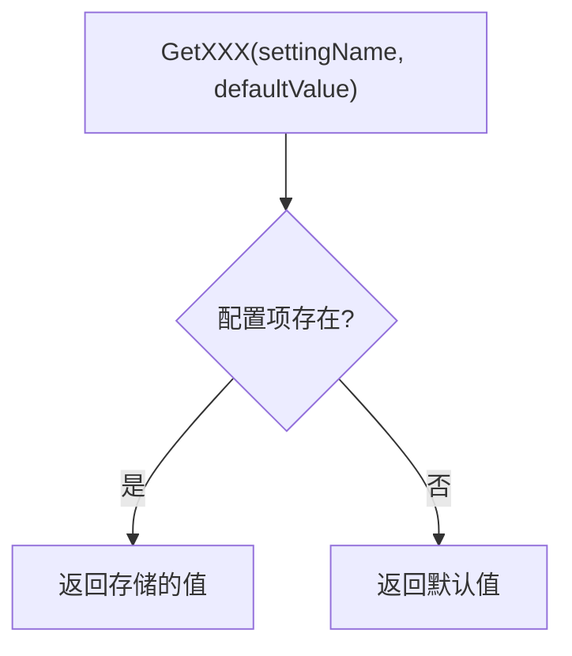
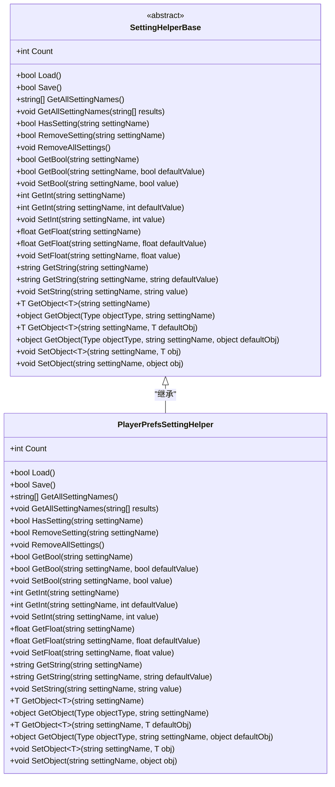
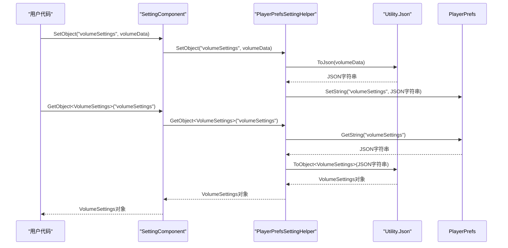

# 设置系统API

<cite>
**Referenced Files in This Document**   
- [SettingComponent.cs](file://Scripts/Runtime/Setting/SettingComponent.cs)
- [SettingHelperBase.cs](file://Scripts/Runtime/Setting/SettingHelperBase.cs)
- [PlayerPrefsSettingHelper.cs](file://Scripts/Runtime/Setting/PlayerPrefsSettingHelper.cs)
- [DefaultSettingSerializer.cs](file://Scripts/Runtime/Setting/DefaultSettingSerializer.cs)
</cite>

## 目录
1. [简介](#简介)
2. [核心组件](#核心组件)
3. [数据类型与默认值](#数据类型与默认值)
4. [持久化存储扩展](#持久化存储扩展)
5. [复杂对象序列化](#复杂对象序列化)
6. [使用示例](#使用示例)

## 简介

本文档详述了Unity游戏框架中的设置系统API，以`SettingComponent`为核心，全面介绍其配置项的存储、读取和删除机制。系统支持多种数据类型，并提供灵活的持久化存储扩展点，允许开发者根据需求自定义存储方式。文档还解释了复杂对象的序列化过程，并提供实际应用示例。

## 核心组件

`SettingComponent`是设置系统的核心组件，负责管理游戏配置项的生命周期。它通过`ISettingManager`接口与底层存储系统交互，提供了统一的API来操作配置数据。

该组件在`Awake`阶段初始化，通过反射或直接引用创建指定的`SettingHelperBase`实现，并将其注册到设置管理器中。在`Start`阶段，组件会自动尝试加载已保存的配置。

**Section sources**
- [SettingComponent.cs](file://Scripts/Runtime/Setting/SettingComponent.cs#L18-L321)
- [SettingHelperBase.cs](file://Scripts/Runtime/Setting/SettingHelperBase.cs#L17-L206)

## 数据类型与默认值

设置系统支持多种基本数据类型的读写操作，包括布尔值、整数、浮点数和字符串。所有操作方法均遵循`GetXXX`、`SetXXX`和`RemoveXXX`的命名规范。

### 支持的数据类型
- **布尔值**: `GetBool`, `SetBool`
- **整数**: `GetInt`, `SetInt`
- **浮点数**: `GetFloat`, `SetFloat`
- **字符串**: `GetString`, `SetString`
- **复杂对象**: `GetObject`, `SetObject`

### 默认值机制
系统提供了完善的默认值支持。当读取一个不存在的配置项时，可以指定一个默认值作为返回结果。这避免了因配置项缺失而导致的异常，提高了系统的健壮性。



**Diagram sources**
- [SettingComponent.cs](file://Scripts/Runtime/Setting/SettingComponent.cs#L18-L321)

**Section sources**
- [SettingComponent.cs](file://Scripts/Runtime/Setting/SettingComponent.cs#L18-L321)

## 持久化存储扩展

系统通过`SettingHelperBase`抽象类提供持久化存储的扩展点，允许开发者实现自定义的存储策略。

### SettingHelperBase 扩展点
`SettingHelperBase`是一个抽象基类，定义了所有持久化操作的接口，包括加载、保存、读取、写入和删除配置项。开发者可以通过继承此类来实现新的存储方式。

### PlayerPrefsSettingHelper 实现
`PlayerPrefsSettingHelper`是`SettingHelperBase`的一个具体实现，它使用Unity的`PlayerPrefs`系统进行数据持久化。

该实现将布尔值转换为整数（1表示true，0表示false）进行存储，所有其他基本类型直接使用`PlayerPrefs`的原生方法。对于复杂对象，它通过JSON序列化后以字符串形式存储。



**Diagram sources**
- [SettingHelperBase.cs](file://Scripts/Runtime/Setting/SettingHelperBase.cs#L17-L206)
- [PlayerPrefsSettingHelper.cs](file://Scripts/Runtime/Setting/PlayerPrefsSettingHelper.cs#L17-L310)

**Section sources**
- [SettingHelperBase.cs](file://Scripts/Runtime/Setting/SettingHelperBase.cs#L17-L206)
- [PlayerPrefsSettingHelper.cs](file://Scripts/Runtime/Setting/PlayerPrefsSettingHelper.cs#L17-L310)

## 复杂对象序列化

对于复杂对象的存储，系统依赖`Utility.Json`工具进行序列化和反序列化。`DefaultSettingSerializer`类负责管理序列化过程，它定义了配置文件的头部标识，确保数据的完整性和正确性。

当调用`SetObject`方法时，对象会被转换为JSON字符串并存储；当调用`GetObject`方法时，存储的JSON字符串会被反序列化回原始对象类型。



**Diagram sources**
- [PlayerPrefsSettingHelper.cs](file://Scripts/Runtime/Setting/PlayerPrefsSettingHelper.cs#L17-L310)
- [DefaultSettingSerializer.cs](file://Scripts/Runtime/Setting/DefaultSettingSerializer.cs#L14-L33)

**Section sources**
- [PlayerPrefsSettingHelper.cs](file://Scripts/Runtime/Setting/PlayerPrefsSettingHelper.cs#L17-L310)
- [DefaultSettingSerializer.cs](file://Scripts/Runtime/Setting/DefaultSettingSerializer.cs#L14-L33)

## 使用示例

以下示例展示了如何使用设置系统保存和恢复用户偏好设置。

### 保存游戏音量设置
```csharp
// 保存主音量
SettingComponent.SetInt("MasterVolume", 75);

// 保存音乐音量
SettingComponent.SetInt("MusicVolume", 50);

// 保存音效音量
SettingComponent.SetInt("SfxVolume", 80);

// 保存所有设置
SettingComponent.Save();
```

### 保存分辨率设置
```csharp
// 保存分辨率
SettingComponent.SetInt("ScreenWidth", 1920);
SettingComponent.SetInt("ScreenHeight", 1080);
SettingComponent.SetBool("FullScreen", true);

// 保存设置
SettingComponent.Save();
```

### 游戏启动时恢复设置
```csharp
// 在游戏启动时调用，SettingComponent会自动加载
// 读取音量设置，使用默认值以防配置项不存在
int masterVolume = SettingComponent.GetInt("MasterVolume", 50);
int musicVolume = SettingComponent.GetInt("MusicVolume", 50);
int sfxVolume = SettingComponent.GetInt("SfxVolume", 50);

// 应用音量设置
AudioManager.SetMasterVolume(masterVolume);
AudioManager.SetMusicVolume(musicVolume);
AudioManager.SetSfxVolume(sfxVolume);

// 读取分辨率设置
int width = SettingComponent.GetInt("ScreenWidth", 1280);
int height = SettingComponent.GetInt("ScreenHeight", 720);
bool fullScreen = SettingComponent.GetBool("FullScreen", false);

// 应用分辨率设置
Screen.SetResolution(width, height, fullScreen);
```

### 自定义对象存储
```csharp
// 定义一个包含多个设置的类
[Serializable]
public class GamePreferences {
    public int MasterVolume;
    public int MusicVolume;
    public int SfxVolume;
    public int ScreenWidth;
    public int ScreenHeight;
    public bool FullScreen;
}

// 保存整个偏好设置对象
GamePreferences prefs = new GamePreferences {
    MasterVolume = 75,
    MusicVolume = 50,
    SfxVolume = 80,
    ScreenWidth = 1920,
    ScreenHeight = 1080,
    FullScreen = true
};

SettingComponent.SetObject("GamePreferences", prefs);
SettingComponent.Save();

// 读取偏好设置对象
GamePreferences loadedPrefs = SettingComponent.GetObject<GamePreferences>("GamePreferences", new GamePreferences());
```

**Section sources**
- [SettingComponent.cs](file://Scripts/Runtime/Setting/SettingComponent.cs#L18-L321)
- [PlayerPrefsSettingHelper.cs](file://Scripts/Runtime/Setting/PlayerPrefsSettingHelper.cs#L17-L310)