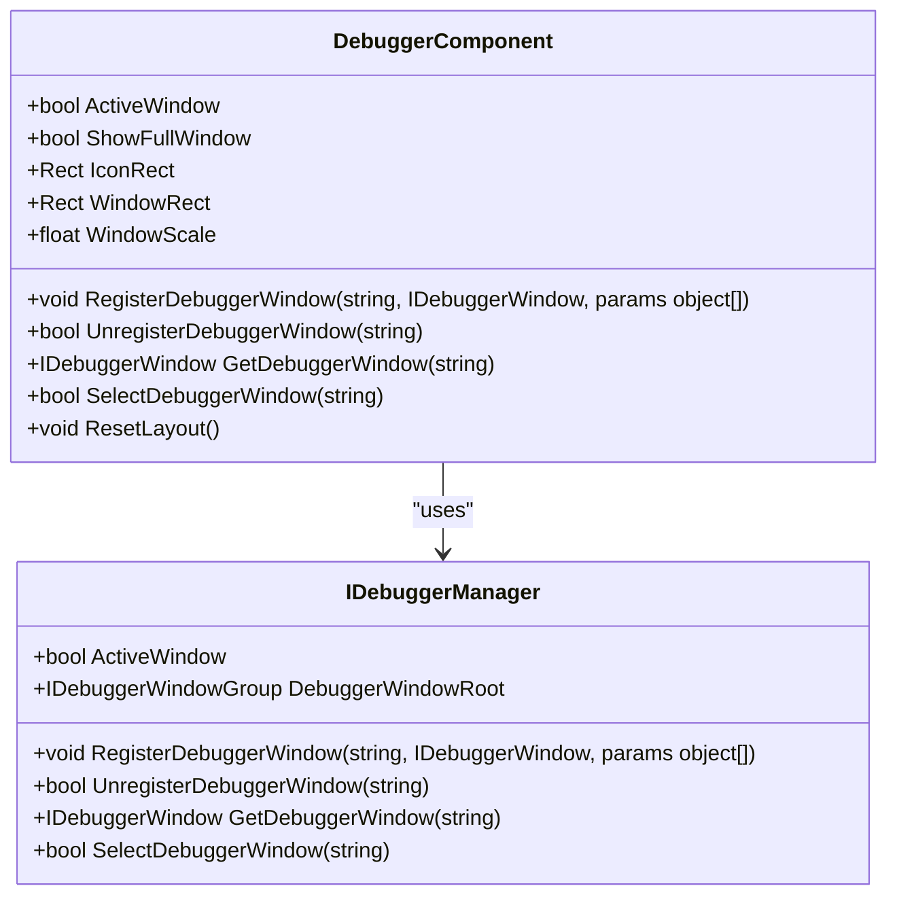
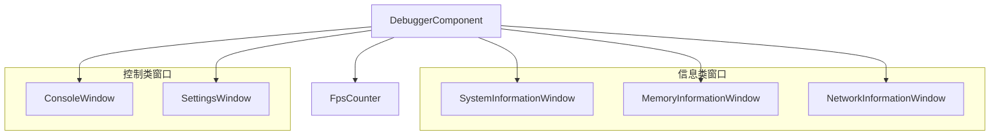
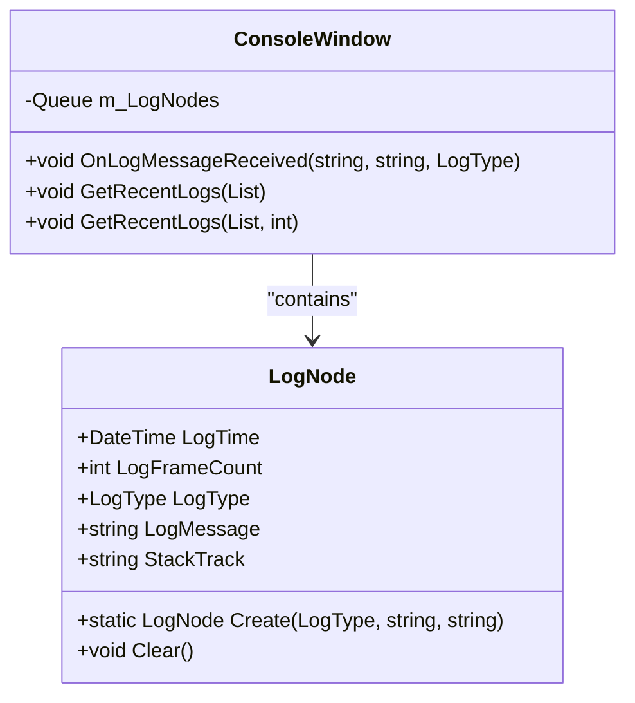
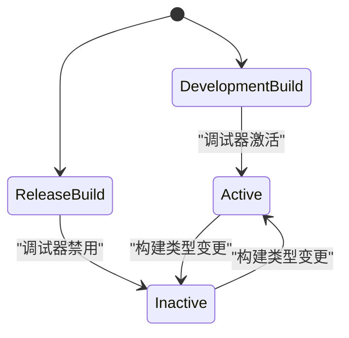

# 调试器API

<cite>
**Referenced Files in This Document**   
- [DebuggerComponent.cs](file://Scripts/Runtime/Debugger/DebuggerComponent.cs)
- [DebuggerComponent.ConsoleWindow.cs](file://Scripts/Runtime/Debugger/DebuggerComponent.ConsoleWindow.cs)
- [DebuggerComponent.LogNode.cs](file://Scripts/Runtime/Debugger/DebuggerComponent.LogNode.cs)
- [DebuggerComponent.FpsCounter.cs](file://Scripts/Runtime/Debugger/DebuggerComponent.FpsCounter.cs)
- [Log.cs](file://Scripts/Runtime/Utility/Log.cs)
- [LogRedirection.cs](file://Scripts/Editor/Misc/LogRedirection.cs)
</cite>

## 目录
1. [简介](#简介)
2. [核心组件](#核心组件)
3. [调试器激活与窗口管理](#调试器激活与窗口管理)
4. [内置调试窗口](#内置调试窗口)
5. [日志系统](#日志系统)
6. [自定义调试窗口](#自定义调试窗口)
7. [开发版与发布版行为](#开发版与发布版行为)
8. [性能开销](#性能开销)

## 简介
调试器系统API提供了一套完整的运行时调试解决方案，允许开发者在游戏运行时监控和诊断应用状态。该系统通过`DebuggerComponent`组件实现，支持多种内置调试窗口，包括控制台、性能监控、内存分析等。调试器提供了灵活的激活策略，可根据构建类型自动调整行为，并支持自定义调试信息窗口的集成。日志系统通过`LogNode`结构高效收集和显示日志信息，同时支持日志重定向功能，便于在编辑器中快速定位问题代码。

## 核心组件

`DebuggerComponent`是调试系统的核心，负责管理所有调试窗口的生命周期和用户界面。它通过`IDebuggerManager`接口与底层框架交互，实现了调试窗口的注册、激活和布局管理。`FpsCounter`类提供帧率监控功能，而`ConsoleWindow`则负责日志的收集和显示。`LogNode`作为日志数据结构，存储了日志消息、时间戳和堆栈跟踪等关键信息。

**Section sources**
- [DebuggerComponent.cs](file://Scripts/Runtime/Debugger/DebuggerComponent.cs#L1-L428)
- [DebuggerComponent.FpsCounter.cs](file://Scripts/Runtime/Debugger/DebuggerComponent.FpsCounter.cs#L11-L80)
- [DebuggerComponent.ConsoleWindow.cs](file://Scripts/Runtime/Debugger/DebuggerComponent.ConsoleWindow.cs#L15-L517)
- [DebuggerComponent.LogNode.cs](file://Scripts/Runtime/Debugger/DebuggerComponent.LogNode.cs#L18-L122)

## 调试器激活与窗口管理

调试器的激活行为由`DebuggerActiveWindowType`枚举控制，支持三种模式：始终开启、仅在开发构建时开启和仅在编辑器中开启。激活状态通过`ActiveWindow`属性进行管理，该属性与`IDebuggerManager`的`ActiveWindow`属性同步。调试器提供浮动图标和完整窗口两种显示模式，用户可以通过点击浮动图标切换到完整窗口。



**Diagram sources **
- [DebuggerComponent.cs](file://Scripts/Runtime/Debugger/DebuggerComponent.cs#L1-L428)

**Section sources**
- [DebuggerComponent.cs](file://Scripts/Runtime/Debugger/DebuggerComponent.cs#L1-L428)

## 内置调试窗口

调试器系统内置了多种调试窗口，涵盖系统信息、性能监控、内存分析等多个方面。`ConsoleWindow`显示应用程序的日志输出，支持按日志类型（信息、警告、错误、致命）进行过滤。`FpsCounter`实时计算并显示当前帧率。其他窗口如`SystemInformationWindow`、`MemoryInformationWindow`等提供了详细的系统和资源使用情况。



**Diagram sources **
- [DebuggerComponent.cs](file://Scripts/Runtime/Debugger/DebuggerComponent.cs#L1-L428)

**Section sources**
- [DebuggerComponent.cs](file://Scripts/Runtime/Debugger/DebuggerComponent.cs#L1-L428)
- [DebuggerComponent.ConsoleWindow.cs](file://Scripts/Runtime/Debugger/DebuggerComponent.ConsoleWindow.cs#L15-L517)
- [DebuggerComponent.FpsCounter.cs](file://Scripts/Runtime/Debugger/DebuggerComponent.FpsCounter.cs#L11-L80)

## 日志系统

日志系统是调试器的核心功能之一，通过`LogNode`结构体高效地收集和管理日志信息。每个`LogNode`实例包含日志时间、帧计数、类型、消息内容和堆栈跟踪。日志通过`ReferencePool`进行对象池管理，避免频繁的内存分配。`ConsoleWindow`监听`Application.logMessageReceived`事件，自动捕获所有Unity日志并将其转换为`LogNode`实例。



**Diagram sources **
- [DebuggerComponent.LogNode.cs](file://Scripts/Runtime/Debugger/DebuggerComponent.LogNode.cs#L18-L122)
- [DebuggerComponent.ConsoleWindow.cs](file://Scripts/Runtime/Debugger/DebuggerComponent.ConsoleWindow.cs#L15-L517)

**Section sources**
- [DebuggerComponent.LogNode.cs](file://Scripts/Runtime/Debugger/DebuggerComponent.LogNode.cs#L18-L122)
- [DebuggerComponent.ConsoleWindow.cs](file://Scripts/Runtime/Debugger/DebuggerComponent.ConsoleWindow.cs#L15-L517)

## 自定义调试窗口

开发者可以通过实现`IDebuggerWindow`接口创建自定义调试窗口，并使用`RegisterDebuggerWindow`方法将其注册到调试器中。自定义窗口可以显示任何运行时信息，如游戏状态、AI决策过程或网络流量统计。以下示例展示了如何创建和注册一个自定义调试窗口：

```csharp
// 示例：创建自定义调试窗口
public class CustomDebugWindow : IDebuggerWindow
{
    public void Initialize(params object[] args) { }
    public void Shutdown() { }
    public void OnEnter() { }
    public void OnLeave() { }
    public void OnUpdate(float elapseSeconds, float realElapseSeconds) { }
    public void OnDraw()
    {
        GUILayout.Label("自定义调试信息");
        // 绘制自定义UI
    }
}

// 注册自定义窗口
DebuggerComponent debugger = GetComponent<DebuggerComponent>();
debugger.RegisterDebuggerWindow("Custom/MyWindow", new CustomDebugWindow());
```

**Section sources**
- [DebuggerComponent.cs](file://Scripts/Runtime/Debugger/DebuggerComponent.cs#L1-L428)

## 开发版与发布版行为

调试器在不同构建类型中表现出不同的行为。在开发构建中，调试器默认处于激活状态，提供完整的调试功能。在发布构建中，调试器可以配置为禁用或仅显示基本的性能指标。这种差异通过`DebuggerActiveWindowType.OnlyOpenWhenDevelopment`设置实现，确保发布版本不会暴露调试界面，同时最小化性能开销。



**Diagram sources **
- [DebuggerComponent.cs](file://Scripts/Runtime/Debugger/DebuggerComponent.cs#L1-L428)

**Section sources**
- [DebuggerComponent.cs](file://Scripts/Runtime/Debugger/DebuggerComponent.cs#L1-L428)

## 性能开销

调试器系统的性能开销主要来自日志收集和UI渲染。日志收集通过对象池和队列管理，将内存分配开销降至最低。UI渲染仅在调试器激活时执行，且支持可配置的最大日志行数限制。`FpsCounter`以可配置的更新间隔计算帧率，避免每帧都进行计算。在发布构建中禁用调试器可以完全消除其性能开销。

**Section sources**
- [DebuggerComponent.cs](file://Scripts/Runtime/Debugger/DebuggerComponent.cs#L1-L428)
- [DebuggerComponent.FpsCounter.cs](file://Scripts/Runtime/Debugger/DebuggerComponent.FpsCounter.cs#L11-L80)