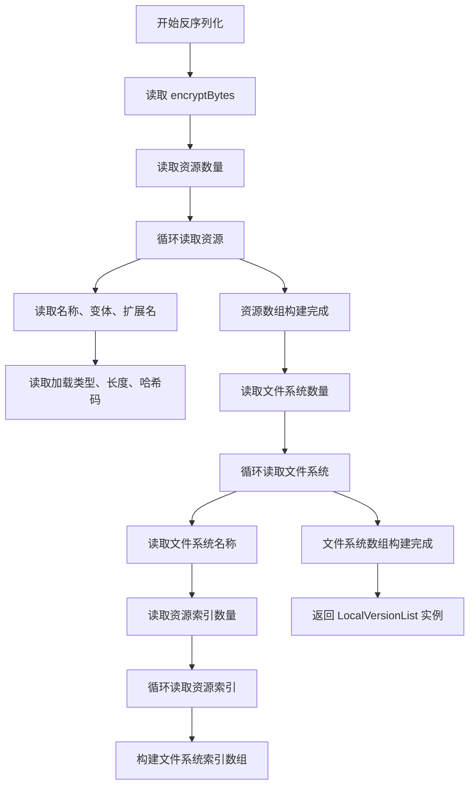

# 版本列表序列化

<cite>
**本文档中引用的文件**  
- [BuiltinVersionListSerializer.LocalVersionListDeserializeCallback.cs](file://Scripts/Runtime/Resource/BuiltinVersionListSerializer.LocalVersionListDeserializeCallback.cs)
- [BuiltinVersionListSerializer.cs](file://Scripts/Runtime/Resource/BuiltinVersionListSerializer.cs)
- [BinaryExtension.cs](file://Scripts/Runtime/Utility/BinaryExtension.cs)
- [ResourceComponent.cs](file://Scripts/Runtime/Resource/ResourceComponent.cs)
</cite>

## 目录
1. [简介](#简介)
2. [版本兼容性设计](#版本兼容性设计)
3. [反序列化回调函数分析](#反序列化回调函数分析)
4. [7BitEncodedInt32编码机制](#7bitencodedint32编码机制)
5. [文件系统索引结构](#文件系统索引结构)
6. [加密字节（encryptBytes）的作用](#加密字节encryptbytes的作用)
7. [序列化机制在资源更新流程中的核心地位](#序列化机制在资源更新流程中的核心地位)
8. [自定义序列化器实现指导](#自定义序列化器实现指导)
9. [结论](#结论)

## 简介
`BuiltinVersionListSerializer` 类是 Unity 游戏框架中用于处理本地资源版本列表序列化与反序列化的核心组件。该类通过支持多个版本格式（V0、V1、V2），实现了向后兼容的资源管理机制，确保在不同版本之间平滑迁移。本文档深入分析其版本兼容性设计，重点解析 `LocalVersionListDeserializeCallback_V0`、`V1`、`V2` 三个反序列化回调函数如何处理不同格式的本地资源列表，阐明 7BitEncodedInt32 编码、文件系统索引结构以及加密字节在字符串读取中的作用，并说明该机制在资源版本检查与更新流程中的关键地位。

## 版本兼容性设计
`BuiltinVersionListSerializer` 采用版本号注册机制，允许系统根据版本号动态选择对应的反序列化或序列化回调函数。这种设计使得框架能够支持多种版本格式，同时保持良好的扩展性。

在 `ResourceComponent` 初始化过程中，通过调用 `RegisterDeserializeCallback` 方法将不同版本的反序列化函数注册到 `ReadOnlyVersionListSerializer` 中：

```csharp
m_ResourceManager.ReadOnlyVersionListSerializer.RegisterDeserializeCallback(0, BuiltinVersionListSerializer.LocalVersionListDeserializeCallback_V0);
m_ResourceManager.ReadOnlyVersionListSerializer.RegisterDeserializeCallback(1, BuiltinVersionListSerializer.LocalVersionListDeserializeCallback_V1);
m_ResourceManager.ReadOnlyVersionListSerializer.RegisterDeserializeCallback(2, BuiltinVersionListSerializer.LocalVersionListDeserializeCallback_V2);
```

此机制确保了无论资源列表以何种版本存储，系统都能正确解析。

**Section sources**
- [ResourceComponent.cs](file://Scripts/Runtime/Resource/ResourceComponent.cs#L706-L712)

## 反序列化回调函数分析

### V0 版本反序列化
`LocalVersionListDeserializeCallback_V0` 处理最基础的版本格式。它首先读取长度为 4 字节的加密密钥 `encryptBytes`，然后读取资源数量（使用标准 `Int32` 编码）。对于每个资源，依次读取名称、变体、加载类型、长度和哈希码。V0 版本不包含扩展名字段，且资源数量使用固定 4 字节整数表示。

**Section sources**
- [BuiltinVersionListSerializer.LocalVersionListDeserializeCallback.cs](file://Scripts/Runtime/Resource/BuiltinVersionListSerializer.LocalVersionListDeserializeCallback.cs#L15-L35)

### V1 版本反序列化
`LocalVersionListDeserializeCallback_V1` 在 V0 基础上引入了扩展名（extension）字段，并采用 `7BitEncodedInt32` 编码来存储资源数量和资源长度。这提高了存储效率，尤其适用于资源数量或长度较小的情况。扩展名字段同样经过加密处理，若为空则使用默认扩展名 `"dat"`。

**Section sources**
- [BuiltinVersionListSerializer.LocalVersionListDeserializeCallback.cs](file://Scripts/Runtime/Resource/BuiltinVersionListSerializer.LocalVersionListDeserializeCallback.cs#L37-L62)

### V2 版本反序列化
`LocalVersionListDeserializeCallback_V2` 在 V1 基础上进一步引入了文件系统（FileSystem）索引结构。在读取完所有资源后，会读取文件系统数量，随后为每个文件系统读取其名称及所包含资源的索引数组。这些索引指向前面已读取的资源数组，从而建立文件系统与其资源之间的映射关系。这一结构支持更高效的资源分组与加载管理。

**Section sources**
- [BuiltinVersionListSerializer.LocalVersionListDeserializeCallback.cs](file://Scripts/Runtime/Resource/BuiltinVersionListSerializer.LocalVersionListDeserializeCallback.cs#L61-L101)

## 7BitEncodedInt32编码机制
7BitEncodedInt32 是一种变长整数编码方式，用于优化小数值的存储空间。其编码规则如下：每个字节的最高位（第 7 位）作为继续标志，若为 1 表示后续字节仍属于同一数值；低 7 位存储实际数据。解码时持续读取字节，直到遇到最高位为 0 的字节为止。

该机制在 `BinaryExtension.cs` 中实现：

```csharp
public static int Read7BitEncodedInt32(this BinaryReader binaryReader)
{
    int value = 0;
    int shift = 0;
    byte b;
    do
    {
        if (shift >= 35)
        {
            throw new GameFrameworkException("7 bit encoded int is invalid.");
        }

        b = binaryReader.ReadByte();
        value |= (b & 0x7f) << shift;
        shift += 7;
    } while ((b & 0x80) != 0);

    return value;
}
```

此编码显著减少了小整数在磁盘或网络传输中的占用空间，尤其适用于资源数量、长度等通常较小的字段。

**Section sources**
- [BinaryExtension.cs](file://Scripts/Runtime/Utility/BinaryExtension.cs#L0-L41)

## 文件系统索引结构
V2 版本引入的 `FileSystem` 结构用于组织资源，支持按文件系统进行资源分组管理。每个 `FileSystem` 包含：
- **名称（Name）**：文件系统标识符，加密存储
- **资源索引数组（ResourceIndexes）**：指向 `LocalVersionList.Resource[]` 数组的整数索引列表

这种设计允许将多个资源逻辑上归入同一文件系统，便于批量加载、卸载或版本控制。例如，在资源构建阶段，可通过 `GetResourceIndexesFromFileSystem` 方法生成索引映射。



**Diagram sources**
- [BuiltinVersionListSerializer.LocalVersionListDeserializeCallback.cs](file://Scripts/Runtime/Resource/BuiltinVersionListSerializer.LocalVersionListDeserializeCallback.cs#L61-L101)

**Section sources**
- [BuiltinVersionListSerializer.LocalVersionListDeserializeCallback.cs](file://Scripts/Runtime/Resource/BuiltinVersionListSerializer.LocalVersionListDeserializeCallback.cs#L61-L101)
- [ResourceBuilderController.cs](file://Scripts/Editor/ResourceBuilder/ResourceBuilderController.cs#L1183-L1196)

## 加密字节（encryptBytes）的作用
`encryptBytes` 是一个长度为 4 的字节数组，作为 XOR 加密的密钥，用于保护字符串字段（如资源名称、变体、扩展名、文件系统名称）不被明文存储。在反序列化时，首先读取 `encryptBytes`，后续所有加密字符串均使用该密钥进行解密。

字符串加密过程如下：
1. 将字符串转换为字节流
2. 使用 `Utility.Encryption.GetSelfXorBytes` 对字节流与 `encryptBytes` 进行异或运算
3. 写入流前先写入长度（单字节）

解密时执行逆向操作，确保敏感信息（如资源路径）在存储时具备基本安全性。

**Section sources**
- [BinaryExtension.cs](file://Scripts/Runtime/Utility/BinaryExtension.cs#L119-L159)

## 序列化机制在资源更新流程中的核心地位
该序列化机制是资源版本检查与热更新流程的核心。客户端启动时，通过反序列化本地版本列表（`LocalVersionList`）获取当前已安装资源的元数据（名称、长度、哈希码等），并与服务器端的远程版本列表对比，识别出需要更新的资源。由于支持多版本解析，即使客户端版本较旧，也能正确读取历史格式的版本列表，保证更新流程的稳定性。

此外，`ReadWriteVersionListSerializer` 负责将更新后的版本信息写回本地，确保下次启动时能基于最新状态进行资源管理。

**Section sources**
- [ResourceComponent.cs](file://Scripts/Runtime/Resource/ResourceComponent.cs#L706-L712)

## 自定义序列化器实现指导
为支持未来格式升级，建议遵循以下原则实现自定义序列化器：
1. **继承版本注册机制**：使用 `RegisterDeserializeCallback` 和 `RegisterSerializeCallback` 注册新旧版本处理函数
2. **保持向后兼容**：旧版本反序列化函数不得修改，新增版本应递增版本号
3. **使用 7BitEncodedInt32**：对整数字段优先使用变长编码以节省空间
4. **统一加密策略**：字符串字段应使用 `WriteEncryptedString` 和 `ReadEncryptedString` 方法处理
5. **结构化扩展**：新增功能（如资源分组、依赖关系）应封装为独立结构体，避免破坏原有字段顺序

示例：
```csharp
public static bool CustomVersionListSerializeCallback_V3(BinaryWriter binaryWriter, CustomVersionList versionList)
{
    Utility.Random.GetRandomBytes(s_CachedHashBytes);
    binaryWriter.Write(s_CachedHashBytes);
    // 写入新结构...
    Array.Clear(s_CachedHashBytes, 0, CachedHashBytesLength);
    return true;
}
```

## 结论
`BuiltinVersionListSerializer` 通过精心设计的版本兼容机制、高效的 7BitEncodedInt32 编码、灵活的文件系统索引结构以及基础的字符串加密，构建了一个稳定、高效且可扩展的资源版本管理方案。该机制不仅保障了资源更新流程的可靠性，也为未来功能演进提供了良好的架构基础。开发者在进行自定义扩展时，应严格遵循现有设计模式，确保系统的长期可维护性。