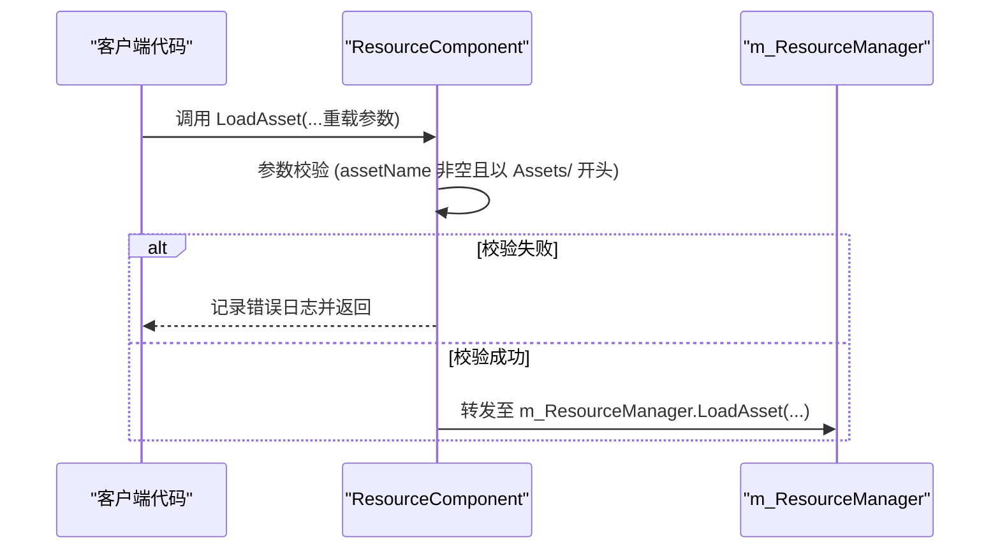
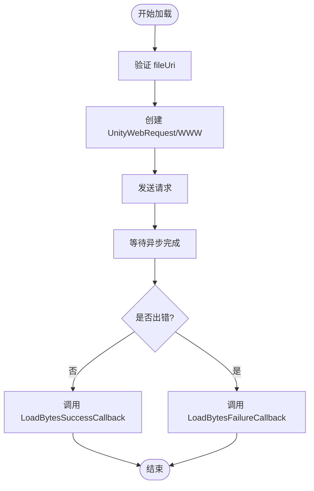

# 资源加载API

<cite>
**本文档引用的文件**  
- [ResourceComponent.cs](file://Scripts/Runtime/Resource/ResourceComponent.cs)
- [DefaultResourceHelper.cs](file://Scripts/Runtime/Resource/DefaultResourceHelper.cs)
- [LoadResourceAgentHelperBase.cs](file://Scripts/Runtime/Resource/LoadResourceAgentHelperBase.cs)
</cite>

## 目录
1. [简介](#简介)
2. [核心组件](#核心组件)
3. [参数说明](#参数说明)
4. [内部调用链](#内部调用链)
5. [异步加载逻辑](#异步加载逻辑)
6. [扩展点：自定义加载代理](#扩展点自定义加载代理)
7. [代码示例](#代码示例)
8. [常见错误排查](#常见错误排查)
9. [结论](#结论)

## 简介
本API文档详细说明了Unity游戏框架中资源加载系统的核心功能，重点聚焦于`ResourceComponent`类中的`LoadAsset`系列重载方法。文档涵盖参数含义、内部调用流程、异步加载机制、扩展点设计以及实际使用示例，旨在为开发者提供全面的资源加载指导。

## 核心组件

`ResourceComponent`是资源管理的核心组件，负责协调资源的加载、卸载和生命周期管理。其主要职责包括参数校验、任务分发至底层资源管理器（`m_ResourceManager`），并提供多种重载方法以支持灵活的资源加载需求。

**Section sources**
- [ResourceComponent.cs](file://Scripts/Runtime/Resource/ResourceComponent.cs#L20-L1365)

## 参数说明

### assetName（资源完整路径）
- **含义**：指定要加载资源的完整路径。
- **要求**：必须以`Assets/`开头，否则将抛出错误日志并终止加载。
- **示例**：`"Assets/Textures/UI/MainMenu.png"`

### assetType（可选，指定加载类型）
- **含义**：明确指定资源的类型（如`Texture2D`、`GameObject`等）。
- **作用**：用于类型安全检查，确保加载结果符合预期。
- **默认值**：`null`，表示不指定类型，由系统自动推断。

### priority（加载优先级）
- **含义**：定义资源加载任务的优先级。
- **默认值**：`DefaultPriority`（值为0），数值越大优先级越高。
- **用途**：在资源代理队列中决定任务执行顺序。

### loadAssetCallbacks（回调委托集合）
- **含义**：包含成功、失败、更新回调的委托集合。
- **组成**：
  - `LoadAssetSuccessCallback`：加载成功时调用。
  - `LoadAssetFailureCallback`：加载失败时调用。
  - `LoadAssetUpdateCallback`：加载过程中进度更新时调用。

### userData（用户自定义数据）
- **含义**：允许开发者传入任意对象，在回调中返回，便于上下文关联。
- **用途**：常用于标识特定加载任务或传递额外信息。

**Section sources**
- [ResourceComponent.cs](file://Scripts/Runtime/Resource/ResourceComponent.cs#L873-L970)

## 内部调用链

`LoadAsset`系列方法遵循统一的调用链逻辑：

1. **参数校验**：检查`assetName`是否为空或是否以`Assets/`开头。
2. **重定向调用**：所有重载方法最终都会调用最完整的重载版本（包含所有参数）。
3. **转发至资源管理器**：通过`m_ResourceManager.LoadAsset`执行实际的加载操作。



**Diagram sources**
- [ResourceComponent.cs](file://Scripts/Runtime/Resource/ResourceComponent.cs#L955-L970)

## 异步加载逻辑

`DefaultResourceHelper`类实现了底层的异步加载逻辑，主要通过`UnityWebRequest`（Unity 5.4+）或`WWW`（旧版本）实现。

### 加载流程
1. 创建`UnityWebRequest`或`WWW`实例，发起网络/文件请求。
2. 使用协程等待异步操作完成。
3. 检查请求状态，区分成功与失败。
4. 成功时，通过`LoadBytesSuccessCallback`返回数据；失败时，通过`LoadBytesFailureCallback`返回错误信息。



**Diagram sources**
- [DefaultResourceHelper.cs](file://Scripts/Runtime/Resource/DefaultResourceHelper.cs#L21-L181)

## 扩展点：自定义加载代理

`LoadResourceAgentHelperBase`是一个抽象基类，作为自定义加载代理的扩展点。

### 作用
- 允许开发者替换默认的资源加载行为（如使用自定义网络库、加密协议等）。
- 通过`m_CustomLoadResourceAgentHelper`字段注入自定义实现。

### 关键方法
- `ReadFile` / `ReadBytes`：异步读取资源文件或二进制流。
- `ParseBytes`：将二进制流解析为加载对象。
- `LoadAsset`：最终加载资源到内存。
- `Reset`：重置代理状态。

**Section sources**
- [LoadResourceAgentHelperBase.cs](file://Scripts/Runtime/Resource/LoadResourceAgentHelperBase.cs#L17-L94)

## 代码示例

### 加载普通资源
```csharp
string assetPath = "Assets/Textures/UI/Button.png";
LoadAssetCallbacks callbacks = new LoadAssetCallbacks(
    (assetName, asset, duration, userData) =>
    {
        Texture2D tex = asset as Texture2D;
        // 使用纹理
    },
    (assetName, status, errorMessage, userData) =>
    {
        Debug.LogError($"加载失败: {errorMessage}");
    }
);
ResourceComponent.LoadAsset(assetPath, typeof(Texture2D), callbacks, "自定义数据");
```

### 加载场景资源
```csharp
string scenePath = "Assets/Scenes/GameScene.unity";
LoadAssetCallbacks sceneCallbacks = new LoadAssetCallbacks(
    (name, asset, duration, data) => Debug.Log("场景加载成功"),
    (name, status, msg, data) => Debug.LogError("场景加载失败: " + msg)
);
ResourceComponent.LoadAsset(scenePath, null, 1, sceneCallbacks, null);
```

**Section sources**
- [ResourceComponent.cs](file://Scripts/Runtime/Resource/ResourceComponent.cs#L955-L970)
- [DefaultResourceHelper.cs](file://Scripts/Runtime/Resource/DefaultResourceHelper.cs#L21-L181)

## 常见错误排查

### 路径格式错误
- **现象**：日志输出`Asset name 'xxx' is invalid.`。
- **原因**：`assetName`未以`Assets/`开头。
- **解决**：确保资源路径正确，例如使用`AssetDatabase.GetAssetPath()`获取。

### 类型不匹配
- **现象**：加载成功但类型转换失败。
- **原因**：`assetType`与实际资源类型不符。
- **解决**：确认资源类型，或在成功回调中进行类型检查。

### 回调未触发
- **现象**：资源未加载，无任何回调。
- **原因**：`loadAssetCallbacks`为`null`或参数校验失败。
- **解决**：确保回调对象已正确初始化，并检查`assetName`有效性。

**Section sources**
- [ResourceComponent.cs](file://Scripts/Runtime/Resource/ResourceComponent.cs#L955-L970)

## 结论
本文档详细解析了`ResourceComponent`的`LoadAsset`系列方法，从参数定义、内部流程到扩展机制，为开发者提供了完整的资源加载解决方案。通过理解其设计原理和常见问题，可以更高效、稳定地在项目中实现资源管理。