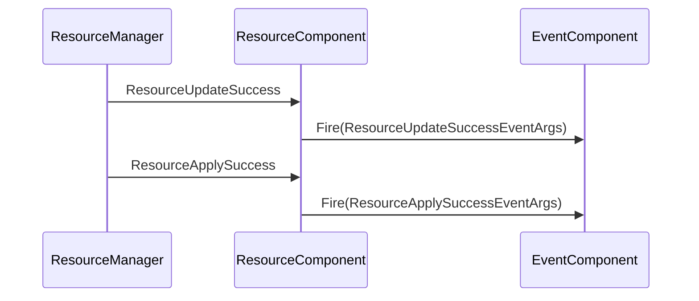

# 资源应用事件

<cite>
**Referenced Files in This Document**   
- [ResourceApplySuccessEventArgs.cs](file://Scripts/Runtime/Resource/ResourceApplySuccessEventArgs.cs)
- [ResourceUpdateSuccessEventArgs.cs](file://Scripts/Runtime/Resource/ResourceUpdateSuccessEventArgs.cs)
- [ResourceComponent.cs](file://Scripts/Runtime/Resource/ResourceComponent.cs)
</cite>

## 目录
1. [简介](#简介)
2. [核心字段解析](#核心字段解析)
3. [事件触发时机](#事件触发时机)
4. [事件监听与代码示例](#事件监听与代码示例)
5. [与资源更新成功事件的顺序关系](#与资源更新成功事件的顺序关系)

## 简介
`ResourceApplySuccessEventArgs` 是 Unity 游戏框架中定义的一个事件类，用于在资源从更新包解压并成功写入本地存储后触发。该事件是资源更新流程中的关键环节，标志着资源已成功应用到本地，可供后续加载和使用。本文档将详细解析该事件的结构、字段含义、触发时机以及如何监听和处理该事件。

**Section sources**
- [ResourceApplySuccessEventArgs.cs](file://Scripts/Runtime/Resource/ResourceApplySuccessEventArgs.cs#L15-L117)

## 核心字段解析
`ResourceApplySuccessEventArgs` 类包含以下关键字段，用于描述已成功应用的资源信息：

- **Name**: 资源名称。表示被应用的资源的唯一标识符。
- **ApplyPath**: 本地应用路径。表示资源解压后在本地文件系统中的存放路径。
- **ResourcePackPath**: 源资源包路径。表示包含该资源的原始资源包（如 .zip 文件）的路径。
- **Length**: 解压后大小。表示资源解压后的实际大小（以字节为单位）。
- **ZipLength**: 压缩包大小。表示资源在压缩包内的大小（以字节为单位）。

这些字段为开发者提供了关于资源应用过程的完整信息，可用于日志记录、资源管理或性能监控。

**Section sources**
- [ResourceApplySuccessEventArgs.cs](file://Scripts/Runtime/Resource/ResourceApplySuccessEventArgs.cs#L45-L85)

## 事件触发时机
`ResourceApplySuccessEventArgs` 事件在资源更新流程的特定阶段被触发。具体来说，当系统从一个资源包（Resource Pack）中解压出资源，并成功将其写入到本地的读写路径（ReadWritePath）后，该事件就会被触发。这通常发生在调用 `ResourceComponent.ApplyResources` 方法之后，是资源从远程或打包状态变为本地可用状态的标志性事件。

**Section sources**
- [ResourceComponent.cs](file://Scripts/Runtime/Resource/ResourceComponent.cs#L824-L827)
- [ResourceComponent.cs](file://Scripts/Runtime/Resource/ResourceComponent.cs#L1336-L1339)

## 事件监听与代码示例
要监听 `ResourceApplySuccessEventArgs` 事件，需要通过事件系统（EventComponent）注册一个事件处理函数。以下是一个典型的代码示例，展示了如何监听该事件并进行后续处理，例如记录日志或触发资源加载：

```csharp
// 假设 m_EventComponent 是已获取的事件组件实例
m_EventComponent.Subscribe(ResourceApplySuccessEventArgs.EventId, OnResourceApplySuccess);

private void OnResourceApplySuccess(object sender, GameEventArgs e)
{
    ResourceApplySuccessEventArgs ne = (ResourceApplySuccessEventArgs)e;
    // 记录日志
    Log.Info($"资源应用成功: 名称={ne.Name}, 路径={ne.ApplyPath}, 大小={ne.Length}B");
    // 触发后续的资源加载或其他业务逻辑
    // LoadResource(ne.Name);
}
```

此代码示例中，`Subscribe` 方法用于订阅事件，`OnResourceApplySuccess` 是事件处理函数，它接收事件参数并提取出资源的名称、路径和大小等信息。

**Section sources**
- [ResourceComponent.cs](file://Scripts/Runtime/Resource/ResourceComponent.cs#L1336-L1339)

## 与资源更新成功事件的顺序关系
在资源更新流程中，`ResourceApplySuccessEventArgs` 事件与 `ResourceUpdateSuccessEventArgs` 事件存在明确的先后顺序。`ResourceUpdateSuccessEventArgs` 事件通常在资源下载和更新流程完成时触发，而 `ResourceApplySuccessEventArgs` 事件则是在此之后，当资源包被解压并应用到本地时触发。因此，`ResourceApplySuccessEventArgs` 的触发晚于 `ResourceUpdateSuccessEventArgs`，它标志着资源更新流程的最终完成，资源已完全准备好供游戏使用。



**Diagram sources**
- [ResourceComponent.cs](file://Scripts/Runtime/Resource/ResourceComponent.cs#L1336-L1339)
- [ResourceComponent.cs](file://Scripts/Runtime/Resource/ResourceComponent.cs#L1328-L1330)

**Section sources**
- [ResourceUpdateSuccessEventArgs.cs](file://Scripts/Runtime/Resource/ResourceUpdateSuccessEventArgs.cs#L15-L117)
- [ResourceComponent.cs](file://Scripts/Runtime/Resource/ResourceComponent.cs#L1328-L1339)